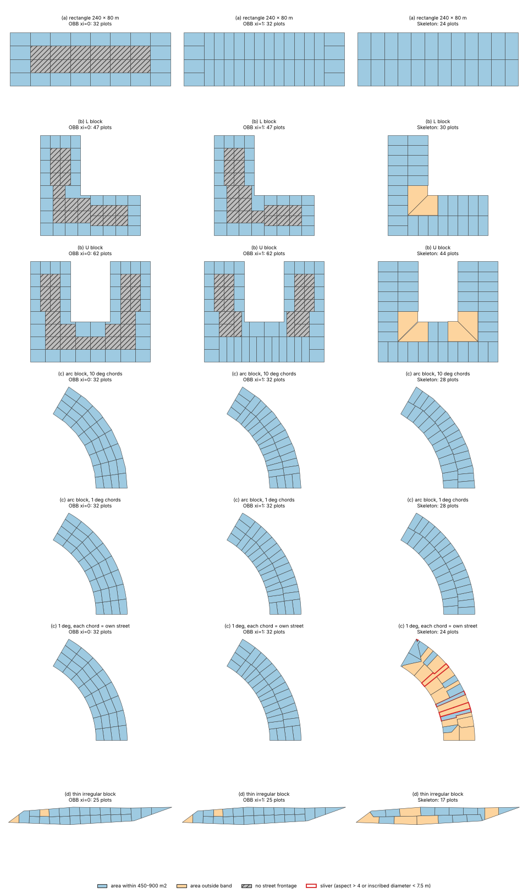

# C10: Plot subdivision and land use algorithms

Researched 2026-10-30. Brief file unavailable; scope taken from the task line. The shared web-search budget ran out after five searches, so most sources were opened directly by URL (see Choices made).

## Answer

Studio should offer two subdivision modes and check every result. The first mode is straight-skeleton strips (Vanegas et al. 2012; CityEngine "Skeleton") [[1]](https://www.cs.purdue.edu/cgvlab/papers/aliaga/eg2012.pdf)[[3]](https://doc.arcgis.com/en/cityengine/latest/help/help-layers-block-parameters.htm). Use it by default for residential blocks, because only this mode guarantees street frontage. The second mode is the oriented-bounding-box (OBB) recursive split (CityEngine "Recursive"). Use it for deep or commercial blocks and for the inner part of a block. Run both through a validation pass that reports landlocked plots, slivers, plots outside the area band, and coverage. I measured both modes on test blocks with a 450 to 900 m² target ([script](assets/C10/parcel_bench.py), [results](assets/C10/results.json)). With "force street access" at 1 (always try the rotated split), the OBB split still landlocked 19 of 47 plots on an L block and 18 of 62 on a U block. Lowering the minimum lot width from 15 m to 10 m cut that to 2, but gave the U block 8 slivers. A strict variant that refuses landlocking splits left 18 plots on each block above the 900 m² maximum, up to 2,100 m². The skeleton mode produced no landlocked plots on any block. Its weaknesses were oversized lots at concave corners (1,600 m²) and on shallow blocks (up to 1,243 m²), and sensitivity to how curves are stored. When each chord of a 1° arc was treated as its own street, the skeleton result fell apart: 6 slivers, 13 plots over the maximum, and a 0.1 m² fragment. Moving from 10° to 1° chords changed 43% of skeleton plots but only 6% of OBB plots (intersection over union, IoU, below 0.9). The CGAL skeleton took 2.5 ms on 8 vertices and 1.24 s on 482. So Studio should keep each arc as one street and turn it into short segments only at the end. For UAE rules, the most complete public plot table is Dubai's Local Order 2 of 1999 [[25]](https://dmpmedia.dm.gov.ae/uploads/2024/12/%D8%A3%D9%85%D8%B1-%D9%85%D8%AD%D9%84%D9%8A-%D8%B1%D9%82%D9%85-2-%D9%84%D8%B3%D9%86%D8%A9-1999-%D8%A8%D8%B4%D8%A3%D9%86-%D8%A8%D8%AA%D8%B5%D9%86%D9%8A%D9%81-%D9%88%D8%AA%D9%82%D9%86%D9%8A%D9%8A%D9%86-%D8%A7%D8%B3%D8%AA%D8%B9%D9%85%D8%A7%D9%84%D8%A7%D8%AA-%D8%A7%D9%84%D8%A3%D8%B1%D8%A7%D8%B6%D9%8A-%D9%81%D9%8A-%D8%A5%D9%85%D8%A7%D8%B1%D8%A9-%D8%AF%D8%A8%D9%8A.pdf). It covers zones R1 to R9, RC, C, I and A, with minimum area, width, depth, setbacks and coverage. For example, an R2 villa plot is at least 10,000 ft² (929 m²), 80 × 100 ft (24.4 × 30.5 m), with 10 ft (3.05 m) setbacks and 50% coverage. Dubai's community facility standards and the Dubai 2040 land-use matrix add facility sizes and zone permissions [[27]](https://dmpmedia.dm.gov.ae/uploads/2021/09/%D9%82%D8%A7%D8%A6%D9%85%D8%A9-%D8%A7%D9%84%D9%85%D8%B9%D8%A7%D9%8A%D9%8A%D8%B1-%D8%A7%D9%84%D8%AA%D8%AE%D8%B7%D9%8A%D8%B7%D9%8A%D8%A9-%D9%84%D9%84%D8%AE%D8%AF%D9%85%D8%A7%D8%AA-%D8%A7%D9%84%D8%B9%D8%A7%D9%85%D8%A9.pdf)[[29]](https://dmpmedia.dm.gov.ae/uploads/2024/04/Dubai-2040-Urban-Master-Plan-2040-Executive-Summary-v1.pdf). Public Emirati housing plots are 900 to 1,080 m² in Abu Dhabi (Abu Dhabi Housing Authority, ADHA) [[35]](https://iskan.abudhabi/en/Media-Center/News/2024-Q2-North-BaniYas-housing-project)[[36]](https://iskan.abudhabi/en/Media-Center/News/2026_Q3_ADHA_and_LEAD_Development_Announce_Start-_of-_Unit_Allocation) and about 1,115 m² in Dubai (Mohammed Bin Rashid Housing Establishment, MBRHE, via news reports) [[37]](https://www.thenationalnews.com/uae/government/10-000-housing-plots-to-be-released-for-three-new-emirati-communities-in-dubai-1.720246). Main caveats: I could not retrieve any Abu Dhabi Urban Planning Council (UPC) or Department of Municipalities and Transport (DMT) plot standard, so Abu Dhabi figures are "not found". The 1999 Dubai table is a baseline that each plot's affection plan overrides. CGAL's straight skeleton is GPL [[12]](https://doc.cgal.org/latest/Manual/packages.html), so a closed-source Studio needs a commercial licence or its own implementation.

## Algorithm comparison

"Complexity" for OBB and Voronoi is my analysis (marked "analysis"), backed by the timings measured below. n = vertices of the block, k = number of plots.

| Method | Inputs | Guarantees (frontage / min width / area tolerance / shape) | Failure cases | Complexity | Published source |
|---|---|---|---|---|---|
| Recursive split of longest near-parallel edges (Parish and Müller 2001) | Block polygon, threshold area | Frontage: none. Lots without street access are discarded, so land is left unassigned. Assumes convex, rectangular lots and forbids concave ones | Leaves "odd-shaped empty areas" (Vanegas). Fails on concave blocks | Analysis: about O(k·n) splits | [[6]](https://cgl.ethz.ch/Downloads/Publications/Papers/2001/p_Par01.pdf), critique in [[1]](https://www.cs.purdue.edu/cgvlab/papers/aliaga/eg2012.pdf) |
| OBB recursive split (Vanegas et al. 2012, Algorithm 2) | Block, Amin/Amax, Wmin/Wmax, irregularity ω, street-access preference ξ | Full partition, no gaps. Frontage: claimed "If ξ = 1 street access is always guaranteed"; my measurement on concave blocks says otherwise. Area: splits until inside (Amin, Amax). Shape: near-rectangular | Landlocked lots on L/U blocks, and a trade-off between frontage and width or area (measured below). The split line can cross a concave block more than once | Analysis: one minimum-area rectangle plus one polygon split per node of the split tree, so about O(k·n log n). Measured 8 to 29 ms per block in Python | [[1]](https://www.cs.purdue.edu/cgvlab/papers/aliaga/eg2012.pdf) |
| Straight-skeleton strips (Vanegas et al. 2012, Algorithm 1) | Block, logical streets, offset depth d_offset, Wmin/Wmax, ω, StreetWidth or StreetLength corner rule | Frontage: by construction, "the resulting regions always have street access". Width: rays spaced around (Wmin+Wmax)/2. Area: small and triangular lots merged up to Amin, deep lots split again. Shape: diagonal corner edges repaired (β-strips) | Shallow blocks, triangles at reflex corners, curved edges stored as many short segments (measured below). Needs a robust skeleton | Skeleton cost dominates. CGAL gives no Big-O [[11]](https://doc.cgal.org/latest/Straight_skeleton_2/index.html). Measured 2.5 ms at 8 vertices to 1,236 ms at 482 | [[1]](https://www.cs.purdue.edu/cgvlab/papers/aliaga/eg2012.pdf) |
| CityEngine "Recursive" | lotAreaMin/Max, lotWidthMin, irregularity, forceStreetAccess, seed, cornerAngleMax, cornerWidth | Area bounds are "approximate". Street access is a "preference", not a guarantee. A high lotWidthMin can push lots above lotAreaMax | Same as OBB | Not published | [[3]](https://doc.arcgis.com/en/cityengine/latest/help/help-layers-block-parameters.htm)[[4]](https://doc.arcgis.com/en/cityengine/latest/python/subdivide-shapes-settings.htm) |
| CityEngine "Skeleton" | lotAreaMin, lotWidthMin (target frontage), irregularity, cornerAlignment (street width or length), shallowLotFrac, simplify, seed | "Skeleton Subdivision creates street-aligned lots that always have access". The Python API says the straight skeleton "guarantees street access" | A low lot width "may create many narrow lots" | Not published | [[3]](https://doc.arcgis.com/en/cityengine/latest/help/help-layers-block-parameters.htm)[[4]](https://doc.arcgis.com/en/cityengine/latest/python/subdivide-shapes-settings.htm) |
| CityEngine "Offset" | offsetWidth (lot depth) plus recursive parameters for the inner part | Perimeter lots within offsetWidth of the street. The inner part is split recursively | Falls back to OBB if offsetWidth is near 0 or collapses the offset polygon | Not published | [[3]](https://doc.arcgis.com/en/cityengine/latest/help/help-layers-block-parameters.htm) |
| CityEngine "No Subdivision" | Block | One lot equal to the block | Not applicable | O(1) | [[3]](https://doc.arcgis.com/en/cityengine/latest/help/help-layers-block-parameters.htm) |
| Minimum-area bounding-box tool (Wickramasuriya et al. 2011) | Block | Described by Vanegas as a basic implementation with "very limited stylistic control" | Not stated (secondary) | Not stated | Secondary: [[1]](https://www.cs.purdue.edu/cgvlab/papers/aliaga/eg2012.pdf) (Fig. 2c) |
| Voronoi tessellation of points near the block border | Seed points | Not stated | Shown as a weaker alternative in Vanegas Fig. 2b | Analysis: O(m log m) for m seeds, plus clipping | Secondary: [[1]](https://www.cs.purdue.edu/cgvlab/papers/aliaga/eg2012.pdf) |
| Cube packing | Block | Not stated | "leads to badly formed parcels in concave areas" | Not stated | Secondary: [[1]](https://www.cs.purdue.edu/cgvlab/papers/aliaga/eg2012.pdf) (Fig. 2d) |
| Recursive split with growth simulation (Weber et al. 2009) | Block | Not stated | "often create unrealistic parcel 'spikes'" | Not stated | Secondary: [[1]](https://www.cs.purdue.edu/cgvlab/papers/aliaga/eg2012.pdf) (App. C) |
| SideFX Labs Lot Subdivision (Houdini) | Alignment (bounding box or longest edge), Minimum Lot Size, Iterations, Irregularity, Vertical Bias, Cluster Lots | No frontage guarantee documented | Not documented | Iterations set by the user (one pass gives 2 pieces, two give 4) | [[7]](https://www.sidefx.com/docs/houdini/nodes/sop/labs--lot_subdivision.html) |
| ArcGIS Pro Subdivide Polygon | Number of equal parts or Equal areas (target area), split angle, Strips or Stacked blocks | Equal areas plus "a remainder part". No frontage rule. Target Width "is not yet supported" | Concave shapes not discussed | Not published | [[8]](https://doc.esri.com/en/arcgis-pro/latest/tool-reference/data-management/subdivide-polygon.html) |
| Learning: BlockPlanner (ICCV 2021) | Block and training data | Land lots with "3D geometry and land use semantics". Validity enforced by loss functions, not hard rules | No hard frontage or area guarantee | Not stated | [[9]](https://openaccess.thecvf.com/content/ICCV2021/html/Xu_BlockPlanner_City_Block_Generation_With_Vectorized_Graph_Representation_ICCV_2021_paper.html) |
| Learning: GlobalMapper (ICCV 2023) | Arbitrary block shapes; skeleton maps them to a canonical form | Generates building layouts, not legal plots | No plot rules | Not stated | [[10]](https://openaccess.thecvf.com/content/ICCV2023/html/He_GlobalMapper_Arbitrary-Shaped_Urban_Layout_Generation_ICCV_2023_paper.html) |
| TestFit (single-family) | Parcel, road layout, "minimum lot size" | Not documented publicly | Not documented | Not documented | [[17]](https://www.testfit.io/typologies/single-family) |
| Giraffe | "generate subdivision ... layouts that reflect your standards" | Not documented publicly | Not documented | Not documented | [[19]](https://www.giraffe.build/) |
| Autodesk Forma, Archistar | No public plot-subdivision documentation found | Not found | Not found | Not found | [[21]](https://help.autodeskforma.com/) (login wall), [[22]](https://www.archistar.ai/) |

Measured on this machine (Python 3.13, shapely 2.2.0, CGAL through compas_cgal 0.10.0; Linux, not Windows), full method in Detail. Units are m and m²; target band 450 to 900 m².

| Block | Method | Plots | Area min / mean / max | In band | Landlocked | Slivers | Max vertices |
|---|---|---|---|---|---|---|---|
| (a) rectangle 240 × 80 | OBB, ξ = 0 | 32 | 600 / 600 / 600 | 32 | 12 | 0 | 4 |
| (a) | OBB, ξ = 1 | 32 | 600 / 600 / 600 | 32 | 0 | 0 | 4 |
| (a) | Skeleton | 24 | 800 / 800 / 800 | 24 | 0 | 0 | 4 |
| (b) L block | OBB, ξ = 1 | 47 | 500 / 545 / 850 | 47 | 19 | 0 | 6 |
| (b) L block | Skeleton | 30 | 800 / 853 / 1,600 | 28 | 0 | 0 | 4 |
| (b) U block | OBB, ξ = 1 | 62 | 500 / 619 / 900 | 62 | 18 | 0 | 6 |
| (b) U block | Skeleton | 44 | 800 / 873 / 1,600 | 40 | 0 | 0 | 4 |
| (c) arc block, 10° chords | OBB, ξ = 1 | 32 | 573 / 677 / 796 | 32 | 0 | 0 | 5 |
| (c) arc block, 10° chords | Skeleton | 28 | 643 / 774 / 834 | 28 | 0 | 0 | 9 |
| (c) arc block, 1° chords | OBB, ξ = 1 | 32 | 579 / 681 / 797 | 32 | 0 | 0 | 11 |
| (c) arc block, 1° chords | Skeleton | 28 | 730 / 778 / 838 | 28 | 0 | 0 | 22 |
| (c) 1°, each chord its own street | Skeleton | 24 | 0.1 / 908 / 1,592 | 9 | 1 | 6 | 34 |
| (d) thin irregular block | OBB, ξ = 1 | 25 | 298 / 550 / 834 | 23 | 0 | 0 | 5 |
| (d) thin irregular block | Skeleton | 17 | 462 / 808 / 1,243 | 12 | 0 | 0 | 10 |

## Detail

### Published parcel subdivision algorithms

**Parish and Müller (2001).** Vanegas et al. say this paper "pioneered a procedural approach to urban modeling" [[1]](https://www.cs.purdue.edu/cgvlab/papers/aliaga/eg2012.pdf) (old: 2001). It divides a block "using a simple, recursive algorithm that divides the longest edges that are approximately parallel until the subdivided lots are under a threshold area". It "forbids the creation of concave allotments". Afterwards "all allotments that are too small or do not have direct access to a street are discarded" [[6]](https://cgl.ethz.ch/Downloads/Publications/Papers/2001/p_Par01.pdf). Vanegas et al. point out that it "leaves odd-shaped empty areas inside city blocks that do not belong to any parcel" [[1]](https://www.cs.purdue.edu/cgvlab/papers/aliaga/eg2012.pdf). For a planning tool, unassigned land is not acceptable.

**Vanegas, Kelly, Weber, Halatsch, Aliaga and Müller (2012), "Procedural Generation of Parcels in Urban Modeling".** Published in Computer Graphics Forum 31(2), pages 681 to 690 (Eurographics 2012) [[2]](https://diglib.eg.org/handle/10.1111/v31i2pp681-690). The authors worked at Esri R&D Zurich, Purdue, Glasgow and ETH. Their algorithms "have been implemented within CityEngine" [[1]](https://www.cs.purdue.edu/cgvlab/papers/aliaga/eg2012.pdf). This is the source of CityEngine's block subdivision. The paper (all quotes from [[1]](https://www.cs.purdue.edu/cgvlab/papers/aliaga/eg2012.pdf)):

- Sets four requirements: the parcels "collectively partition the block", "all parcels have the option of street access", parcels have "a simple exterior boundary, often nearly rectangular", and parcels "are aligned as best as possible with the adjacent street segment".
- Defines the attributes. Parcel area bounds (Amin, Amax). Width bounds (Wmin, Wmax) on "the length of the sides of the oriented bounding box of a parcel". Split irregularity ω in [0, 1].
- **Skeleton subdivision (Algorithm 1).**
  - It computes the straight skeleton of the block contour with CGAL. Each face of the skeleton belongs to one street edge.
  - Faces on the same "logical street" are merged into α-strips.
  - "Diagonal edges" at convex corners are moved to the neighbouring strip, which gives β-strips. The winner is chosen by a StreetWidth rule (the default) or a StreetLength rule. At reflex angles the rule is always "None".
  - Each strip is sliced by rays perpendicular to the street. Ray origins are spaced "normally distributed around (Wmin + Wmax)/2, with σ² = 3ω".
  - Post-processing covers three cases. A block "too shallow to accommodate the two rows of parcels" gets its shallow parcels grouped. Lots larger than Amax "are split again, via a second ray cast". "Triangular parcels and parcels with small areas are repeatedly unioned with their neighbors" across "the longest edge".
  - An optional offset distance d_offset limits lot depth and leaves an inner "patio" that can be split another way.
- **OBB subdivision (Algorithm 2).**
  - It computes "the minimum-area OBB". The split line passes through the middle of the OBB's long edge, moved at random in proportion to ω. Its "direction ... is given by the direction of the smallest edge of the OBB".
  - Splitting repeats until area or front width is within bounds.
  - "If a parcel resulting from a split has no street access, the direction of the split line is rotated 90 degrees ... with probability ξ". The paper states "If ξ = 1 street access is always guaranteed".
  - Extras: fit OBBs aligned with a parcel edge, fix child seeds before recursion for stability, and snap split lines to nearby block vertices.
  - The authors note that this split "considers only the geometry of the parent shape and road access", which makes it "very stable" under local edits.
- **Persistence.** The paper matches parcels before and after an edit with a distance based on generalised barycentric coordinates. This lets per-parcel attributes survive road edits. All results "can be generated from scratch in under 3 seconds", and re-splitting one block after a local edit runs "at interactive rates of between 1 and 10 milliseconds per block".
- **Comparisons.** Figure 2 compares a Voronoi tessellation of points near the border, a minimum-area bounding-box tool [WCP*11], and cube packing ("badly formed parcels in concave areas"). Appendix C says the recursive splits of Weber et al. 2009 "often create unrealistic parcel 'spikes'".

**CityEngine block subdivision and CGA rules.** Esri's current help lists four subdivision types [[3]](https://doc.arcgis.com/en/cityengine/latest/help/help-layers-block-parameters.htm):

- "Recursive Subdivision creates rectangular lots by repeatedly splitting the block." This is the default.
- "Offset Subdivision creates lots only within a given distance from the street edges of the block."
- "Skeleton Subdivision creates street-aligned lots that always have access."
- "No Subdivision doesn't perform subdivision on this shape."

Key parameters [[3]](https://doc.arcgis.com/en/cityengine/latest/help/help-layers-block-parameters.htm):

- forceStreetAccess is "The factor indicating the preference for lots with street access".
- lotWidthMin in Recursive mode: "Subdivision stops if the length of any of the sides of any of the resulting lots is less than this value", and a high value means lots "may be larger than ... Lot Area Max".
- lotWidthMin in Skeleton mode is "The ideal length of street front that each lot should possess".
- irregularity in Recursive mode is "The relative deviation of the split line from the middle point of the center of the oriented bounding box (OBB)".
- cornerAngleMax inserts a corner lot when "the angle at the vertex of a block contour is less than this value". cornerWidth sets the width of that corner lot.
- shallowLotFrac is the "Limit for merging triangular lots".
- simplify: "A high value creates irregular lots with fewer vertices".
- offsetWidth: Offset mode falls back to OBB subdivision if offsetWidth is close to 0.0, or high enough that the offset polygon collapses.

The page shows example images with Force Street Access near 0 and near 1.0, and with Lot Width Min of 15 and 30, but gives no default values. The Python API exposes the same settings as LotSubdivisionMethod (NONE, SKELETON, OFFSET, RECURSIVE), LotAreaMin, LotAreaMax, LotMinWidth, Irregularity, ForceStreetAccess, CornerAlignment (STREET_LENGTH, STREET_WIDTH), CornerWidth, CornerAngleMax, OffsetWidth, Simplify, Seed, LotElevation and ShallowLotFrac. It says "the straight skeleton guarantees street access" [[4]](https://doc.arcgis.com/en/cityengine/latest/python/subdivide-shapes-settings.htm). After the block is split, CityEngine's CGA rule language places buildings on each lot. The `setback(distance)` operation selects lot edges, and `street.front`, `street.back` and `street.side` pick edges by their relation to the street. These selectors "depend on the availability of the streetWidth attribute map", and otherwise fall back to object-space selectors [[5]](https://doc.arcgis.com/en/cityengine/latest/cga/cga-setback.htm). This matters for UAE rules: front, side and rear setbacks differ (see the Dubai table below). So a plot must know which of its edges face a street, not just its outline.

**Other published methods.**

- *Geometric tools in GIS and DCC software.*
  - ArcGIS Pro's Subdivide Polygon "Divides polygon features into a number of equal areas or parts". It offers equal parts or equal areas (with "a remainder part"), a split angle (default 0), and Strips or Stacked blocks. Its Target Width "is not yet supported", and it has no frontage rule [[8]](https://doc.esri.com/en/arcgis-pro/latest/tool-reference/data-management/subdivide-polygon.html).
  - SideFX Labs Lot Subdivision "iteratively subdivides polygons into smaller 'lots'". It offers bounding-box or longest-edge alignment, Minimum Lot Size, Iterations, Irregularity, Vertical Bias and lot clustering [[7]](https://www.sidefx.com/docs/houdini/nodes/sop/labs--lot_subdivision.html).
  - Neither guarantees frontage. Both are OBB-family splitters.
- *Voronoi / Lloyd.* The only Voronoi parcel method I could verify is the one Vanegas et al. show as an inferior comparison (Fig. 2b) [[1]](https://www.cs.purdue.edu/cgvlab/papers/aliaga/eg2012.pdf). I found no primary source for Lloyd-relaxed parcel generation (search budget exhausted).
- *Learning-based.*
  - BlockPlanner (Xu et al., ICCV 2021) is "the first generative model of city blocks". It synthesises "valid city blocks with varying land lots configurations". Each lot is a vector "covering both its 3D geometry and land use semantics", and validity is enforced by "a set of effective loss functions" [[9]](https://openaccess.thecvf.com/content/ICCV2021/html/Xu_BlockPlanner_City_Block_Generation_With_Vectorized_Graph_Representation_ICCV_2021_paper.html).
  - GlobalMapper (He and Aliaga, ICCV 2023) generates building layouts in blocks of any shape. It uses skeletonisation "for mapping arbitrary city block shapes to a canonical form" and was demonstrated on "28 large cities" [[10]](https://openaccess.thecvf.com/content/ICCV2023/html/He_GlobalMapper_Arbitrary-Shaped_Urban_Layout_Generation_ICCV_2023_paper.html).
  - Neither gives hard guarantees on frontage, width or area. So they suit suggestions, not plots submitted for approval.
- *Template, tiling and optimisation methods* (for example hierarchical domain splitting with templates, or genetic-algorithm land partitioning): the ACM page I tried returned a bot wall and I could not search further. Not verified; listed under Risks.

### Measured failure cases

**Method.** The script is [assets/C10/parcel_bench.py](assets/C10/parcel_bench.py). Raw output is in [results.json](assets/C10/results.json) and [run_output.txt](assets/C10/run_output.txt), and the figure is [c10_subdivision.png](assets/C10/c10_subdivision.png).

Parameters:
- lotAreaMin Amin = 450 m² and lotAreaMax Amax = 900 m². This band runs from about Dubai's R4 minimum to just under its R2 minimum (see the UAE table).
- lotWidthMin Wmin = 15 m.
- Skeleton target frontage = 20 m.
- Irregularity ω = 0 unless stated. Results are deterministic.

Definitions:
- A plot *has street access* if its boundary shares at least 1 m with the block boundary. Every block edge is a street.
- A *sliver* is a plot whose OBB long/short ratio is above 4, or whose largest inscribed circle has a diameter under 7.5 m (½ Wmin). The inscribed circle comes from `shapely.maximum_inscribed_circle`.
- *Coverage* is union area divided by block area. It was 100.000% with zero overlap for every run.

The OBB code follows Algorithm 2 and the CityEngine Recursive rules. Its core:

```python
def rec(poly):
    if poly.area <= A_MAX:
        out.append(poly); return
    first = try_split(poly, False)              # cut perpendicular to OBB long axis
    chosen = first
    if first is not None and any(frontage(q, ring_buf) < ACCESS_MIN for q in first) \
            and rng.random() < xi:              # forceStreetAccess: rotate 90 degrees
        second = try_split(poly, True)
        if second is not None:
            chosen = second
    if chosen is None:
        chosen = try_split(poly, True)
    if chosen is None:                          # every split breaks lotWidthMin
        out.append(poly); return
    for q in chosen: rec(q)
# try_split returns None if any child's OBB short side < W_MIN (CityEngine lotWidthMin)
```

The skeleton code gets the interior straight skeleton from CGAL through `compas_cgal.straight_skeleton_2.interior_straight_skeleton` [[14]](https://pypi.org/project/compas-cgal/). It nodes the skeleton edges, polygonises them into one face per edge, and merges faces per logical street. Then it applies the β-strip diagonal fix (StreetLength rule, convex corners only), slices strips with perpendicular rays every ≈ 20 m, and merges lots under Amin or triangular lots into the neighbour with the longest shared edge.

Simplified relative to the paper:
- No second ray cast for lots over Amax.
- Rays are not bent along skeleton edges.
- No offset depth (d_offset = ∞).

The first run lost 13 to 15% of the arc block's area. CGAL skeleton edges can meet part-way along another edge, and `polygonize` silently drops faces unless the lines are noded first (`unary_union`). After the fix, coverage was 100%. Anyone porting this needs the same noding step.

Command and timing: `PYTHONPATH=pylib python3 parcel_bench.py <out>` ran in 13.7 s for every case, sweep and the figure. Timings varied between runs by up to about 2×, because other agents shared the machine.



**(a) Rectangle 240 × 80 m.** Every method is clean. OBB gives 32 plots of 15 × 40 m (600 m²). Without force-street-access (ξ = 0), the default split gives the 12 middle plots no frontage (the hatched band in the figure). With ξ = 1, all have frontage. The skeleton gives 24 plots of 20 × 40 m (800 m²). Two raw skeleton faces at the short ends become empty after the diagonal fix, which matches the paper's "strips of zero area are removed". Without the fix and the merge, the skeleton gives 32 plots including 8 triangles of 200 m², with rectangularity 0.81. So the β-strip and merge steps are not optional.

**(b) Concave L and U blocks (80 m deep arms).**
- *OBB, lotWidthMin 15 m, ξ = 1:* the L block got 19 of 47 plots landlocked and the U block 18 of 62. Every plot was in the area band.
- *Why:* an instrumented run on the L block found 19 splits where the default cut would landlock a child. The rotated cut failed lotWidthMin in 17 of them and still landlocked a child in 1 ([obb_access_diagnosis.py](assets/C10/obb_access_diagnosis.py)). On the U block the counts were 26, 16 and 2. So "ξ = 1 guarantees access" does not hold once a minimum width applies on concave blocks.
- *Width trade-off:*

| Block | lotWidthMin | Plots | Landlocked | Slivers | Area min to max |
|---|---|---|---|---|---|
| L | 15 m | 47 | 19 | 0 | 500 to 850 |
| L | 10 m | 47 | 2 | 0 | 500 to 850 |
| L | 5 m | 47 | 2 | 0 | 500 to 850 |
| U | 15 m | 62 | 18 | 0 | 500 to 900 |
| U | 10 m | 62 | 2 | 8 | 500 to 900 |
| U | 5 m | 62 | 2 | 8 | 500 to 900 |

- *Strict variant* ([obb_strict_variant.py](assets/C10/obb_strict_variant.py)): this never accepts a landlocking split and keeps the parent instead. Landlocked plots drop to 0, but 18 of 28 L plots exceed 900 m² (up to 2,100 m²) and 18 of 44 U plots exceed it (up to 1,500 m²). On concave blocks OBB splitting cannot meet frontage, width and area together. Something has to give, and the tool should say which.
- *Irregularity ω = 0.3 over 20 seeds* (ξ = 1): the L block had 38 to 45 plots with 11 to 17 landlocked. The U block had 59 to 63 plots with 16 to 24 landlocked and up to 1 sliver. Even the plain rectangle got 6 to 11 landlocked plots, because random cut positions make the rotated cut fail the width test.
- *Skeleton:* 0 landlocked plots on both blocks. But 2 (L) and 4 (U) plots are 1,600 m², twice Amax. These are the lots at the reflex (inside) corners. Behind a reflex vertex the skeleton face of the inner street fans out along the 45° bisector, and the last ray slice takes that whole wedge: a 20 × 40 m lot plus an 800 m² triangle, with a 45° side boundary. The raw output before merging already has them, so the merge step is not the cause. The paper's second ray cast for lots over Amax (not implemented here) would split these. Rectangularity fell to 0.97 to 0.98.

**(c) Arc block (annular sector, radii 220 and 300 m, 60°, 80 m deep).** Both long edges are circular arcs. The inner one is concave, so every chord vertex on it is a reflex vertex. Each arc was turned into chords of equal angle (sagitta = chord-to-arc gap):

| Chord angle | Block vertices | Outer sagitta (m) | Block area error | OBB plots | OBB max vertices | Skeleton plots (arc = 1 street) | Skeleton max vertices | CGAL skeleton time | Skeleton plots / slivers (each chord = street) |
|---|---|---|---|---|---|---|---|---|---|
| 20° | 8 | 4.558 | 2.018% | 32 | 5 | 27 | 7 | 2.5 ms | 27 / 0 |
| 10° | 14 | 1.142 | 0.507% | 32 | 5 | 28 | 9 | 11.4 ms | 29 / 0 |
| 5° | 26 | 0.286 | 0.127% | 32 | 5 | 28 | 9 | 20.5 ms | 26 / 0 |
| 2° | 62 | 0.046 | 0.020% | 32 | 7 | 28 | 14 | 79.2 ms | 27 / 1 |
| 1° | 122 | 0.011 | 0.005% | 32 | 11 | 28 | 22 | 217.6 ms | 24 / 6 |
| 0.5° | 242 | 0.003 | 0.001% | 32 | 19 | 28 | 38 | 578.4 ms | 27 / 18 |
| 0.25° | 482 | 0.001 | 0.000% | 32 | 34 | 28 | 72 | 1,235.6 ms | 24 / 16 |

What changes with discretisation:
- *Geometry error.* The chord sagitta shrinks fast: from 1.14 m at 10° to 0.011 m at 1°. The block area error goes from 0.5% to 0.005%.
- *Plot count.* With the arc kept as one logical street, both methods give stable plot counts (OBB 32, skeleton 27 to 28).
- *Plot shapes.* Comparing 10° with 1°: 93.8% of OBB plots match a plot in the other result with IoU ≥ 0.9, but only 57.1% of skeleton plots do (median IoU 0.946). The skeleton slices along the street polyline, so moving vertices moves every cut.
- *Vertex count.* The largest plot has 5 vertices at 10° and 34 at 0.25° (OBB), or 9 and 72 (skeleton). Every exported plot polygon carries the arc's density.
- *Runtime.* CGAL skeleton time grows roughly as n^1.3 in this sweep: 14 to 482 vertices is 34× more vertices and 108× more time. OBB time stays at 8 to 21 ms.
- *Treating each chord as a street.* This is what happens if the curve's identity is lost on import. The skeleton makes one strip per chord. At 1°: 24 plots, of which 6 are slivers, 13 exceed Amax, 1 has under 1 m of frontage, and the smallest is 0.1 m². That fragment had no neighbour sharing more than 0.5 m, so the merge step could not absorb it. At 0.5° there are 18 slivers. The raw output before merging is 128 plots, 120 of them slivers. Merging faces "on the same logical street" (Vanegas §4.2.1) is what makes the skeleton work on curves. OBB does not care about street identity, so it was unaffected.
- *Frontage.* With ξ = 0, OBB gave 12 landlocked plots on the arc block at both resolutions, and 0 with ξ = 1.

**(d) Thin irregular block** (430 m long, at most 45.4 m wide, narrowing to 10.3 m at x = 400 m and 3.4 m at x = 420 m before a sharp tip; widths measured with vertical cuts every 5 m). OBB with ξ = 1 gives 25 plots, all with frontage and no slivers. Two plots are under Amin (298 m²), both in the tapering ends. The skeleton gives 17 plots with 5 over Amax (up to 1,243 m²) and mean rectangularity 0.87. The block is shallower than two rows of 20 m frontage lots, so the merge step builds long combined lots. The paper's "too shallow" case covers this with a special grouping rule [[1]](https://www.cs.purdue.edu/cgvlab/papers/aliaga/eg2012.pdf). Raw skeleton output before merging is 45 plots, all below 450 m², 6 of them slivers.

**C# port check.** [ObbSplit.cs](assets/C10/ObbSplit.cs) is a 114-line console sample. It uses NetTopologySuite 2.6.0: `MinimumAreaRectangle.GetMinimumRectangle` computes the minimum-area rectangle [[15]](https://nettopologysuite.github.io/NetTopologySuite/api/NetTopologySuite.Algorithm.MinimumAreaRectangle.html), and `Polygonizer` does the split. It reproduced the Python plot counts, landlocked counts, minimum and maximum areas and 100% coverage on all six blocks, for example `b_L plots= 47 noAccess=19 areaMin= 500.0 areaMax= 850.0` ([output](assets/C10/ObbSplit_output.txt), .NET 8 on Linux x64, 19 to 88 ms per block including the first-call JIT). I did not test Native AOT or Windows.

**Licences for a skeleton.** CGAL's "2D Straight Skeleton and Polygon Offsetting" package is listed with licence "GPL" [[12]](https://doc.cgal.org/latest/Manual/packages.html). CGAL says users who cannot meet the open-source terms "can buy a commercial license ... from GeometryFactory" [[13]](https://www.cgal.org/license.html). compas_cgal 0.10.0 (released 2026-07-23) presents itself as LGPL-3.0 [[14]](https://pypi.org/project/compas-cgal/), but it wraps that GPL package, so do not rely on its label. CGAL's manual also notes the skeleton needs "exact predicates but not exact constructions", and that "producing the straight skeleton is much slower than generating offset polygons" [[11]](https://doc.cgal.org/latest/Straight_skeleton_2/index.html). That fits the timing growth measured above.

### Competitor parameters

| Product | What is publicly documented about plot subdivision (read 2026-10-30) | Parameters exposed |
|---|---|---|
| Esri CityEngine | Full documentation (above). The implementation follows Vanegas et al. | Type (Recursive, Offset, Skeleton, None), lotAreaMin/Max, lotWidthMin, irregularity, forceStreetAccess, seed, cornerAngleMax, cornerWidth, cornerAlignment, shallowLotFrac, simplify, offsetWidth, alignment to terrain [[3]](https://doc.arcgis.com/en/cityengine/latest/help/help-layers-block-parameters.htm)[[4]](https://doc.arcgis.com/en/cityengine/latest/python/subdivide-shapes-settings.htm) |
| TestFit | Single Family page: "Subdivide a large piece of land into individual parcels for single-family or mixed-density development"; layouts account for a "minimum lot size"; "customizable road layout" with "road length" takeoffs [[17]](https://www.testfit.io/typologies/single-family). Site Solver lists "customizable road layout" and zoning inputs (FAR, dwelling units per acre, parking ratio) [[18]](https://www.testfit.io/product/site-solver). The home page lists Site Solver, Parking Solver and add-ons [[16]](https://www.testfit.io/) | Minimum lot size and road layout are stated. Lot width, depth, frontage and setbacks: not documented publicly |
| Giraffe | "generate subdivision, apartment, retail, and parking layouts that reflect your standards" [[19]](https://www.giraffe.build/). The residential page mentions "land subdivisions" and modelling "setbacks" [[20]](https://www.giraffe.build/use-cases/au-residential). The help-centre collection returned 403 | Not documented publicly |
| Autodesk Forma | The help site redirects to a login page [[21]](https://help.autodeskforma.com/) | Not verified |
| Archistar | The home page covers compliance checks ("automating compliance checks against planning rules") and does not mention subdivision [[22]](https://www.archistar.ai/) | Not found |
| SideFX Houdini (Labs) | Lot Subdivision node [[7]](https://www.sidefx.com/docs/houdini/nodes/sop/labs--lot_subdivision.html) | Alignment, Minimum Lot Size, Iterations, Irregularity, Vertical Bias, Vertical Packing, Cluster Lots, Number of Clusters, seeds |
| Esri ArcGIS Pro | Subdivide Polygon tool [[8]](https://doc.esri.com/en/arcgis-pro/latest/tool-reference/data-management/subdivide-polygon.html) | Method (equal parts or equal areas), number of areas, target area, split angle, Strips or Stacked blocks |

No competitor publicly documents a frontage guarantee, a sliver test or behaviour on curved blocks. CityEngine documents the most, and its wording ("approximate" area bounds, access as a "preference") matches the trade-offs measured above.

### Public UAE plot standards

Square feet are converted at 1 ft = 0.3048 m (1 ft² = 0.0929 m²). Quotes from Arabic sources are my translations.

**Dubai: Local Order No. 2 of 1999 on the classification and regulation of land use.** Dubai Municipality (DM) lists this order under current Building Regulation legislation. The page links an Arabic-only PDF of 120 pages (4.43 MB, dated 16/12/2024) [[23]](https://www.dm.gov.ae/municipality-business/)[[24]](https://www.dm.gov.ae/documents/local-order-2-of-1999-concerning-classification-and-regulation-of-land-use-in-the-emirate-of-dubai/). It is a scanned document and its text layer is unusable, so I read the pages as images [[25]](https://dmpmedia.dm.gov.ae/uploads/2024/12/%D8%A3%D9%85%D8%B1-%D9%85%D8%AD%D9%84%D9%8A-%D8%B1%D9%82%D9%85-2-%D9%84%D8%B3%D9%86%D8%A9-1999-%D8%A8%D8%B4%D8%A3%D9%86-%D8%A8%D8%AA%D8%B5%D9%86%D9%8A%D9%81-%D9%88%D8%AA%D9%82%D9%86%D9%8A%D9%8A%D9%86-%D8%A7%D8%B3%D8%AA%D8%B9%D9%85%D8%A7%D9%84%D8%A7%D8%AA-%D8%A7%D9%84%D8%A3%D8%B1%D8%A7%D8%B6%D9%8A-%D9%81%D9%8A-%D8%A5%D9%85%D8%A7%D8%B1%D8%A9-%D8%AF%D8%A8%D9%8A.pdf) (old: 1999). Its last page, "جدول بمعايير الأرض والبناء" (table of land and building standards), gives:

| Zone | Use | Min plot area | Min width | Min depth | Setbacks front / side / rear | Max height | Max coverage |
|---|---|---|---|---|---|---|---|
| R1 | Private family housing | 40,000 ft² (3,716 m²) | 150 ft (45.7 m) | 200 ft (61.0 m) | 20 / 15 / 15 ft (6.1 / 4.6 / 4.6 m) | 35 ft (10.7 m) | 40% |
| R2 | Private family housing | 10,000 ft² (929 m²) | 80 ft (24.4 m) | 100 ft (30.5 m) | 10 / 10 / 10 ft (3.05 m each) | 35 ft | 50% |
| R3 | Private family housing | 7,500 ft² (697 m²) | 65 ft (19.8 m) | 100 ft (30.5 m) | 10 / 10 / 10 ft | 35 ft | 60% |
| R4 | Private family housing | 5,000 ft² (465 m²) | 60 ft (18.3 m) | 80 ft (24.4 m) | 10 / 10 / 10 ft | 35 ft | 60% |
| R5 | Private family housing (small plots) | 2,500 ft² (232 m²) | 50 ft (15.2 m) | 50 ft (15.2 m) | 10% of the opposite side, not less than 5 ft (1.5 m) | 35 ft | 65% |
| R5T | Twin (attached) villas, two units per plot | 2,500 ft² (232 m²); 1,150 ft² (107 m²) per part | 50 ft; 25 ft (7.6 m) per part | 50 ft; 25 ft per part | 5 ft / not required / 5 ft | 35 ft | not stated |
| R6a / R6b / R6c | Apartments up to 4 floors | 10,000 / 5,000 to 9,999 / under 5,000 ft² | 80 / 55 / 30 ft | 100 / 90 / 70 ft | front not required; 10 / 10 ft (R6a, R6b) | per height map | not stated |
| R7 | Apartments up to 9 floors | 7,500 ft² (697 m²) | not required | not required | 30 ft from street centreline; side and rear ¼ of height | per height map | not stated |
| R8 | Apartments over 9 floors | 10,000 ft² (929 m²) | 80 ft | 100 ft | front not required; side and rear per note * | per height map | not stated |
| R9 | Collective (staff/labour) housing | 5,000 ft² | 50 ft | 90 ft | not required / 10 / 10 ft | per height map | not stated |
| RC1, RC2 | Residential-commercial | 5,000 ft² | 55 ft | 90 ft | not required / * / * | per height map | not stated |
| CBD | Central business district | not required | not required | not required | front not required; others per note * (setback starts from the first floor where openings face the neighbour) | per height map | not stated |
| C1 | Neighbourhood commercial | 2,500 ft² | 30 ft | 50 ft | not required / 5 / 5 ft | per height map | not stated |
| C2, C3 | District and general commercial | 5,000 ft² | 50 ft | 90 ft | not required / 10 / 10 ft | per height map | not stated |
| I-1 | Light industry | 5,000 ft² | 50 ft | 90 ft | not required / 10 / 10 ft | per height map | not stated |
| I-2 | Medium industry | 20,000 ft² (1,858 m²) | 150 ft | 150 ft | not required / 10 / 10 ft | per height map | not stated |
| I-3 | Heavy industry | 40,000 ft² (3,716 m²) | 150 ft | 200 ft | not required / 10 / 10 ft | per height map | not stated |
| A1 | Agricultural, private | 40,000 ft² | 150 ft | 150 ft | 30 / 20 / 30 ft | 2 floors | not stated |
| A2 | Agricultural, investment | 160,000 ft² (14,864 m²) | 300 ft (91.4 m) | 300 ft | 50 / 50 / 50 ft | 2 floors | not stated |

Notes from the table:
- \* "10 ft or a quarter of the building height, whichever is greater, for buildings up to 10 floors, and 25 ft for buildings over 10 floors".
- Jebel Ali industrial area has special standards: a minimum setback of 20 ft on all sides and building coverage of at least 35%, except for some uses.

The zone chapters add context. R4 is for plots of "mixed sizes". R5T is "for middle-income" households, with one unit on each 1,150 ft² part. The order also defines P.L. (public land), Planned Unit Development zones P.U.D 1 to 4 (Mirdif, Riggat Al Buteen, consulates, Al Khabaisi) and accessory, temporary and parking rules [[25]](https://dmpmedia.dm.gov.ae/uploads/2024/12/%D8%A3%D9%85%D8%B1-%D9%85%D8%AD%D9%84%D9%8A-%D8%B1%D9%82%D9%85-2-%D9%84%D8%B3%D9%86%D8%A9-1999-%D8%A8%D8%B4%D8%A3%D9%86-%D8%A8%D8%AA%D8%B5%D9%86%D9%8A%D9%81-%D9%88%D8%AA%D9%82%D9%86%D9%8A%D9%8A%D9%86-%D8%A7%D8%B3%D8%AA%D8%B9%D9%85%D8%A7%D9%84%D8%A7%D8%AA-%D8%A7%D9%84%D8%A3%D8%B1%D8%A7%D8%B6%D9%8A-%D9%81%D9%8A-%D8%A5%D9%85%D8%A7%D8%B1%D8%A9-%D8%AF%D8%A8%D9%8A.pdf). DM's index also lists Law No. 16 of 2023 on Urban Planning, its 2026 amendment, and resolutions that modify planning parameters (for example Administrative Resolution No. 227 of 2022) [[23]](https://www.dm.gov.ae/municipality-business/). I did not open those, so I cannot say which of the 1999 figures they change.

**Dubai: plot affection plans and DDA rules.** In Dubai the binding numbers for a specific plot come from its affection plan or site plan, not from a public table. The Dubai Development Authority (DDA) home page links "Codes and Guidelines" and a GIS "Development Information System" [[32]](https://www.dda.gov.ae/). Its sitemap lists "site-plan-issuance", "zoning-exception" and "copy-of-planning-data" services [[33]](https://www.dda.gov.ae/en/Sitemap). DDA's "Codes and Guidelines" page returned HTTP 404 on 2026-10-30 [[34]](https://www.dda.gov.ae/en/planning-development/codes-and-guidelines). **DDA development control regulation figures: not found.** The Dubai Building Code page links a 2021 PDF, but that URL redirected to DM's home page [[30]](https://www.dm.gov.ae/municipality-business/planning-and-construction/dubai-building-code-2/). **DBC setback figures: not verified.**

**Dubai: community facility plot sizes.** DM describes its Planning Standards as covering housing and health facilities, site coordination, roads, and studies tied to population densities [[28]](https://www.dm.gov.ae/municipality-business/planning-standards/). The Planning Standards' Guide introduces the "Dubai Community Facilities Planning Standards" for educational, health, religious, commercial, police, civil defence and other facilities [[47]](https://www.dm.gov.ae/municipality-business/planning-standards-guide/). The public summary is DM's "Community facilities standards list" (Arabic only, dated 18/07/2019, form DM-PD-P1-Wi2, issue 2) [[26]](https://www.dm.gov.ae/documents/community-facilities-standards-list/)[[27]](https://dmpmedia.dm.gov.ae/uploads/2021/09/%D9%82%D8%A7%D8%A6%D9%85%D8%A9-%D8%A7%D9%84%D9%85%D8%B9%D8%A7%D9%8A%D9%8A%D8%B1-%D8%A7%D9%84%D8%AA%D8%AE%D8%B7%D9%8A%D8%B7%D9%8A%D8%A9-%D9%84%D9%84%D8%AE%D8%AF%D9%85%D8%A7%D8%AA-%D8%A7%D9%84%D8%B9%D8%A7%D9%85%D8%A9.pdf). Its text layer garbles digits, so I read the rendered pages. Page 1 covers low-density areas (under 70 persons/ha). Page 2 covers medium density (70 to 220 persons/ha). Selected low-density rows (population served, minimum site area, m² per person, catchment radius, coverage):

| Level | Facility | Population | Min site (m²) | m²/person | Catchment (m) | Coverage |
|---|---|---|---|---|---|---|
| Neighbourhood | Daily-prayer mosque | 2,000 | 1,800 | 0.9 | 500 | 40% |
| Neighbourhood | Family park | 2,000 | 4,000 | 2 | 400 | not stated |
| Residential area | Friday mosque | 6,000 | 4,500 | 0.75 | 1,000 | 40% |
| Residential area | Kindergarten | 6,000 | 3,000 | 0.5 | 800 | 40% |
| Residential area | Primary school | 6,000 | 8,000 | 1.3 | 800 | 40% |
| Residential area | Area park | 6,000 | 12,000 | 2 | 800 | not stated |
| District | Intermediate school | 10,000 | 9,000 | 0.9 | 1,500 | 40% |
| District | Secondary school | 20,000 | 12,000 | 0.6 | 2,500 | 40% |
| District | Government health centre | 30,000 | 7,500 | 0.25 | 3,000 | 50% |
| District | District park | 20,000 | 20,000 | 1 | 2,500 | not stated |
| Sector | Police station | 70,000 | 5,000 | 0.07 | 5,000 | 50% |
| Sector | Government hospital | 80,000 | 12,000 | 0.15 | not set | 50% |
| Sector | Sector park | 70,000 | 500,000 | 7 | 5,000 | not stated |

For medium density, the daily mosque row reads 3,000 people, a 1,500 m² site and 0.5 m²/person [[27]](https://dmpmedia.dm.gov.ae/uploads/2021/09/%D9%82%D8%A7%D8%A6%D9%85%D8%A9-%D8%A7%D9%84%D9%85%D8%B9%D8%A7%D9%8A%D9%8A%D8%B1-%D8%A7%D9%84%D8%AA%D8%AE%D8%B7%D9%8A%D8%B7%D9%8A%D8%A9-%D9%84%D9%84%D8%AE%D8%AF%D9%85%D8%A7%D8%AA-%D8%A7%D9%84%D8%B9%D8%A7%D9%85%D8%A9.pdf). The footnotes say some services may sit inside mixed-use buildings, some are optional, some are not required within development projects, and "all service areas include parking".

**Emirati housing plot sizes (Abu Dhabi and Dubai).**

| Programme / project | Plot size | Built-up area | Source |
|---|---|---|---|
| ADHA, North Bani Yas (2024 Q2) | "plots of 1,080 square metres each" | villas "between 425 and 602 square metres per unit"; phase one has 1,365 villas, the full project 3,453 | [[35]](https://iskan.abudhabi/en/Media-Center/News/2024-Q2-North-BaniYas-housing-project) |
| ADHA with LEAD Development, Al Dhaher, Al Ain (allocation from 27 August 2026) | "plot areas ranging between 900 and 1,000 square meters" | "built-up areas ranging between 430 and 530 square meters" | [[36]](https://iskan.abudhabi/en/Media-Center/News/2026_Q3_ADHA_and_LEAD_Development_Announce_Start-_of-_Unit_Allocation) |
| MBRHE, Al Ruwayyah, Wadi Shabak, Mushrif (2018) | "Each plot is 1,115 square metres in size"; 10,092 plots on 2,547 ha | not stated | [[37]](https://www.thenationalnews.com/uae/government/10-000-housing-plots-to-be-released-for-three-new-emirati-communities-in-dubai-1.720246) (third party, news) |
| MBRHE / DM, Wadi Al Safa and Al Tai (2018) | "the distributed plots will span an area of 12,000 square feet" (≈ 1,115 m²; the article does not say this is per plot) | not stated | [[38]](https://gulfnews.com/uae/government/mohammad-approves-two-areas-for-emirati-housing-1.1560789) (third party, news) |
| Sheikh Zayed Housing Programme (federal) | **not found**: the programme's page redirects to the Ministry of Energy and Infrastructure, which returned HTTP 503 | not found | [[45]](https://www.moei.gov.ae/ar/about-ministry/sheikh-zayed-housing-program) (not verified) |

**Abu Dhabi: Plan Abu Dhabi, Urban Street Design Manual, Community Facility Planning Standards, Development Code.**
- **Not found.** UPC's site returned HTTP 503 [[41]](https://www.upc.gov.ae/).
- DMT's home page lists no planning manuals, and its E-Library showed "0 Results Found" [[39]](https://www.dmt.gov.ae/en)[[40]](https://www.dmt.gov.ae/en/Media-Centre/E-Library).
- A third-party copy of the Urban Street Design Manual returned HTTP 403 [[42]](https://bicycleinfrastructuremanuals.com/manuals4/Abu-Dhabi-StreetDesignManual.pdf).
- The pages I could open about the manual (Otak, the consultant [[43]](https://www.otak.com/about/projects/abu-dhabi-urban-street-design-manual/), and Gulf News, 2010 [[44]](https://gulfnews.com/uae/abu-dhabi-unveils-urban-street-design-manual-1.585828)) give no block, frontage or setback numbers.
- DMT points people to TAMM's "Request for Site Plan" for plot-level data [[39]](https://www.dmt.gov.ae/en). As in Dubai, binding plot numbers in Abu Dhabi are issued per plot.
- Abu Dhabi block sizes, plot frontages, depths, setbacks, community facility plot areas and land-use classes: **not found** in this session.

### UAE land-use code lists and land-use mixes

**Dubai, 1999 zoning codes** [[25]](https://dmpmedia.dm.gov.ae/uploads/2024/12/%D8%A3%D9%85%D8%B1-%D9%85%D8%AD%D9%84%D9%8A-%D8%B1%D9%82%D9%85-2-%D9%84%D8%B3%D9%86%D8%A9-1999-%D8%A8%D8%B4%D8%A3%D9%86-%D8%A8%D8%AA%D8%B5%D9%86%D9%8A%D9%81-%D9%88%D8%AA%D9%82%D9%86%D9%8A%D9%8A%D9%86-%D8%A7%D8%B3%D8%AA%D8%B9%D9%85%D8%A7%D9%84%D8%A7%D8%AA-%D8%A7%D9%84%D8%A3%D8%B1%D8%A7%D8%B6%D9%8A-%D9%81%D9%8A-%D8%A5%D9%85%D8%A7%D8%B1%D8%A9-%D8%AF%D8%A8%D9%8A.pdf):

- Residential: R1 to R9 and R5T.
- Residential-commercial: RC1, RC2.
- Commercial: C1 neighbourhood, C2 district/suburban, C3 general, C.B.D.
- Industrial: I1 light, I2 medium, I3 heavy.
- Agricultural: A1 private, A2 investment.
- Public land: P.L.
- Planned unit developments: P.U.D 1 to 4.

Each zone chapter lists permitted, conditional and accessory uses. For example, R zones allow nurseries, clinics and mosques "after approval".

**Dubai 2040 Urban Master Plan, unified land uses.** The executive summary has a matrix of "Unified land uses (used in the masterplan/planning permit applications)" against 16 zones [[29]](https://dmpmedia.dm.gov.ae/uploads/2024/04/Dubai-2040-Urban-Master-Plan-2040-Executive-Summary-v1.pdf) (PDF page 28, printed page 52). The matrix is marked "Preliminary recommendation for land uses permitted in each zone".

- **16 zones:** Commercial, Conservation, Light industry, Heavy industry, Land bank, Mixed-use, Open space and recreation, Public services, Low-density residential, Medium-density residential, High-density residential, Rural, Tourism, Wilderness, Transportation, Utility.
- **10 general land uses, with detailed uses:**
  - Residential: single family, multi family, collective.
  - Commercial: retail, mall, event and exhibition, office, recreation and entertainment, fuel station.
  - Hospitality: resort, hotel, serviced apartment.
  - Industrial: light, medium, heavy, logistics.
  - Mixed use: mixed commercial, residential, hospitality, industrial.
  - Community facility: religious, education, healthcare, municipal services, social and cultural, safety and security.
  - Transportation: public transit, maritime, aviation, freight rail, right of ways, parking.
  - Utilities: power, potable water, sewerage, drainage/stormwater, irrigation, firefighting, district cooling, telecommunications, solid waste, oil and gas, integrated utilities.
  - Agriculture: animal and livestock, agriculture and nursery.
  - Open space and parks: parks and beaches, sports recreation, public realm, buffer, wilderness.
- **Legend:** each cell is "Permitted - Primary", "Permitted - Secondary", "Not permitted" or "Not considered". For example, "Residential single family" is primary in the Low-density residential zone and secondary in the Medium and High-density residential zones.
- **Density targets** in the same document: 2,500 persons/km² in the current urban area and 4,200 persons/km² in the 2040 urban area, with population growing from 3.3 m to 5.8 m.
- **Land-use percentage mix:** **not found** in the executive summary.

**Dubai Land Department (DLD) open data** uses coarser classes: Usage "Residential, Commercial, Other", and Land Type "Residential, Agricultural, Industrial, Commercial, Public Facilities, Government Authority" [[31]](https://dubailand.gov.ae/en/open-data/real-estate-data/). DM's open-data list has building-usage datasets but no published land-use or parcel layer [[46]](https://www.dm.gov.ae/open-data2/).

**From codes to a land-use mix (worked example).** No public UAE source I reached gives a target percentage mix. DM's facility standards do give per-capita land rates, and these imply a minimum facility share. [dm_facility_rates.py](assets/C10/dm_facility_rates.py) sums the low-density rates I transcribed:

```text
$ python3 -I dm_facility_rates.py
sum of per-person minima, all rows: 22.00 m2/person
excluding optional (**) and not-required-in-projects (^): 19.48 m2/person
of which parks: 12.00 m2/person
at 40 persons/ha: facility land >= 779 m2/ha = 7.8% of gross land
at 70 persons/ha: facility land >= 1364 m2/ha = 13.6% of gross land
```

So at the top of DM's low-density band (70 persons/ha), required community facilities and parks need at least about 14% of gross land, before roads. Parks are 12 of the 19.5 m² per person. A tool can therefore turn a zone (density band) plus population into a facility plot list with minimum sizes. It does this through the standards table, not a fixed percentage. The Dubai 2040 matrix then says which plot uses each zone allows.

## Risks and open questions

- **Abu Dhabi standards not found.** No UPC or DMT plot size, frontage, depth, setback, block size, facility standard or land-use class list could be opened (503, 403, 404, or an empty library). The shared search budget ran out after five searches, so I could not look for other official copies. This is the largest gap for a UAE-first product.
- **The Dubai 1999 table may be partly superseded.** It is listed as current legislation, but Law 16/2023 and the 2022, 2020 and 2011 resolutions amend planning parameters, and each plot's affection plan governs. Treat the table as a default, not as the rule for a given plot.
- **Transcription risk.** I read the Dubai Local Order table and the facility standards from rendered page images, because the text layers were scanned or garbled. A human should check the figures against the PDFs before shipping them as data.
- **MBRHE plot sizes come from news reports (2018)**, not MBRHE documents. The Gulf News "12,000 square feet" may not be a per-plot figure.
- **The skeleton implementation is simplified.** It has no Amax re-split, no rays bent along skeleton edges, no offset-depth mode, and only the StreetLength corner rule. The oversized lots at reflex corners and on the thin block are partly due to these gaps. The paper's full method would reduce them. It would not change the frontage guarantee or the curve sensitivity.
- **My OBB fallback is a choice.** When the rotated split breaks lotWidthMin, my code takes the original split (landlocking a child). The "strict" variant shows the other choice. CityEngine's wording ("Subdivision stops ...") does not say which it does.
- **Licensing.** CGAL's straight skeleton is GPL. compas_cgal's LGPL label does not change that. A closed-source Windows build needs a GeometryFactory licence or an in-house skeleton. Price not found.
- **Not verified:** Autodesk Forma (login wall), Giraffe's help centre (403), DDA codes (404), the Dubai Building Code PDF (redirect), the federal Sheikh Zayed Housing Programme (503), template, tiling and optimisation methods (ACM 403), and Lloyd/Voronoi primary sources.
- **Not tested:** Windows, Native AOT, polygons with holes (inner courtyards), road-width-dependent setbacks, and blocks of 1,000+ vertices with OBB in C#.

## Sources

1. Procedural Generation of Parcels in Urban Modeling. Vanegas, Kelly, Weber, Halatsch, Aliaga, Müller (Eurographics 2012). https://www.cs.purdue.edu/cgvlab/papers/aliaga/eg2012.pdf. Read 2026-10-30.
2. Procedural Generation of Parcels in Urban Modeling, record in Computer Graphics Forum 31(2). Eurographics Digital Library. https://diglib.eg.org/handle/10.1111/v31i2pp681-690. Read 2026-10-30 (search result text only).
3. Block Parameters. Esri ArcGIS CityEngine help (latest). https://doc.arcgis.com/en/cityengine/latest/help/help-layers-block-parameters.htm. Read 2026-10-30.
4. subdivide shapes settings. Esri CityEngine Python API (latest). https://doc.arcgis.com/en/cityengine/latest/python/subdivide-shapes-settings.htm. Read 2026-10-30.
5. setback operation. Esri CityEngine CGA reference (latest). https://doc.arcgis.com/en/cityengine/latest/cga/cga-setback.htm. Read 2026-10-30.
6. Procedural Modeling of Cities. Parish and Müller, ETH Zürich (SIGGRAPH 2001). https://cgl.ethz.ch/Downloads/Publications/Papers/2001/p_Par01.pdf. Read 2026-10-30. Old (2001).
7. Labs Lot Subdivision geometry node. SideFX Houdini documentation. https://www.sidefx.com/docs/houdini/nodes/sop/labs--lot_subdivision.html. Read 2026-10-30.
8. Subdivide Polygon (Data Management). Esri ArcGIS Pro documentation. https://doc.esri.com/en/arcgis-pro/latest/tool-reference/data-management/subdivide-polygon.html. Read 2026-10-30.
9. BlockPlanner: City Block Generation With Vectorized Graph Representation. Xu et al., ICCV 2021, CVF Open Access. https://openaccess.thecvf.com/content/ICCV2021/html/Xu_BlockPlanner_City_Block_Generation_With_Vectorized_Graph_Representation_ICCV_2021_paper.html. Read 2026-10-30.
10. GlobalMapper: Arbitrary-Shaped Urban Layout Generation. He and Aliaga, ICCV 2023, CVF Open Access. https://openaccess.thecvf.com/content/ICCV2023/html/He_GlobalMapper_Arbitrary-Shaped_Urban_Layout_Generation_ICCV_2023_paper.html. Read 2026-10-30.
11. 2D Straight Skeleton and Polygon Offsetting, user manual. CGAL. https://doc.cgal.org/latest/Straight_skeleton_2/index.html. Read 2026-10-30.
12. Package Overview. CGAL manual. https://doc.cgal.org/latest/Manual/packages.html. Read 2026-10-30.
13. License. CGAL project. https://www.cgal.org/license.html. Read 2026-10-30.
14. compas-cgal 0.10.0. PyPI (COMPAS project). https://pypi.org/project/compas-cgal/. Read 2026-10-30. Third party (wrapper of CGAL).
15. MinimumAreaRectangle class. NetTopologySuite API documentation. https://nettopologysuite.github.io/NetTopologySuite/api/NetTopologySuite.Algorithm.MinimumAreaRectangle.html. Read 2026-10-30.
16. TestFit home page. TestFit. https://www.testfit.io/. Read 2026-10-30.
17. Single Family typology. TestFit. https://www.testfit.io/typologies/single-family. Read 2026-10-30.
18. Site Solver. TestFit. https://www.testfit.io/product/site-solver. Read 2026-10-30.
19. Giraffe home page. Giraffe. https://www.giraffe.build/. Read 2026-10-30.
20. Residential use case (AU). Giraffe. https://www.giraffe.build/use-cases/au-residential. Read 2026-10-30.
21. Autodesk Forma help. Autodesk. https://help.autodeskforma.com/. Read 2026-10-30. Not verified: redirects to login.
22. Archistar home page. Archistar. https://www.archistar.ai/. Read 2026-10-30.
23. Laws and Legislations (municipality business index). Dubai Municipality. https://www.dm.gov.ae/municipality-business/. Read 2026-10-30.
24. Local Order (2) of 1999 Concerning Classification and Regulation of Land Use in the Emirate of Dubai (document page). Dubai Municipality. https://www.dm.gov.ae/documents/local-order-2-of-1999-concerning-classification-and-regulation-of-land-use-in-the-emirate-of-dubai/. Read 2026-10-30.
25. أمر محلي رقم 2 لسنة 1999 بشأن تصنيف وتقنين استعمالات الأراضي في إمارة دبي (PDF, Arabic, 120 pages). Dubai Municipality. https://dmpmedia.dm.gov.ae/uploads/2024/12/%D8%A3%D9%85%D8%B1-%D9%85%D8%AD%D9%84%D9%8A-%D8%B1%D9%82%D9%85-2-%D9%84%D8%B3%D9%86%D8%A9-1999-%D8%A8%D8%B4%D8%A3%D9%86-%D8%A8%D8%AA%D8%B5%D9%86%D9%8A%D9%81-%D9%88%D8%AA%D9%82%D9%86%D9%8A%D9%8A%D9%86-%D8%A7%D8%B3%D8%AA%D8%B9%D9%85%D8%A7%D9%84%D8%A7%D8%AA-%D8%A7%D9%84%D8%A3%D8%B1%D8%A7%D8%B6%D9%8A-%D9%81%D9%8A-%D8%A5%D9%85%D8%A7%D8%B1%D8%A9-%D8%AF%D8%A8%D9%8A.pdf. Read 2026-10-30. Old (1999); scanned, read from page images.
26. Community facilities standards list (document page). Dubai Municipality. https://www.dm.gov.ae/documents/community-facilities-standards-list/. Read 2026-10-30.
27. قائمة المعايير التخطيطية للخدمات العامة, DM-PD-P1-Wi2 issue 2, 2019-07-18 (PDF, Arabic). Dubai Municipality. https://dmpmedia.dm.gov.ae/uploads/2021/09/%D9%82%D8%A7%D8%A6%D9%85%D8%A9-%D8%A7%D9%84%D9%85%D8%B9%D8%A7%D9%8A%D9%8A%D8%B1-%D8%A7%D9%84%D8%AA%D8%AE%D8%B7%D9%8A%D8%B7%D9%8A%D8%A9-%D9%84%D9%84%D8%AE%D8%AF%D9%85%D8%A7%D8%AA-%D8%A7%D9%84%D8%B9%D8%A7%D9%85%D8%A9.pdf. Read 2026-10-30. Read from page images.
28. The Planning Standards (page). Dubai Municipality. https://www.dm.gov.ae/municipality-business/planning-standards/. Read 2026-10-30.
29. Dubai 2040 Urban Master Plan, Structure Plan Executive Summary (PDF). Dubai Municipality. https://dmpmedia.dm.gov.ae/uploads/2024/04/Dubai-2040-Urban-Master-Plan-2040-Executive-Summary-v1.pdf. Read 2026-10-30.
30. Dubai Building Code (page). Dubai Municipality. https://www.dm.gov.ae/municipality-business/planning-and-construction/dubai-building-code-2/. Read 2026-10-30. Not verified: the linked PDF redirected to the home page.
31. Real Estate Data (open data). Dubai Land Department. https://dubailand.gov.ae/en/open-data/real-estate-data/. Read 2026-10-30.
32. Dubai Development Authority home page. DDA. https://www.dda.gov.ae/. Read 2026-10-30.
33. Sitemap. DDA. https://www.dda.gov.ae/en/Sitemap. Read 2026-10-30.
34. Codes and Guidelines. DDA. https://www.dda.gov.ae/en/planning-development/codes-and-guidelines. Read 2026-10-30. Not verified: HTTP 404.
35. North Bani Yas housing project (2024 Q2 news). Abu Dhabi Housing Authority. https://iskan.abudhabi/en/Media-Center/News/2024-Q2-North-BaniYas-housing-project. Read 2026-10-30.
36. ADHA and LEAD Development Announce Start of Unit Allocation (2026 Q3 news). Abu Dhabi Housing Authority. https://iskan.abudhabi/en/Media-Center/News/2026_Q3_ADHA_and_LEAD_Development_Announce_Start-_of-_Unit_Allocation. Read 2026-10-30.
37. 10,000 housing plots to be released for three new Emirati communities in Dubai (2018-04-10). The National. https://www.thenationalnews.com/uae/government/10-000-housing-plots-to-be-released-for-three-new-emirati-communities-in-dubai-1.720246. Read 2026-10-30. Third party; old-ish (2018).
38. Mohammad approves two areas for Emirati housing (updated 2018-09-15). Gulf News. https://gulfnews.com/uae/government/mohammad-approves-two-areas-for-emirati-housing-1.1560789. Read 2026-10-30. Third party.
39. DMT home page. Department of Municipalities and Transport, Abu Dhabi. https://www.dmt.gov.ae/en. Read 2026-10-30.
40. E-Library. DMT. https://www.dmt.gov.ae/en/Media-Centre/E-Library. Read 2026-10-30 ("0 Results Found").
41. Urban Planning Council home page. UPC Abu Dhabi. https://www.upc.gov.ae/. Read 2026-10-30. Not verified: HTTP 503.
42. Abu Dhabi Urban Street Design Manual (mirror PDF). bicycleinfrastructuremanuals.com. https://bicycleinfrastructuremanuals.com/manuals4/Abu-Dhabi-StreetDesignManual.pdf. Read 2026-10-30. Not verified: HTTP 403; third party.
43. Abu Dhabi Urban Street Design Manual (project page). Otak. https://www.otak.com/about/projects/abu-dhabi-urban-street-design-manual/. Read 2026-10-30. Third party.
44. Abu Dhabi unveils urban street design manual. Gulf News. https://gulfnews.com/uae/abu-dhabi-unveils-urban-street-design-manual-1.585828. Read 2026-10-30. Third party; old (2010).
45. Sheikh Zayed Housing Program. Ministry of Energy and Infrastructure. https://www.moei.gov.ae/ar/about-ministry/sheikh-zayed-housing-program. Read 2026-10-30. Not verified: HTTP 503.
46. Open Data. Dubai Municipality. https://www.dm.gov.ae/open-data2/. Read 2026-10-30.
47. Planning Standards' Guide (page). Dubai Municipality. https://www.dm.gov.ae/municipality-business/planning-standards-guide/. Read 2026-10-30.

## Choices made

- I relied on the brief's inferences: Studio is a C#/.NET Windows desktop masterplanning app for the GCC (UAE first). Because the task line asks about plot subdivision, I assumed Studio already has some plot subdivision and land-use assignment, but I did not assume how they work.
- I set the test parameters myself:
  - Area band 450 to 900 m² and lotWidthMin 15 m.
  - Skeleton frontage 20 m.
  - Access means at least 1 m shared with the block boundary, with every block edge a street.
  - Sliver means OBB aspect over 4 or inscribed-circle diameter under 7.5 m.
  - The band was chosen to sit between Dubai's R4 and R2 minimum plot areas. It is not a UAE rule.
- Test blocks: a 240 × 80 m rectangle. L and U blocks with 80 m arms. An annular sector with radii 220 and 300 m over 60°. A 430 m thin block. I did both L and U because the task allowed either.
- The skeleton method is a simplified Vanegas Algorithm 1 (gaps listed under Risks). OBB follows Algorithm 2 with CityEngine's lotWidthMin rule. When the rotated split fails, the original split is used, and I measured a strict variant as well.
- I used compas_cgal 0.10.0 (CGAL) from PyPI, installed into a scratch folder, only to measure. I did not commit it to the assets.
- The shared WebSearch budget (200 calls across all agents) ran out after my fifth search. After that I opened pages by direct URL (official sites and publisher pages), and did not use search engines, mirrors or archives.
- I read the Arabic DM PDFs as rendered page images because their text layers were unusable. Figures were converted at 1 ft = 0.3048 m.
- For MBRHE plot sizes I used news reports, flagged as third party, because no MBRHE page with sizes was reached.
- I wrote a C# NetTopologySuite sample to check the OBB split is portable. It runs on Linux .NET 8, not Windows.

## What Studio should do

1. **[M COMPLETES] Add a plot-quality validator to whatever subdivision Studio already runs.** It should report frontage length per plot, landlocked plots, OBB short side, inscribed-circle width, aspect ratio, area band, rectangularity and coverage or overlap. Show the failures on the canvas. Every method failed some of these checks on the test blocks, and nothing in the competitor documentation reports them (Measured failure cases; Competitor parameters).
2. **[M COMPLETES] Keep curves as curves through subdivision.** Store an arc or spline as one street edge, with one logical-street id. Group chords by that id. Discretise only at the end, at about 1 to 2° per chord (sagitta 0.011 to 0.046 m on a 300 m radius). Chords treated as separate streets broke the skeleton (6 to 18 slivers). Finer chords cost up to 1.24 s and 72-vertex plots (Measured failure cases, item c).
3. **[S COMPLETES] If Studio's splitter is OBB-based, expose CityEngine-compatible parameters and make the trade-off explicit.** Expose lotAreaMin/Max, lotWidthMin, irregularity, forceStreetAccess, seed and corner lots. Add a "frontage first / area first" switch. On concave blocks, ξ = 1 still landlocked 19 of 47 plots at 15 m width, and the strict mode left 18 plots oversized (Measured failure cases, item b; Published algorithms).
4. **[L NEW] Add a straight-skeleton strip mode as the residential default**, following Vanegas Algorithm 1 in full: logical-street merge, β-strip corner fix, ray slicing, the Amax re-split, shallow-block grouping and an offset-depth patio. In tests it was the only mode with zero landlocked plots on every block. Budget for the skeleton itself: CGAL's package is GPL, so either buy a GeometryFactory licence or write and harden an in-house wavefront skeleton. Test it on reflex arcs (Published algorithms; Licences).
5. **[S COMPLETES] Make subdivisions persistent under edits.** Fix child seeds before recursion and match plots across edits with the paper's barycentric distance, so that per-plot land use and attributes survive road changes. Skeleton plots moved more than OBB plots when only the arc discretisation changed (57% versus 94% kept IoU ≥ 0.9) (Published algorithms; item c).
6. **[M NEW] Ship a Dubai rule pack as data.** Include the zones R1 to R9, R5T, RC1 and RC2, C1 to C3, CBD, I-1 to I-3 and A1 and A2 with minimum area, width and depth, front, side and rear setbacks, height and coverage. Map them to the Dubai 2040 unified land uses and zones. Label it "1999 baseline, affection plan overrides". Front, side and rear setbacks need street-aware plot edges, like CGA's street.front (Public UAE plot standards; Land-use code lists).
7. **[M NEW] Add a community-facility land calculator** from DM's standards: population and density band in, a list of facility plots with minimum sizes and catchments out. Example: at least 19.5 m² per person, which is about 14% of gross land at 70 persons/ha (Land-use code lists, worked example).
8. **[S NEW] Add Emirati-housing plot presets.** ADHA 900 to 1,080 m² with 425 to 602 m² built-up area, and MBRHE about 1,115 m². Label them as programme examples, not regulations (Public UAE plot standards).
9. **[S NEW] Get the Abu Dhabi standards through official channels** (DMT, TAMM site plans, UPC manuals) before claiming Abu Dhabi support. No Abu Dhabi plot, frontage, setback or land-use-class figure was publicly reachable in this research (Risks and open questions).
