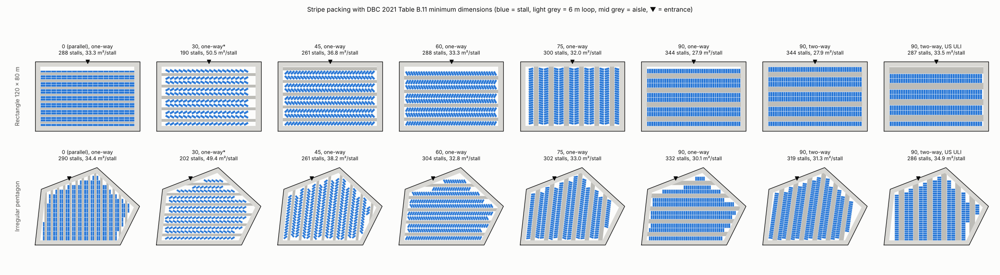
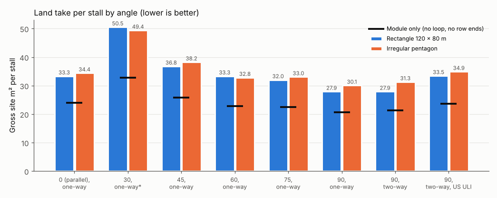

# C12: Parking layout standards and algorithms

Researched 2026-10-30. Brief file unavailable; scope taken from the task line. The shared web-search budget ran out part way through, and several official Abu Dhabi and Saudi hosts could not be reached from this session (see Risks).

## Answer

For Dubai, Studio should use Dubai Building Code (DBC) 2021 Table B.11 as its default rule pack. Every bay is 2.5 m wide. Bays at 45°, 60°, 75° and 90° are 5.5 m long and take one-way aisles of 3.3, 3.8, 5.5 and 5.5 m. A 90° two-way aisle is 6.0 m. Parallel bays are 2.5 × 6.0 m on a 3.0 m aisle. DBC has no 30° row and states no module width, so Studio must derive the module (17.0 m for 90° two-way). Dubai accessible parking is 2% of spaces (minimum 1) for 25 to 500 spaces. The bay stays 2.5 × 5.5 m and gets an access aisle of at least 1.2 m, which may be shared. These bays must be within 50 m of the entrance. I could not open any official Abu Dhabi (Integrated Transport Centre, ITC, or Quality and Conformity Council TR-541) or Saudi (Ministry of Municipalities and Housing, MOMRAH, or Saudi Building Code SBC 201) stall table in this session, so those rows read "not found". Saudi accessible-bay rules were found: a 2.4 × 6.1 m bay plus a 2.1 m aisle. No Gulf Cooperation Council (GCC) source I opened gives a trees-per-bay or landscape-percentage rule; only US sources do (10% of paved area, or 4.18 m² per space). I measured a simple stripe packer with DBC minimums on a 120 × 80 m site and a 9,980 m² irregular site. 90° gave the lowest land take: 27.9 and 30.1 m² gross per stall (344 and 332 stalls). 60° and 75° needed 9 to 19% more land per stall, and 45° needed 27 to 32% more. US Urban Land Institute (ULI) dimensions gave 10 to 17% fewer stalls than DBC at 90° two-way. Score layouts on stall count, gross m² per stall, stall-area efficiency, circulation length, dead ends (DBC: avoid them, at most 8 bays), one-way flow continuity, and accessible-bay distance. Published work finds hand-drawn lots have about 25% less capacity than mixed-integer optimised ones, so a stripe packer is a baseline, not an optimiser. Main caveat: Abu Dhabi and Saudi stall tables are still missing and must come from a licensed or client-supplied copy.

## Parking dimensions by authority and angle

All values are minimums in metres; US values are converted from feet (source value in brackets). "Not found" means no public source was reachable. The "module" is the full width of one aisle with a row of stalls on each side.

### Table 1: Stall and aisle dimensions

| Authority (source) | Angle | Stall width | Stall length (depth to aisle) | Aisle one-way | Aisle two-way | Module width (double-loaded) |
|---|---|---|---|---|---|---|
| Dubai, DBC 2021 Table B.11 [[1]](https://dmpmedia.dm.gov.ae/uploads/2021/12/Dubai%20Building%20Code_English_2021%20Edition_compressed.pdf#page=86) | 0° (parallel) | 2.5 | 6.0 length (2.5 depth) | 3.0 | not stated | 8.0 (computed) |
| Dubai, DBC 2021 | 30° | not found (no 30° row) | not found | not found | not found | not found |
| Dubai, DBC 2021 | 45° | 2.5 | 5.5 (5.66 depth, computed) | 3.3 | not stated | 14.61 (computed) |
| Dubai, DBC 2021 | 60° | 2.5 | 5.5 (6.01 depth, computed) | 3.8 | not stated | 15.83 (computed) |
| Dubai, DBC 2021 | 75° (extra DBC row) | 2.5 | 5.5 (5.96 depth, computed) | 5.5 | not stated | 17.42 (computed) |
| Dubai, DBC 2021 | 90° | 2.5 (2.8 next to a wall or column) | 5.5 (5.0 allowed in some cases) | 5.5 | 6.0 | 16.5 one-way / 17.0 two-way (computed) |
| Dubai, Roads and Transport Authority (RTA) | all | not found (RTA manuals cited by DBC were not reachable) | not found | not found | not found | not found |
| Abu Dhabi, ITC "Standards & Specifications for Parking Design" v1.0 / QCC TR-541-1 [[12]](https://jawdah.qcc.abudhabi.ae/en/Registration/QCCServices/Services/STD/ISGL/ISGL-LIST/TR-541-1.pdf)[[13]](https://www.scribd.com/document/519714827/Abu-Dhabi-Parking-Standards) | all | not found (documents exist; not verified: blocked) | not found | not found | not found | not found |
| Abu Dhabi, Urban Street Design Manual 2010 [[14]](https://bicycleinfrastructuremanuals.com/manuals4/Abu-Dhabi-StreetDesignManual.pdf) | on-street | not found (not verified: HTTP 403) | not found | n/a | n/a | n/a |
| Saudi Arabia, MOMRAH / SBC 201 [[9]](https://www.sbc.gov.sa/ar/BC/Pages/BuildingCode/BC.aspx?year=2024)[[11]](https://momrah.gov.sa/en) | all | not found (host unreachable; SBC viewer did not load) | not found | not found | not found | not found |
| US, ULI/NPA via Iowa SUDAS Table 8B-1.02 (secondary) [[3]](https://www.iowasudas.org/wp-content/uploads/sites/15/2019/12/Chapter_08-2019.pdf#page=7) | 45° | 2.59 (8'6") or 2.74 (9'0") | 3.89 projection (12'9") | 6.55 (21'6") | 9.04 (29'8") | 14.33 one-way (47'0") / 16.81 two-way (55'2") |
| US, ULI/NPA via SUDAS | 60° | 2.59 or 2.74 | 4.75 projection (15'7") | 6.20 (20'4") | 7.87 (25'10") | 15.70 one-way (51'6") / 17.37 two-way (57'0") |
| US, ULI/NPA via SUDAS | 90° | 2.59 or 2.74 | 5.49 (18'0") | not given | 7.32 (24'0") | 18.29 (60'0") |
| US, ULI/NPA via SUDAS | 0° and 30° | not in SUDAS ("refer to The Dimensions of Parking") | | | | |
| US city example: Portland Title 33 Table 266-4 (not ITE/ULI) [[4]](https://www.portland.gov/sites/default/files/code/266-parking_3.pdf#page=13) | 0° | 2.44 (8') | 6.86 curb length (22'6"), depth 2.44 | 3.66 (12') | 6.10 (20') | 8.53 one-way (computed) |
| Portland | 30° | 2.59 (8'6") | depth 4.57 (15') | 3.66 (12') | 6.10 (20') | 12.80 one-way (computed) |
| Portland | 45° | 2.59 | depth 5.18 (17') | 3.66 (12') | 6.10 (20') | 14.02 one-way (computed) |
| Portland | 60° | 2.59 | depth 5.33 (17'6") | 4.88 (16') | 6.10 (20') | 15.54 one-way (computed) |
| Portland | 90° | 2.59 | depth 4.88 (16') | 6.10 (20') | 6.10 (20') | 15.85 (computed) |
| US, Institute of Transportation Engineers (ITE) | all | not found (SUDAS cites ULI/NPA, not ITE, for dimensions [[3]](https://www.iowasudas.org/wp-content/uploads/sites/15/2019/12/Chapter_08-2019.pdf#page=3)) | | | | |

"Computed" values are mine. They use the DBC bay drawn as a rectangle with one corner on the aisle edge (DBC Figures B.60 to B.63 [[1]](https://dmpmedia.dm.gov.ae/uploads/2021/12/Dubai%20Building%20Code_English_2021%20Edition_compressed.pdf#page=86)): depth = L·sin(a) + w·cos(a), module = 2 × depth + aisle. Each computed DBC value was checked by the C# sample in [RuleCheck.cs](assets/C12/RuleCheck.cs); Portland and ULI modules are 2 × depth + aisle from the quoted values.

### Table 2: Accessible bays

| Authority | Bay size | Access aisle | Number required | Location |
|---|---|---|---|---|
| Dubai, DBC 2021 C.6.4 [[1]](https://dmpmedia.dm.gov.ae/uploads/2021/12/Dubai%20Building%20Code_English_2021%20Edition_compressed.pdf#page=194) | Car angled/perpendicular 2.5 × 5.5; parallel 2.5 × 6.0; van 3.35 × 5.5 (Table C.18) | ≥ 1.2 m, may be shared between two bays; side aisle for angled bays, rear aisle along a sidewalk | 25 to 500 spaces: 2% (min 1); over 500: plus 1% of the extra spaces; hospitals 10%; vans 10% of accessible bays, at least 1 per building (Table C.17) | ≤ 50 m from the entrance; 1 next to each accessible entrance; ≤ 2% slope [[1]](https://dmpmedia.dm.gov.ae/uploads/2021/12/Dubai%20Building%20Code_English_2021%20Edition_compressed.pdf#page=195) |
| Abu Dhabi | not found (TR-541-1 lists "disabled parking" but could not be opened [[12]](https://jawdah.qcc.abudhabi.ae/en/Registration/QCCServices/Services/STD/ISGL/ISGL-LIST/TR-541-1.pdf)) | not found | not found | not found |
| Saudi Arabia, Universal Accessibility Built Environment (UABE) Guidelines 2010 [[6]](https://start.kscdr.org/upload/uap-be-en.pdf#page=62) and Accessibility Code for Riyadh City [[8]](https://www.rcrc.gov.sa/static/app/uploads/2025/03/EN-Accessibility-Code-for-Riyadh-City-1.pdf#page=21) | Perpendicular 2.4 × 6.1; angled 2.9 × 6.35; parallel 5.4 long, 3.9 including the access zone; "limited mobility" 2.4 × 6.1 | 2.1 m (1.5 m in renovation); limited mobility 1.2 m; may be shared | 1–50: 1 + 1 limited mobility; 51–100: 2 + 2; 101–200: 4 + 2; 201–300: 5 + 3; 301–500: 6 + 4; over 500: 6 + 1 per 100 over 500, and 4 + 1 per 100 [[6]](https://start.kscdr.org/upload/uap-be-en.pdf#page=61) | Shortest distance to the accessible entrance; ≤ 2% slope; 2.75 m headroom (2.6 m indoors) |
| US, 2010 ADA Standards (Americans with Disabilities Act) §208, §502 [[5]](https://www.access-board.gov/ada/) | Car 2.44 (96 in); van 3.35 (132 in), or 2.44 if its aisle is 2.44 | 1.525 m (60 in), full length, may be shared; van aisle on the passenger side for angled vans | 1–25: 1; 26–50: 2; 51–75: 3; 76–100: 4; 101–150: 5; 151–200: 6; 201–300: 7; 301–400: 8; 401–500: 9; 501–1000: 2%; 1001+: 20 + 1 per 100; 1 in 6 is a van space; hospital outpatient 10% | Shortest accessible route to an accessible entrance |

### Table 3: Landscape minimums for surface parking

| Authority | Trees per N bays | Islands | % landscape or shade |
|---|---|---|---|
| Dubai, DBC 2021 | not found | not found | Not parking-specific: ≥ 50% of a development's hardscape must have SRI (solar reflectance index) ≥ 33, open-grid paving, vegetation shade, shading that meets Table B.33, or solar-panel shade (B.10.5.3); ≥ 25% of planted area must be native or adapted species (B.10.5.1) [[1]](https://dmpmedia.dm.gov.ae/uploads/2021/12/Dubai%20Building%20Code_English_2021%20Edition_compressed.pdf#page=142) |
| Abu Dhabi | not found | not found | not found |
| Saudi Arabia | not found | not found | not found |
| US ULI / ITE | not found (SUDAS defers to local zoning) | | |
| US, SUDAS fallback guidance [[3]](https://www.iowasudas.org/wp-content/uploads/sites/15/2019/12/Chapter_08-2019.pdf#page=18) | not stated | Islands ≥ 2.44 m (8 ft) back of curb to back of curb; planters ≥ 1.83 m (6 ft) across; no space more than 22.9 m (75 ft) from landscaped open space | Landscape ≥ 10% of total paved area |
| US city example, Portland 33.266 [[4]](https://www.portland.gov/sites/default/files/code/266-parking_3.pdf#page=17)[[4]](https://www.portland.gov/sites/default/files/code/266-parking_3.pdf#page=14) | not stated as a ratio for surface lots | Strips ≥ 1.22 m (4 ft) between rows; tree pit ≥ 1.52 m (5 ft) | ≥ 4.18 m² (45 sq ft) of interior landscape per space when a site has more than 10 spaces; lots ≥ 2,023 m² (21,780 sq ft) choose one green feature, for example 40% tree-canopy shade |

### Table 4: Measured stripe-packing results (DBC minimums, method in Detail)

Rectangle: 120 × 80 m = 9,600 m². Irregular: pentagon of 9,980 m². Both sites include a 6 m two-way perimeter loop. "Module only" is the area per stall inside an endless module, with no loop and no row ends.

| Site | Case | Stalls | Gross m²/stall | Stall-area efficiency | Module only m²/stall | Circulation length (m) | Unused interior (m²) | Mean walk to entrance (m) | DBC accessible bays |
|---|---|---|---|---|---|---|---|---|---|
| Rectangle | 0° parallel, one-way | 288 | 33.3 | 45.0% | 24.0 | 1,240 | 432 | 52.7 | 6 |
| Rectangle | 30° one-way (assumed aisle) | 190 | 50.5 | 27.2% | 32.8 | 916 | 2,950 | 50.1 | 4 |
| Rectangle | 45° one-way | 261 | 36.8 | 37.4% | 25.8 | 916 | 1,973 | 51.2 | 6 |
| Rectangle | 60° one-way | 288 | 33.3 | 41.2% | 22.8 | 808 | 1,742 | 52.3 | 6 |
| Rectangle | 75° one-way | 300 | 32.0 | 43.0% | 22.5 | 784 | 975 | 50.4 | 6 |
| Rectangle | 90° one-way | 344 | 27.9 | 49.3% | 20.6 | 808 | 238 | 51.9 | 7 |
| Rectangle | 90° two-way | 344 | 27.9 | 49.3% | 21.3 | 808 | 22 | 51.2 | 7 |
| Rectangle | 90° two-way, US ULI dimensions | 287 | 33.5 | 42.5% | 23.7 | 808 | 104 | 52.6 | 6 |
| Irregular | 0° parallel, one-way | 290 | 34.4 | 43.6% | 24.0 | 1,344 | 525 | 56.3 | 6 |
| Irregular | 30° one-way (assumed aisle) | 202 | 49.4 | 27.8% | 32.8 | 956 | 3,076 | 55.7 | 5 |
| Irregular | 45° one-way | 261 | 38.2 | 36.0% | 25.8 | 906 | 2,428 | 55.5 | 6 |
| Irregular | 60° one-way | 304 | 32.8 | 41.9% | 22.8 | 859 | 1,750 | 56.8 | 7 |
| Irregular | 75° one-way | 302 | 33.1 | 41.6% | 22.5 | 808 | 1,211 | 55.3 | 7 |
| Irregular | 90° one-way | 332 | 30.1 | 45.7% | 20.6 | 848 | 612 | 57.1 | 7 |
| Irregular | 90° two-way | 319 | 31.3 | 44.0% | 21.3 | 812 | 739 | 55.4 | 7 |
| Irregular | 90° two-way, US ULI dimensions | 286 | 34.9 | 40.7% | 23.7 | 789 | 678 | 55.6 | 6 |





## Detail

### Dubai: Dubai Building Code 2021 and RTA guidance

**Source.** Dubai Municipality's code page links the 2021 edition [[2]](https://www.dm.gov.ae/dubai-building-code/). The PDF I read is the 2021 English edition, 843 pages [[1]](https://dmpmedia.dm.gov.ae/uploads/2021/12/Dubai%20Building%20Code_English_2021%20Edition_compressed.pdf). Parking is in Part B, section B.7.2. Accessible parking is in Part C, section C.6.4.

**Bay and driveway table.** DBC B.7.2.4 says bays and driveways "shall be not less than the minimum values given in Table B.11" [[1]](https://dmpmedia.dm.gov.ae/uploads/2021/12/Dubai%20Building%20Code_English_2021%20Edition_compressed.pdf#page=86). The rows are:

- Parallel, one way: 2.5 × 6 m, driveway 3 m.
- 45°, one way: 2.5 × 5.5 m, driveway 3.3 m.
- 60°, one way: 2.5 × 5.5 m, driveway 3.8 m.
- 75°, one way: 2.5 × 5.5 m, driveway 5.5 m.
- 90°, one way: 2.5 × 5.5 m, driveway 5.5 m.
- 90°, two way: 2.5 × 5.5 m, driveway 6 m.

Table B.11 has three notes that a layout engine must model:

- **Shorter 90° bays.** Perpendicular bays "may be reduced to 5 m × 2.5 m" on two conditions: "all perpendicular bays in plots less than 30 m in length", or "up to 10% of perpendicular bays in plots of 30 m length or greater" [[1]](https://dmpmedia.dm.gov.ae/uploads/2021/12/Dubai%20Building%20Code_English_2021%20Edition_compressed.pdf#page=86).
- **Bays next to structure.** Bays "bounded by building structural elements or walls shall have an additional space of 300 mm". The figures show "≥2.8 m" for such bays [[1]](https://dmpmedia.dm.gov.ae/uploads/2021/12/Dubai%20Building%20Code_English_2021%20Edition_compressed.pdf#page=86).
- **Rectangle geometry.** Figures B.60 to B.63 draw angled bays as 2.5 × 5.5 m rectangles. Each has one corner on the dashed aisle edge, which makes a saw-tooth row [[1]](https://dmpmedia.dm.gov.ae/uploads/2021/12/Dubai%20Building%20Code_English_2021%20Edition_compressed.pdf#page=87). The figures also show "≥3.0 m" at the end of each row, which appears to be the exit driveway; the table does not define it.

**Other layout rules in B.7.2.3** [[1]](https://dmpmedia.dm.gov.ae/uploads/2021/12/Dubai%20Building%20Code_English_2021%20Edition_compressed.pdf#page=83):

- Parking floor slope is at most 4%, and accessible parking at most 2%.
- Wheel stoppers are at most 120 mm high and at least 200 mm wide where bays face walls or walkways.
- A straight, preferably level, 6 m approach "should be provided before vehicle access barriers".
- A parking area may not double as a loading space.
- Columns get angle guards.
- "Dead-end driveways should be avoided. If they are to be included in design, they should serve a maximum of eight spaces with manoeuvring space provided" (Figure B.58) [[1]](https://dmpmedia.dm.gov.ae/uploads/2021/12/Dubai%20Building%20Code_English_2021%20Edition_compressed.pdf#page=85).
- Tandem parking is limited to two bays for the same residential unit, or three bays for valet-only hotel parking [[1]](https://dmpmedia.dm.gov.ae/uploads/2021/12/Dubai%20Building%20Code_English_2021%20Edition_compressed.pdf#page=85).

**Provision rules that sit next to the layout:**

- Table B.13 gives parking ratios, for example 1 bay per 50 m² of office net area and 1 to 3 bays per residential unit. Affection plans and Development Control Regulations (DCR) take precedence over the table [[1]](https://dmpmedia.dm.gov.ae/uploads/2021/12/Dubai%20Building%20Code_English_2021%20Edition_compressed.pdf#page=89).
- Buildings with more than 20 bays need 5% "preferred parking" for hybrid, electric and carpool vehicles. Malls must give 20% of those preferred bays electric-vehicle (EV) charging [[1]](https://dmpmedia.dm.gov.ae/uploads/2021/12/Dubai%20Building%20Code_English_2021%20Edition_compressed.pdf#page=90).
- Bicycle parking is 5% of the car requirement [[1]](https://dmpmedia.dm.gov.ae/uploads/2021/12/Dubai%20Building%20Code_English_2021%20Edition_compressed.pdf#page=91).

**RTA.** DBC defers to three RTA documents [[1]](https://dmpmedia.dm.gov.ae/uploads/2021/12/Dubai%20Building%20Code_English_2021%20Edition_compressed.pdf#page=78)[[1]](https://dmpmedia.dm.gov.ae/uploads/2021/12/Dubai%20Building%20Code_English_2021%20Edition_compressed.pdf#page=36):

- the "Dubai Access management manual" (RTA, 2014), for vehicle access;
- the "Geometric design manual for Dubai Roads" (RTA, 2017), for public rights of way;
- the "Dubai trip generation and parking rates manual" (RTA, 2013), for uses not in Table B.13 [[1]](https://dmpmedia.dm.gov.ae/uploads/2021/12/Dubai%20Building%20Code_English_2021%20Edition_compressed.pdf#page=90).

I did not find a public RTA document with stall dimensions. Treat DBC Table B.11 as the Dubai plot-level rule. Free zones and master developers may have their own regulations; I did not check those.

### Abu Dhabi: DMT / ITC / UPC

Abu Dhabi has parking design documents, but I could not open any of them:

- **QCC TR-541-1.** A search result described the "Standard Drawing Guideline, Part 1 TR-541-1", hosted by the Abu Dhabi Quality and Conformity Council (QCC). The snippet said the working group was "organized by Abu Dhabi Quality and Conformity Council and established in September 2023, which was requested by Integrated Transport Center". It also said the drawings cover parking dimensions, entry and exit details, motorcycle and light-electric-vehicle (LEV) parking, and disabled parking, marked "2021 amendment, final issue January 2022". The PDF reset the connection and then returned HTTP 503 [[12]](https://jawdah.qcc.abudhabi.ae/en/Registration/QCCServices/Services/STD/ISGL/ISGL-LIST/TR-541-1.pdf).
- **ITC parking standards.** Search results listed a Scribd copy of "Abu Dhabi Parking Design Standards", described as "Standards & Specifications for Parking Design (Car, Motorcycle, Truck, School Bus & Car Lift) Version 1.0", with separate standards for plots over and under 1,000 m². Scribd blocked the page [[13]](https://www.scribd.com/document/519714827/Abu-Dhabi-Parking-Standards).
- **ITC e-library.** The official e-library loads its document list with script, and no documents were visible to me [[15]](https://admobility.gov.ae/en/e-library).
- **Urban Street Design Manual.** A search result described the manual as approved in 2010 for the Urban Planning Council (UPC), and said it "shall be used by all agencies in the design and approval of all urban street and network designs in the Emirate of Abu Dhabi". The PDF mirror returned HTTP 403 [[14]](https://bicycleinfrastructuremanuals.com/manuals4/Abu-Dhabi-StreetDesignManual.pdf).

Every Abu Dhabi number is therefore "not found". Do not reuse Dubai values for Abu Dhabi without the ITC document.

### Saudi Arabia: MOMRAH, SBC and Riyadh

- **MOMRAH.** The ministry site failed DNS resolution from this session. It lies outside the allowed network [[11]](https://momrah.gov.sa/en).
- **SBC 201.** The Saudi Building Code (SBC) 2024 listing shows SBC 201 (the general building code), with a "view" link and an "add to cart" link [[9]](https://www.sbc.gov.sa/ar/BC/Pages/BuildingCode/BC.aspx?year=2024). The viewer only showed "We are not able to download the web viewer" [[10]](https://view.protectedpdf.com/qhxkte). I could not read its parking clauses.
- **Royal Commission for Riyadh City (RCRC).** RCRC's Wadi Hanifah drive-through code gives a parking ratio (one space per 25 m² of facility), but no bay dimensions. That page is Arabic and drawn as vector images, so I read it from a rendered image. I did not cite it further.

Saudi general stall and aisle dimensions are "not found".

Saudi accessible parking is well documented in two sources:

- The 2010 UABE Guidelines from the Prince Salman Center for Disability Research. They are still distributed by the King Salman Center for Disability Research (KSCDR) [[7]](https://www.kscdr.org.sa/en/universal-accessibility-guidelines).
- The Accessibility Code for Riyadh City (PDF created 2024). It repeats the same count table "as per current KSA guidelines" [[8]](https://www.rcrc.gov.sa/static/app/uploads/2025/03/EN-Accessibility-Code-for-Riyadh-City-1.pdf#page=17).

Values are in Table 2. The Saudi model has two classes: accessible bays and "limited mobility" bays. Its bays are longer than Dubai's: 6.1 m perpendicular and 6.35 m angled [[6]](https://start.kscdr.org/upload/uap-be-en.pdf#page=62).

### ITE / ULI (US references)

I found no public ITE dimension table. The Iowa Statewide Urban Design and Specifications (SUDAS) manual tells designers to follow "Urban Land Institute (ULI) & National Parking Association (NPA), The Dimensions of Parking" [[3]](https://www.iowasudas.org/wp-content/uploads/sites/15/2019/12/Chapter_08-2019.pdf#page=3). Its Table 8B-1.02 is "Adapted from Urban Land Institute, National Parking Association" [[3]](https://www.iowasudas.org/wp-content/uploads/sites/15/2019/12/Chapter_08-2019.pdf#page=7). That makes SUDAS the secondary public source for ULI here. Its pages are marked "Revised: 2013 Edition", so the source is old.

Key SUDAS points:

- Stall width is 8'6" for low turnover and 9'0" for moderate to high turnover. Add at least 12 in next to walls or islands [[3]](https://www.iowasudas.org/wp-content/uploads/sites/15/2019/12/Chapter_08-2019.pdf#page=6).
- Stall length is 18 ft, and may be reduced by up to 2 ft where cars can overhang [[3]](https://www.iowasudas.org/wp-content/uploads/sites/15/2019/12/Chapter_08-2019.pdf#page=6).
- Modules are defined as M1 = 2 × stall projection + aisle; M2 = single-loaded; M3 = wall to interlock; M4 = interlock to interlock. "Interlock" means the overlap of stall ends when angled rows from adjacent modules nest together [[3]](https://www.iowasudas.org/wp-content/uploads/sites/15/2019/12/Chapter_08-2019.pdf#page=8).
- Aisles may be 1 ft narrower when at least 30% of stalls have curbs [[3]](https://www.iowasudas.org/wp-content/uploads/sites/15/2019/12/Chapter_08-2019.pdf#page=7).
- SUDAS adds a useful comparison. Perpendicular parking and one-way angled parking need "approximately equal" surface area per space. Two-way angled parking needs "approximately 10% to 15% more area per parking space" [[3]](https://www.iowasudas.org/wp-content/uploads/sites/15/2019/12/Chapter_08-2019.pdf#page=7).

SUDAS has no 0° or 30° rows. For those I quote Portland, Oregon's zoning code Table 266-4 (dated 1/1/25) as a US city example only. It is not ITE or ULI [[4]](https://www.portland.gov/sites/default/files/code/266-parking_3.pdf#page=13).

### Where the sources differ

- **Bay width.** Dubai uses 2.5 m. ULI uses 2.59 to 2.74 m [[3]](https://www.iowasudas.org/wp-content/uploads/sites/15/2019/12/Chapter_08-2019.pdf#page=6). Portland uses 2.59 m for angled stalls and 2.44 m for parallel [[4]](https://www.portland.gov/sites/default/files/code/266-parking_3.pdf#page=13). Saudi accessible bays are 2.4 m, narrower than Dubai's 2.5 m, but they get a wider aisle [[6]](https://start.kscdr.org/upload/uap-be-en.pdf#page=62).
- **90° two-way aisle.** Dubai 6.0 m, ULI 7.32 m, Portland 6.10 m.
- **Aisle measurement.** DBC measures the aisle between bay corners and gives narrow one-way aisles: 3.3 m at 45°, 3.8 m at 60°. ULI measures a "stall projection" equal to stall length × sin(angle) (18 ft × sin 45° = 12'9") and pairs it with wider aisles: 6.55 m at 45°, 6.20 m at 60°. Yet the double-loaded modules come out almost the same. At 45° one-way, DBC gives 14.61 m (computed) and ULI 14.33 m. At 60° one-way, DBC gives 15.83 m and ULI 15.70 m. Studio must store which convention each rule pack uses, or a ULI aisle will be applied to a DBC bay.
- **Accessible bays.** Bay size, aisle width and count tables all differ; see Table 2. Dubai counts by percentage. Saudi Arabia and the US use stepped tables, and Saudi Arabia adds limited-mobility bays.
- **Accessible slope.** The 2% maximum is the same in Dubai [[1]](https://dmpmedia.dm.gov.ae/uploads/2021/12/Dubai%20Building%20Code_English_2021%20Edition_compressed.pdf#page=83) and Saudi Arabia [[6]](https://start.kscdr.org/upload/uap-be-en.pdf#page=62).
- **Landscape.** The only figures I found are US: 10% of paved area (SUDAS) and 4.18 m² per space (Portland). They differ in kind: one is a share of area, the other is per space.

### Accessible bays

The Dubai rules (DBC C.6.4) [[1]](https://dmpmedia.dm.gov.ae/uploads/2021/12/Dubai%20Building%20Code_English_2021%20Edition_compressed.pdf#page=194):

- Accessible spaces are counted from Table C.17. For hospitals and healthcare, "10% of the overall parking capacity should be accessible". Van spaces "should be provided at a rate of 10% of overall accessible parking count", with at least one per building or facility.
- Buildings without parking that are headquarters, hospitals, schools, sports facilities, beaches, rehabilitation centres or clinics need two bays in public areas, at most 50 m from the entrance.
- The location rules in C.6.4.2 are a checklist a layout engine can test [[1]](https://dmpmedia.dm.gov.ae/uploads/2021/12/Dubai%20Building%20Code_English_2021%20Edition_compressed.pdf#page=195):
  - at most 50 m from the building entrance;
  - one bay next to each accessible entrance;
  - bays spread across entrances;
  - one at grade in multi-level parking where grade parking exists;
  - a ≥ 1,200 mm access aisle connected to an accessible route;
  - angled bays get a side aisle on the driver's side;
  - a shared aisle must be centred between the two bays.

The US ADA gives the count table and widths in Table 2. It also has the rule that "for every six or fraction of six" accessible spaces, at least one is a van space. Access aisles "shall not overlap the vehicular way" [[5]](https://www.access-board.gov/ada/).

**Measured cost of accessible bays** (arithmetic in [sensitivity.py](assets/C12/sensitivity.py)). I took the 344-stall Dubai rectangle layout and widened one row for each authority's accessible bays, compared with the same number of 2.5 m standard bays:

```
$ python3 sensitivity.py
DBC: 7 accessible (van 1 ) row width 23.15 m vs 17.5 m -> extra 5.65 m = 2.26 bays
ADA: 8 bays row width 28.96 vs 20.0 -> extra 8.96 m = 3.59 DBC bays
KSA: 6 + 4 LM row width 32.7 vs 25.0 -> extra 7.7 m = 3.08 DBC bays (and 6.1 m long, not 5.5 m)
```

Accessible provision costs about 2 to 4 standard bays per 344, roughly 1%. The cost is small because Dubai's accessible car bay is the same 2.5 × 5.5 m as a standard bay, plus the shared 1.2 m aisle. The bigger risk is location. The 50 m rule and the rule of one bay per entrance can force accessible bays into rows the optimiser would not choose.

### Landscape minimums

DBC 2021 has no trees-per-bay, island-spacing or parking-landscape percentage. Searching the extracted text for "landscap" and "tree" found only the general rules in Table 3, plus tree grilles on accessible routes [[1]](https://dmpmedia.dm.gov.ae/uploads/2021/12/Dubai%20Building%20Code_English_2021%20Edition_compressed.pdf#page=142). Dubai's RTA does run a permit for residents to install a standard-model shade over reserved residential bays. I saw this only in a search-result snippet [[29]](https://www.rta.ae/wps/portal/rta/ae/home/promotion/external-parking-shades) and the page did not load for me, so it is not a layout rule. No Abu Dhabi or Saudi landscape rule was found.

**Measured effect, using US values** (no GCC value exists to test). The DBC 90° two-way rectangle has only 22 m² of unused interior. Any landscape must therefore replace bays, at 13.75 m² of stall area per bay:

```
SUDAS 10 %: 960 m2 -> 69 bays lost = 20.1 %
Portland 45 ft2/space ( 4.18 m2 ) -> 79 bays lost = 23.0 %
```

These are upper bounds. Planting the loop edge or the 2 ft overhang zone that Portland allows [[4]](https://www.portland.gov/sites/default/files/code/266-parking_3.pdf#page=13) would reduce the loss. The point for Studio: a landscape rule can cost a fifth of the stalls, so it must be an explicit rule-pack parameter, not an afterthought.

### TestFit (documented features)

TestFit sells "Parking Solver" as a product. Its page, quoted verbatim [[16]](https://www.testfit.io/product/parking-solver):

- "Generate optimal surface and structured parking layouts on any site"
- "Auto-generate surface and structured configurations based on parcel size and shape"
- "Set and adjust target parking ratios to meet zoning or project requirements"
- "Track stall counts and check parking ratios against project targets in real time"
- "Configure ADA, EV, compact, trailer, and custom stall types"
- "Adjust drive aisle widths, angles, and configurations"
- "Place entrances, exits, and circulation paths to match site access"
- "Override the automation anywhere it matters — stalls, aisles, and access points all stay editable"
- "Import sites and parking layouts directly into Revit with our add-in"
- "Export to CAD (.dxf), SketchUp (.skp), and CSV"

The 5.25 release notes (2026) add custom spaces inside parking structures. They say "Stalls and drive aisles respond to each placed space" and "The parking responds to the program instead of the program bending to the stall count" [[18]](https://www.testfit.io/blog/testfit-5-25-financial-filters-and-custom-garage-spaces).

The public pages do not document the algorithm, the stall-dimension libraries or standards, the scoring beyond stall counts and ratios, or any GCC standard. All of that is "not found".

Pricing, read 2026-10-30 [[17]](https://www.testfit.io/pricing):

| Plan | Price | Notes |
|---|---|---|
| Parking Solver | USD 195 per month (shown as "$195/month") | Includes "Parking automation" |
| Site Solver | "Starting at $15,000/year" | Includes Parking Solver; sold through "Get a Demo" |
| Site Solver Portfolio | "Starting at $20,000/year" | Sold through "Get a Demo" |

### Transoft ParkCAD

ParkCAD 2026 runs inside AutoCAD, Civil 3D, MicroStation and OpenRoads Designer [[19]](https://www.transoftsolutions.com/civil-and-transportation/software/site-and-parking-design/parkcad/). Documented features:

- "design standards that conform to regional design guidelines from over 20 jurisdictions around the world". The jurisdictions are not named, so GCC coverage is unknown.
- "ParkCAD takes seconds to lay out parking rows and aisles within a closed boundary". The page also describes finding the row layout and rotation that give the most spaces.
- Users "change the angle of the parking stalls in your row".
- "Add accessible parking based on guidelines and vehicle type".
- It reports "the current stall count and the percentage and number of accessible parking stalls".
- "Lengths, areas, and quantities for all ParkCAD objects in the layout can be calculated and reported".

There is no published price. The page offers "Request a Quote", a trial, and user or team subscription licences (read 2026-10-30) [[19]](https://www.transoftsolutions.com/civil-and-transportation/software/site-and-parking-design/parkcad/).

### Autodesk and others (Revit, Forma, Vehicle Tracking, Archistar, Giraffe)

- **Autodesk.** The Vehicle Tracking [[22]](https://www.autodesk.com/products/vehicle-tracking/overview) and Forma [[23]](https://www.autodesk.com/products/forma/overview) product pages returned HTTP 403, and the help pages I tried returned 404. I cannot state their parking features. For Revit, the only verified link is that TestFit imports parking layouts into Revit through its add-in [[16]](https://www.testfit.io/product/parking-solver).
- **Giraffe** (browser-based site feasibility tool). Its home page says "Adjust parameters to generate subdivision, apartment, retail, and parking layouts that reflect your standards" and "live calculations track building areas, unit counts, and parking totals" [[20]](https://www.giraffe.build/). Prices stated there, read 2026-10-30: individual plans from USD 45 per month; team plans USD 2,250 per user per year for businesses with 5 or fewer staff; prototype sprints from USD 10k. No parking algorithm documentation was public; the knowledge-base folders returned 403.
- **Archistar.** The home page now redirects to "AI PreCheck", which it markets to cities and local governments. It makes no claims about parking or generative layouts [[21]](https://www.archistar.ai/). Its parking capability is "not found".

### Academic layout algorithms

I read one 2025/2026 paper, Thomas and Rambha (arXiv 2506.09961 v3), which reviews the field [[25]](https://arxiv.org/abs/2506.09961). Where I could not open the primary paper, the description below comes from that review and is flagged "secondary".

| Work | Method | What it optimises | Notes |
|---|---|---|---|
| Iranpour & Tung 1989 (secondary [[25]](https://arxiv.org/abs/2506.09961)) | Set of nonlinear equations | Maximise capacity | Adds an "ease factor" for parking manoeuvres to pick among equal-capacity layouts. Old. |
| Abdelfatah & Taha 2014, J. Traffic and Logistics Engineering 2(3) 176–183 (secondary [[25]](https://arxiv.org/abs/2506.09961); journal page [[26]](http://www.jtle.net/index.php?m=content&c=index&a=show&catid=9&id=96)) | Mixed-integer programming (MIP) solved with LINDO | Maximise total stalls by choosing how many rows of each type (angle and dimensions) fit in the lot | A row-type mix model. Full text was not on the journal page. |
| Yıldırım et al. 2019 (secondary [[25]](https://arxiv.org/abs/2506.09961)) | Cutting-stock-like model | Maximise stalls within predefined bay patterns | Circulation is pre-allocated. |
| Syahrini et al. 2018; Maina et al. 2025 (secondary [[25]](https://arxiv.org/abs/2506.09961)) | Mathematical models | Stalls in rectangular or triangular lots | Predefined bay configurations. |
| Stiglmayr 2020 (secondary [[25]](https://arxiv.org/abs/2506.09961)) | Grid; each cell is parking or driving; distance and flow formulations plus a heuristic | Stalls subject to reachability | "Little control over the geometric dimensions". |
| Stephan, Weidinger & Boysen 2021, Transportation Science 55(4) [[24]](https://api.semanticscholar.org/graph/v1/paper/DOI:10.1287/trsc.2021.1049?fields=title,authors,year,venue,abstract) | MIP at three raster resolutions, orthogonal parking | "we maximize the number of parking spaces each reachable via a driving lane" | Tested against 177 real lots. The review reports manual lots "typically have 25% less capacity" than MIP designs [[25]](https://arxiv.org/abs/2506.09961). |
| Forbes & Harris 2022 (secondary [[25]](https://arxiv.org/abs/2506.09961)) | Cutting planes | Speeds up a similar MIP | |
| Cudzik & Nessel 2024, Sustainability 16(2) 592 [[27]](https://api.semanticscholar.org/graph/v1/paper/DOI:10.3390/su16020592?fields=title,authors,year,venue,abstract,openAccessPdf) | Heuristic: stalls along boundaries, extra rows in directions taken from the boundary polylines, many variants | Space use; quantitative and qualitative comparison with 5 real lots | About 16% more spaces than the existing layouts (secondary [[25]](https://arxiv.org/abs/2506.09961)). Publisher PDF returned 403. |
| Thomas & Rambha 2025/2026 [[25]](https://arxiv.org/abs/2506.09961) | Flow-based MIP, then branch-and-cut with valid inequalities; one-way and two-way lanes; optional turn restrictions and several entrances | Maximise perpendicular stalls; every stall and driveway connected to the entrance and exit | On 325 New York City lots, median run time fell 87.43% (one-way) and 79.36% (two-way). "One-way configurations accommodated, on average, 18.63% more vehicles … than their two-way counterparts". |
| Jamaludin, Zhou & Yeoh 2024, "Automated Basement Car Park Design: Impact of Design Factors on Static Capacity" [[28]](https://api.semanticscholar.org/graph/v1/paper/DOI:10.1287/trsc.2021.1049/citations?fields=title,year,venue,externalIds,citationCount&limit=100) | not verified (title only; abstract not available) | | |

**Genetic algorithms.** The only one in the sources I opened is used for scheduling robots in automated parking. It is not a layout method (Chen et al. 2020, cited in [[25]](https://arxiv.org/abs/2506.09961)). A genetic-algorithm layout paper is "not found" here.

**Strip packing.** Thomas and Rambha note that two-dimensional bin packing "also involves fitting as many rectangular fields … within a given region, but does not include reachability constraints" [[25]](https://arxiv.org/abs/2506.09961). That missing reachability is exactly what the stripe (module) method supplies by construction. It is the practical method behind the ULI module tables [[3]](https://www.iowasudas.org/wp-content/uploads/sites/15/2019/12/Chapter_08-2019.pdf#page=8).

What the field optimises:

- **Exact methods** (Stephan; Thomas and Rambha) maximise stall count on a raster grid, with reachability as a hard constraint. They handle irregular lots and obstacles, but grid resolution trades stalls against solve time, and most handle only 90° parking.
- **Row-mix models** (Abdelfatah and Taha; Yıldırım) choose the number and angle of rows inside a fixed frame.
- **Heuristics** (Cudzik and Nessel) generate many variants for a designer to compare.

### How layouts are scored

| Metric | Definition used here | Who uses it | Measured range here (DBC) |
|---|---|---|---|
| Stall count | Bays that fit and are reachable | Every optimiser: Stephan [[24]](https://api.semanticscholar.org/graph/v1/paper/DOI:10.1287/trsc.2021.1049?fields=title,authors,year,venue,abstract), Thomas & Rambha [[25]](https://arxiv.org/abs/2506.09961), Abdelfatah & Taha (secondary [[25]](https://arxiv.org/abs/2506.09961)); TestFit [[16]](https://www.testfit.io/product/parking-solver); ParkCAD [[19]](https://www.transoftsolutions.com/civil-and-transportation/software/site-and-parking-design/parkcad/) | 190 to 344 |
| Ratio check | Stalls against the required ratio | TestFit "target parking ratios" [[16]](https://www.testfit.io/product/parking-solver); DBC Table B.13 [[1]](https://dmpmedia.dm.gov.ae/uploads/2021/12/Dubai%20Building%20Code_English_2021%20Edition_compressed.pdf#page=89) | n/a |
| Gross m² per stall | Site area ÷ stalls | SUDAS compares area per space by layout type [[3]](https://www.iowasudas.org/wp-content/uploads/sites/15/2019/12/Chapter_08-2019.pdf#page=7) | 27.9 to 50.5 |
| Module m² per stall | Module width × pitch ÷ 2 (ideal, no ends) | Derived from SUDAS module definitions [[3]](https://www.iowasudas.org/wp-content/uploads/sites/15/2019/12/Chapter_08-2019.pdf#page=8) | 20.6 to 32.8 |
| Stall-area efficiency | Stalls × bay area ÷ site area | ParkCAD reports areas and quantities [[19]](https://www.transoftsolutions.com/civil-and-transportation/software/site-and-parking-design/parkcad/) | 27% to 49% |
| Circulation length | Loop centre line + aisle lengths | Measured here | 784 to 1,344 m |
| Dead ends | Aisles open at one end; bays served | DBC: avoid; at most 8 bays with a turning bay [[1]](https://dmpmedia.dm.gov.ae/uploads/2021/12/Dubai%20Building%20Code_English_2021%20Edition_compressed.pdf#page=85) | 0 by construction |
| Flow continuity | Every stall reachable from the entrance and able to return to the exit; one-way aisles in a loop | Thomas & Rambha constraints [[25]](https://arxiv.org/abs/2506.09961); Stephan reachability [[24]](https://api.semanticscholar.org/graph/v1/paper/DOI:10.1287/trsc.2021.1049?fields=title,authors,year,venue,abstract) | Met by construction |
| Turning | No sharp or indistinct turns | Thomas & Rambha turn restrictions [[25]](https://arxiv.org/abs/2506.09961) | Not measured |
| Walking distance | Mean or maximum stall-to-entrance distance; accessible bays ≤ 50 m | DBC C.6.4.2 [[1]](https://dmpmedia.dm.gov.ae/uploads/2021/12/Dubai%20Building%20Code_English_2021%20Edition_compressed.pdf#page=195); ADA "shortest accessible route" [[5]](https://www.access-board.gov/ada/) | Mean 50 to 57 m (straight line) |
| Compliance | Bay and aisle minimums, 2.8 m bays at structure, 5.0 m bay cap, slopes, accessible count and aisle, preferred and EV share | DBC B.7.2, C.6.4 [[1]](https://dmpmedia.dm.gov.ae/uploads/2021/12/Dubai%20Building%20Code_English_2021%20Edition_compressed.pdf#page=86) | Dimensions met by construction |
| Unused area | Interior not covered by stalls or aisles | Measured here; shows room for landscape | 22 to 3,076 m² |

### Measurement: stripe packing on two sample sites

**Method.** [stripe_pack.py](assets/C12/stripe_pack.py) (Python 3.13, shapely 2.2, numpy, matplotlib):

1. Inset the site by a 6.0 m two-way loop (the DBC 90° two-way driveway). Every aisle ends on this loop at both ends, so there are no dead ends and one-way aisles always have an entry and an exit.
2. Build the bay template as a rectangle at the stall angle, one corner on the aisle edge, as in DBC Figures B.60 to B.63. Row depth is d = L·sin(a) + w·cos(a). Pitch along the aisle is p = w / sin(a). Parallel bays lie long side to the aisle.
3. Lay double-loaded modules (row, aisle, mirrored row) as parallel stripes.
4. Search the stripe direction from 0° to 178° in 2° steps, plus every site-edge direction. Search the stripe offset in 0.5 m steps. Keep the layout with the most stalls.
5. Accept a stall only if the stall and the aisle strip in front of it are both inside the interior.

The core loop (abridged):

```python
for phi in phis:                                    # stripe direction
    I = affinity.rotate(interior, -phi, origin=c)   # stripes run along x
    shapely.prepare(I)
    xs = np.arange(minx - tw, maxx + tw, p)         # stall pitch along aisle
    for s in np.arange(0, module, phase_step):      # stripe offset
        y0 = miny + s - module
        while y0 < maxy:
            ya0, ya1 = y0 + d, y0 + d + aisle       # aisle band
            cand = concat(polygons(tc + (xs, y0)),  polygons(tm + (xs, ya1 + d)))
            front = box(xs + fx, ya0, xs + fx + p, ya1)   # aisle in front of each bay
            ok = shapely.contains(I, cand) & shapely.contains(I, front)
            stalls.extend(cand[ok]); y0 += module
        keep the (phi, s) with most stalls
```

**Command and output** (full output in [run_output.txt](assets/C12/run_output.txt), data in [results.json](assets/C12/results.json)):

```
$ cd reports/assets/C12 && python3 stripe_pack.py
Rectangle 120 x 80 m   0 (parallel), one-way    stalls= 288 m2/stall= 33.33 eff= 45.0% theory= 24.00 circ=1240.0 m ...
Rectangle 120 x 80 m   45, one-way              stalls= 261 m2/stall= 36.78 eff= 37.4% theory= 25.83 circ= 916.0 m ...
Rectangle 120 x 80 m   60, one-way              stalls= 288 m2/stall= 33.33 eff= 41.2% theory= 22.84 circ= 808.0 m ...
Rectangle 120 x 80 m   90, two-way              stalls= 344 m2/stall= 27.91 eff= 49.3% theory= 21.25 circ= 808.0 m ...
Irregular pentagon     90, one-way              stalls= 332 m2/stall= 30.06 eff= 45.7% theory= 20.62 circ= 847.8 m ...
Irregular pentagon     90, two-way              stalls= 319 m2/stall= 31.29 eff= 44.0% theory= 21.25 circ= 811.5 m ...
elapsed 70.6 s
```

**Findings:**

1. **90° wins on land take.** It gave 27.9 m² per stall on the rectangle and 30.1 m² on the irregular site. Against the best 90° result on each site:
   - 75° and 60° need 9 to 19% more land per stall;
   - 45° needs 27 to 32% more;
   - 30°, with an assumed aisle because DBC has no 30° row, needs 64 to 81% more (49.4 to 50.5 m² per stall).

   This matches the module-only figures from the DBC table: 20.6 to 21.3 m² at 90°, 22.5 to 22.8 m² at 60° and 75°, and 25.8 m² at 45°.
2. **The gap between gross and module-only area is site loss.** Gross land take is 7 to 18 m² per stall above the module-only figure (7 to 10 m² at 90°). The 6 m loop alone is 2,256 m², 23.5% of the rectangle.
3. **Parallel looks competitive on count, but not on circulation.** On the rectangle, parallel gave 288 stalls, the same as 60°, because DBC allows a 3.0 m one-way aisle. But it needs 1,240 m of circulation against 808 m. Circulation length is the metric that rules it out.
4. **Fit matters more than aisle width.** One-way 90° (5.5 m aisle) gave the same count as two-way (6.0 m) on the rectangle: the 68 m interior holds exactly four 17.0 m modules. On the irregular site, one-way gave 13 more stalls (4%).
5. **Direction search matters on irregular sites.** Re-running the irregular site at single directions (2° steps), 90° two-way ranged from 293 to 319 stalls (about 9%), 60° from 282 to 304, and 45° from 250 to 260.
6. **Dimensions matter as much as angle.** US ULI dimensions (2.59 × 5.49 m bays, 7.32 m aisle) gave 287 stalls against DBC's 344 on the rectangle (17% fewer), and 286 against 319 on the irregular site (10% fewer). A rule pack applied to the wrong market gives badly wrong yields.

**Limits of this test.** There is no interlock between back-to-back angled rows, so angled layouts are slightly pessimistic. Stalls sit on a fixed lattice per row. There are no perimeter stalls outside the loop, no islands, columns, ramps, gates or accessible bays. Walking distance is straight-line to an assumed entrance. 30° uses an assumed aisle. Only two sites were tested.

## Risks and open questions

- **Abu Dhabi stall, aisle, accessible and landscape values: not found.** The ITC "Standards & Specifications for Parking Design" v1.0 and QCC TR-541-1 exist [[12]](https://jawdah.qcc.abudhabi.ae/en/Registration/QCCServices/Services/STD/ISGL/ISGL-LIST/TR-541-1.pdf)[[13]](https://www.scribd.com/document/519714827/Abu-Dhabi-Parking-Standards) but were blocked. The ITC e-library is script-only [[15]](https://admobility.gov.ae/en/e-library). The Urban Street Design Manual mirror returned 403 [[14]](https://bicycleinfrastructuremanuals.com/manuals4/Abu-Dhabi-StreetDesignManual.pdf).
- **Saudi stall and aisle values: not found.** momrah.gov.sa is outside this session's allowed network and would need to be allowed [[11]](https://momrah.gov.sa/en). The SBC 201 viewer did not load [[10]](https://view.protectedpdf.com/qhxkte). balady.gov.sa and mot.gov.sa reset the connection.
- **Dubai RTA parking manuals.** The three RTA manuals DBC cites (Access Management 2014, Geometric Design 2017, Trip Generation and Parking Rates 2013) [[1]](https://dmpmedia.dm.gov.ae/uploads/2021/12/Dubai%20Building%20Code_English_2021%20Edition_compressed.pdf#page=36) were not found publicly, and their stall content, if any, is unknown. Free-zone and master-developer regulations were not checked.
- **DBC edition.** I used the 2021 PDF. I did not check whether later circulars changed Table B.11.
- **DBC geometry.** Treating the bays as rectangles with a corner on the aisle is my reading of Figures B.60 to B.63. The "≥3.0 m" label at the end of each row is not defined in the text.
- **ULI and ITE.** ULI values come from SUDAS, a secondary and old (2013) source. "The Dimensions of Parking" itself was not opened, ULI 0° and 30° values were not found, and ITE dimension values were not found.
- **Landscape minimums for Dubai, Abu Dhabi and Saudi Arabia: not found.** Dubai public-realm or Al Sa'fat green-building rules may cover parking shade. One Al Sa'fat update notice I opened had no parking content [[30]](https://dmpmedia.dm.gov.ae/uploads/2024/11/10-1-2-updating-Al-Safat-List-Dubai-Green-Building-System.pdf).
- **Vendor tools.** TestFit's algorithm and scoring are undocumented publicly. ParkCAD does not name its 20+ jurisdictions. Autodesk pages were blocked. Archistar shows no parking product.
- **Academic sources.** Several descriptions are secondary, via Thomas and Rambha. No genetic-algorithm layout paper was found.
- **Search budget.** The shared web-search budget ran out mid-research. Later sources were found by following links and reference lists from opened pages, and by direct DOI lookups.
- **What the packer did not test.** Accessible-bay placement, landscape islands, ramps and structured parking were not measured; costs for the first two are arithmetic only. Results are Linux and Python; nothing ran inside Studio.

## Sources

1. Dubai Building Code, 2021 Edition (English, compressed). Dubai Municipality. https://dmpmedia.dm.gov.ae/uploads/2021/12/Dubai%20Building%20Code_English_2021%20Edition_compressed.pdf. Read 2026-10-30. Pages cited with #page anchors.
2. Dubai Building Code page. Dubai Municipality. https://www.dm.gov.ae/dubai-building-code/. Read 2026-10-30.
3. Iowa SUDAS Design Manual, Chapter 8 Parking Lots. Iowa Statewide Urban Design and Specifications. https://www.iowasudas.org/wp-content/uploads/sites/15/2019/12/Chapter_08-2019.pdf. Read 2026-10-30. Third party; secondary: summarises ULI/NPA "The Dimensions of Parking"; old (2013 edition text).
4. Title 33 Planning and Zoning, Chapter 33.266 Parking, Loading and Transportation and Parking Demand Management (1/1/25). City of Portland, Oregon. https://www.portland.gov/sites/default/files/code/266-parking_3.pdf. Read 2026-10-30. US city example, not ITE/ULI.
5. 2010 ADA Standards for Accessible Design (§208, §502). U.S. Access Board. https://www.access-board.gov/ada/. Read 2026-10-30. Old (2010) but current.
6. Universal Accessibility Built Environment Guidelines for the Kingdom of Saudi Arabia, 1431H–2010. Prince Salman Center for Disability Research. https://start.kscdr.org/upload/uap-be-en.pdf. Read 2026-10-30. Old (2010).
7. Universal Accessibility Guidelines page. King Salman Center for Disability Research. https://www.kscdr.org.sa/en/universal-accessibility-guidelines. Read 2026-10-30.
8. Accessibility Code for Riyadh City (English). Royal Commission for Riyadh City. https://www.rcrc.gov.sa/static/app/uploads/2025/03/EN-Accessibility-Code-for-Riyadh-City-1.pdf. Read 2026-10-30. Riyadh only.
9. Saudi Building Code 2024 listing. Saudi Building Code National Committee. https://www.sbc.gov.sa/ar/BC/Pages/BuildingCode/BC.aspx?year=2024. Read 2026-10-30.
10. SBC 201 online viewer. Saudi Building Code National Committee. https://view.protectedpdf.com/qhxkte. Read 2026-10-30. Not verified: viewer did not load.
11. Ministry of Municipalities and Housing (MOMRAH) site. https://momrah.gov.sa/en. Not verified: host not resolvable from this session.
12. Standard Drawing Guideline Part 1, TR-541-1. Abu Dhabi Quality and Conformity Council. https://jawdah.qcc.abudhabi.ae/en/Registration/QCCServices/Services/STD/ISGL/ISGL-LIST/TR-541-1.pdf. Not verified: connection reset, then HTTP 503; description from search-result text only.
13. Abu Dhabi Parking Design Standards (Scribd upload). Scribd. https://www.scribd.com/document/519714827/Abu-Dhabi-Parking-Standards. Not verified: page blocked; third party upload; description from search-result text only.
14. Abu Dhabi Urban Street Design Manual (mirror). bicycleinfrastructuremanuals.com. https://bicycleinfrastructuremanuals.com/manuals4/Abu-Dhabi-StreetDesignManual.pdf. Not verified: HTTP 403; third party mirror; old (2010).
15. E-Library. Abu Dhabi Mobility (Integrated Transport Centre). https://admobility.gov.ae/en/e-library. Read 2026-10-30. Document list not visible (script-loaded).
16. Parking Solver product page. TestFit. https://www.testfit.io/product/parking-solver. Read 2026-10-30. Vendor claims.
17. Pricing. TestFit. https://www.testfit.io/pricing. Read 2026-10-30.
18. TestFit 5.25: From What Fits to What Earns (release notes, 2026). TestFit. https://www.testfit.io/blog/testfit-5-25-financial-filters-and-custom-garage-spaces. Read 2026-10-30.
19. ParkCAD product page. Transoft Solutions. https://www.transoftsolutions.com/civil-and-transportation/software/site-and-parking-design/parkcad/. Read 2026-10-30. Vendor claims.
20. Giraffe home page. Giraffe. https://www.giraffe.build/. Read 2026-10-30.
21. Archistar home page (redirects to AI PreCheck). Archistar. https://www.archistar.ai/. Read 2026-10-30.
22. Autodesk Vehicle Tracking product page. Autodesk. https://www.autodesk.com/products/vehicle-tracking/overview. Not verified: HTTP 403.
23. Autodesk Forma product page. Autodesk. https://www.autodesk.com/products/forma/overview. Not verified: HTTP 403.
24. Stephan, K., Weidinger, F., Boysen, N. (2021). Layout Design of Parking Lots with Mathematical Programming. Transportation Science 55(4). Record and abstract via Semantic Scholar API. https://api.semanticscholar.org/graph/v1/paper/DOI:10.1287/trsc.2021.1049?fields=title,authors,year,venue,abstract. Read 2026-10-30. Publisher page https://doi.org/10.1287/trsc.2021.1049 not verified (HTTP 403).
25. Thomas, H., Rambha, T. A Branch-and-Cut Algorithm for the Optimal Design of Parking Lots with One-way and Two-way Lanes. arXiv 2506.09961 v3 (15 Sep 2026). https://arxiv.org/abs/2506.09961. Read 2026-10-30 (PDF). Used as secondary for the earlier works it reviews.
26. Parking Capacity Optimization Using Linear Programming (Abdelfatah, A. S., Taha, M. A.), article page. Journal of Traffic and Logistics Engineering, Vol. 2 No. 3, September 2014. http://www.jtle.net/index.php?m=content&c=index&a=show&catid=9&id=96. Read 2026-10-30. Full text not on page; old (2014).
27. Cudzik, J., Nessel, M. (2024). Computational Approach towards Repetitive Design Tasks: The Case Study of Parking Lot Automated Design. Sustainability 16(2) 592. Record and abstract via Semantic Scholar API. https://api.semanticscholar.org/graph/v1/paper/DOI:10.3390/su16020592?fields=title,authors,year,venue,abstract,openAccessPdf. Read 2026-10-30. Publisher PDF not verified (HTTP 403).
28. Citations of Stephan et al. 2021 (list). Semantic Scholar API. https://api.semanticscholar.org/graph/v1/paper/DOI:10.1287/trsc.2021.1049/citations?fields=title,year,venue,externalIds,citationCount&limit=100. Read 2026-10-30. Used to find [25] and the Jamaludin et al. title.
29. External parking shades page. Roads and Transport Authority, Dubai. https://www.rta.ae/wps/portal/rta/ae/home/promotion/external-parking-shades. Not verified: page did not load; seen as search-result text only.
30. Updating Al Sa'fat list, Dubai Green Building System (one-page notice, 2024). Dubai Municipality. https://dmpmedia.dm.gov.ae/uploads/2024/11/10-1-2-updating-Al-Safat-List-Dubai-Green-Building-System.pdf. Read 2026-10-30 (text extracted; no parking, tree or shade terms).

## Choices made

- Relied on the brief's inferences: Studio is a C# (.NET) Windows urban-design application; it already has parking layout (implied by this task line); its market is the GCC, UAE first. I did not look at or assume Studio's code.
- Took "Dubai" to mean DBC 2021 Part B and Part C. No RTA stall table was found; DBC defers to RTA only for access, roads and parking rates.
- Read the DBC bays as rectangles with one corner on the aisle edge (Figures B.60 to B.63). I derived module widths and the "module only" area from that reading, because DBC states neither.
- Ran 30° (no DBC row) with the DBC bay and the narrowest DBC one-way aisle (3.3 m, the 45° value), labelled as an assumption. All other angles use DBC values only. I also ran the DBC 75° row, which the task did not list, because DBC has it.
- Used Iowa SUDAS as the public secondary source for ULI/NPA values, and Portland's code as a US city example for 0° and 30°, because the ULI book and any ITE dimension table were not public.
- For Saudi accessible bays, used the 2010 UABE Guidelines and the Riyadh Accessibility Code, since MOMRAH and SBC 201 were unreachable.
- Measurement model: a 6.0 m two-way perimeter loop for every case, so all angles are compared with the same circulation and no dead ends. No interlock; fixed stall lattice per row; direction searched in 2° steps plus site-edge directions; offset in 0.5 m steps.
- Gross m² per stall includes the loop. Stall-area efficiency uses the bay rectangle area (13.75 m² for DBC). Walking distance is straight-line to an assumed entrance marked on each site.
- Accessible-bay cost: one row widened, shared aisles in pairs, each van given its own aisle (worst case). ADA van count by the 1-in-6 rule.
- Landscape sensitivity uses US values because no GCC value was found. It assumes islands replace bays one for one.
- After the web-search budget ran out, I found papers by following links and reference lists from opened pages, and by direct DOI record lookups on Semantic Scholar and arXiv. I ran no keyword searches after that point.
- Reported TestFit and Giraffe prices in USD because the pages show "$" on US sites; both are quoted as shown.

## What Studio should do

1. **[S] [COMPLETES]** Move parking dimensions out of code into authority "rule packs": data files that record angle, flow, bay width, length, aisle, the geometry convention, and clause references. Ship the Dubai DBC 2021 pack first; [dubai-dbc-2021-parking-rules.json](assets/C12/dubai-dbc-2021-parking-rules.json) and [RuleCheck.cs](assets/C12/RuleCheck.cs) are a working start (.NET 8 on Linux). Supported by "Parking dimensions by authority and angle" and "Dubai".
2. **[S] [COMPLETES]** Store the measurement convention per pack (DBC bay-corner aisle versus ULI stall projection) and always show the derived module width. Mixing conventions mis-sizes aisles by up to about 3 m, and the wrong pack changed yield by 10 to 17% in the test. Supported by "Where the sources differ" and "Measurement".
3. **[S] [COMPLETES]** Add a score panel to the existing layout: stall count against the required ratio, gross m² per stall, stall-area efficiency, circulation length, unused area, dead-end count (DBC limit 8 bays), and mean and maximum walk. Supported by "How layouts are scored".
4. **[M] [COMPLETES]** Add direction and offset search to the layout generator, with site-edge directions as candidates. On the irregular test site, direction alone moved the 90° result by about 9% (293 to 319 stalls). Supported by "Measurement".
5. **[S] [COMPLETES]** Add DBC compliance checks:
   - 2.8 m bays next to structure;
   - the 5.0 m short-bay cap (all bays on plots under 30 m long, otherwise at most 10%);
   - slopes of 4% (2% for accessible bays);
   - a 6 m straight approach before barriers;
   - 5% preferred parking above 20 bays, and EV charging on 20% of those bays in malls.

   Supported by "Dubai".
6. **[M] [COMPLETES]** Count and place accessible bays automatically from the active pack:
   - DBC: 2%, 1.2 m shared aisle, within 50 m, one per accessible entrance;
   - Saudi: 2.4 × 6.1 m bay plus 2.1 m aisle, plus limited-mobility bays;
   - ADA: stepped table plus vans.

   Flag location failures, not just counts. Supported by "Accessible bays".
7. **[S] [COMPLETES]** Make landscape a user-entered rule in each pack (trees per N bays, % landscape, minimum island size), empty by default for GCC packs, and show the stall loss. US-style rules cost about 20 to 23% of stalls in the test. Supported by "Landscape minimums".
8. **[M] [NEW]** Obtain the Abu Dhabi ITC parking standards and QCC TR-541-1, and the MOMRAH parking requirements and SBC 201 parking clauses, through clients or licensed copies. Fill the Abu Dhabi and Saudi packs only from those documents. Supported by "Risks and open questions".
9. **[L] [NEW]** Add an optional exact optimiser for small surface lots: a grid mixed-integer program with reachability, in the style of Stephan et al. or Thomas and Rambha, with a time budget. Report its gain over the stripe baseline; published figures are hand layouts about 25% below optimised ones, and 18.63% more stalls with one-way aisles than two-way. Supported by "Academic layout algorithms".
10. **[S] [NEW]** Export the stalls, aisles and scores to DXF and CSV, matching what TestFit and ParkCAD offer for quantity take-off. Supported by "TestFit" and "Transoft ParkCAD".
