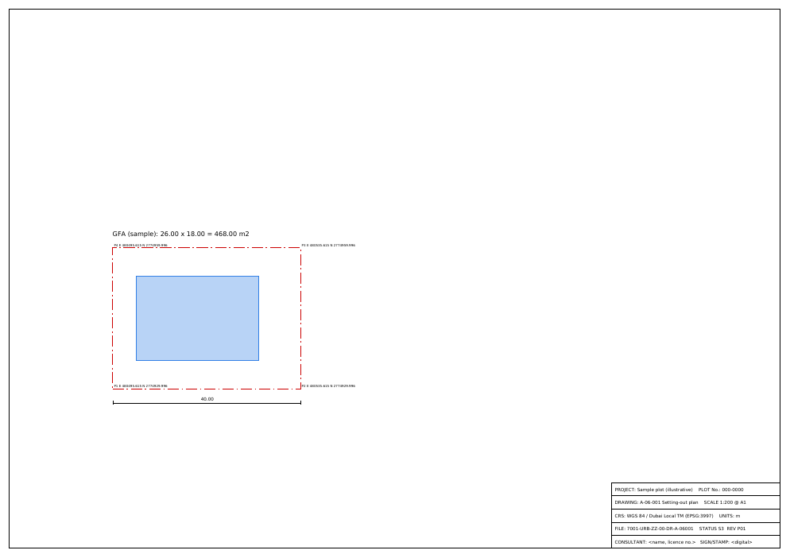

# C15: Municipal submission and drawing standards

Researched 2026-10-30. Brief file unavailable; scope taken from the task line. The shared web-search budget ran out part way through, so a few items (Revit PDF layers, Dubai BPS help pages, ISO 19650 UK National Annex field lengths) were not verified; they are listed under Risks and open questions.

## Answer

None of the four authorities asks for PDF/A, ISO 13567 or AIA layer names. Each one publishes its own small set of rules, and they differ enough that Studio needs one export preset per authority. **Dubai Municipality (DM)** building permits go through Dubai BPS, which accepts drawings only as DWF. DM master plans are submitted as MicroStation V7 2D DGN in DLTM (Dubai Local Transverse Mercator, EPSG:3997), following a "Digital Data Delivery" standard that DM gives out on request but does not publish. **DDA (Dubai Development Authority)** wants A1, monochrome, one-sheet-per-file DWF named `A-00-xxx Name`, plus a coloured shaded area diagram. Its master plans need a PDF report and DGN GIS data in DLTM. **Abu Dhabi (DMT/ADM)** publishes the most precise CAD rules, but only for planning data. These are DWG no newer than AutoCAD 2012, in WGS 84 / UTM 40N at 1 unit = 1 m, with a fixed layer table, a fixed file-name pattern and a QC (quality-check) tool. **Trakhees (PCFC)** takes every document as PDF. The area sheet goes in as DWF with floor polylines, and utility drawings go in as AutoCAD in DLTM. My recommendation: keep AIA/NCS-format layer names inside Studio, check them with the regexes in this report, and map them to each authority's layers on export. Ship the six presets in [export_presets.json](assets/C15/export_presets.json). Write layered PDFs as PDF/A-2b. That is the archival level that allows layers: I measured that PDF/A-1 rejects them, and so does PDF/A-2 when the default layer configuration has no `/Name`. My hand-built layered A1 sheet passed veraPDF 1.30.3 for PDF/A-2b (144 of 144 rules) and for PDF/A-4 (109 of 109). The main caveat: DM's building-permit CAD rules, DM's data-delivery standard, Trakhees' "Blue code" and ADM's building-permit CAD standard are not public. Confirm them with each authority before you treat any preset as final.

## Submission requirements by authority

Quoted text is in quotation marks. "Not found" means I found no public document; "not verified" means a document exists but I could not open it.

| Requirement | Dubai Municipality (building permit; master plan) | Dubai Development Authority (DDA) | Abu Dhabi DMT / ADM (TAMM, ADM SDD) | Trakhees (PCFC CED) |
|---|---|---|---|---|
| Portal | Building permit: Dubai BPS. The DM manual has consultants log in to BPS and attach files [[9]](https://dmpmedia.dm.gov.ae/uploads/2020/11/Design-Build-Manual.pdf); the BPS help pages linked from the DM FAQ [[10]](https://dmpmedia.dm.gov.ae/uploads/2023/09/FAQ-for-Buildings-Permit-Procedures-and-Regulations-eng-1.pdf) were blocked here (not verified). Master plan: "electronically through Dubai Municipality website www.dm.gov.ae starting from 1.6.2013" [[8]](https://dmpmedia.dm.gov.ae/uploads/2022/07/%D9%85%D8%AA%D8%B7%D9%84%D8%A8%D8%A7%D8%AA-%D8%A7%D8%B9%D8%AA%D9%85%D8%A7%D8%AF-%D8%A7%D9%84%D9%85%D8%AE%D8%B7%D8%B7-%D9%85%D8%B9%D8%AF%D9%84-04-07-2022.pdf) | Zoning e-Services at webzoning.dda.gov.ae for design approvals [[6]](https://dda.gov.ae/en/planning-development/design/preliminary-design-approval); Master Planning eServices at mpeservices.dda.gov.ae [[4]](https://dda.gov.ae/en/planning-development/master-planning/final-master-plan) | Planning data: "submitted together with all necessary documents directly to the Urban Planning Division (UPD)" and QC'd by UPD or SDD (Spatial Data Division) [[13]](https://www.dmt.gov.ae/adm/-/media/Project/DMT/ADM/E-Library/0001-Oct-2021-Doc/SDDPlanningDataSubmissionSpecifications_v1182.pdf). Building permit on TAMM: third-party guide only [[53]](https://uaefreezonefinder.com/uae-building-permit-abu-dhabi-guide-2026/) (not verified). DMT's AI "BIM and Automated Plan Review System (APRS)" accepts 2D CAD (news, 2024) [[16]](https://en.aletihad.ae/news/uae/4480684/department-of-municipalities--transport-launches-ai-solution) | "applied online via link http://online.Trakhees.ae" [[19]](https://pcfc.ae/en/Service%20Documents/PCFC-TRK-CED-PS-CP-01,%20Client%20procedure%20for%20Obtaining%20Building%20Permits.pdf); master plans through the CPR system [[20]](https://pcfc.ae/en/Service%20Documents/PCFC-TRK-CED-PL-CP-01,%20Obtaining%20NOC%20for%20Master%20Plans.pdf) |
| Required drawings: site / affection plan | Master plan: "A landownership proof such as an Affection Plan, or Title Deed from the Land Department" [[8]](https://dmpmedia.dm.gov.ae/uploads/2022/07/%D9%85%D8%AA%D8%B7%D9%84%D8%A8%D8%A7%D8%AA-%D8%A7%D8%B9%D8%AA%D9%85%D8%A7%D8%AF-%D8%A7%D9%84%D9%85%D8%AE%D8%B7%D8%B7-%D9%85%D8%B9%D8%AF%D9%84-04-07-2022.pdf). Building permit list: not found (official) | "Site Plan must be valid at the time of submission" [[6]](https://dda.gov.ae/en/planning-development/design/preliminary-design-approval); master plan: "Valid Site Plan Copy (latest update)/Valid DM Affection Plan/Valid DLD Title Deed" [[5]](https://dda.gov.ae/-/media/Project/TECOM/Media/DDA/General/DDA_PDF/PD_PDF/Master-Planning/P-03-FINAL-MASTER-PLAN/ZA-MP-CL-03-Final-Master-Plan-review-Checklist); "A-06-XXX Setting-out Plan" [[2]](https://dda.gov.ae/-/media/Project/TECOM/Media/DDA/documents/drawings-submission-standards-september-2021.pdf) | Planning data: maximum three DWG files (Plot, Roads, Services) plus one optional "Additional" file [[13]](https://www.dmt.gov.ae/adm/-/media/Project/DMT/ADM/E-Library/0001-Oct-2021-Doc/SDDPlanningDataSubmissionSpecifications_v1182.pdf). Building permit: not found (official) | "Copy of Trakhees Site Plan" [[18]](https://pcfc.ae/en/Service%20Documents/TRK-CED-PS-CF01a,%20Building%20Permit%20Application%20Form.pdf); "Plot limits with coordinates & plot dimension to be as per TKS site plan/ lease drawings" [[22]](https://pcfc.ae/en/Rules%20and%20Regulations/Trakhees/Civil%20Engineering%20Department/Structural%20&%20Architectural/Circulars/CEDGR-2.pdf) |
| Required drawings: plans, sections, elevations | Not found (official). Third-party guides list architectural, structural and MEP sets [[50]](https://daralnaseeb.com/blog/drawing-approval-dubai-complete-guide-2026) (not verified) | "A-07-XXX Floor plans (from Basement levels till Top Roof floor)", "Building Elevations (Minimum of 4 Elevations)", "Building Sections (Minimum of 2 Sections)", plus cover sheet, perspectives, unit matrix and accessibility drawings [[2]](https://dda.gov.ae/-/media/Project/TECOM/Media/DDA/documents/drawings-submission-standards-september-2021.pdf) | Not found (official). A Scribd copy of "ADM GIS Building Data Delivery Standards v4.1" says "For each building floor one CAD drawing in DWG format shall be delivered" [[17]](https://www.scribd.com/document/858676037/ADM-GIS-Building-Data-Delivery-Standards-v4-1) (third party; page did not load) | "Set of Architectural Drawings as per TKS Blue code"; structural "as per TKS Grey code"; HVAC "as per TKS MEP Yellow code" [[18]](https://pcfc.ae/en/Service%20Documents/TRK-CED-PS-CF01a,%20Building%20Permit%20Application%20Form.pdf); "Plans, Elevations, Sections and Details as per BRDG" [[22]](https://pcfc.ae/en/Rules%20and%20Regulations/Trakhees/Civil%20Engineering%20Department/Structural%20&%20Architectural/Circulars/CEDGR-2.pdf) |
| Area statements | Master plan: tables of "uses, allotment area, gross floor area and building envelope (height, built up area, setbacks), and required parking". The Arabic column adds an Excel file of the formulas used [[8]](https://dmpmedia.dm.gov.ae/uploads/2022/07/%D9%85%D8%AA%D8%B7%D9%84%D8%A8%D8%A7%D8%AA-%D8%A7%D8%B9%D8%AA%D9%85%D8%A7%D8%AF-%D8%A7%D9%84%D9%85%D8%AE%D8%B7%D8%B7-%D9%85%D8%B9%D8%AF%D9%84-04-07-2022.pdf) | "A-03-XXX Shaded Area Diagram (Area Calculation Sheet)" and "A-04-XXX Required Calculations (Plot coverage, Parking, Garbage, Projection …etc)" [[2]](https://dda.gov.ae/-/media/Project/TECOM/Media/DDA/documents/drawings-submission-standards-september-2021.pdf); master plan Land Use Budget sheet "in Excel format" [[3]](https://dda.gov.ae/-/media/0CDFF6B21C134DD793DA846C3525C17A.pdf) | Plot attribute block (PlotNumber, SectorNumber, UsageCategoryType, UsageType) on closed polylines [[13]](https://www.dmt.gov.ae/adm/-/media/Project/DMT/ADM/E-Library/0001-Oct-2021-Doc/SDDPlanningDataSubmissionSpecifications_v1182.pdf); building GFA sheet: not found | "Calculation sheet (Area, Parking & garbage…) as per BRDG" [[22]](https://pcfc.ae/en/Rules%20and%20Regulations/Trakhees/Civil%20Engineering%20Department/Structural%20&%20Architectural/Circulars/CEDGR-2.pdf); "Area calculation sheet shall be provided in DWF format including floors poly line" [[18]](https://pcfc.ae/en/Service%20Documents/TRK-CED-PS-CF01a,%20Building%20Permit%20Application%20Form.pdf) |
| File format: DWG version | BPS: DWG not accepted as a drawing ("In Drawings only (dwf) files can be attached") [[9]](https://dmpmedia.dm.gov.ae/uploads/2020/11/Design-Build-Manual.pdf). Master plan uses DGN, not DWG [[8]](https://dmpmedia.dm.gov.ae/uploads/2022/07/%D9%85%D8%AA%D8%B7%D9%84%D8%A8%D8%A7%D8%AA-%D8%A7%D8%B9%D8%AA%D9%85%D8%A7%D8%AF-%D8%A7%D9%84%D9%85%D8%AE%D8%B7%D8%B7-%D9%85%D8%B9%D8%AF%D9%84-04-07-2022.pdf) | Version not stated; "digital copy of AutoCAD and polyline diagram drawings" for third-party survey reports [[1]](https://dda.gov.ae/-/media/436DDFA50D8B4AC1A075607917327616.pdf) | "AutoCAD DWG format not later than 2012 release" [[13]](https://www.dmt.gov.ae/adm/-/media/Project/DMT/ADM/E-Library/0001-Oct-2021-Doc/SDDPlanningDataSubmissionSpecifications_v1182.pdf) | Version not stated; "PDF & AutoCAD in DLTM coordinates" (utilities route NOC) [[21]](https://pcfc.ae/en/Service%20Documents/TRK-CED-PL-CF03b,%20Application%20form%20for%20Utilities%20Services%20Route%20NOC.pdf) |
| File format: PDF, PDF/A, DWF, DGN | BPS drawings: DWF; "In documents any file format can be attached" [[9]](https://dmpmedia.dm.gov.ae/uploads/2020/11/Design-Build-Manual.pdf). Master plan: "Micro station V7 DLTM-2D" [[8]](https://dmpmedia.dm.gov.ae/uploads/2022/07/%D9%85%D8%AA%D8%B7%D9%84%D8%A8%D8%A7%D8%AA-%D8%A7%D8%B9%D8%AA%D9%85%D8%A7%D8%AF-%D8%A7%D9%84%D9%85%D8%AE%D8%B7%D8%B7-%D9%85%D8%B9%D8%AF%D9%84-04-07-2022.pdf). PDF/A: not found | "All drawings should be in A1 size and in DWF format" [[1]](https://dda.gov.ae/-/media/436DDFA50D8B4AC1A075607917327616.pdf). Master plan: "Only soft copies (PDF, DGN and Excel)", PDF "version 7 or later", "without password and/or restrictions" [[3]](https://dda.gov.ae/-/media/0CDFF6B21C134DD793DA846C3525C17A.pdf). PDF/A: not found | DWG only for SDD data [[13]](https://www.dmt.gov.ae/adm/-/media/Project/DMT/ADM/E-Library/0001-Oct-2021-Doc/SDDPlanningDataSubmissionSpecifications_v1182.pdf). BIM: IFC model deliverables for infrastructure ("The PIM model/s in IFC format") [[14]](https://dmt.gov.ae/adm/-/media/Project/DMT/ADM/E-Library/0001-Jan-2022-Doc/ADM-BIM-002Documentation-Guidelines-for-Infrastructure-projects.pdf). PDF/A: not found | "All documents should be submitted in PDF format" [[18]](https://pcfc.ae/en/Service%20Documents/TRK-CED-PS-CF01a,%20Building%20Permit%20Application%20Form.pdf); area sheet in DWF (row above). PDF/A: not found |
| Georeferenced CAD | Master plan digital drawings in DLTM [[8]](https://dmpmedia.dm.gov.ae/uploads/2022/07/%D9%85%D8%AA%D8%B7%D9%84%D8%A8%D8%A7%D8%AA-%D8%A7%D8%B9%D8%AA%D9%85%D8%A7%D8%AF-%D8%A7%D9%84%D9%85%D8%AE%D8%B7%D8%B7-%D9%85%D8%B9%D8%AF%D9%84-04-07-2022.pdf). Building permit: not found | GIS data in "Real coordinates in meters (m)" [[3]](https://dda.gov.ae/-/media/0CDFF6B21C134DD793DA846C3525C17A.pdf) | "Features created in arbitrary coordinate system shall not be accepted" [[13]](https://www.dmt.gov.ae/adm/-/media/Project/DMT/ADM/E-Library/0001-Oct-2021-Doc/SDDPlanningDataSubmissionSpecifications_v1182.pdf) | Utility drawings "in AutoCAD and DLTM coordinates and PDF format" [[21]](https://pcfc.ae/en/Service%20Documents/TRK-CED-PL-CF03b,%20Application%20form%20for%20Utilities%20Services%20Route%20NOC.pdf) |
| Coordinate system | DLTM. EPSG:3997 "WGS 84 / Dubai Local TM": Transverse Mercator, central meridian 55.3333°, scale factor 1, false easting 500 000 m [[12]](https://epsg.io/3997) (third party, EPSG data); DM introduced DLTM in 1999 [[11]](https://www.fig.net/resources/proceedings/fig_proceedings/cairo/ppt/ts_13/ts13_12_marzooqi_etal_ppt.pdf) (old, 2005) | "WGS 1984 Dubai Local TM (DLTM)" [[3]](https://dda.gov.ae/-/media/0CDFF6B21C134DD793DA846C3525C17A.pdf) | UTM, WGS 84, "Zone : 40 North", central meridian 57° (zone 39: 51°), scale factor 0.9996 [[13]](https://www.dmt.gov.ae/adm/-/media/Project/DMT/ADM/E-Library/0001-Oct-2021-Doc/SDDPlanningDataSubmissionSpecifications_v1182.pdf) | DLTM [[21]](https://pcfc.ae/en/Service%20Documents/TRK-CED-PL-CF03b,%20Application%20form%20for%20Utilities%20Services%20Route%20NOC.pdf)[[20]](https://pcfc.ae/en/Service%20Documents/PCFC-TRK-CED-PL-CP-01,%20Obtaining%20NOC%20for%20Master%20Plans.pdf) |
| Layer naming standard | Master plan: "DM Digital Data Delivery- General Standards (copy of this specifications could be Obtained from DM project coordinator)" [[8]](https://dmpmedia.dm.gov.ae/uploads/2022/07/%D9%85%D8%AA%D8%B7%D9%84%D8%A8%D8%A7%D8%AA-%D8%A7%D8%B9%D8%AA%D9%85%D8%A7%D8%AF-%D8%A7%D9%84%D9%85%D8%AE%D8%B7%D8%B7-%D9%85%D8%B9%D8%AF%D9%84-04-07-2022.pdf): not public | Building: not found. GIS: "Plot boundaries; and Plot numbers"; plot IDs like "MU-A-001" [[3]](https://dda.gov.ae/-/media/0CDFF6B21C134DD793DA846C3525C17A.pdf) | Fixed SDD layer tables (for example `Plot`, `PlotDetail`, `RoadCenterLine`) with colour, linetype and lineweight; the predefined attribute blocks may not be changed [[13]](https://www.dmt.gov.ae/adm/-/media/Project/DMT/ADM/E-Library/0001-Oct-2021-Doc/SDDPlanningDataSubmissionSpecifications_v1182.pdf) | Not found. Utilities: "CAD drawing to highlight approved and revised utility/s in layers and layouts" [[21]](https://pcfc.ae/en/Service%20Documents/TRK-CED-PL-CF03b,%20Application%20form%20for%20Utilities%20Services%20Route%20NOC.pdf) |
| Drawing scale | "Select scale size of attachments which should be the same for drawings" [[9]](https://dmpmedia.dm.gov.ae/uploads/2020/11/Design-Build-Manual.pdf) (p. 76). Scale values: not found | Not stated for buildings. Master plan plans: "Include a scale bar", "All dimensions measured in meters" [[3]](https://dda.gov.ae/-/media/0CDFF6B21C134DD793DA846C3525C17A.pdf) | "drafted at full scale ... one drawing unit equals one meter" [[13]](https://www.dmt.gov.ae/adm/-/media/Project/DMT/ADM/E-Library/0001-Oct-2021-Doc/SDDPlanningDataSubmissionSpecifications_v1182.pdf) | Not found |
| Sheet size | Not found | A1 [[1]](https://dda.gov.ae/-/media/436DDFA50D8B4AC1A075607917327616.pdf); master plan report "sized to print legibly at A4" [[3]](https://dda.gov.ae/-/media/0CDFF6B21C134DD793DA846C3525C17A.pdf) | Not applicable (model-space data) [[13]](https://www.dmt.gov.ae/adm/-/media/Project/DMT/ADM/E-Library/0001-Oct-2021-Doc/SDDPlanningDataSubmissionSpecifications_v1182.pdf) | Not found |
| Title block | Not found (official) | Cover sheet `A-00-001`; detail sheets must carry "All the specefications are complied with the authority's standards" [[2]](https://dda.gov.ae/-/media/Project/TECOM/Media/DDA/documents/drawings-submission-standards-september-2021.pdf); master plan plans need a "north arrow with Qibla direction" [[3]](https://dda.gov.ae/-/media/0CDFF6B21C134DD793DA846C3525C17A.pdf) | "Title" attribute block with consultant and contractor fields; "Submitted drawing must have at least consultant name, or a contractor name or both", in English [[13]](https://www.dmt.gov.ae/adm/-/media/Project/DMT/ADM/E-Library/0001-Oct-2021-Doc/SDDPlanningDataSubmissionSpecifications_v1182.pdf) | Not found; forms ask for Community Name, Plot No. "as per TKS Site Plan" and Project ID "P-" [[18]](https://pcfc.ae/en/Service%20Documents/TRK-CED-PS-CF01a,%20Building%20Permit%20Application%20Form.pdf) |
| Area calculation sheet format | Excel formulas file for master plans (above). Building permit: not found | Coloured shaded area diagram (exempt from monochrome) [[1]](https://dda.gov.ae/-/media/436DDFA50D8B4AC1A075607917327616.pdf); LUB Excel template from DDA customer service [[3]](https://dda.gov.ae/-/media/0CDFF6B21C134DD793DA846C3525C17A.pdf) | Not found | DWF with floor polylines [[18]](https://pcfc.ae/en/Service%20Documents/TRK-CED-PS-CF01a,%20Building%20Permit%20Application%20Form.pdf) |
| Signatures / stamps | BPS: tick "undertaking statements"; DM returns "stamped drawings" [[9]](https://dmpmedia.dm.gov.ae/uploads/2020/11/Design-Build-Manual.pdf). Consultant stamp rules: not found | Drainage sheet "D-00-XXX DM General Notes and standard sign and stamped by consultant" [[2]](https://dda.gov.ae/-/media/Project/TECOM/Media/DDA/documents/drawings-submission-standards-september-2021.pdf); revisions compare "Latest Approved Stamped drawings (YELLOW cloud)" with "Proposed drawings (RED cloud)" [[1]](https://dda.gov.ae/-/media/436DDFA50D8B4AC1A075607917327616.pdf) | Not found | "Authorized Name & Signature" on the form [[18]](https://pcfc.ae/en/Service%20Documents/TRK-CED-PS-CF01a,%20Building%20Permit%20Application%20Form.pdf); "Authorized Engineer Name & Signature" on the checklist [[22]](https://pcfc.ae/en/Rules%20and%20Regulations/Trakhees/Civil%20Engineering%20Department/Structural%20&%20Architectural/Circulars/CEDGR-2.pdf); NOC issued "along with the stamped drawings" [[20]](https://pcfc.ae/en/Service%20Documents/PCFC-TRK-CED-PL-CP-01,%20Obtaining%20NOC%20for%20Master%20Plans.pdf) |
| File naming | Not found | Sheets "must start with A-00-xxx (Drw. No.) and then the 'Name'"; "Each drawing / sheet must be uploaded in a separate file"; revisions "As Approved" / "As Proposed" [[1]](https://dda.gov.ae/-/media/436DDFA50D8B4AC1A075607917327616.pdf). Master plan: names "must clearly describe the file and reference the subject property" [[3]](https://dda.gov.ae/-/media/0CDFF6B21C134DD793DA846C3525C17A.pdf) | `<ProjectID>_<YYYYMMDD>_<AP/MP>_<Plot/Roads/Services/additional>_<ADM/DOT>.dwg`; "Any submitted drawing file not conforming to the naming structure shall be rejected" [[13]](https://www.dmt.gov.ae/adm/-/media/Project/DMT/ADM/E-Library/0001-Oct-2021-Doc/SDDPlanningDataSubmissionSpecifications_v1182.pdf) | Not found; uploads go into folder codes "(GD) General Documents", "(ARCH)", "(STR)", "(HVAC)", "(GB)", "(FP)" [[18]](https://pcfc.ae/en/Service%20Documents/TRK-CED-PS-CF01a,%20Building%20Permit%20Application%20Form.pdf) |

### Export preset per authority

The same presets are in machine-readable form, each with its own source, in [assets/C15/export_presets.json](assets/C15/export_presets.json). "choice" marks a default I picked because the authority publishes nothing (see Choices made).

| Setting | DM building (BPS) | DM master plan | DDA building | DDA master plan | ADM SDD planning data | Trakhees building |
|---|---|---|---|---|---|---|
| Primary format | DWF [[9]](https://dmpmedia.dm.gov.ae/uploads/2020/11/Design-Build-Manual.pdf) | DGN V7 2D [[8]](https://dmpmedia.dm.gov.ae/uploads/2022/07/%D9%85%D8%AA%D8%B7%D9%84%D8%A8%D8%A7%D8%AA-%D8%A7%D8%B9%D8%AA%D9%85%D8%A7%D8%AF-%D8%A7%D9%84%D9%85%D8%AE%D8%B7%D8%B7-%D9%85%D8%B9%D8%AF%D9%84-04-07-2022.pdf) | DWF, one sheet per file [[1]](https://dda.gov.ae/-/media/436DDFA50D8B4AC1A075607917327616.pdf) | PDF report + DGN + Excel [[3]](https://dda.gov.ae/-/media/0CDFF6B21C134DD793DA846C3525C17A.pdf) | DWG [[13]](https://www.dmt.gov.ae/adm/-/media/Project/DMT/ADM/E-Library/0001-Oct-2021-Doc/SDDPlanningDataSubmissionSpecifications_v1182.pdf) | PDF [[18]](https://pcfc.ae/en/Service%20Documents/TRK-CED-PS-CF01a,%20Building%20Permit%20Application%20Form.pdf) |
| DWG version | n/a | n/a | AC1024 for the AutoCAD polyline file (choice) | n/a | AC1024 (2010–2012 format) or older [[13]](https://www.dmt.gov.ae/adm/-/media/Project/DMT/ADM/E-Library/0001-Oct-2021-Doc/SDDPlanningDataSubmissionSpecifications_v1182.pdf), measured header below | AC1024 (choice) |
| Units | m (choice) | m (choice) | m (choice) | m [[3]](https://dda.gov.ae/-/media/0CDFF6B21C134DD793DA846C3525C17A.pdf) | m, 1 unit = 1 m [[13]](https://www.dmt.gov.ae/adm/-/media/Project/DMT/ADM/E-Library/0001-Oct-2021-Doc/SDDPlanningDataSubmissionSpecifications_v1182.pdf) | m (choice) |
| CRS | EPSG:3997 (choice; DM's system [[8]](https://dmpmedia.dm.gov.ae/uploads/2022/07/%D9%85%D8%AA%D8%B7%D9%84%D8%A8%D8%A7%D8%AA-%D8%A7%D8%B9%D8%AA%D9%85%D8%A7%D8%AF-%D8%A7%D9%84%D9%85%D8%AE%D8%B7%D8%B7-%D9%85%D8%B9%D8%AF%D9%84-04-07-2022.pdf)) | EPSG:3997 [[8]](https://dmpmedia.dm.gov.ae/uploads/2022/07/%D9%85%D8%AA%D8%B7%D9%84%D8%A8%D8%A7%D8%AA-%D8%A7%D8%B9%D8%AA%D9%85%D8%A7%D8%AF-%D8%A7%D9%84%D9%85%D8%AE%D8%B7%D8%B7-%D9%85%D8%B9%D8%AF%D9%84-04-07-2022.pdf)[[12]](https://epsg.io/3997) | EPSG:3997 (choice) | EPSG:3997 [[3]](https://dda.gov.ae/-/media/0CDFF6B21C134DD793DA846C3525C17A.pdf) | EPSG:32640 [[13]](https://www.dmt.gov.ae/adm/-/media/Project/DMT/ADM/E-Library/0001-Oct-2021-Doc/SDDPlanningDataSubmissionSpecifications_v1182.pdf) | EPSG:3997 [[21]](https://pcfc.ae/en/Service%20Documents/TRK-CED-PL-CF03b,%20Application%20form%20for%20Utilities%20Services%20Route%20NOC.pdf) |
| Layer map | AIA/NCS names (choice) | DM standard, not public [[8]](https://dmpmedia.dm.gov.ae/uploads/2022/07/%D9%85%D8%AA%D8%B7%D9%84%D8%A8%D8%A7%D8%AA-%D8%A7%D8%B9%D8%AA%D9%85%D8%A7%D8%AF-%D8%A7%D9%84%D9%85%D8%AE%D8%B7%D8%B7-%D9%85%D8%B9%D8%AF%D9%84-04-07-2022.pdf) | AIA/NCS names (choice) | plot boundaries + plot numbers [[3]](https://dda.gov.ae/-/media/0CDFF6B21C134DD793DA846C3525C17A.pdf) | SDD tables, exact names [[13]](https://www.dmt.gov.ae/adm/-/media/Project/DMT/ADM/E-Library/0001-Oct-2021-Doc/SDDPlanningDataSubmissionSpecifications_v1182.pdf) | AIA/NCS names; approved vs revised on separate layers (choice + [[21]](https://pcfc.ae/en/Service%20Documents/TRK-CED-PL-CF03b,%20Application%20form%20for%20Utilities%20Services%20Route%20NOC.pdf)) |
| PDF type | PDF/A-2b layered review copy (choice) | n/a | PDF/A-2b layered review copy (choice) | PDF "version 7 or later", no passwords [[3]](https://dda.gov.ae/-/media/0CDFF6B21C134DD793DA846C3525C17A.pdf); PDF/A-2b (choice) | not required [[13]](https://www.dmt.gov.ae/adm/-/media/Project/DMT/ADM/E-Library/0001-Oct-2021-Doc/SDDPlanningDataSubmissionSpecifications_v1182.pdf) | PDF/A-2b layered (choice) |
| Sheet size | A1 (choice) | n/a | A1 [[1]](https://dda.gov.ae/-/media/436DDFA50D8B4AC1A075607917327616.pdf) | A4 report [[3]](https://dda.gov.ae/-/media/0CDFF6B21C134DD793DA846C3525C17A.pdf) | n/a | A1 (choice) |
| Line weights (mm) | 0.25 / 0.35 / 0.5 / 0.7 from the ISO 128 series [[24]](https://www.nationalcadstandard.org/ncs6/pdfs/ncs6_pg.pdf) (choice of pens) | DM standard | monochrome; same pens (choice) | same (choice) | 0.25 default, Sector 0.30, Zone 0.40 [[13]](https://www.dmt.gov.ae/adm/-/media/Project/DMT/ADM/E-Library/0001-Oct-2021-Doc/SDDPlanningDataSubmissionSpecifications_v1182.pdf) | same as DM (choice) |
| File naming | `A-07-001 Floor plans.dwf` (choice, DDA style) | describe file + property (choice) | `A-07-001 Floor plans.dwf`, plus "As Approved" / "As Proposed" [[1]](https://dda.gov.ae/-/media/436DDFA50D8B4AC1A075607917327616.pdf)[[2]](https://dda.gov.ae/-/media/Project/TECOM/Media/DDA/documents/drawings-submission-standards-september-2021.pdf) | "clearly describe the file and reference the subject property" [[3]](https://dda.gov.ae/-/media/0CDFF6B21C134DD793DA846C3525C17A.pdf) | `P11_20261030_AP_Plot_ADM.dwg` pattern [[13]](https://www.dmt.gov.ae/adm/-/media/Project/DMT/ADM/E-Library/0001-Oct-2021-Doc/SDDPlanningDataSubmissionSpecifications_v1182.pdf) | `P-1234_ARCH_A-07-001_Floor-plans.pdf` in folder ARCH (choice) |

## Detail

### Dubai Municipality

**Building permits (Dubai BPS).** The DM "Design Build Manual" walks a consultant through BPS. The attachments screen "contains multiple categories for attachments in two types (Documents & Drawings)". "In documents any file format can be attached" and "In Drawings only (dwf) files can be attached" [[9]](https://dmpmedia.dm.gov.ae/uploads/2020/11/Design-Build-Manual.pdf) (p. 76). The same step says: "Select scale size of attachments which should be the same for drawings, and does not matter for documents". The consultant then ticks "the undertaking statements" and, after approval, can "print the stamped drawings and download permit" [[9]](https://dmpmedia.dm.gov.ae/uploads/2020/11/Design-Build-Manual.pdf). The manual was produced in Adobe InDesign in November 2021 (PDF metadata), so the current BPS screens may differ. DM's 2023 permit FAQ points to help documents on `bpspermit.dm.ae` [[10]](https://dmpmedia.dm.gov.ae/uploads/2023/09/FAQ-for-Buildings-Permit-Procedures-and-Regulations-eng-1.pdf). The egress proxy refused that host, so I could not read them (not verified). I found no official DM list of building-permit drawings, CAD layers, title block or file naming.

Third-party sites contradict each other. One consultant guide says DM drawings must be "PDF or DWF" and that DWG is not accepted for final submittals. Another (in the same search results) says "DWG and PDF/A" [[50]](https://daralnaseeb.com/blog/drawing-approval-dubai-complete-guide-2026). These are third party and not verified, and they disagree. The DM manual's "only (dwf)" is the only official statement I found.

**Master plans (DM Planning Department).** DM's 2022 checklist asks for an official letter, "Digital drawings (Micro Station 7 DLTM-2D)" and a technical report. The report must include "A landownership proof such as an Affection Plan, or Title Deed from the Land Department" [[8]](https://dmpmedia.dm.gov.ae/uploads/2022/07/%D9%85%D8%AA%D8%B7%D9%84%D8%A8%D8%A7%D8%AA-%D8%A7%D8%B9%D8%AA%D9%85%D8%A7%D8%AF-%D8%A7%D9%84%D9%85%D8%AE%D8%B7%D8%B7-%D9%85%D8%B9%D8%AF%D9%84-04-07-2022.pdf). The final submission repeats the DGN files and adds "Regulations tables (Micro Station 7 DLTM-2D)". The key sentence for CAD export is: "All digital plans and drawings shall be prepared using the application Micro station V7 DLTM-2D; and must be prepared in accordance with DM Digital Data Delivery- General Standards (copy of this specifications could be Obtained from DM project coordinator)" [[8]](https://dmpmedia.dm.gov.ae/uploads/2022/07/%D9%85%D8%AA%D8%B7%D9%84%D8%A8%D8%A7%D8%AA-%D8%A7%D8%B9%D8%AA%D9%85%D8%A7%D8%AF-%D8%A7%D9%84%D9%85%D8%AE%D8%B7%D8%B7-%D9%85%D8%B9%D8%AF%D9%84-04-07-2022.pdf). So the layer and level rules exist but are not public. The fee is "AED 0.03 / sq.m of the approved project GFA (minimum fees is AED 50,000.00 per project)" (read 2026-10-30) [[8]](https://dmpmedia.dm.gov.ae/uploads/2022/07/%D9%85%D8%AA%D8%B7%D9%84%D8%A8%D8%A7%D8%AA-%D8%A7%D8%B9%D8%AA%D9%85%D8%A7%D8%AF-%D8%A7%D9%84%D9%85%D8%AE%D8%B7%D8%B7-%D9%85%D8%B9%D8%AF%D9%84-04-07-2022.pdf). DM's web page for the checklist adds nothing beyond the PDF [[48]](https://www.dm.gov.ae/municipality-business/planning-and-construction/submittal-requirements-for-master-plan-approval/).

**DLTM.** A 2005 DM presentation says "In the year 1999 DM switch over to WGS84 spheroid and new projection called DLTM was introduced" [[11]](https://www.fig.net/resources/proceedings/fig_proceedings/cairo/ppt/ts_13/ts13_12_marzooqi_etal_ppt.pdf) (old, 2005). The EPSG registry entry 3997, "WGS 84 / Dubai Local TM", is Transverse Mercator with central meridian 55.3333333333333°, scale factor 1, false easting 500 000 m and false northing 0. Its area of use is "United Arab Emirates (UAE) - Dubai municipality", and its information source is the Dubai RTA [[12]](https://epsg.io/3997) (third party: epsg.io shows EPSG data). pyproj 3.8 has the same definition (`+proj=tmerc +lat_0=0 +lon_0=55.3333333333333 +k=1 +x_0=500000 +y_0=0 +datum=WGS84`, measured).

### Dubai Development Authority (DDA)

**Building design submissions.** Circular 400 (29 September 2021) is the format rule [[1]](https://dda.gov.ae/-/media/436DDFA50D8B4AC1A075607917327616.pdf):

- "All drawings should be in A1 size and in DWF format".
- "All drawings should be in black and white /monochrome format except for perspectives and Shaded Area Diagrams".
- Tabs: "Architecture, Structural, Mechanical and Fit out (If applicable)". Sheet names start with the drawing number, for example "A-00-xxx (Drw. No.) and then the 'Name'".
- Revisions: "latest approved stamped drawings (YELLOW cloud) and proposed drawings (RED cloud)", and file names end with "As Approved" or "As Proposed".
- "Third party survey reports: Colored shaded area diagram and digital copy of AutoCAD and polyline diagram drawings should be submitted."
- "Each drawing / sheet must be uploaded in a separate file (DWF format). Drawings that are combined into a single file will not be accepted."

The linked "Drawings Submission Standards" list the sheets for each stage [[2]](https://dda.gov.ae/-/media/Project/TECOM/Media/DDA/documents/drawings-submission-standards-september-2021.pdf). The preliminary architectural set is A-00-001 Cover Sheet, A-01 Schedule of Drawings, A-02 Perspectives, A-03 Shaded Area Diagram (Area Calculation Sheet), A-04 Required Calculations, A-05 Unit Matrix, A-06 Setting-out Plan, A-07 Floor plans, A-08 Elevations (minimum 4), A-09 Sections (minimum 2) and A-10 Boundary Wall. Final design adds A-11 Accessibility Drawings (Dubai Universal Design Code), A-12 detail sheets, and the M- (HVAC), D- (drainage), P- (water supply) and S- (structural) series. Fit-out uses F- numbers. Every A-12 sheet must carry the note "All the specefications are complied with the authority's standards" (sic) [[2]](https://dda.gov.ae/-/media/Project/TECOM/Media/DDA/documents/drawings-submission-standards-september-2021.pdf). The preliminary design approval page names Zoning e-Services as the portal. It also states a fee of AED 0.02 per square foot of total built-up area (minimum AED 200, maximum AED 10,000) plus AED 10 "Knowledge Dirham" and AED 10 "Innovation Dirham" per transaction (read 2026-10-30) [[6]](https://dda.gov.ae/en/planning-development/design/preliminary-design-approval). DDA site plans are requested through the same portal; the page does not describe the site plan's format or coordinates [[7]](https://dda.gov.ae/en/planning-development/master-planning/site-plan-issuance).

**Master plans.** The DDA Master Planning Guidelines V2 [[3]](https://dda.gov.ae/-/media/0CDFF6B21C134DD793DA846C3525C17A.pdf) (PDF pp. 16–25) set out these rules:

- Reports: "Only soft copies (PDF, DGN and Excel) of the documents must be provided".
- Spatial data: "Data Format: Microstation DGN", "Real coordinates in meters (m)", "Coordinate system: WGS 1984 Dubai Local TM (DLTM)". The spatial data must contain "Plot boundaries; and Plot numbers".
- Plot numbering: "Project Initial - Zone - Plot Number (ex. MU-A-001)", with FC, UT and OS for facility, utility and open-space plots.
- Plans: "Include a scale bar", "Include a north arrow with Qibla direction", "All dimensions measured in meters".
- Electronic files: "Submit in 'Portable Document Format' (PDF) version 7 or later", "Submit LUB in Excel format", the report "as a single PDF file", "without password and/or restrictions". "Electronic file names must clearly describe the file and reference the subject property".

The final master plan page also asks for "Building Footprint Layout (CAD and Excel)" [[4]](https://dda.gov.ae/en/planning-development/master-planning/final-master-plan). The checklist ZA-MP-CL-03 (Issue 5, 2024) lists 30-odd plans and tables, from the land use budget to ROW cross sections [[5]](https://dda.gov.ae/-/media/Project/TECOM/Media/DDA/General/DDA_PDF/PD_PDF/Master-Planning/P-03-FINAL-MASTER-PLAN/ZA-MP-CL-03-Final-Master-Plan-review-Checklist). DDA also runs a GIS Development Information System [[49]](https://dda.gov.ae/planning-development/master-planning).

### Abu Dhabi DMT / ADM

**Planning data (official, detailed).** "Standards & Specifications for Planning Data Submission (Plot, Roads & Service Corridors)", version 1.18.2 (2 August 2021), from the ADM Town Planning Sector, Spatial Data Division, is the most precise public CAD standard in this study [[13]](https://www.dmt.gov.ae/adm/-/media/Project/DMT/ADM/E-Library/0001-Oct-2021-Doc/SDDPlanningDataSubmissionSpecifications_v1182.pdf):

- Format: "AutoCAD software which is not later than 2012 version. The drawings file format must be .DWG format".
- Files: up to three main DWG files (Plot, Roads, Services) plus one optional "additional" file. A master plan must include all three.
- File name: `<ProjectID>_<YYYYMMDD>_<AP/MP>_<Plot/Roads/Services/additional>_<ADM/DOT>.dwg`, for example `P101_20130707_MP_Roads_ADM.dwg`. Non-conforming names are rejected.
- Units and CRS: "one drawing unit equals one meter". UTM on WGS 84, "Zone : 40 North", central meridian 57° (51° for zone 39), scale factor 0.9996. "Features created in arbitrary coordinate system shall not be accepted."
- Layers: fixed tables, for example `Plot` (closed polyline, colour 51, Continuous, 0.25), `Sector` (colour 3, 0.30) and `Zone` (colour 7, 0.40). Each geometry layer has a matching `...Detail` attribute-block layer, and "Layers and corresponding block attribute share the same name".
- Title: a `Title` attribute block with consultant and contractor name, address, contact person, phone and e-mail. "Submitted drawing must have at least consultant name, or a contractor name or both".
- Geometry rules: topologically clean; LWPOLYLINE only; "Ellipse, Splines and Arcs shall not be used at all"; no "hatch, solid, xref, xline, line, groups"; no elevation, width or 3D objects. Attribute insertion points must "reside" inside their polygon.
- Tools: a DWG template, a compiled AutoLISP QC tool (`.fas`) and a QC tool manual. These are supplied as external attachments, which I did not obtain.

**Building permits.** I found no official DMT/ADM building-permit CAD standard. A Scribd copy titled "ADM GIS Building Data Delivery Standards v4.1" says, per the search snippet, "For each building floor one CAD drawing in DWG format shall be delivered" and "AutoCAD 2006 or later version" [[17]](https://www.scribd.com/document/858676037/ADM-GIS-Building-Data-Delivery-Standards-v4-1). The page would not load, and the copy is third party, so this is not verified. DMT's 2024 "AI-Enabled Building Information Modelling (BIM) and Automated Plan Review System (APRS)" lets consultants "submit 2D CAD drawings" that the platform converts to 3D [[16]](https://en.aletihad.ae/news/uae/4480684/department-of-municipalities--transport-launches-ai-solution) (news report, third party). A third-party guide describes the TAMM route as UAE PASS, then "Construction Permits", then "New Building Permit Application" [[53]](https://uaefreezonefinder.com/uae-building-permit-abu-dhabi-guide-2026/) (not verified). GlobalBIM summarises ADM's guidelines as covering "naming conventions, coordinate systems, and file formats" and ISO 19650 [[47]](https://globalbim.org/info-collection/abu-dhabi-municipality-adm-guidelines/) (third party).

**BIM.** ADM's BIM Documentation Guidelines for Infrastructure (v1.0, October 2020) use an ISO 19650-style file name (detailed under ISO 19650 below) and ask for "The PIM model/s in IFC format" [[14]](https://dmt.gov.ae/adm/-/media/Project/DMT/ADM/E-Library/0001-Jan-2022-Doc/ADM-BIM-002Documentation-Guidelines-for-Infrastructure-projects.pdf). The ADM BIM Code of Practice (v1, October 2020) maps submissions to status codes S1–S7 with revisions "P1" and "Pn" [[15]](https://www.dmt.gov.ae/adm/-/media/Project/DMT/ADM/E-Library/0001-Jan-2022-Doc/ADM-BIM-005Code-of-Practice.pdf).

### Trakhees (PCFC)

The Trakhees Civil Engineering Department's building permit application form (TRK-CED-PS-CF01a, Rev. 05, June 2021) is the most useful document [[18]](https://pcfc.ae/en/Service%20Documents/TRK-CED-PS-CF01a,%20Building%20Permit%20Application%20Form.pdf):

- "All documents should be submitted in PDF format... organized into folders as identified by folder code". The codes are (GD) General Documents, (STR) Structural, (ARCH) Architectural, (HVAC), (GB) Green Buildings and (FP) Facility Permits.
- Drawing items: "Copy of Trakhees Site Plan", "Set of Architectural Drawings as per TKS Blue code", "Area calculation sheet shall be provided in DWF format including floors poly line", "Set of accessible path Drawings as per DUDC", "Set of Structural Drawings as per TKS Grey code" and "Set of HVAC Drawings & Calculations as per TKS MEP Yellow code".
- Project fields: "Total BUA (Sq.M) - as per TKS Blue code" and "Plot Area (Sq.M) - as per TKS Site Plan".
- A declaration with "Authorized Name & Signature".

The client procedure (PCFC-TRK-CED-PS-CP-01, Rev. 03, January 2023) sends applications to "http://online.Trakhees.ae". For revisions it asks for a "soft copy (in PDF formats) of revised drawings along with previous approved drawings" [[19]](https://pcfc.ae/en/Service%20Documents/PCFC-TRK-CED-PS-CP-01,%20Client%20procedure%20for%20Obtaining%20Building%20Permits.pdf). The 2015 concept-design checklist adds "Calculation sheet (Area, Parking & garbage…) as per BRDG" and "Plot limits with coordinates & plot dimension to be as per TKS site plan/ lease drawings". It expands BRDG as "Trakhees Building Regulations & Design Guidelines- Architecture" [[22]](https://pcfc.ae/en/Rules%20and%20Regulations/Trakhees/Civil%20Engineering%20Department/Structural%20&%20Architectural/Circulars/CEDGR-2.pdf) (2015, may be superseded).

For utilities, the route NOC form asks for "Trial pit locations result/s in PDF & AutoCAD in DLTM coordinates". Revisions need "Revised Layout Drawing Plans with Cross-Sections in AutoCAD and DLTM coordinates and PDF format". "CAD drawing to highlight approved and revised utility/s in layers and layouts", with approved items "highlighted in Yellow colour" and revised items "in Red colour" [[21]](https://pcfc.ae/en/Service%20Documents/TRK-CED-PL-CF03b,%20Application%20form%20for%20Utilities%20Services%20Route%20NOC.pdf).

Master plans follow PCFC-TRK-CED-PL-CP-01 (Rev. 04, December 2024). The consultant submits online through CPR, the submission is forwarded "to DM through DM system" for a Dubai 2040 alignment check, and the consultant receives "the NOC letter along with the stamped drawings". Fees are "10 Fils per square meter of the total area of the project and a minimum of AED 50,000" for the initial NOC and "3 Fils per square meter of approved built up area" for the final one (read 2026-10-30) [[20]](https://pcfc.ae/en/Service%20Documents/PCFC-TRK-CED-PL-CP-01,%20Obtaining%20NOC%20for%20Master%20Plans.pdf). Trakhees' web pages returned HTTP 403 to scripted access, and the BRDG and "Blue code" documents themselves were not found.

### ISO 13567 layer naming

ISO 13567 has two current parts, ISO 13567-1:2017 (overview and principles) and ISO 13567-2:2017 (concepts, format and codes for construction documentation). The technical report part 3 (1999) was withdrawn in 2015 [[26]](https://en.wikipedia.org/wiki/ISO_13567) (secondary; the ISO pages returned HTTP 403). A layer name is a string of fixed-length fields. "The first three fields are mandatory, and the remaining fields are optional" [[27]](https://www.itcon.org/data/works/att/2004_1.content.02673.pdf) (old, 2004).

| # | Field | Length | Mandatory | Codes (examples) |
|---|---|---|---|---|
| 1 | Agent responsible | 2 | yes | `A-` architect, `A2` second architect, `C-` civil, `E-` electrical, `L-` landscape, `S-` structural, `T-` town planner [[26]](https://en.wikipedia.org/wiki/ISO_13567) |
| 2 | Element | 6 | yes | classification code, for example CI/SfB or Uniclass [[26]](https://en.wikipedia.org/wiki/ISO_13567) |
| 3 | Presentation | 2 | yes | `E` element graphics, `T` text, `H` hatching, `D` dimensions, `J` section/detail marks, `K` revision marks, `G` grid, `U` user/construction lines, `B` border, `V` paper-space text, `I` tables; the second character can carry pen width or text height [[26]](https://en.wikipedia.org/wiki/ISO_13567) |
| 4 | Status | 1 | no | `N` new, `E` existing to remain, `R` to be removed, `T` temporary, `O`/`F` to be moved (original/final) [[26]](https://en.wikipedia.org/wiki/ISO_13567) |
| 5 | Sector | 4 | no | floor, block or zone, for example `01B1` (floor 1, block 1) [[26]](https://en.wikipedia.org/wiki/ISO_13567) |
| 6 | Phase | 1 | no | `P` pre-design, `D` design, `R` procurement, `C` construction, `O` post-construction, `1`–`9` [[26]](https://en.wikipedia.org/wiki/ISO_13567) |
| 7 | Projection | 1 | no | `0` plan, `1` elevation, `2` section, `3` 3D [[26]](https://en.wikipedia.org/wiki/ISO_13567) |
| 8 | Scale | 1 | no | `A` 1:1 … `E` 1:50, `F` 1:100, `G` 1:200, `H` 1:500, `I` 1:1000 …, `1`–`7` ranges [[26]](https://en.wikipedia.org/wiki/ISO_13567) |
| 9 | Work package | 2 | no | for example `RC`, `23` [[26]](https://en.wikipedia.org/wiki/ISO_13567) |
| 10 | User defined | any | no | free text [[26]](https://en.wikipedia.org/wiki/ISO_13567) |

`-` means "all values / not subdivided" and `_` means "unused" [[26]](https://en.wikipedia.org/wiki/ISO_13567). The same source's generic layer list ties presentation codes `E1`–`E6` to line widths 0.13–0.70 mm and `T1`–`T5` to text heights 1.8–7.0 mm [[26]](https://en.wikipedia.org/wiki/ISO_13567). That gives a direct link to ISO 128 pens.

### AIA CAD Layer Guidelines and the US National CAD Standard

The US National CAD Standard (NCS) V6 includes the AIA CAD Layer Guidelines, the Uniform Drawing System and Plotting Guidelines [[25]](https://www.nationalcadstandard.org/ncs6/content.php). Its layer format is "Discipline Designator, Major Group, two Minor Groups, and Status". "The Discipline Designator and Major Group fields are mandatory", and fields are separated by a dash, as in `AI-WALL-FULL-DIMS-N` [[23]](https://www.nationalcadstandard.org/ncs6/pdfs/ncs6_clg_lnf.pdf) (2014 sample pages). The fields are:

- **Discipline designator.** "a two-character field. The first character is the discipline character, and the second character is an optional modifier". Level 1 codes are A, B, C, D, E, F, G, H, I, L, M, O, P, Q, R, S, T, V, W, X and Z. For example, `AD` is Architectural Demolition.
- **Major group.** "a four-character field". User-defined groups "must contain four alphabetic and/or numeric characters and/or '~'".
- **Minor group.** "optional, four-character", with up to two allowed.
- **Status.** "optional single-character": A abandoned, D existing to demolish, E existing to remain, F future, M to be moved, N new, T temporary, X not in contract, or phase numbers 1–9.

For conceptual ISO 13567 conformance, "the layer name format and length must be the same for all layers on a given project" and "the use of the Major Group 'ANNO' is not permitted" [[23]](https://www.nationalcadstandard.org/ncs6/pdfs/ncs6_clg_lnf.pdf). This matters because `G-ANNO-TTLB`-style names are very common.

**Measured: validating names with a regex.** [layer_names.py](assets/C15/layer_names.py) holds one regex per standard. It also checks exact membership of the ADM SDD list. The core patterns are:

```python
ISO13567 = r"^(?P<agent>[A-Z][A-Z0-9_\-])(?P<element>[A-Z0-9_\-]{6})(?P<presentation>[ETHDJKGUBVI_\-][A-Z0-9_\-])" \
           r"(?:(?P<status>[NERTOF_\-])(?:(?P<sector>[A-Z0-9_\-]{4})(?:(?P<phase>[PDRCO1-9_\-])" \
           r"(?:(?P<projection>[0-3_\-])(?:(?P<scale>[A-K1-7_\-])(?:(?P<workpackage>[A-Z0-9_\-]{2})" \
           r"(?P<user>[A-Za-z0-9_\-]*))?)?)?)?)?)?$"
AIA_NCS  = r"^(?P<discipline>[ABCDEFGHILMOPQRSTVWXZ][A-Z]?)-(?P<major>[A-Z0-9~]{4})" \
           r"(?:-(?P<minor1>[A-Z0-9~]{4}))?(?:-(?P<minor2>[A-Z0-9~]{4}))?(?:-(?P<status>[ADEFMNTX1-9]))?$"
```

Output, trimmed (full log in [measurements.txt](assets/C15/measurements.txt)):

```text
A-WALL                    ISO 13567: FAIL | AIA/NCS: ok discipline=A,major=WALL
AI-WALL-FULL-DIMS-N       ISO 13567: FAIL | AIA/NCS: ok discipline=AI,major=WALL,minor1=FULL,minor2=DIMS,status=N
C-PROP-LINE               ISO 13567: ok agent=C-,element=PROP-L,presentation=IN,status=E | AIA/NCS: ok ...
G-ANNO-TTLB               ISO 13567: FAIL | AIA/NCS: ok ... (warn: ANNO not allowed for ISO 13567 conformance)
A-WALL-Q / Y-WALL / a-wall / A-WALL-FULL-TEXT-DIMS   AIA/NCS: FAIL
A-37420-T2N01B113B23pro   ISO 13567: ok agent=A-,element=37420-,presentation=T2,status=N,sector=01B1,phase=1,projection=3,scale=B,workpackage=23,user=pro
SF5821AAE-NI---13C23USER  ISO 13567: ok agent=SF,element=5821AA,presentation=E-,status=N,sector=I---,phase=1,projection=3,scale=C,workpackage=23,user=USER
A-------Z- / A-------E-Q / A-B374-T-                 ISO 13567: FAIL
Plot, PlotDetail          ADM SDD plot: ok (both standards FAIL)
```

Two findings. First, `C-PROP-LINE` is a valid AIA name and also, by accident, a syntactically valid ISO 13567 name: agent `C-`, element `PROP-L`, presentation `IN`. Syntax alone cannot tell the two standards apart, so Studio must store which standard a project uses and validate against that one only. Second, the authorities that publish layer rules (ADM) use neither standard. Their names have to come from an explicit map.

### ISO 128 (lines, line widths, text)

ISO 128 is now organised as ISO 128-1:2020 (introduction and fundamental requirements), ISO 128-2:2020 (basic conventions for lines) and ISO 128-3:2022 (views, sections and cuts). ISO 128-2 replaced the older line parts 20–25, and ISO 128-3 replaced parts 30–50 [[28]](https://en.wikipedia.org/wiki/ISO_128) (secondary; ISO pages blocked).

**Line widths.** The NCS plotting guideline lists 0.13, 0.18, 0.25, 0.35, 0.50, 0.70, 1.00, 1.40 and 2.00 mm. Its 0.13 mm entry was "Incorporated to reflect ISO 128-20, 1996 Edition addition" [[24]](https://www.nationalcadstandard.org/ncs6/pdfs/ncs6_pg.pdf). The steps grow "by approximately a factor of the square root of 2", so the series survives A-size enlargement and reduction [[29]](https://en.wikipedia.org/wiki/Engineering_drawing) (secondary).

**Line types.** I could not open ISO 128-2 itself. The ISO line types used in CAD are numbered 02–15 (01 is continuous). I measured their dash patterns from the 14 `ACAD_ISOnnW100` definitions bundled in ezdxf 1.4.5 (`ezdxf/tools/_iso_pattern.py`, which says it was "Collected, extracted and scaled from various DXF files"; third-party data). Lengths are in mm for the `W100` (1.00 mm) variant:

| Type | Pattern (dash +, gap −, dot 0.5) | Type | Pattern |
|---|---|---|---|
| 02 | 12, −3 (dashed) | 09 | 24, −3, 6, −3, 6, −3 (long dash, two short dashes) |
| 03 | 12, −18 (dashed, wide space) | 10 | 12, −3, 0.5, −3 (dash dot) |
| 04 | 24, −3, 0.5, −3 (long dash dot, the usual centre/axis line) | 11 | 12, −3, 12, −3, 0.5, −3 (two dashes, dot) |
| 05 | 24, −3, 0.5, −3, 0.5, −3 (long dash, two dots) | 12 | 12, −3, 0.5, −3, 0.5, −3 (dash, two dots) |
| 06 | 24 + three dots | 13 | two dashes + two dots |
| 07 | 0.5, −3 (dotted) | 14 | dash + three dots |
| 08 | 24, −3, 6, −3 (long dash, short dash) | 15 | two dashes + three dots |

The sample sheet below draws the plot boundary as type 04 (24/3/0.5/3, scaled to the 0.7 mm pen as 12/3/1.5/3 mm; that scaling is a choice).

**Text.** Lettering is ISO 3098 (ISO 3098-1 is listed among ISO 128's related standards [[28]](https://en.wikipedia.org/wiki/ISO_128)). I did not open ISO 3098. The text heights 1.8, 2.5, 3.5, 5.0 and 7.0 mm used in ISO 13567 presentation codes [[26]](https://en.wikipedia.org/wiki/ISO_13567) are what the sample sheet uses (2.5, 3.5, 5 mm).

None of the four authorities cites ISO 128. ADM fixes lineweights per layer instead (0.25 default, 0.30 Sector, 0.40 Zone) [[13]](https://www.dmt.gov.ae/adm/-/media/Project/DMT/ADM/E-Library/0001-Oct-2021-Doc/SDDPlanningDataSubmissionSpecifications_v1182.pdf).

### ISO 19650 container naming, status and revision codes

ISO 19650 has six parts: 1 concepts (2018), 2 delivery phase (2018), 3 operational phase (2020), 4 information exchange (2022), 5 security (2020) and 6 health and safety (2025) [[31]](https://en.wikipedia.org/wiki/ISO_19650) (secondary). The UK National Annex to ISO 19650-2 defines the container ID and the status and revision codes. UK BIM Framework Guidance Part C (Edition 1, September 2020) reproduces the codes with BSI's permission [[30]](https://ukbimframework.org/wp-content/uploads/2021/02/Guidance-Part-C_Facilitating-the-common-data-environment-workflow-and-technical-solutions_Edition-1.pdf):

- **Container ID**, shown in the guidance as `7001-BBH-ZZ-01-DR-A-00011` (a first-floor plan). Read left to right, it is Project `7001`, Originator `BBH`, Volume/System `ZZ`, Level/Location `01`, Type `DR` (drawing; `M3` is used for a model), Role `A` and Number `00011`. The guidance points to "ISO 19650-2 National Annex clauses NA.2.2 and NA.3.6" for the Type field [[30]](https://ukbimframework.org/wp-content/uploads/2021/02/Guidance-Part-C_Facilitating-the-common-data-environment-workflow-and-technical-solutions_Edition-1.pdf). The exact field lengths of the National Annex were not verified (BSI paywall).
- **Status codes (Table NA.1).**
  - Work in progress: S0 "Initial status".
  - Shared: S1 "Suitable for coordination", S2 "Suitable for information", S3 "Suitable for review and comment", S4 "Suitable for stage approval", S6 "Suitable for PIM authorization", S7 "Suitable for AIM authorization". "S5 is no longer used and has been withdrawn".
  - Published: A1, An "Authorized and accepted" (contractual revision); B1, Bn "Partial sign-off (with comments)"; CR "As constructed record document".
- **Revisions.** "Letter prefix can only be P or C. P represents Preliminary (non-contractual)... C represents Contractual". Two digits give the shared revision and ".01" gives the WIP version, so a container moves P01.01 → P01 → C01 [[30]](https://ukbimframework.org/wp-content/uploads/2021/02/Guidance-Part-C_Facilitating-the-common-data-environment-workflow-and-technical-solutions_Edition-1.pdf).

Abu Dhabi uses the same field order. ADM's table is Project Number, Originator, Federation/Breakdown/Zones, Location or Part, Type, Discipline/Role, Number. Its examples include `1284-8 ADM CVL Sp3 3D C 0001` [[14]](https://dmt.gov.ae/adm/-/media/Project/DMT/ADM/E-Library/0001-Jan-2022-Doc/ADM-BIM-002Documentation-Guidelines-for-Infrastructure-projects.pdf), which shows that ADM does not hold to two-character fields. None of the four authorities asks for ISO 19650 names on permit sheets. DDA sheet numbers (`A-07-001`) and ADM SDD file names are separate schemes. In practice Studio has to keep the ISO 19650 container ID as metadata and print the authority's sheet number on the sheet.

### PDF/A (ISO 19005 parts 1 to 4)

| Part | Base PDF | Conformance levels | Layers (optional content) | Transparency | Embedded files | Source |
|---|---|---|---|---|---|---|
| PDF/A-1 (ISO 19005-1:2005) | PDF 1.4 | 1a, 1b | forbidden; measured: veraPDF clause 6.1.13 "shall not contain a key with the name OCProperties" | forbidden; measured: clause 6.4 "ca ... shall be 1.0" | forbidden | [[32]](https://en.wikipedia.org/wiki/PDF/A)[[34]](https://www.loc.gov/preservation/digital/formats/fdd/fdd000125.shtml) |
| PDF/A-2 (ISO 19005-2:2011) | PDF 1.7 (ISO 32000-1) | 2a, 2b, 2u | allowed; measured: clause 6.9 requires a `/Name` in each configuration dictionary | allowed | PDF/A files only | [[32]](https://en.wikipedia.org/wiki/PDF/A)[[35]](https://www.loc.gov/preservation/digital/formats/fdd/fdd000319.shtml) |
| PDF/A-3 (ISO 19005-3:2012) | PDF 1.7 | 3a, 3b, 3u | as PDF/A-2 | as PDF/A-2 | any format (for example DWG, XML, CSV) | [[32]](https://en.wikipedia.org/wiki/PDF/A)[[36]](https://www.loc.gov/preservation/digital/formats/fdd/fdd000360.shtml) |
| PDF/A-4 (ISO 19005-4:2020) | PDF 2.0 (ISO 32000-2) | base, 4f (any embedded files), 4e (engineering: 3D, RichMedia, JavaScript; "supersedes PDF/E") | allowed; measured pass below | allowed | 4f, 4e | [[32]](https://en.wikipedia.org/wiki/PDF/A)[[37]](https://www.loc.gov/preservation/digital/formats/fdd/fdd000532.shtml) |

Rules common to all parts: "All fonts must be embedded and also must be legally embeddable", colours must be device-independent, encryption is forbidden and XMP metadata is required [[32]](https://en.wikipedia.org/wiki/PDF/A)[[33]](https://www.loc.gov/preservation/digital/formats/fdd/fdd000318.shtml). PDF/A-4 "drops the three conformance levels (A, B, U)" [[33]](https://www.loc.gov/preservation/digital/formats/fdd/fdd000318.shtml). "All versions of the PDF/A specifications are considered current", so there is no need to convert older files [[37]](https://www.loc.gov/preservation/digital/formats/fdd/fdd000532.shtml). For engineering sheets that need layers, PDF/A-2b is the lowest level that works. PDF/A-3b or PDF/A-4f add the option to embed the source DWG/DXF or an area-calculation spreadsheet in the same file.

### Layered PDF: Optional Content Groups

ISO 32000-1:2008 clause 8.11 defines optional content: "useful in items such as CAD drawings, layered artwork, maps" [[38]](https://opensource.adobe.com/dc-acrobat-sdk-docs/pdfstandards/PDF32000_2008.pdf). The parts are:

1. **OCG dictionary.** `/Type /OCG`, a required `/Name` (shown in the viewer's layer panel), and optional `/Intent` and `/Usage`. Usage sub-dictionaries such as `/Print` and `/View` let a layer be visible on screen but not printed, which is how CAD "no-plot" layers can be carried.
2. **Marking content.** Content is made optional "by enclosing them between the marked-content operators BDC and EMC ... with a marked-content tag of OC". The group must be "a named resource listed in the Properties subdictionary".
3. **Catalog.** `/OCProperties` holds `/OCGs` ("Every optional content group shall be included in this array") and `/D`, the default configuration. `/D` carries `/BaseState`, `/ON`, `/OFF`, `/Locked` and `/Order`. `/Order` is the layer-panel tree; nested arrays may start with a text label [[38]](https://opensource.adobe.com/dc-acrobat-sdk-docs/pdfstandards/PDF32000_2008.pdf).

### Measured: a layered A1 sheet as PDF/A-2b and PDF/A-4

[make_layered_pdf.py](assets/C15/make_layered_pdf.py) writes the PDF by hand with pikepdf 10.17.0. The sheet is A1 at 1:200 and has seven OCGs with AIA/NCS names. Pens come from the ISO 128 series. DejaVu Sans is embedded as a subset. The default configuration has a `/Name` and an `/Order` that lists every OCG. A no-plot layer has `/Usage /Print /PrintState /OFF`, the area diagram uses a 35 % transparent fill, and plot corners are labelled in DLTM. [inspect_ocg.py](assets/C15/inspect_ocg.py) dumps the structure:

```text
/OCProperties /OCGs: 7 groups
  obj   4  /Name (G-ANNO-TTLB)          obj 8 /Name (A-AREA-PATT)
  obj   6  /Name (C-PROP-LINE)          obj 9 /Name (A-ANNO-DIMS)
  obj   7  /Name (A-WALL)               obj 10 /Name (A-ANNO-TEXT)
  obj   5  /Name (G-ANNO-NPLT)  Usage: PrintState=/OFF ViewState=/OFF
/D default config: /Name=Default (plot set)
  /OFF: ['G-ANNO-NPLT']   /Locked: ['G-ANNO-TTLB']
  /Order: [General: G-ANNO-TTLB, G-ANNO-NPLT] [Civil: C-PROP-LINE] [Architectural: A-WALL, A-AREA-PATT, A-ANNO-DIMS, A-ANNO-TEXT]
page 1 /Resources /Properties: /oc0 -> G-ANNO-TTLB ... /oc6 -> G-ANNO-NPLT
  content stream: 2127 bytes, 7 '/OC ... BDC', 7 'EMC' (balanced=True)
    /OC /oc1 BDC
    0.8 0 0 RG 1.984 w
    [34.02 8.50 4.25 8.50] 0 d
    340.157 510.236 m 907.087 510.236 l 907.087 935.433 l 340.157 935.433 l h S
    EMC
```

veraPDF 1.30.3 [[46]](https://software.verapdf.org/releases/verapdf-installer.zip) was installed from the official installer and run with OpenJDK 21. The command was `verapdf -f <profile> --format mrr <file>`:

| File (size) | Profile | Result |
|---|---|---|
| layered_pdfa2b.pdf (19 175 B) | PDF/A-2b | **PASS**, 144 rules, 0 failed |
| layered_pdfa2b.pdf | PDF/A-1b | FAIL, 4 rules: 6.1.13 OCProperties not allowed; 6.4 transparency (`ca` must be 1.0); 6.2.2 output-intent ICC profile (Pillow's built-in sRGB profile is ICC v4.4, and the PDF/A-1 test needs version < 3.0); 6.7.11 pdfaid:part mismatch |
| layered_pdfa2b_noname.pdf (`/D` without `/Name`) | PDF/A-2b | FAIL, 1 rule: 6.9 "Each optional content configuration dictionary ... shall contain the Name key" |
| layered_pdfa4.pdf (PDF 2.0, no Info dictionary, `pdfaid:rev 2020`) | PDF/A-4 | **PASS**, 109 rules, 0 failed |

A render check used poppler `pdftoppm` at 100 dpi on a 1700 × 1000 px crop. The green no-plot layer produced 0 pixels with the default configuration and 922 pixels once all groups were switched on. Poppler honours the `/OFF` default.



**C#: same layers from .NET.** [OcgPdfSharp.cs](assets/C15/OcgPdfSharp.cs) uses PDFsharp 6.2.2 on .NET 8 (Linux, not Windows). Title text goes through `XGraphics`. The OCGs, `/Properties` and a second content stream with `/OC /ocN BDC … EMC` use only PDFsharp's low-level `PdfDictionary` API. The result has the expected structure, and veraPDF 2b passes 143 of 144 rules. The one failure is clause 6.6.4 (no PDF/A identification): PDFsharp 6.2.2 regenerates the XMP packet on save and dropped the one I added. Its own `SetPdfA()` writes `pdfaid:part 1` (from the strings in the assembly), which PDF/A-1 combines with a ban on layers. In this test `SetPdfA()` also threw "DrawString issued outside of document structure in PDF/UA document". So PDF/A-2 output from PDFsharp needs a post-processing step that writes the XMP. Licences differ between versions. PDFsharp 6.2.2 is MIT, but 6.5.0 (published 2026-10-14) is "AGPL-3.0-only" [[43]](https://api.nuget.org/v3-flatcontainer/pdfsharp/6.5.0/pdfsharp.nuspec). iText 9.8.0 points to the AGPL [[44]](https://api.nuget.org/v3-flatcontainer/itext/9.8.0/itext.nuspec). ACadSharp 3.8.35 is MIT and describes itself as a "C# library to read/write cad files like dxf/dwg" [[45]](https://api.nuget.org/v3-flatcontainer/acadsharp/3.8.35/acadsharp.nuspec) (its DWG writing was not tested here).

### How AutoCAD, Revit and other tools export layered PDF (and DWF)

- **AutoCAD (2027 help).** PDF Publish Options has "Include layer information: Adds layer information to the PDF file so that you can turn layers on or off when viewing or printing PDF files". "Capture fonts used in the drawing" embeds TrueType fonts. Some fonts are never embedded, and "Text in SHX fonts is always converted to geometry ... Additionally, the text is copied to the PDF file as a comment" [[39]](https://help.autodesk.com/cloudhelp/2027/ENU/AutoCAD-LT/files/GUID-D51537B5-2F74-47F5-A9AE-046406895417.htm). That page lists no PDF/A option. Autodesk also notes that "PDF drawings are limited to lines, cubic Bézier curves, fills, TrueType text, colors, and layers" [[41]](https://help.autodesk.com/cloudhelp/2027/ENU/AutoCAD-LT/files/GUID-DFC086F4-E98C-4FF7-A55E-67FC35007DE5.htm). For DWF, the format DM and DDA ask for, "By default, Layer and Block Information is set to Don't Include". If included, "you can turn individual layers on and off when you view or print the DWF file" [[40]](https://help.autodesk.com/cloudhelp/2027/ENU/AutoCAD-LT/files/GUID-9A17A2C7-F594-4854-ADC8-61CFAC575F8B.htm).
- **Revit.** Not verified. I could not reach Revit's PDF-export or DWG layer-mapping help pages after the search budget ran out (see Risks).
- **QGIS 3.44.** Print layouts export "Create Geospatial PDF: Generate a georeferenced PDF file", with "Include vector feature information (choose the layers and group them into logical PDF groups)". The page does not mention PDF/A [[42]](https://docs.qgis.org/latest/en/docs/user_manual/print_layout/create_output.html).
- **Studio.** The two measured routes above: pikepdf-style hand writing, or PDFsharp's object API plus an XMP post-step.

### Coordinate systems: measured grid-versus-ground area

Studio has to put real coordinates in the right CRS (coordinate reference system) per authority: DLTM for DM, DDA and Trakhees, and UTM 40N for ADM. The grid scale factor also changes reported areas slightly. Measured with pyproj `get_factors` on the ellipsoid (height ignored):

```text
Abu Dhabi city, UTM 40N (EPSG:32640)  k=1.000473 areal=1.000947  (10,000 m2 ground = 10009.5 m2 grid, +0.095%)
Abu Dhabi city, UTM 39N (EPSG:32639)  k=1.001048 areal=1.002098  (+0.210%)
Dubai Marina, DLTM (EPSG:3997)        k=1.000005 areal=1.000009  (+0.001%)
Dubai Marina, UTM 40N (EPSG:32640)    k=1.000035 areal=1.000069  (+0.007%)
Sample origin 25.0800N 55.1400E -> DLTM E 480495.615 N 2774929.996; UTM 40N E 312408.396 N 2775097.069
```

DLTM keeps Dubai areas within 0.001 % of ground. In Abu Dhabi city, UTM 40N grid areas are about 0.1 % larger than ground areas. That is about 9.5 m² on a 1 ha plot, which matters if an area statement is checked against a survey. None of the sources says whether authorities expect grid or ground areas (open question).

**Measured: ADM SDD-style DXF.** [adm_sdd_check.py](assets/C15/adm_sdd_check.py) writes [sample_adm_plot.dxf](assets/C15/sample_adm_plot.dxf) with ezdxf. The file is DXF R2010, the SDD Plot layers with their colours and lineweights, metres, UTM 40N coordinates, and a `PlotDetail` attribute block. A mini QC then checks the SDD rules:

```text
ACADVER: AC1024 | INSUNITS: 6
ezdxf audit errors: 0 fixes: 0
file name P11_20261030_AP_Plot_ADM.dwg matches SDD pattern: True
bad name 'Plot_P11.dwg' matches: False
SDD QC errors: none
```

`AC1024` is the AutoCAD 2010–2012 file generation, which meets "not later than 2012". The step from DXF to DWG needs a converter, which I did not test. ADM's own `.fas` QC tool was not available here.

## Risks and open questions

- **Unpublished authority rules.** These are the biggest gap:
  - DM's "Digital Data Delivery – General Standards" (DGN levels, symbology) is available only "from DM project coordinator" [[8]](https://dmpmedia.dm.gov.ae/uploads/2022/07/%D9%85%D8%AA%D8%B7%D9%84%D8%A8%D8%A7%D8%AA-%D8%A7%D8%B9%D8%AA%D9%85%D8%A7%D8%AF-%D8%A7%D9%84%D9%85%D8%AE%D8%B7%D8%B7-%D9%85%D8%B9%D8%AF%D9%84-04-07-2022.pdf).
  - Trakhees' "TKS Blue / Grey / MEP Yellow code" and BRDG were not found.
  - ADM's building-permit CAD standard (v4.1) was seen only as a Scribd title and snippet [[17]](https://www.scribd.com/document/858676037/ADM-GIS-Building-Data-Delivery-Standards-v4-1).
  - DM BPS help pages (`bpspermit.dm.ae`) were blocked by the proxy.
  - TAMM pages were not reached.
  
  Ask each authority for these before you call a preset "compliant".
- **Old documents.** DM's BPS manual dates from 2020–2021, DDA Circular 400 from 2021, ADM SDD v1.18.2 from 2021, and the Trakhees concept-design checklist from 2015. Any of them may have been superseded quietly.
- **Conflicting third-party claims.** Third parties disagree on DM formats ("PDF or DWF" against "DWG and PDF/A") [[50]](https://daralnaseeb.com/blog/drawing-approval-dubai-complete-guide-2026). They also disagree on a DM BIM mandate: one says a "Circular 9-1-3 of 2026" with a G+12 / 15,000 m² threshold [[51]](https://bonarchdraft.com/dubai-bim-circular-9-1-3/), another says BIM has been required "since 1 January 2024" [[52]](https://www.bimcopilot.com/blog/bim-requirements-dubai-2026-what-firms-get-wrong). All are third party, seen in search results only and not opened. Treat them as unverified.
- **DWF and DGN V7 writers.** DM and DDA require DWF, and DM and DDA master plans require MicroStation V7 DGN. I did not find or test a .NET library for either, so this is the largest engineering unknown. AutoCAD's own DWF export leaves layer information off by default [[40]](https://help.autodesk.com/cloudhelp/2027/ENU/AutoCAD-LT/files/GUID-9A17A2C7-F594-4854-ADC8-61CFAC575F8B.htm).
- **Revit** layered-PDF and DWG layer-mapping behaviour: not verified.
- **ISO texts not opened.** ISO 13567, ISO 128-2 and ISO 3098 were read through secondary sources. ISO pages returned 403, so ISO prices were not checked. The UK National Annex field lengths for ISO 19650 container IDs were not verified.
- **Grid versus ground areas.** Not found whether area statements should use grid or ground areas (measured difference up to +0.21 % in Abu Dhabi on UTM 39N).
- **Arabic text.** DDA plans and ADM attributes need Arabic names (for example `SectorNameArabic` [[13]](https://www.dmt.gov.ae/adm/-/media/Project/DMT/ADM/E-Library/0001-Oct-2021-Doc/SDDPlanningDataSubmissionSpecifications_v1182.pdf)). My PDF sample uses a WinAnsi simple font, which cannot carry Arabic. A Type0/Identity-H font path was not tested.
- **Libraries.** PDFsharp changed licence from MIT (6.2.2) to AGPL-3.0-only (6.5.0) [[43]](https://api.nuget.org/v3-flatcontainer/pdfsharp/6.5.0/pdfsharp.nuspec). Pin versions and track licences.
- **Platform.** Everything ran on Linux. AutoCAD, Revit, Windows and Acrobat were not available, so viewer behaviour of the layered PDFs was checked only with poppler.

## Sources

1. DDA Circular 400: Drawings Submission Standards (29 Sep 2021). Dubai Development Authority. https://dda.gov.ae/-/media/436DDFA50D8B4AC1A075607917327616.pdf. Read 2026-10-30.
2. Drawings Submission Standards, September 2021. Dubai Development Authority. https://dda.gov.ae/-/media/Project/TECOM/Media/DDA/documents/drawings-submission-standards-september-2021.pdf. Read 2026-10-30.
3. Master Planning Guidelines V2 (PDF pp. 16–25). Dubai Development Authority. https://dda.gov.ae/-/media/0CDFF6B21C134DD793DA846C3525C17A.pdf. Read 2026-10-30.
4. Final Master Plan (service page). Dubai Development Authority. https://dda.gov.ae/en/planning-development/master-planning/final-master-plan. Read 2026-10-30.
5. Final Master Plan Requirements – Checklist, ZA-MP-CL-03 Issue 5. Dubai Development Authority. https://dda.gov.ae/-/media/Project/TECOM/Media/DDA/General/DDA_PDF/PD_PDF/Master-Planning/P-03-FINAL-MASTER-PLAN/ZA-MP-CL-03-Final-Master-Plan-review-Checklist. Read 2026-10-30.
6. Preliminary Design Approval (service page). Dubai Development Authority. https://dda.gov.ae/en/planning-development/design/preliminary-design-approval. Read 2026-10-30.
7. Site Plan Issuance (service page). Dubai Development Authority. https://dda.gov.ae/en/planning-development/master-planning/site-plan-issuance. Read 2026-10-30.
8. Submittal Requirements for Master Plan Approval (rev. 04-07-2022). Dubai Municipality, Planning Department. https://dmpmedia.dm.gov.ae/uploads/2022/07/%D9%85%D8%AA%D8%B7%D9%84%D8%A8%D8%A7%D8%AA-%D8%A7%D8%B9%D8%AA%D9%85%D8%A7%D8%AF-%D8%A7%D9%84%D9%85%D8%AE%D8%B7%D8%B7-%D9%85%D8%B9%D8%AF%D9%84-04-07-2022.pdf. Read 2026-10-30.
9. Design Build Manual (Dubai BPS interactive guide, p. 76). Dubai Municipality. https://dmpmedia.dm.gov.ae/uploads/2020/11/Design-Build-Manual.pdf. Read 2026-10-30. Old (2020–2021).
10. FAQ for Buildings Permit Procedures and Regulations (2023). Dubai Municipality. https://dmpmedia.dm.gov.ae/uploads/2023/09/FAQ-for-Buildings-Permit-Procedures-and-Regulations-eng-1.pdf. Read 2026-10-30. The linked bpspermit.dm.ae pages: not verified (proxy refused host).
11. Derivation of Datum Transformation Parameters for Dubai Emirate (FIG Working Week presentation). Y. Al Marzooqi, H. Fashir, S. I. Ahmed, Dubai Municipality. https://www.fig.net/resources/proceedings/fig_proceedings/cairo/ppt/ts_13/ts13_12_marzooqi_etal_ppt.pdf. Read 2026-10-30. Old (2005).
12. EPSG:3997 WGS 84 / Dubai Local TM. epsg.io (EPSG data; information source Dubai RTA). https://epsg.io/3997. Read 2026-10-30. Third party.
13. Standards & Specifications for Planning Data Submission (Plot, Roads & Service Corridors), v1.18.2. Abu Dhabi City Municipality, Town Planning Sector – Spatial Data Division (DMT). https://www.dmt.gov.ae/adm/-/media/Project/DMT/ADM/E-Library/0001-Oct-2021-Doc/SDDPlanningDataSubmissionSpecifications_v1182.pdf. Read 2026-10-30.
14. BIM Documentation Guidelines for Infrastructure, v1.0 (Oct 2020). DMT – Municipality of Abu Dhabi City. https://dmt.gov.ae/adm/-/media/Project/DMT/ADM/E-Library/0001-Jan-2022-Doc/ADM-BIM-002Documentation-Guidelines-for-Infrastructure-projects.pdf. Read 2026-10-30.
15. BIM Code of Practice, Version 1 (Oct 2020). DMT – Municipality of Abu Dhabi City. https://www.dmt.gov.ae/adm/-/media/Project/DMT/ADM/E-Library/0001-Jan-2022-Doc/ADM-BIM-005Code-of-Practice.pdf. Read 2026-10-30.
16. Department of Municipalities & Transport launches AI solution (22 Apr 2024). Aletihad. https://en.aletihad.ae/news/uae/4480684/department-of-municipalities--transport-launches-ai-solution. Read 2026-10-30. Third party (news).
17. ADM GIS Building Data Delivery Standards v4.1 (copy). Scribd. https://www.scribd.com/document/858676037/ADM-GIS-Building-Data-Delivery-Standards-v4-1. Read 2026-10-30. Third party; not verified: page did not load, search snippet only.
18. Application Form for Building Permit (BP), TRK-CED-PS-CF01a Rev. 05 (June 2021). Trakhees / PCFC. https://pcfc.ae/en/Service%20Documents/TRK-CED-PS-CF01a,%20Building%20Permit%20Application%20Form.pdf. Read 2026-10-30.
19. Client procedure for Obtaining Building Permits, PCFC-TRK-CED-PS-CP-01 Rev. 03 (Jan 2023). Trakhees / PCFC. https://pcfc.ae/en/Service%20Documents/PCFC-TRK-CED-PS-CP-01,%20Client%20procedure%20for%20Obtaining%20Building%20Permits.pdf. Read 2026-10-30.
20. Client Procedure for Obtaining Initial / Final Master Plan & DCR, PCFC-TRK-CED-PL-CP-01 Rev. 04 (Dec 2024). Trakhees / PCFC. https://pcfc.ae/en/Service%20Documents/PCFC-TRK-CED-PL-CP-01,%20Obtaining%20NOC%20for%20Master%20Plans.pdf. Read 2026-10-30.
21. Application form for Utilities Services Route NOC, TRK-CED-PL-CF03b (2024). Trakhees / PCFC. https://pcfc.ae/en/Service%20Documents/TRK-CED-PL-CF03b,%20Application%20form%20for%20Utilities%20Services%20Route%20NOC.pdf. Read 2026-10-30.
22. Circular CEDGR-2 and Architectural Verification Checklist (31 Mar 2015). Trakhees Civil Engineering Division. https://pcfc.ae/en/Rules%20and%20Regulations/Trakhees/Civil%20Engineering%20Department/Structural%20&%20Architectural/Circulars/CEDGR-2.pdf. Read 2026-10-30. Old (2015).
23. United States National CAD Standard V6: AIA CAD Layer Guidelines (sample pages). National Institute of Building Sciences. https://www.nationalcadstandard.org/ncs6/pdfs/ncs6_clg_lnf.pdf. Read 2026-10-30. Old (2014).
24. United States National CAD Standard V6: Plotting Guidelines (sample page). National Institute of Building Sciences. https://www.nationalcadstandard.org/ncs6/pdfs/ncs6_pg.pdf. Read 2026-10-30. Old (2014).
25. NCS Version 6 Content. National Institute of Building Sciences. https://www.nationalcadstandard.org/ncs6/content.php. Read 2026-10-30.
26. ISO 13567. Wikipedia. https://en.wikipedia.org/wiki/ISO_13567. Read 2026-10-30. Secondary: summarises ISO 13567-1/-2:2017.
27. A case study of the ISO 13567 CAD layering standard for automated quantity measurement in Hong Kong. T. K. Tse, K. A. Wong, ITcon Vol. 9. https://www.itcon.org/data/works/att/2004_1.content.02673.pdf. Read 2026-10-30. Old (2004); secondary.
28. ISO 128. Wikipedia. https://en.wikipedia.org/wiki/ISO_128. Read 2026-10-30. Secondary.
29. Engineering drawing. Wikipedia. https://en.wikipedia.org/wiki/Engineering_drawing. Read 2026-10-30. Secondary.
30. Information management according to BS EN ISO 19650 – Guidance Part C, Edition 1 (Sep 2020). UK BIM Framework. https://ukbimframework.org/wp-content/uploads/2021/02/Guidance-Part-C_Facilitating-the-common-data-environment-workflow-and-technical-solutions_Edition-1.pdf. Read 2026-10-30. Secondary: reproduces BS EN ISO 19650-2 National Annex Table NA.1.
31. ISO 19650. Wikipedia. https://en.wikipedia.org/wiki/ISO_19650. Read 2026-10-30. Secondary.
32. PDF/A. Wikipedia. https://en.wikipedia.org/wiki/PDF/A. Read 2026-10-30. Secondary.
33. PDF/A Family, PDF for Long-term Preservation (fdd000318, updated 03/20/2026). Library of Congress. https://www.loc.gov/preservation/digital/formats/fdd/fdd000318.shtml. Read 2026-10-30.
34. PDF/A-1 (fdd000125). Library of Congress. https://www.loc.gov/preservation/digital/formats/fdd/fdd000125.shtml. Read 2026-10-30.
35. PDF/A-2 (fdd000319). Library of Congress. https://www.loc.gov/preservation/digital/formats/fdd/fdd000319.shtml. Read 2026-10-30.
36. PDF/A-3 (fdd000360). Library of Congress. https://www.loc.gov/preservation/digital/formats/fdd/fdd000360.shtml. Read 2026-10-30.
37. PDF/A-4 (fdd000532, updated 03/20/2026). Library of Congress. https://www.loc.gov/preservation/digital/formats/fdd/fdd000532.shtml. Read 2026-10-30.
38. Document management – Portable document format – Part 1: PDF 1.7 (ISO 32000-1:2008 copy), clause 8.11. Adobe Systems. https://opensource.adobe.com/dc-acrobat-sdk-docs/pdfstandards/PDF32000_2008.pdf. Read 2026-10-30.
39. PDF Publish Options Dialog Box (AutoCAD LT 2027 help). Autodesk. https://help.autodesk.com/cloudhelp/2027/ENU/AutoCAD-LT/files/GUID-D51537B5-2F74-47F5-A9AE-046406895417.htm. Read 2026-10-30.
40. To Work With Publishing Options (AutoCAD LT 2027 help). Autodesk. https://help.autodesk.com/cloudhelp/2027/ENU/AutoCAD-LT/files/GUID-9A17A2C7-F594-4854-ADC8-61CFAC575F8B.htm. Read 2026-10-30.
41. About DWF and DWFx Files (AutoCAD LT 2027 help). Autodesk. https://help.autodesk.com/cloudhelp/2027/ENU/AutoCAD-LT/files/GUID-DFC086F4-E98C-4FF7-A55E-67FC35007DE5.htm. Read 2026-10-30.
42. Creating an Output (QGIS 3.44 User Manual). QGIS Project. https://docs.qgis.org/latest/en/docs/user_manual/print_layout/create_output.html. Read 2026-10-30.
43. PDFsharp 6.5.0 and 6.2.2 package metadata (nuspec). NuGet. https://api.nuget.org/v3-flatcontainer/pdfsharp/6.5.0/pdfsharp.nuspec (and /6.2.2/pdfsharp.nuspec). Read 2026-10-30.
44. iText 9.8.0 package metadata (nuspec). NuGet. https://api.nuget.org/v3-flatcontainer/itext/9.8.0/itext.nuspec. Read 2026-10-30.
45. ACadSharp 3.8.35 package metadata (nuspec). NuGet. https://api.nuget.org/v3-flatcontainer/acadsharp/3.8.35/acadsharp.nuspec. Read 2026-10-30.
46. veraPDF installer (greenfield 1.30.3). veraPDF Consortium. https://software.verapdf.org/releases/verapdf-installer.zip. Downloaded 2026-10-30.
47. Abu Dhabi Municipality (ADM) Guidelines. Global BIM Network. https://globalbim.org/info-collection/abu-dhabi-municipality-adm-guidelines/. Read 2026-10-30. Third party.
48. Submittal Requirements for Master Plan Approval (web page). Dubai Municipality. https://www.dm.gov.ae/municipality-business/planning-and-construction/submittal-requirements-for-master-plan-approval/. Read 2026-10-30.
49. Master Planning (web page). Dubai Development Authority. https://dda.gov.ae/planning-development/master-planning. Read 2026-10-30.
50. Drawing Approval Dubai 2026: DM, DDA, Trakhees & DCD Steps. Dar Al Naseeb (consultancy). https://daralnaseeb.com/blog/drawing-approval-dubai-complete-guide-2026. Seen 2026-10-30. Third party; search-result text only, not opened.
51. Dubai BIM Circular 9-1-3 (2026). Bonarch Draft (vendor blog). https://bonarchdraft.com/dubai-bim-circular-9-1-3/. Seen 2026-10-30. Third party; search-result text only, not opened.
52. BIM Requirements in Dubai (2026). BIM Copilot (vendor blog). https://www.bimcopilot.com/blog/bim-requirements-dubai-2026-what-firms-get-wrong. Seen 2026-10-30. Third party; search-result text only, not opened.
53. UAE building permit Abu Dhabi guide 2026. UAE Free Zone Finder. https://uaefreezonefinder.com/uae-building-permit-abu-dhabi-guide-2026/. Seen 2026-10-30. Third party; search-result text only, not opened.

Measured (no URL): ezdxf 1.4.5 ISO linetype data (`ezdxf/tools/_iso_pattern.py`, installed copy); pyproj 3.8 EPSG definitions; pikepdf 10.17.0; poppler `pdftoppm`; .NET 8 SDK. Scripts and the full log are in [assets/C15](assets/C15/measurements.txt).

## Choices made

- **Inferences (no brief available).** Urbanto Studio is a Windows C# (.NET) urban-design and masterplanning app for the GCC, UAE first. Because this task line exists, I assumed Studio already exports drawings or sheets (PDF and/or DWG) that consultants use in submissions. I also assumed Studio has a 2D plan or sheet view with layers and area calculations (C2 implies 3D massing). I did not look at or describe Studio code.
- **Authority split.** I read "Dubai Municipality building permit / planning" as two submission types, building permits (BPS) and master-plan approval. Both are covered, and the export table has a column for each. DDA is split the same way.
- **ADM SDD stands in for Abu Dhabi.** It is a planning-data spec, not a building-permit spec. It is used as the Abu Dhabi CAD/GIS rule set because it is the only official one I could open.
- **Layer naming inside Studio.** AIA/NCS format, not ISO 13567, because names are readable and NCS is more widely published. ISO 13567 and authority names are produced by mapping on export.
- **Layered PDF level.** PDF/A-2b as the default, because it is the lowest level that allows layers and transparency (measured). PDF/A-4 or 3b/4f is optional where the source file should be embedded.
- **Defaults where the authority is silent.** All marked "choice" in the preset table and the JSON:
  - DWG `AC1024` (2010–2012 generation), which satisfies ADM's limit and is widely readable.
  - A1 sheets.
  - Pens 0.25 / 0.35 / 0.5 / 0.7 mm.
  - DDA-style sheet names for DM.
  - Trakhees file names prefixed with the Trakhees Project ID and folder code.
  - Including layer information in DWF output.
- **Sample data.** The sample plot (40 × 30 m at 25.08 N, 55.14 E; 30 × 25 m in Abu Dhabi city), plot numbers and project IDs are illustrative, not real records.
- **ISO 13567 example.** I read the Wikipedia example "A-B374—T-" as `A-B374--T-` (the long dash taken as two hyphens).
- **Regex limits.** The regexes check syntax only. Discipline and status letters come from NCS V6. Presentation, status, phase, projection and scale letters come from the ISO 13567 secondary source.
- **veraPDF.** Run because Java 21 was present. I installed it from the official installer into the scratch folder.
- **Third-party claims.** Cited only where no official source existed, and always flagged.

## What Studio should do

1. **[M] [COMPLETES]** Add per-authority export presets to the existing drawing export. Use the schema in [export_presets.json](assets/C15/export_presets.json): format, DWG version, units, CRS, layer map, sheet size, pens, naming, and a source link per value. Today's rules differ by authority in every row of the table (see Submission requirements by authority).
2. **[S] [COMPLETES]** Make layered PDF output PDF/A-2b by default. Every OCG in `/OCGs` and `/Order`, a `/Name` on `/D`, no-plot layers via `/Usage /Print`, embedded fonts, and an XMP and output intent. Run veraPDF in CI. The measured failures (PDF/A-1 bans layers; clause 6.9 needs `/Name`) are exactly what a naive exporter hits (see Measured: a layered A1 sheet).
3. **[S] [COMPLETES]** Validate layer names with the two regexes. Store the project's chosen standard, because `C-PROP-LINE` passes both syntaxes. Warn on `ANNO` when ISO 13567 conformance is wanted (see AIA CAD Layer Guidelines and the regex results).
4. **[M] [COMPLETES]** Store a project CRS and export real coordinates: EPSG:3997 for DM, DDA and Trakhees, EPSG:32640 for ADM. Show the grid-to-ground area factor next to area statements, since it is about 0.1 % in Abu Dhabi (see Coordinate systems).
5. **[M] [COMPLETES]** Export the area calculation as closed per-floor polylines on a dedicated layer, plus an Excel table. One model then feeds DDA's coloured A-03 Shaded Area Diagram, Trakhees' "DWF ... including floors poly line" and DM's Excel formulas file (see the Area statements row).
6. **[S] [COMPLETES]** Add sheet numbering and file naming per authority. DDA needs `A-07-001 Name`, one sheet per file, and "As Approved" / "As Proposed" sets with yellow and red clouds. Keep the ISO 19650 container ID, status (S0–S7, A, B, CR) and revision (P01.01 → P01 → C01) as metadata (see ISO 19650 and DDA).
7. **[M] [NEW]** Add an ADM SDD pre-check before export: DWG ≤ 2012, the SDD layer table, closed LWPOLYLINE only, no arcs, splines, hatches or lines, attribute point inside its polygon, and the file-name regex. The measured mini QC shows the checks are cheap (see Measured: ADM SDD-style DXF).
8. **[L] [NEW]** Add a DWF writer (DM BPS, DDA, Trakhees area sheet), with layer information included. It is mandatory for two Dubai authorities, and no .NET option was verified (see Risks).
9. **[L] [NEW]** Add MicroStation V7 2D DGN export in DLTM for DM and DDA master plans. Obtain DM's "Digital Data Delivery – General Standards" first (see Dubai Municipality and DDA master plans).
10. **[S] [NEW]** Before you label any preset "authority-compliant", write to DM, Trakhees and DMT for the unpublished standards (DM data delivery, TKS Blue code/BRDG, ADM building CAD v4.1). Record the answers in the preset sources (see Risks).
