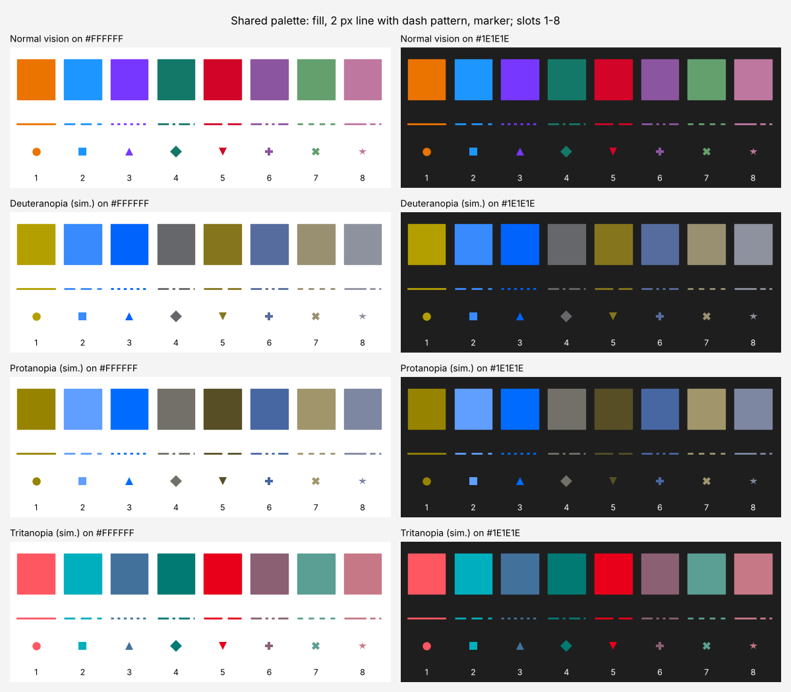
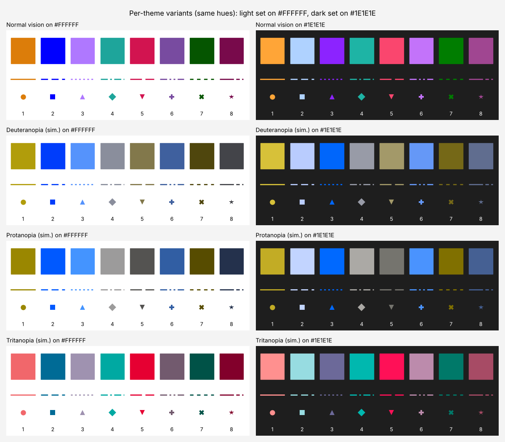

# C16: Keyboard accessibility and screen readers in CAD

Researched 2026-10-30. Brief file unavailable; scope taken from the task line. Nothing was run on Windows or with a screen reader; the colour palette and the C# sample were measured or compiled on Linux.

## Answer

Studio should expose its drawing as a UI Automation (UIA) tree, not a picture: the 2D/3D viewport as a Pane with Selection, Scroll and Transform (zoom); every drawn object as a UIA fragment (Custom control type with a localised type such as "building") with SelectionItem, Transform and Invoke, a Name that says what it is and how big, PositionInSet/SizeOfSet and ItemStatus; the properties panel as standard Edit, ComboBox and CheckBox controls with Value or RangeValue; nodes as Groups with ExpandCollapse, ports as focusable elements with Invoke and ControllerFor/FlowsTo relations; the data table as a DataGrid with Grid and Table on the container and GridItem/TableItem on cells. Arrow keys must move real UIA focus between canvas objects and raise AutomationFocusChanged, because NVDA's default "selective" event registration on Windows 11 22H2 and later listens to the focused element for most events. Command results ("Moved 3 objects 2 m east") go out as UIA Notification events (WPF `AutomationPeer.RaiseNotificationEvent`, .NET 6 or later, Windows 10 1709 or later). For keyboard-only drafting, copy AutoCAD's documented conventions: typed commands, Enter or Space to repeat, `@x,y` and `@d<a` entry, `#` for absolute points, Tab between dynamic-input fields, typed object-snap overrides, Ctrl+W/Shift+Space selection cycling and Ctrl+arrow nudge. Add the one thing only Blender documents among the four node editors surveyed: connecting nodes without a mouse ("Make Links", J). Measured: eight colours can meet 3:1 on both #FFFFFF and #1E1E1E only if their relative luminance lies between 0.139 and 0.300. Inside that band the chosen shared palette (#EB7300, #1E96FF, #7837FF, #147869, #D20528, #8C55A0, #64A06E, #BE78A0) keeps every pair at least 19.3 CAM02-UCS units apart for normal vision, 16.7 under simulated deuteranopia, 17.0 under protanopia and 16.5 under tritanopia. That clears the ≤12 "potential issue" line in Petroff's work but misses the 18 he enforced for eight-colour sets. Per-theme variants that keep the same hues reach 20.6 to 20.9. Main caveat: nothing here was tested with Narrator or NVDA on Windows. Also, under simulated protanopia the red slot falls to 2.0:1 on the dark background, so colour must always come with a line style, a marker shape and a text label.

## UI Automation map for Studio's surfaces

Control types and patterns come from Microsoft's mapping table [[2]](https://learn.microsoft.com/en-us/windows/win32/winauto/uiauto-controlpatternmapping) and pattern pages (cited per cell). Where a row says "Custom" or adds a pattern that the mapping table does not list for that type, that is this report's design choice, not a Microsoft rule. The Narrator and NVDA columns give only documented behaviour, and none of it was tested here.

| Studio surface | UIA control type | Control patterns to implement | Key properties | Events to raise | Narrator: announces or needs | NVDA: announces or needs |
|---|---|---|---|---|---|---|
| **2D/3D canvas (viewport)** | Pane (Scroll, Transform conditional, Window not supported [[2]](https://learn.microsoft.com/en-us/windows/win32/winauto/uiauto-controlpatternmapping)); LocalizedControlType "plan view" / "3D view" | Selection, CanSelectMultiple = true [[5]](https://learn.microsoft.com/en-us/windows/win32/winauto/uiauto-implementingselection); Scroll for pan, values 0 to 100, -1 when not scrollable, right-to-left aware [[14]](https://learn.microsoft.com/en-us/windows/win32/winauto/uiauto-implementingscroll); Transform2 for zoom (CanZoom, Zoom, ZoomLevel, ZoomMinimum/Maximum) [[3]](https://learn.microsoft.com/en-us/windows/win32/winauto/uiauto-implementingtransform) | Name ("Plan, 214 objects"); LocalizedControlType; HelpText (key help); FullDescription for scale and layer filter; AutomationId [[15]](https://learn.microsoft.com/en-us/windows/win32/winauto/uiauto-automation-element-propids) | Selection_Invalidated after large selection changes [[5]](https://learn.microsoft.com/en-us/windows/win32/winauto/uiauto-implementingselection); structure change after add/remove (WPF: `ResetChildrenCache`) [[23]](https://learn.microsoft.com/en-us/dotnet/api/system.windows.automation.peers.automationpeer?view=windowsdesktop-8.0); Notification for command results [[16]](https://learn.microsoft.com/en-us/windows/win32/api/uiautomationcoreapi/nf-uiautomationcoreapi-uiaraisenotificationevent) | Reads name, state and control type of each control; Caps Lock+arrows walks elements; developer mode (Ctrl+Caps Lock+F12) masks everything not exposed to UIA [[20]](https://learn.microsoft.com/en-us/windows/apps/design/accessibility/accessibility-testing) | Object navigation (NVDA+numpad 8/4/6/2) walks the hierarchy; screen review "may not see some or all text" drawn by newer technologies, so a GPU canvas is silent without UIA [[25]](https://download.nvaccess.org/documentation/userGuide.html) |
| **Canvas object** (building, plot, road) | Custom with LocalizedControlType "building" etc. (Custom *must* have a localised type string) [[15]](https://learn.microsoft.com/en-us/windows/win32/winauto/uiauto-automation-element-propids) | SelectionItem [[4]](https://learn.microsoft.com/en-us/windows/win32/winauto/uiauto-implementingselectionitem); Transform (Move/Resize/Rotate; required for children that move freely in a container) [[3]](https://learn.microsoft.com/en-us/windows/win32/winauto/uiauto-implementingtransform); Invoke = open properties, must not block [[6]](https://learn.microsoft.com/en-us/windows/win32/winauto/uiauto-implementinginvoke); ExpandCollapse for groups and blocks [[13]](https://learn.microsoft.com/en-us/windows/win32/winauto/uiauto-implementingexpandcollapse); ScrollItem to bring into view [[1]](https://learn.microsoft.com/en-us/windows/win32/winauto/uiauto-controlpatternsoverview) | Name = label + key size, no role word; ItemType (layer or use); ItemStatus ("locked", "clash"); PositionInSet/SizeOfSet; Level for nesting; DescribedBy to the properties panel; BoundingRectangle in screen pixels; IsOffscreen; stable AutomationId [[15]](https://learn.microsoft.com/en-us/windows/win32/winauto/uiauto-automation-element-propids) | AutomationFocusChanged when arrows move focus [[24]](https://learn.microsoft.com/en-us/dotnet/api/system.windows.automation.peers.automationevents?view=windowsdesktop-8.0); ElementSelected / AddedToSelection / RemovedFromSelection [[4]](https://learn.microsoft.com/en-us/windows/win32/winauto/uiauto-implementingselectionitem); PropertyChanged for Name, BoundingRectangle, ItemStatus (WPF `InvalidatePeer`) [[23]](https://learn.microsoft.com/en-us/dotnet/api/system.windows.automation.peers.automationpeer?view=windowsdesktop-8.0); Invoked [[6]](https://learn.microsoft.com/en-us/windows/win32/winauto/uiauto-implementinginvoke) | Name, state ("selected") and type on focus; Caps Lock+Enter runs the default action (Invoke) [[20]](https://learn.microsoft.com/en-us/windows/apps/design/accessibility/accessibility-testing) | Reports a navigated object "similarly to the way it reports the system focus"; "1 of 4" position when the setting is on (it can also guess) [[25]](https://download.nvaccess.org/documentation/userGuide.html) |
| **Properties panel** | Group per category (ExpandCollapse conditional) or Tree/TreeItem; fields as Edit, Spinner, ComboBox, CheckBox [[2]](https://learn.microsoft.com/en-us/windows/win32/winauto/uiauto-controlpatternmapping) | Value for free text [[7]](https://learn.microsoft.com/en-us/windows/win32/winauto/uiauto-implementingvalue); RangeValue for bounded numbers (Minimum, Maximum, SmallChange, LargeChange) [[8]](https://learn.microsoft.com/en-us/windows/win32/winauto/uiauto-implementingrangevalue); ComboBox: ExpandCollapse must, Selection and Value conditional; CheckBox: Toggle [[2]](https://learn.microsoft.com/en-us/windows/win32/winauto/uiauto-controlpatternmapping); ExpandCollapse on categories [[13]](https://learn.microsoft.com/en-us/windows/win32/winauto/uiauto-implementingexpandcollapse) | Name from the visible label via LabeledBy; HelpText for units and limits ("metres, 0.5 to 200"); IsRequiredForForm; IsDataValidForForm; IsReadOnly [[15]](https://learn.microsoft.com/en-us/windows/win32/winauto/uiauto-automation-element-propids)[[7]](https://learn.microsoft.com/en-us/windows/win32/winauto/uiauto-implementingvalue) | PropertyChanged for Value when changed by code (`RaisePropertyChangedEvent`) [[22]](https://learn.microsoft.com/en-us/dotnet/desktop/wpf/controls/ui-automation-of-a-wpf-custom-control); ExpandCollapseState via PropertyChanged [[13]](https://learn.microsoft.com/en-us/windows/win32/winauto/uiauto-implementingexpandcollapse); validation text through a LiveSetting region or Notification [[19]](https://learn.microsoft.com/en-us/archive/blogs/winuiautomation/can-your-desktop-app-leverage-the-new-uia-notification-event-in-order-to-have-narrator-say-exactly-what-your-customers-need) | Name, state and control type for every control; all visible content read [[20]](https://learn.microsoft.com/en-us/windows/apps/design/accessibility/accessibility-testing) | Reads the focused control; reports shortcut keys if exposed (setting) [[25]](https://download.nvaccess.org/documentation/userGuide.html) |
| **Node editor graph** | Pane, LocalizedControlType "node graph" | Selection, Scroll, Transform2 zoom, as for the canvas [[5]](https://learn.microsoft.com/en-us/windows/win32/winauto/uiauto-implementingselection)[[14]](https://learn.microsoft.com/en-us/windows/win32/winauto/uiauto-implementingscroll)[[3]](https://learn.microsoft.com/en-us/windows/win32/winauto/uiauto-implementingtransform) | Name ("Massing graph, 12 nodes, 15 connections"); HelpText [[15]](https://learn.microsoft.com/en-us/windows/win32/winauto/uiauto-automation-element-propids) | Structure change on node/wire add or remove [[23]](https://learn.microsoft.com/en-us/dotnet/api/system.windows.automation.peers.automationpeer?view=windowsdesktop-8.0); Notification "Connected Plot.Area to Sum.A" [[16]](https://learn.microsoft.com/en-us/windows/win32/api/uiautomationcoreapi/nf-uiautomationcoreapi-uiaraisenotificationevent) | Speaks the notification string exactly as supplied [[19]](https://learn.microsoft.com/en-us/archive/blogs/winuiautomation/can-your-desktop-app-leverage-the-new-uia-notification-event-in-order-to-have-narrator-say-exactly-what-your-customers-need) | Speaks UIA notification events (Windows uses them for volume changes since 1903) [[26]](https://github.com/nvaccess/nvda/issues/10626) |
| **Node** | Group (ExpandCollapse conditional) [[2]](https://learn.microsoft.com/en-us/windows/win32/winauto/uiauto-controlpatternmapping), LocalizedControlType "node" | ExpandCollapse to collapse the node [[13]](https://learn.microsoft.com/en-us/windows/win32/winauto/uiauto-implementingexpandcollapse); SelectionItem [[4]](https://learn.microsoft.com/en-us/windows/win32/winauto/uiauto-implementingselectionitem); Transform for move [[3]](https://learn.microsoft.com/en-us/windows/win32/winauto/uiauto-implementingtransform) | Name ("Sum, 2 inputs, 1 output"); ItemStatus ("error: input A unconnected", "stale"); PositionInSet/SizeOfSet; FlowsTo/FlowsFrom for data-flow reading order [[15]](https://learn.microsoft.com/en-us/windows/win32/winauto/uiauto-automation-element-propids) | Focus; selection events; PropertyChanged for ItemStatus and ExpandCollapseState [[13]](https://learn.microsoft.com/en-us/windows/win32/winauto/uiauto-implementingexpandcollapse) | As canvas object | As canvas object |
| **Port** | Custom, LocalizedControlType "input port" / "output port" | Invoke = start or finish a connection [[6]](https://learn.microsoft.com/en-us/windows/win32/winauto/uiauto-implementinginvoke); Value for the literal value of an unconnected input [[7]](https://learn.microsoft.com/en-us/windows/win32/winauto/uiauto-implementingvalue) | Name ("A, number input"); ItemStatus ("connected to Plot.Area" / "unconnected"); ControllerFor = downstream ports; FlowsTo [[15]](https://learn.microsoft.com/en-us/windows/win32/winauto/uiauto-automation-element-propids) | Focus; PropertyChanged for ItemStatus; Notification on connect/disconnect [[16]](https://learn.microsoft.com/en-us/windows/win32/api/uiautomationcoreapi/nf-uiautomationcoreapi-uiaraisenotificationevent) | As canvas object | As canvas object |
| **Wire (connection)** | ListItem inside a "connections" List under each port (SelectionItem must; Invoke conditional) [[2]](https://learn.microsoft.com/en-us/windows/win32/winauto/uiauto-controlpatternmapping) | SelectionItem; Invoke = jump to the other end [[6]](https://learn.microsoft.com/en-us/windows/win32/winauto/uiauto-implementinginvoke) | Name ("from Plot.Area to Sum.A"); PositionInSet/SizeOfSet; FlowsTo the target port [[15]](https://learn.microsoft.com/en-us/windows/win32/winauto/uiauto-automation-element-propids) | Structure change on add/remove [[23]](https://learn.microsoft.com/en-us/dotnet/api/system.windows.automation.peers.automationpeer?view=windowsdesktop-8.0) | List item name and position | "x of y" from PositionInSet/SizeOfSet [[25]](https://download.nvaccess.org/documentation/userGuide.html) |
| **Data table / grid** | DataGrid (Grid must; Scroll, Selection, Table conditional); rows and cells DataItem (SelectionItem must; GridItem, TableItem, Value conditional); headers HeaderItem [[2]](https://learn.microsoft.com/en-us/windows/win32/winauto/uiauto-controlpatternmapping) | Grid: RowCount, ColumnCount, GetItem; zero-based; empty cells still return an element [[9]](https://learn.microsoft.com/en-us/windows/win32/winauto/uiauto-implementinggrid); GridItem: Row, Column, spans, ContainingGrid [[10]](https://learn.microsoft.com/en-us/windows/win32/winauto/uiauto-implementinggriditem); Table: column/row headers, RowOrColumnMajor [[11]](https://learn.microsoft.com/en-us/windows/win32/winauto/uiauto-implementingtable); TableItem: header items per cell [[12]](https://learn.microsoft.com/en-us/windows/win32/winauto/uiauto-implementingtableitem); Spreadsheet/SpreadsheetItem if cells hold formulas [[1]](https://learn.microsoft.com/en-us/windows/win32/winauto/uiauto-controlpatternsoverview) | Table Name (caption); cell Name/Value; ItemStatus for invalid cells; IsReadOnly [[15]](https://learn.microsoft.com/en-us/windows/win32/winauto/uiauto-automation-element-propids) | Focus changes track cell traversal; structure changes when rows are added, removed or merged [[9]](https://learn.microsoft.com/en-us/windows/win32/winauto/uiauto-implementinggrid); PropertyChanged for Value | Must read "the table name, the table description (if available), and the row and column headings" [[20]](https://learn.microsoft.com/en-us/windows/apps/design/accessibility/accessibility-testing) | Row/column header reporting is a user setting; Ctrl+Alt+arrows move by cell in tables NVDA recognises [[25]](https://download.nvaccess.org/documentation/userGuide.html) |

## Detail

### 1. UI Automation patterns for a canvas, properties panel, node editor and table

**What UIA is for.** A control pattern "exposes a particular aspect of a control's functionality" to UIA clients such as screen readers. Patterns combine, so one element can be selectable, movable and invokable at once [[1]](https://learn.microsoft.com/en-us/windows/win32/winauto/uiauto-controlpatternsoverview). Microsoft names drawing tools directly when it describes Transform: "Typical uses for the Transform control pattern are in designers, forms, graphical editors, and drawing applications" [[1]](https://learn.microsoft.com/en-us/windows/win32/winauto/uiauto-controlpatternsoverview). Transform "must also be supported by the children of a container object if the children can be moved, resized, or rotated freely within the boundaries of the container" [[3]](https://learn.microsoft.com/en-us/windows/win32/winauto/uiauto-implementingtransform). That is exactly a plan canvas.

**Fragments, not pictures.** If Studio draws its canvas itself (a DrawingContext, Skia or Direct3D surface), the objects are not WPF UIElements, so WPF builds no peers for them. WPF does not even give Panel and Canvas peers [[22]](https://learn.microsoft.com/en-us/dotnet/desktop/wpf/controls/ui-automation-of-a-wpf-custom-control). The canvas peer must override `GetChildrenCore` and return one peer per object. The default implementation "traverses the visual tree", and custom controls "override this method to expose children elements to automation clients" [[22]](https://learn.microsoft.com/en-us/dotnet/desktop/wpf/controls/ui-automation-of-a-wpf-custom-control). For a single-select container whose children are fragments, Microsoft's guidance is that the container implements Selection and the children implement both the fragment interface and SelectionItem [[5]](https://learn.microsoft.com/en-us/windows/win32/winauto/uiauto-implementingselection)[[4]](https://learn.microsoft.com/en-us/windows/win32/winauto/uiauto-implementingselectionitem).

**Control type choice.** Microsoft prefers specific types over Custom: "UI Automation client products are unable to anticipate the control structure, keyboard interaction, and possible control patterns" of a Custom element [[22]](https://learn.microsoft.com/en-us/dotnet/desktop/wpf/controls/ui-automation-of-a-wpf-custom-control). No standard type describes a building on a plan, so this report uses Custom for canvas objects and ports. In return the provider *must* supply a LocalizedControlType ("for example, 'color picker'"), in lowercase and in the UI language [[15]](https://learn.microsoft.com/en-us/windows/win32/winauto/uiauto-automation-element-propids). Wires are modelled as ListItems in a per-port list, so that clients get a type they already understand.

**Name and the other text properties.** Name must not include the role ("button", "list"), because many clients append LocalizedControlType to Name [[15]](https://learn.microsoft.com/en-us/windows/win32/winauto/uiauto-automation-element-propids). So a building is Name "Block A, 2,450 square metres" plus type "building", not "Building Block A". HelpText fits key hints; ItemStatus fits per-item state ("Busy", "Connected" are Microsoft's examples); ItemType fits "what kind of item" (for Studio, the layer or land use); PositionInSet and SizeOfSet are 1-based and work together [[15]](https://learn.microsoft.com/en-us/windows/win32/winauto/uiauto-automation-element-propids). Relations matter in a node editor. ControllerFor is "an array of automation elements that are manipulated by" this element. FlowsTo and FlowsFrom give reading order "when automation elements are not exposed or structured in the same reading order as perceived by the user". DescribedBy points to another element that explains this one [[15]](https://learn.microsoft.com/en-us/windows/win32/winauto/uiauto-automation-element-propids). An output port is therefore ControllerFor its downstream inputs, and FlowsTo lets a screen reader follow data flow rather than screen position.

**Per-pattern rules that matter for CAD.**

- Invoke "is an asynchronous call and must return immediately without blocking", which matters if Invoke opens a dialog. Significant side effects belong in HelpText. A control that can only be invoked by a mouse side effect is "considered an accessibility issue" [[6]](https://learn.microsoft.com/en-us/windows/win32/winauto/uiauto-implementinginvoke).
- SelectionItem raises ElementSelected when the result is a single selected item, and AddedToSelection or RemovedFromSelection otherwise [[4]](https://learn.microsoft.com/en-us/windows/win32/winauto/uiauto-implementingselectionitem). Selection raises Invalidated "when a selection in a container has changed significantly" (for example Select All) [[5]](https://learn.microsoft.com/en-us/windows/win32/winauto/uiauto-implementingselection).
- Value is for values "not spanning a range" that can be strings. A slider-like range uses RangeValue instead [[7]](https://learn.microsoft.com/en-us/windows/win32/winauto/uiauto-implementingvalue)[[5]](https://learn.microsoft.com/en-us/windows/win32/winauto/uiauto-implementingselection). Neither has its own events, so changes go out as PropertyChanged [[7]](https://learn.microsoft.com/en-us/windows/win32/winauto/uiauto-implementingvalue)[[8]](https://learn.microsoft.com/en-us/windows/win32/winauto/uiauto-implementingrangevalue).
- Transform parameters "are absolute and independent of locale". Objects must not be moved "completely outside the coordinates of its container" [[3]](https://learn.microsoft.com/en-us/windows/win32/winauto/uiauto-implementingtransform). Transform2 adds CanZoom, Zoom, ZoomByUnit and ZoomLevel, which fits the viewport [[3]](https://learn.microsoft.com/en-us/windows/win32/winauto/uiauto-implementingtransform).
- Scroll: percentages are normalised 0 to 100. HorizontalScrollPercent is locale-specific: at 100 a right-to-left (Arabic) layout must be at its leftmost position [[14]](https://learn.microsoft.com/en-us/windows/win32/winauto/uiauto-implementingscroll). This matters for Studio's Gulf Cooperation Council (GCC) market.
- ExpandCollapse has no events of its own; ExpandCollapseState goes out through the generic property-changed event [[13]](https://learn.microsoft.com/en-us/windows/win32/winauto/uiauto-implementingexpandcollapse).
- Grid, GridItem, Table and TableItem: coordinates are zero-based; empty cells still return an element; Table "must also expose a column and/or row header relationship for each child element" [[9]](https://learn.microsoft.com/en-us/windows/win32/winauto/uiauto-implementinggrid)[[10]](https://learn.microsoft.com/en-us/windows/win32/winauto/uiauto-implementinggriditem)[[11]](https://learn.microsoft.com/en-us/windows/win32/winauto/uiauto-implementingtable)[[12]](https://learn.microsoft.com/en-us/windows/win32/winauto/uiauto-implementingtableitem). For formula cells, Spreadsheet and SpreadsheetItem extend Grid and GridItem [[1]](https://learn.microsoft.com/en-us/windows/win32/winauto/uiauto-controlpatternsoverview).
- Text is "for edit controls and documents that expose textual information" [[1]](https://learn.microsoft.com/en-us/windows/win32/winauto/uiauto-controlpatternsoverview). Studio's command line, if it has one, should be an Edit with Text and Value, and its history a Document or List.
- Drag and DropTarget exist for draggable items and drop targets [[1]](https://learn.microsoft.com/en-us/windows/win32/winauto/uiauto-controlpatternsoverview). They describe mouse drags. A keyboard "connect" command is more useful for wiring (Section 4).

**Events and why focus is the backbone.** NVDA's "Registration for UI Automation events and property changes" defaults to "Automatic", which means "'selective' on Windows 11 Sun Valley 2 (version 22H2) and later". In selective mode "NVDA will limit event registration to the system focus for most events" [[25]](https://download.nvaccess.org/documentation/userGuide.html). A property change on a canvas object that is not focused may therefore never reach NVDA. The design rule: arrow keys move a logical focus between objects; each move raises AutomationFocusChanged on the object's peer [[24]](https://learn.microsoft.com/en-us/dotnet/api/system.windows.automation.peers.automationevents?view=windowsdesktop-8.0); `HasKeyboardFocus` returns true for that object [[23]](https://learn.microsoft.com/en-us/dotnet/api/system.windows.automation.peers.automationpeer?view=windowsdesktop-8.0). Raise events only when a client listens (`AutomationPeer.ListenerExists`), which Microsoft recommends "to avoid unnecessary overhead" [[22]](https://learn.microsoft.com/en-us/dotnet/desktop/wpf/controls/ui-automation-of-a-wpf-custom-control).

**Notification vs live region.** The UIA Notification event came with the Windows 10 Fall Creators Update (`UiaRaiseNotificationEvent`, minimum Windows 10 version 1709) [[16]](https://learn.microsoft.com/en-us/windows/win32/api/uiautomationcoreapi/nf-uiautomationcoreapi-uiaraisenotificationevent). It carries a kind, a processing hint, a display string and an activity ID. The processing values are ImportantAll, ImportantMostRecent, All, MostRecent, CurrentThenMostRecent and, from Windows build 26100, ImportantCurrentThenMostRecent. Microsoft warns that ImportantAll "could cause a flooding of information" [[17]](https://learn.microsoft.com/en-us/windows/win32/api/uiautomationcore/ne-uiautomationcore-notificationprocessing). WPF exposes it as `AutomationPeer.RaiseNotificationEvent(kind, processing, displayString, activityId)` in .NET Framework 4.8.1 and Windows Desktop 6 to 11 [[18]](https://learn.microsoft.com/en-us/dotnet/api/system.windows.automation.peers.automationpeer.raisenotificationevent?view=windowsdesktop-8.0). Microsoft's UIA blog post (2017) shows Narrator speaking exactly the supplied string, without the sender's name or role. The same post warns that "if your app starts calling UiaRaiseNotificationEvent() too often, then your customers will soon find the experience irritating". It also advises against hijacking HelpText or SystemAlert to force speech [[19]](https://learn.microsoft.com/en-us/archive/blogs/winuiautomation/can-your-desktop-app-leverage-the-new-uia-notification-event-in-order-to-have-narrator-say-exactly-what-your-customers-need). Live regions (LiveSetting plus LiveRegionChanged) are for on-screen areas whose content changes, and WPF supports them from .NET Framework 4.7.1 [[19]](https://learn.microsoft.com/en-us/archive/blogs/winuiautomation/can-your-desktop-app-leverage-the-new-uia-notification-event-in-order-to-have-narrator-say-exactly-what-your-customers-need)[[24]](https://learn.microsoft.com/en-us/dotnet/api/system.windows.automation.peers.automationevents?view=windowsdesktop-8.0). Use a live region for a visible status bar ("Snap: Endpoint") and a Notification for transient results with no on-screen text ("Moved 3 objects 2 m east", "Area recalculated: 12,400 m²").

### 2. What Narrator and NVDA need, and how to test it

**Narrator.** Microsoft's test procedure: start Narrator with Windows+Ctrl+Enter; navigate with Tab, arrow keys and Caps Lock+arrows. For every control, "Narrator reads all visible content" and reads "each control's name, any applicable state (checked, selected, and so on), and the control type". Interactive elements must work with Caps Lock+Enter. Tables must give "the table name, the table description (if available), and the row and column headings". Caps Lock+Shift+Enter searches the app, and all controls should appear with localised names. Developer mode (Ctrl+Caps Lock+F12) "masks the screen and highlights only programmatically exposed accessible objects and text" [[20]](https://learn.microsoft.com/en-us/windows/apps/design/accessibility/accessibility-testing). Run that check on the canvas: if buildings are not highlighted, Narrator cannot reach them.

**NVDA (2026.3 user guide).** Object navigation lets a user "work with objects that cannot be accessed normally using the keyboard". Objects are hierarchical ("a list contains list items"), and the keys are NVDA+numpad 5 (report), 8 (parent), 4/6 (previous/next), 2 (first child), with laptop equivalents NVDA+Shift+arrows [[25]](https://download.nvaccess.org/documentation/userGuide.html). Studio's tree depth therefore matters: Canvas > Layer group > Object is navigable; a flat list of 20,000 objects is not. "Report object position information" speaks "1 of 4" when an object is reached; NVDA can also guess position information when it is missing, but the guess "may be slightly inaccurate", so expose PositionInSet/SizeOfSet [[25]](https://download.nvaccess.org/documentation/userGuide.html). Screen review reads text "as it appears visually", but "NVDA may not see some or all text displayed on the screen due to the use of newer screen drawing technologies" [[25]](https://download.nvaccess.org/documentation/userGuide.html). A GPU-drawn canvas has no fallback. NVDA speaks UIA notification events: Windows 10 1903 and later raise them for volume and brightness changes, and NVDA users heard them (and complained in Explorer) [[26]](https://github.com/nvaccess/nvda/issues/10626). "Report notifications" in Object Presentation covers help balloons and toast notifications [[25]](https://download.nvaccess.org/documentation/userGuide.html).

**Tools.** Microsoft recommends Accessibility Insights for Windows (Live Inspect, FastPass in "less than five minutes", Troubleshooting) over the older Inspect, AccEvent and AccScope tools. It also recommends running automated checks in pull requests and failing builds on critical issues [[20]](https://learn.microsoft.com/en-us/windows/apps/design/accessibility/accessibility-testing). AccEvent shows whether an event was actually raised before you try Narrator [[19]](https://learn.microsoft.com/en-us/archive/blogs/winuiautomation/can-your-desktop-app-leverage-the-new-uia-notification-event-in-order-to-have-narrator-say-exactly-what-your-customers-need).

### 3. How Blender, AutoCAD, Figma and VS Code expose canvases

| Product | What is documented (with date) | What Studio can take from it |
|---|---|---|
| **Figma** (web, React) | FigJam screen reader support, 16 May 2023: users "navigate FigJam files using the Tab key to jump between objects on the canvas"; sections give a hierarchy and appear in the Landmarks menu; not supported: cursor chat, stamps, voting, widgets, freeform vector nodes [[30]](https://www.figma.com/blog/announcing-figjam-screen-reader-support/). Figma Design keyboard features, 4 Aug 2025: arrow keys pan the canvas; arrow keys move a "pink cursor" between objects and Enter selects; keyboard selection box; frames placed with a "crosshair-guided view" [[32]](https://www.figma.com/blog/introducing-keyboard-accessibility-features/). 14 Oct 2025: "Canvas objects are now also accessible to screen readers", objects are heard "in order", announcements give type, name and state [[31]](https://www.figma.com/blog/introducing-screenreader-and-accessibility-features/). | Focusable canvas objects in a reading order; hierarchy through containers (sections, which for Studio would be layers or blocks); type + name + state announcements; a keyboard "cursor" for placing new geometry. The posts do not describe the implementation. |
| **VS Code** (Electron) | Accessible View (Alt+F2 on Windows) shows hovers, notifications, terminal output and chat "character by character, line by line"; Accessibility Help (Alt+F1) gives context-specific help; accessibility signals play sounds or announcements for line markers (errors, breakpoints), configured under `accessibility.signals.*`; `editor.accessibilitySupport` auto-detects a screen reader and switches to "Screen Reader Optimized" mode; tested with NVDA, JAWS, VoiceOver and Orca; page updated 28 Oct 2026 [[29]](https://code.visualstudio.com/docs/configure/accessibility/accessibility). | Studio's equivalents: an Accessible View of the selection or current view as plain text (counts, areas, adjacency); Alt+F1 help for the focused surface; earcons for snap acquired or clash detected; detect the screen reader and simplify (for example turn off hover-only previews). |
| **AutoCAD** | The command line accepts typed commands with AutoComplete and aliases; options appear in brackets with the letter to type; Enter or Space repeats the previous command (AutoCAD 2027 help) [[34]](https://help.autodesk.com/cloudhelp/2027/ENU/AutoCAD-OnBoarding/files/ACD_FOUNDATIONS_MAIN4.html). Autodesk publishes Section 508 VPATs (Voluntary Product Accessibility Templates); search results show "Autodesk AutoCAD 2026 VPAT" and "AutoCAD 2025 VPAT (pdf - 435Kb)" on its government page, but the page returned HTTP 403 to this research, so the contents are not verified [[33]](https://www.autodesk.com/solutions/government/section-508-accessibility-compliance). No Autodesk statement of screen reader support for the drawing area was found. | The command line is the strongest keyboard and screen-reader channel in CAD: text in, text out. Studio should have one, as an Edit with history, so that every prompt and result is readable. Publishing an ACR/VPAT is normal for CAD vendors that sell to governments. |
| **Blender** | No screen reader support documented. A 26 Nov 2021 post on Blender's developer forum reports that Blender "doesn't look like" it is "even visible to VoiceOver on MacOS Monterrey" [[43]](https://devtalk.blender.org/t/blender-and-accessibility-for-people-with-disabilities/5241/14). The Blender 5.2 LTS manual documents rich keyboard control of node editors (Section 4) [[41]](https://docs.blender.org/manual/en/latest/interface/controls/nodes/editing.html)[[42]](https://docs.blender.org/manual/en/latest/interface/controls/nodes/selecting.html). | Keyboard depth does not make an app screen-reader accessible; a self-drawn UI needs an explicit accessibility tree. No newer Blender status was found (Risks). |

### 4. Keyboard-only drafting conventions

AutoCAD conventions are documented in Autodesk's help. Studio users in the GCC who come from AutoCAD will expect them.

| Convention | AutoCAD behaviour (documented) | Proposal for Studio |
|---|---|---|
| Command entry | Typing completes command names automatically; aliases such as `c` for CIRCLE; options in brackets with the letter to type [[34]](https://help.autodesk.com/cloudhelp/2027/ENU/AutoCAD-OnBoarding/files/ACD_FOUNDATIONS_MAIN4.html) | Command line as a UIA Edit; option letters announced in the prompt text |
| Repeat last command | "You can also repeat the previous command by pressing Enter or the spacebar" [[34]](https://help.autodesk.com/cloudhelp/2027/ENU/AutoCAD-OnBoarding/files/ACD_FOUNDATIONS_MAIN4.html) | Same; announce the repeated command name |
| Absolute coordinates | Command line `x,y`; in dynamic input, `#` forces absolute ("The # is only needed, if you want to specify an absolute coordinate value when prompted for a next point") [[35]](https://help.autodesk.com/cloudhelp/2024/ENU/AutoCAD-DidYouKnow/files/GUID-683349C0-E5C2-4E16-8846-5523E71172A9.htm); "If you enter coordinates on the command line instead of in the tooltip, the # prefix is not used" [[36]](https://help.autodesk.com/cloudhelp/2018/ENU/AutoCAD-LT/files/GUID-58C1D97C-A9B3-4C3C-AC1B-95BE3DF2EDB9.htm) | Accept both; also accept project coordinates (e.g. UTM metres) with an explicit CRS prefix |
| Relative `@x,y` | "To specify relative coordinates, precede the coordinate values with an @ sign" [[36]](https://help.autodesk.com/cloudhelp/2018/ENU/AutoCAD-LT/files/GUID-58C1D97C-A9B3-4C3C-AC1B-95BE3DF2EDB9.htm); dynamic input defaults to "Polar Format and Relative Coordinates" for the next point [[35]](https://help.autodesk.com/cloudhelp/2024/ENU/AutoCAD-DidYouKnow/files/GUID-683349C0-E5C2-4E16-8846-5523E71172A9.htm) | Same |
| Polar `@d<a` | `@1<45` = 1 unit from the last point at 45° from the X axis; "angles increase in the counterclockwise direction"; negative angles go clockwise [[36]](https://help.autodesk.com/cloudhelp/2018/ENU/AutoCAD-LT/files/GUID-58C1D97C-A9B3-4C3C-AC1B-95BE3DF2EDB9.htm) | Same; also accept bearings (N45E) for surveyors, as an option |
| Dynamic input fields | "Instead of pressing comma to move to the next Dynamic Input tooltip, you can press Tab" [[35]](https://help.autodesk.com/cloudhelp/2024/ENU/AutoCAD-DidYouKnow/files/GUID-683349C0-E5C2-4E16-8846-5523E71172A9.htm); for a polar point, type the distance, Tab, then the angle and Enter (search result text, 2021 help) [[37]](https://help.autodesk.com/cloudhelp/2021/ENU/AutoCAD-LT/files/GUID-A265C30C-CFD8-405D-BEE2-257B379475E2.htm) | Make each tooltip field a real UIA Edit with a Name ("Length, metres") so the screen reader says which field Tab moved to |
| Object snap override | At a point prompt, "Enter a object snap by typing its name"; it applies to the next point only [[38]](https://help.autodesk.com/cloudhelp/2024/ENU/AutoCAD-LT-MAC/files/GUID-B3F53966-E1EA-4FD3-8F38-F60244B589EF.htm) | Same names (END, MID, CEN, INT, PER, NEA as in AutoCAD; the cited page points to the OSNAP list rather than listing them); announce the snapped point and the object it snapped to |
| Selection cycling | Ctrl+W toggles selection cycling; Shift+Spacebar is a temporary override; a list box shows the stacked objects [[39]](https://help.autodesk.com/cloudhelp/2022/ENU/AutoCAD-DidYouKnow/files/GUID-D6B80776-EB76-4B70-BAC3-1E3778B910DA.htm) | Same keys; expose the list box as a UIA List so overlapping objects are announced |
| Nudge | Preselect, hold Ctrl and press an arrow key; with Snap off objects move "by 3 pixels" so the distance depends on zoom; with Snap on, by the snap spacing (AutoCAD 2012, third-party test, 2011) [[40]](https://www.cadnauseam.com/tag/nudge/) | Ctrl+arrows nudge by a model distance in metres (grid step), never pixels, and announce the result by Notification |

**Proposed canvas keyboard model for Studio (design, not a standard).** Tab and Shift+Tab move between panes (toolbar, canvas, properties, table); they must not trap focus in the canvas. Microsoft's test asks for "a complete and logical Tab sequence" and "expected arrow-key navigation within composite controls" [[20]](https://learn.microsoft.com/en-us/windows/apps/design/accessibility/accessibility-testing). Inside the canvas: arrows move focus to the nearest object in that direction (Figma uses arrows for a selection cursor [[32]](https://www.figma.com/blog/introducing-keyboard-accessibility-features/)); Space selects; Ctrl+Space adds to the selection; Enter opens properties (Invoke); Ctrl+arrows nudge (AutoCAD); Ctrl+W / Shift+Space cycle stacked objects (AutoCAD); Alt+F1 gives help for the surface and Alt+F2 gives a text view (VS Code [[29]](https://code.visualstudio.com/docs/configure/accessibility/accessibility)). Panning and zooming use the Transform2 and Scroll patterns as well as keys.

### 5. Keyboard in node editors

| Editor | Documented keyboard support | Connecting nodes without a mouse? |
|---|---|---|
| **Unreal Engine Blueprints** (UE 5.8 docs) | Ctrl+F find, Ctrl+Shift+F find in all Blueprints, F7 compile, Home zoom to selection, PageDown/PageUp enter or leave a child graph, arrow keys move selected nodes, F2 rename, F9 breakpoint [[44]](https://dev.epicgames.com/documentation/en-us/unreal-engine/blueprint-editor-cheat-sheet-in-unreal-engine) | No. Pins connect by dragging; Alt+click breaks links; creating a node is "letter key + click" [[44]](https://dev.epicgames.com/documentation/en-us/unreal-engine/blueprint-editor-cheat-sheet-in-unreal-engine). An Epic engineer wrote in 2014: "There is no way to add new wires in the BP editor with just the keyboard" (old) [[45]](https://forums.unrealengine.com/t/keyboard-shortcuts/9320) |
| **Blender node editor** (5.2 LTS manual) | G/R/S transform; A select all, Alt+A none, Ctrl+I invert; L "Linked From" and Shift+L "Linked To" expand the selection along links; Shift+G select grouped; Shift+] / Shift+[ "Activate Same Type Previous/Next" cycles through nodes of one type and centres the view; Ctrl+F "Find Node" searches by name, socket label, warning messages or socket values [[42]](https://docs.blender.org/manual/en/latest/interface/controls/nodes/selecting.html) | **Yes.** "Make Links" (J): "Select multiple nodes with open sockets, then use the Make Links to create links between them"; "Make and Replace Links" (Shift+J) replaces existing links [[41]](https://docs.blender.org/manual/en/latest/interface/controls/nodes/editing.html). Cutting links (Ctrl+right-drag) is still a mouse gesture [[41]](https://docs.blender.org/manual/en/latest/interface/controls/nodes/editing.html) |
| **Grasshopper** (Rhino) | FAQ by its developer, 11 Aug 2012 (old): the Spacebar opens the wheel menu; the other listed shortcuts are mouse + modifier combinations (Shift-drag adds a wire, Ctrl-drag removes wires) [[46]](https://www.grasshopper3d.com/forum/topics/what-hotkeys-and-shortcuts-are-available-in-grasshopper) | No, in what was found |
| **Dynamo** (Primer appendix) | Ctrl+L clean up layout, Ctrl+G group, Ctrl+W note, Ctrl+0 zoom to fit, Delete, F1 node help, F5 run; Tab "adds nodes connected to the selection to the selection" [[47]](https://primer2.dynamobim.org/a_appendix/a-6_dynamo-keyboard-shortcuts) | No. Wires are made with Shift-drag from an output or Ctrl+click on an input [[47]](https://primer2.dynamobim.org/a_appendix/a-6_dynamo-keyboard-shortcuts) |

**What this means for Studio's node editor.** Three of the four tools need a mouse to wire nodes, so Studio cannot copy a convention for that part; it has to design one. A workable model built from the pieces above:

1. Focus a node (arrows move through nodes in data-flow order, which FlowsTo exposes).
2. Enter goes into the node's ports (child elements); Escape goes back up, as in NVDA's parent/child object model.
3. On an output port, "Connect" (for example C) opens a searchable list of compatible inputs, filtered by type, like Blender's Find Node [[42]](https://docs.blender.org/manual/en/latest/interface/controls/nodes/selecting.html).
4. Choosing one creates the wire and raises a Notification ("Connected Plot.Area to Sum.A").
5. A Blender-style "Make Links" on two selected nodes connects matching open sockets in one keystroke [[41]](https://docs.blender.org/manual/en/latest/interface/controls/nodes/editing.html).
6. A port's connection list (ListItems) lets the user jump along or delete a wire.

L / Shift+L to select upstream and downstream, as in Blender [[42]](https://docs.blender.org/manual/en/latest/interface/controls/nodes/selecting.html), and Dynamo's Ctrl+L tidy-up [[47]](https://primer2.dynamobim.org/a_appendix/a-6_dynamo-keyboard-shortcuts) cost little and help sighted keyboard users too.

### 6. C# examples: a custom AutomationPeer for a canvas item, and a Notification event

The full sample is [assets/C16/CanvasAutomation.cs](assets/C16/CanvasAutomation.cs) (270 lines) with [assets/C16/CanvasAutomationSample.csproj](assets/C16/CanvasAutomationSample.csproj). It was **compiled, not run**:

```text
$ dotnet build -c Release        # .NET SDK 8.0.427 on Linux, net8.0-windows, UseWPF, EnableWindowsTargeting=true
Build succeeded.
    0 Warning(s)
    0 Error(s)
```

How it works. The canvas is one `FrameworkElement` that draws everything itself. Its peer (`FrameworkElementAutomationPeer`, control type Pane, LocalizedControlType "plan view") implements `ISelectionProvider` and returns one `CanvasItemAutomationPeer` per object from `GetChildrenCore`. Peers are cached by object ID so that a client sees a stable element. The item peer derives directly from `AutomationPeer`, because objects are not UIElements. It must therefore implement every abstract `...Core` member, including `GetBoundingRectangleCore` in screen coordinates. WPF lists these members, plus `GetPositionInSetCore`/`GetSizeOfSetCore`, `InvalidatePeer`, `ResetChildrenCache` and `RaiseNotificationEvent`, on the AutomationPeer class [[23]](https://learn.microsoft.com/en-us/dotnet/api/system.windows.automation.peers.automationpeer?view=windowsdesktop-8.0). The pattern follows Microsoft's custom-control guidance: override OnCreateAutomationPeer, return `this` from GetPattern, override the Core methods, and raise events through the peer [[22]](https://learn.microsoft.com/en-us/dotnet/desktop/wpf/controls/ui-automation-of-a-wpf-custom-control).

```csharp
public sealed class CanvasItemAutomationPeer : AutomationPeer,
    ISelectionItemProvider, ITransformProvider, IInvokeProvider
{
    // identity: Name has no role word; Custom control type needs a localised type string
    protected override string GetNameCore() => $"{_item.Label}, {_item.AreaM2:#,0} square metres";
    protected override AutomationControlType GetAutomationControlTypeCore() => AutomationControlType.Custom;
    protected override string GetLocalizedControlTypeCore() => _item.Kind;          // "building"
    protected override string GetAutomationIdCore() => _item.Id;
    protected override string GetItemTypeCore() => _item.Layer;
    protected override string GetItemStatusCore() => _item.Locked ? "locked" : "";
    protected override int GetPositionInSetCore() => Canvas.Items.IndexOf(_item) + 1;  // "3 of 40"
    protected override int GetSizeOfSetCore() => Canvas.Items.Count;

    // geometry in screen coordinates
    protected override Rect GetBoundingRectangleCore()
    {
        if (PresentationSource.FromVisual(Canvas) == null) return Rect.Empty;
        Rect r = Canvas.ModelToElement(_item.Bounds);
        return new Rect(Canvas.PointToScreen(r.TopLeft), Canvas.PointToScreen(r.BottomRight));
    }

    // logical focus: keyboard focus stays on the canvas element
    protected override bool HasKeyboardFocusCore() => Canvas.IsKeyboardFocused && Canvas.FocusedItem == _item;
    protected override void SetFocusCore() => Canvas.FocusItem(_item);

    public override object? GetPattern(PatternInterface p) => p switch
    {
        PatternInterface.SelectionItem or PatternInterface.Transform or PatternInterface.Invoke => this,
        _ => null,
    };

    // ITransformProvider: UIA passes screen pixels; convert to model metres
    public bool CanMove => !_item.Locked;
    public void Move(double x, double y)
    {
        Point p = Canvas.PointFromScreen(new Point(x, y));
        _item.Bounds = new Rect(p.X / Canvas.Scale, p.Y / Canvas.Scale, _item.Bounds.Width, _item.Bounds.Height);
        Canvas.InvalidateVisual(); InvalidatePeer();   // re-reads Name and BoundingRectangle
    }
    // ... Select/AddToSelection/RemoveFromSelection, Resize, Rotate, Invoke, remaining Core members
}
```

Raising focus and a Notification from the canvas when the user moves between objects or nudges:

```csharp
// arrow key moved the logical focus
if (UIElementAutomationPeer.FromElement(this) is DrawingCanvasAutomationPeer cp
    && AutomationPeer.ListenerExists(AutomationEvents.AutomationFocusChanged))
    cp.PeerFor(FocusedItem).RaiseAutomationEvent(AutomationEvents.AutomationFocusChanged);

// Ctrl+arrow nudged the selection: say what happened without moving focus
cp.RaiseNotificationEvent(AutomationNotificationKind.ActionCompleted,
                          AutomationNotificationProcessing.MostRecent,   // a newer nudge supersedes an older one
                          $"Moved {moved.Count} objects {dist:0.##} m {dir}",
                          "Studio.Canvas.Nudge");                        // activityId: stable, not localised
```

`RaiseNotificationEvent` is in .NET Framework 4.8.1 and Windows Desktop 6 to 11 [[18]](https://learn.microsoft.com/en-us/dotnet/api/system.windows.automation.peers.automationpeer.raisenotificationevent?view=windowsdesktop-8.0) and needs Windows 10 1709 or later [[16]](https://learn.microsoft.com/en-us/windows/win32/api/uiautomationcoreapi/nf-uiautomationcoreapi-uiaraisenotificationevent). For older stacks, Microsoft's 2017 post gives a P/Invoke to `UiaRaiseNotificationEvent` that wraps the call in `try/catch (EntryPointNotFoundException)` [[19]](https://learn.microsoft.com/en-us/archive/blogs/winuiautomation/can-your-desktop-app-leverage-the-new-uia-notification-event-in-order-to-have-narrator-say-exactly-what-your-customers-need). When objects are added or removed, the sample calls `ResetChildrenCache()`, which "synchronously resets the tree of child elements by calling GetChildrenCore()" [[23]](https://learn.microsoft.com/en-us/dotnet/api/system.windows.automation.peers.automationpeer?view=windowsdesktop-8.0). Whether WPF then delivers a StructureChanged event to clients for fragment children must be checked with Accessibility Insights or AccEvent on Windows (Risks).

**WinUI 3 equivalent.** The same model applies in `Microsoft.UI.Xaml.Automation.Peers`: override `OnCreateAutomationPeer` (it "should do nothing more than initialize a new instance of your custom automation peer"), `GetPatternCore` returning the peer, `GetChildrenCore` for collections, and `GetLocalizedControlTypeCore` only when the type is Custom. Events go through `RaiseAutomationEvent` on the peer [[21]](https://learn.microsoft.com/en-us/windows/apps/design/accessibility/custom-automation-peers). UWP XAML, WinUI's predecessor, has had `AutomationPeer.RaiseNotificationEvent` for apps built for Windows 10 build 16299 or later [[19]](https://learn.microsoft.com/en-us/archive/blogs/winuiautomation/can-your-desktop-app-leverage-the-new-uia-notification-event-in-order-to-have-narrator-say-exactly-what-your-customers-need). The WinUI 3 equivalent was not checked here.

**Avalonia equivalent.** Override `OnCreateAutomationPeer` and return a `ControlAutomationPeer` subclass that overrides `GetAutomationControlTypeCore`, `GetNameCore`, `GetHelpTextCore` and related members. Avalonia lists UI Automation on Windows as "full" support and offers `AutomationProperties.LiveSetting` for announcements [[27]](https://docs.avaloniaui.net/docs/app-development/accessibility). Its provider folder showed ExpandCollapse, Invoke, RangeValue, Scroll, SelectionItem, Selection, Toggle and Value providers, but **no Transform, Grid or Table provider** in the listing seen (the listing may be truncated) [[28]](https://github.com/AvaloniaUI/Avalonia/tree/master/src/Avalonia.Controls/Automation/Provider). Its documentation page does not cover peers for non-control children or a Notification event [[27]](https://docs.avaloniaui.net/docs/app-development/accessibility). On the evidence found, Avalonia would cover the properties panel but not the canvas or table rows of the UIA map above.

### 7. Measured: an eight-colour categorical palette for light and dark themes

**Requirements and sources.**

- *Contrast.* WCAG 2.2 SC 1.4.11 requires "a contrast ratio of at least 3:1 against adjacent color(s)" for graphical objects needed to understand content. Ratios are not rounded ("2.999:1" fails). For line graphs, each line needs 3:1 against its background but lines "do not need to contrast with each other" [[48]](https://www.w3.org/WAI/WCAG22/Understanding/non-text-contrast.html).
- *Formulas.* Contrast ratio = (L1 + 0.05)/(L2 + 0.05). Relative luminance L = 0.2126 R + 0.7152 G + 0.0722 B, after sRGB linearisation with the 0.04045 threshold [[49]](https://www.w3.org/TR/WCAG22/).
- *Use of colour.* SC 1.4.1 also requires that "color is not used as the only visual means" of distinguishing a visual element [[49]](https://www.w3.org/TR/WCAG22/).
- *Backgrounds.* Light #FFFFFF. Dark #1E1E1E, the `editor.background` of Visual Studio Code's "Dark (Visual Studio)" theme [[52]](https://raw.githubusercontent.com/microsoft/vscode/main/extensions/theme-defaults/themes/dark_vs.json).
- *Colour-vision simulation and distance.* colorspacious `sRGB1+CVD` with severity 0 to 100 (100 = dichromacy) implements Machado et al. (2009). Its `deltaE` is Euclidean distance in CAM02-UCS by default [[51]](https://colorspacious.readthedocs.io/en/latest/reference.html).
- *Threshold.* Petroff (arXiv 2107.02270v3, 2024) used exactly this metric: CAM02-UCS ΔE′ after Machado simulation of deuteranopia, protanopia and tritanopia. He generated eight-colour sets with a **minimum perceptual distance of 18**, and in his tables "values ≤ 12 are set in bold purple text to indicate potential distinguishability issues". He also notes that the just-noticeable difference depends on mark size, citing Szafir (2018) [[50]](https://arxiv.org/abs/2107.02270). This report therefore uses **target ≥ 18, floor > 12**, measured as the minimum over all 28 pairs. All pairs, not neighbours, because any two layers can touch on a plan.

**Feasibility, measured.** #1E1E1E has relative luminance 0.01298. 3:1 against it needs L ≥ 3 × (0.01298 + 0.05) − 0.05 = **0.1389**. 3:1 against white needs L ≤ 1.05/3 − 0.05 = **0.3000**. So eight colours *can* meet 3:1 on both backgrounds, but only inside that luminance band, where contrast runs from 3.0 to 5.5 on each side. Of 140,608 grid colours (8-bit sRGB, step 5), 35,955 fall in the band and have CAM02-UCS colourfulness M′ ≥ 20.

**Search method** ([assets/C16/palette_search.py](assets/C16/palette_search.py)):

1. Filter the grid by both contrasts and the colourfulness floor.
2. Convert every candidate to CAM02-UCS for normal vision and for deuteranopia, protanopia and tritanopia at severity 100.
3. Maximin search. 400 random restarts of greedy farthest-point selection, then coordinate ascent: replace one slot at a time with the candidate that maximises its minimum distance to the other seven, until nothing improves.
4. A hue rule makes the eight colours nameable: any two must differ by at least 30° of CAM02-UCS hue.

Key part:

```python
def d_to(idx):  # distance from every candidate to colour idx = min over vision types
    return np.min([np.linalg.norm(S - S[idx], axis=1) for S in spaces], axis=0)
...
for i in range(n):                       # coordinate ascent, never lowers the objective
    others = [s for t, s in enumerate(sel) if t != i]
    dm = np.min([d_to(o) for o in others], axis=0) + mask_for(i, others)   # hue-gap mask
    j = int(np.argmax(dm))
    if dm[j] > current_min_distance_of(sel[i]): sel[i] = j; improved = True
```

Command and output for the chosen palette (seed 20261030; 1 min 31 s on the research machine; re-run after the final script edits and reproduced exactly):

```text
$ python3 palette_search.py shared --hue-gap 30 --with-tritan
{"mode": "shared", "objective_visions": ["normal","deutan","protan","tritan"], "hue_gap_deg": 30.0,
 "candidates_after_filters": 35955, "min_pairwise_dE_objective": 16.52,
 "palette": ["#D20528","#EB7300","#64A06E","#147869","#1E96FF","#7837FF","#8C55A0","#BE78A0"]}
```

Evaluation ([assets/C16/evaluate_palette.py](assets/C16/evaluate_palette.py), output in [assets/C16/palette_results.json](assets/C16/palette_results.json)) re-measures every candidate. It adds contrast after simulating both colour and background, a severity sweep (10, 20 … 100), CIEDE2000 (colour-science 0.4.7) as a cross-check, and a slot order in which every prefix keeps the largest minimum distance.

**Result: the shared palette, in assignment order.** Contrast is the WCAG ratio for the actual colour. "Sim. min" is the lowest ratio after simulating any of the three deficiencies. J′, M′ and h′ are CAM02-UCS lightness, colourfulness and hue.

| Slot | Name | Hex | vs #FFFFFF | vs #1E1E1E | Sim. min, light | Sim. min, dark | J′ | M′ | h′ (°) |
|---|---|---|---|---|---|---|---|---|---|
| 1 | orange | `#EB7300` | 3.01 | 5.54 | 2.66 | 4.44 | 66.7 | 33.9 | 55 |
| 2 | blue | `#1E96FF` | 3.06 | 5.45 | 2.66 | 4.96 | 61.9 | 33.6 | 247 |
| 3 | violet | `#7837FF` | 5.54 | 3.01 | 4.56 | 3.27 | 46.3 | 37.3 | 283 |
| 4 | teal | `#147869` | 5.36 | 3.11 | 4.94 | 2.94 | 46.1 | 20.2 | 182 |
| 5 | red | `#D20528` | 5.54 | 3.01 | 4.54 | 2.01 | 50.2 | 40.4 | 24 |
| 6 | purple | `#8C55A0` | 5.35 | 3.11 | 5.18 | 2.97 | 48.5 | 24.0 | 314 |
| 7 | green | `#64A06E` | 3.09 | 5.39 | 2.95 | 5.22 | 62.6 | 20.1 | 148 |
| 8 | pink | `#BE78A0` | 3.29 | 5.07 | 3.11 | 4.64 | 63.1 | 20.0 | 345 |

Minimum pairwise distance per vision type (all 28 pairs):

| Vision | Min ΔE′ CAM02-UCS (severity 100) | Min over severities 10 to 100 | Worst pair | Min CIEDE2000 (cross-check) |
|---|---|---|---|---|
| Normal | **19.25** | n/a | purple / pink | 16.07 |
| Deuteranopia | **16.71** | 16.55 | red / green | 11.43 |
| Protanopia | **16.97** | 16.97 | purple / pink | 10.37 |
| Tritanopia | **16.52** | 16.52 | purple / pink | 11.71 |

Pairwise ΔE′ matrix (minimum over the four vision types):

| | 1 | 2 | 3 | 4 | 5 | 6 | 7 | 8 |
|---|---|---|---|---|---|---|---|---|
| 1 orange | | 60.7 | 57.3 | 28.2 | 17.6 | 30.8 | 18.6 | 17.3 |
| 2 blue | | | 20.4 | 19.9 | 54.5 | 17.6 | 17.6 | 19.8 |
| 3 violet | | | | 19.5 | 53.7 | 18.9 | 23.7 | 31.7 |
| 4 teal | | | | | 18.0 | 17.7 | 17.8 | 18.0 |
| 5 red | | | | | | 37.3 | 16.7 | 30.7 |
| 6 purple | | | | | | | 33.8 | 16.5 |
| 7 green | | | | | | | | 17.2 |

Using only the first k slots keeps the minimum (all four vision types) at 60.7 (k = 2), 20.4 (3), 19.5 (4), 17.6 (5), 17.6 (6), 16.7 (7) and 16.5 (8). **Up to four categories meet Petroff's 18 target; five to eight meet the floor but not the target.**



**Comparison with alternatives (all measured with the same scripts).**

| Palette | Min contrast on #FFFFFF / #1E1E1E | Min ΔE′ normal / deutan / protan / tritan | Verdict |
|---|---|---|---|
| **Shared (recommended)** | 3.01 / 3.01 | 19.25 / 16.71 / 16.97 / 16.52 | Meets 3:1 on both; above floor; red and protan contrast caveat |
| Shared, max distance, no hue rule (`shared`, no tritan) | 3.00 / 3.01 | 19.46 / 19.29 / 19.34 / **4.28** | Hits 18 for red-green deficiencies, but all olive, green and blue (hard to name) and fails tritanopia |
| Shared, strict (`--sim-contrast`: 3:1 also after simulation) #FF2D41 #5F7800 #5A9B6E #057D78 #2387FF #7837FF #9650AA #CD6EA5 | 3.30 / 3.01 (≥ 3.00 under every simulation) | 18.96 / 14.26 / 14.79 / 14.29 (deutan 13.41 at a lower severity) | Contrast holds for colour-blind users too, at a cost of 2.3 ΔE′ |
| Per-theme, same hues (±12°): light set #DC7D0A #0000FF #AF78FF #1EA59B #D21450 #784BA0 #055500 #780A4B | 3.01 on #FFFFFF | 22.71 / 20.89 / 21.92 / 20.86 | Exceeds 18 |
| Per-theme, same hues: dark set #FFA537 #AFD2FF #8C23FF #1EB4A5 #FA466E #C373FA #007D00 #A04691 | 3.00 on #1E1E1E | 21.71 / 20.57 / 20.94 / 21.22 | Exceeds 18 |
| matplotlib `tab10`, first 8 (baseline from the installed library) | 2.53 / 2.82 | 20.21 / 5.17 / **2.38** / 11.13 | Fails contrast and red-green |
| Petroff's `petroff8` (baseline from matplotlib's style library) | **1.86** / 2.61 | 20.02 / 18.07 / 18.51 / 18.06 | Distances reproduce his ≥ 18 rule (a check on this pipeline), but it was designed for white only and fails 3:1 |

Commands for the other rows: `shared` (max distance), `shared --hue-gap 30 --with-tritan --sim-contrast` (strict), and for the per-theme sets `light --hues '<shared hex list>' --with-tritan --jmin 30 --restarts 200` and `dark --hues '<shared hex list>' --with-tritan --jmax 85 --restarts 200`. The per-theme sets reached 20.86 and 20.57 in the search objective.



**Reading the result.** Eight colours do meet 3:1 on both backgrounds at once, so the fallback in the task (per-theme variants) is not forced. But the narrow luminance band (0.139 to 0.300) costs distinctness: 16.5 instead of 18 or more. Per-theme variants with the same hues buy back about 4 ΔE′ (to 20.6 to 20.9). The price is two hex codes per slot and a lightness order that flips between themes (slot 2 is deep blue on white and pale blue on dark). That makes documentation, exported PDFs and "the blue layer" in conversation less stable. Recommendation: ship the shared palette, assign slots in the order above, and always pair each slot with a fixed dash pattern and marker shape (as in the swatch image). The worst pairs are purple/pink (normal, protan, tritan) and red/green (deutan). Thin 2 px lines show less difference than fills (visible in the swatch image; Petroff notes the size effect [[50]](https://arxiv.org/abs/2107.02270)). Pairing with line style is required anyway by SC 1.4.1 [[49]](https://www.w3.org/TR/WCAG22/), and the Narrator/NVDA layer must expose the category by name (ItemType), never by colour.

## Risks and open questions

- **Not tested on Windows.** No Narrator, NVDA or Accessibility Insights run was possible here. Untested: whether WPF delivers focus events and StructureChanged for fragment peers that derive directly from `AutomationPeer`; how Narrator and NVDA voice a Custom element with a LocalizedControlType such as "building"; and whether NVDA's selective registration drops property changes on non-focused objects in practice. These are the first things to verify.
- **Tree size and performance.** A masterplan can hold tens of thousands of objects. This research did not measure how UIA clients cope with very large child lists. Microsoft offers `IsOffscreen` and `OptimizeForVisualContent` ("exposes only elements that are visible") [[15]](https://learn.microsoft.com/en-us/windows/win32/winauto/uiauto-automation-element-propids). Grouping by layer or block keeps NVDA's object navigation usable. A budget (objects per level) is still an open question.
- **Arabic and right-to-left layouts.** Scroll percentages flip in right-to-left layouts [[14]](https://learn.microsoft.com/en-us/windows/win32/winauto/uiauto-implementingscroll). Narrator's and NVDA's Arabic voices and mixed Arabic/Latin names were not researched.
- **Palette caveats.** CVD simulation is a model; real anomalous trichromats vary. Simulated contrast drops below 3:1 for six colour/background combinations (lowest: red on #1E1E1E for protanopia, 2.01). The strict variant fixes that but lowers distinctness to 14.3. Distances were measured for flat colours, not antialiased 1 to 2 px lines; no just-noticeable-difference value for thin lines was found here. Monitor gamut, Windows HDR and printing were not considered. The search used a step-5 grid, so a finer search might add a few tenths.
- **Second dark background.** Results are for #1E1E1E only. A darker or lighter dark theme moves the luminance floor (0.139) and needs a re-run of the script.
- **AutoCAD VPAT not read.** Autodesk's VPAT page returned HTTP 403. Its listing of AutoCAD 2025/2026 VPATs comes from search results only, and their contents (including any screen reader claims) are not verified.
- **Blender status after 2021 not found.** No current statement from Blender developers on screen reader support was found; the web search budget ran out before a deeper search.
- **Old or third-party sources.** The Grasshopper (2012) and Unreal forum (2014) statements are old. The nudge pixel distance comes from a 2011 third-party test (3 pixels; one search summary said 2, so sources disagree). The AutoCAD polar-entry Tab behaviour comes from search-result text of the 2021 help.
- **Avalonia coverage.** The Avalonia provider listing seen lacked Transform, Grid and Table providers. Confirm against current Avalonia source before choosing it for the canvas or table.
- **Native AOT.** WPF's compatibility with Native AOT (an open question for Studio) was not researched here.

## Sources

1. UI Automation Control Patterns Overview. Microsoft Learn. https://learn.microsoft.com/en-us/windows/win32/winauto/uiauto-controlpatternsoverview. Read 2026-10-30.
2. Control Types and Their Supported Control Patterns. Microsoft Learn. https://learn.microsoft.com/en-us/windows/win32/winauto/uiauto-controlpatternmapping. Read 2026-10-30.
3. Transform Control Pattern. Microsoft Learn. https://learn.microsoft.com/en-us/windows/win32/winauto/uiauto-implementingtransform. Read 2026-10-30.
4. SelectionItem Control Pattern. Microsoft Learn. https://learn.microsoft.com/en-us/windows/win32/winauto/uiauto-implementingselectionitem. Read 2026-10-30.
5. Selection Control Pattern. Microsoft Learn. https://learn.microsoft.com/en-us/windows/win32/winauto/uiauto-implementingselection. Read 2026-10-30.
6. Invoke Control Pattern. Microsoft Learn. https://learn.microsoft.com/en-us/windows/win32/winauto/uiauto-implementinginvoke. Read 2026-10-30.
7. Value Control Pattern. Microsoft Learn. https://learn.microsoft.com/en-us/windows/win32/winauto/uiauto-implementingvalue. Read 2026-10-30.
8. RangeValue Control Pattern. Microsoft Learn. https://learn.microsoft.com/en-us/windows/win32/winauto/uiauto-implementingrangevalue. Read 2026-10-30.
9. Grid Control Pattern. Microsoft Learn. https://learn.microsoft.com/en-us/windows/win32/winauto/uiauto-implementinggrid. Read 2026-10-30.
10. GridItem Control Pattern. Microsoft Learn. https://learn.microsoft.com/en-us/windows/win32/winauto/uiauto-implementinggriditem. Read 2026-10-30.
11. Table Control Pattern. Microsoft Learn. https://learn.microsoft.com/en-us/windows/win32/winauto/uiauto-implementingtable. Read 2026-10-30.
12. TableItem Control Pattern. Microsoft Learn. https://learn.microsoft.com/en-us/windows/win32/winauto/uiauto-implementingtableitem. Read 2026-10-30.
13. ExpandCollapse Control Pattern. Microsoft Learn. https://learn.microsoft.com/en-us/windows/win32/winauto/uiauto-implementingexpandcollapse. Read 2026-10-30.
14. Scroll Control Pattern. Microsoft Learn. https://learn.microsoft.com/en-us/windows/win32/winauto/uiauto-implementingscroll. Read 2026-10-30.
15. Automation Element Property Identifiers. Microsoft Learn. https://learn.microsoft.com/en-us/windows/win32/winauto/uiauto-automation-element-propids. Read 2026-10-30.
16. UiaRaiseNotificationEvent function. Microsoft Learn. https://learn.microsoft.com/en-us/windows/win32/api/uiautomationcoreapi/nf-uiautomationcoreapi-uiaraisenotificationevent. Read 2026-10-30.
17. NotificationProcessing enumeration. Microsoft Learn. https://learn.microsoft.com/en-us/windows/win32/api/uiautomationcore/ne-uiautomationcore-notificationprocessing. Read 2026-10-30.
18. AutomationPeer.RaiseNotificationEvent Method (WPF). Microsoft Learn. https://learn.microsoft.com/en-us/dotnet/api/system.windows.automation.peers.automationpeer.raisenotificationevent?view=windowsdesktop-8.0. Read 2026-10-30.
19. Can your desktop app leverage the new UIA Notification event in order to have Narrator say exactly what your customers need? Guy Barker, Microsoft UI Automation blog (archived), 2017-11-08. https://learn.microsoft.com/en-us/archive/blogs/winuiautomation/can-your-desktop-app-leverage-the-new-uia-notification-event-in-order-to-have-narrator-say-exactly-what-your-customers-need. Read 2026-10-30. Old (2017); WPF section predates native support.
20. Accessibility testing (Windows apps). Microsoft Learn, 2026-07-22. https://learn.microsoft.com/en-us/windows/apps/design/accessibility/accessibility-testing. Read 2026-10-30.
21. Custom automation peers (Windows apps / WinUI). Microsoft Learn, 2026-08-21. https://learn.microsoft.com/en-us/windows/apps/design/accessibility/custom-automation-peers. Read 2026-10-30.
22. UI Automation of a Custom Control (WPF). Microsoft Learn (content dated 2017-03-30, updated 2025-08-27). https://learn.microsoft.com/en-us/dotnet/desktop/wpf/controls/ui-automation-of-a-wpf-custom-control. Read 2026-10-30. Old (2017) content.
23. AutomationPeer Class (System.Windows.Automation.Peers). Microsoft Learn. https://learn.microsoft.com/en-us/dotnet/api/system.windows.automation.peers.automationpeer?view=windowsdesktop-8.0. Read 2026-10-30.
24. AutomationEvents Enum (System.Windows.Automation.Peers). Microsoft Learn. https://learn.microsoft.com/en-us/dotnet/api/system.windows.automation.peers.automationevents?view=windowsdesktop-8.0. Read 2026-10-30.
25. NVDA 2026.3 User Guide. NV Access. https://download.nvaccess.org/documentation/userGuide.html. Read 2026-10-30.
26. Issue #10626 "Annoying volume announcement in Explorer window". NV Access, GitHub, 2019-12-14 to 2023-05-07. https://github.com/nvaccess/nvda/issues/10626. Read 2026-10-30.
27. Accessibility. Avalonia documentation. https://docs.avaloniaui.net/docs/app-development/accessibility. Read 2026-10-30.
28. Avalonia source: src/Avalonia.Controls/Automation/Provider. AvaloniaUI, GitHub. https://github.com/AvaloniaUI/Avalonia/tree/master/src/Avalonia.Controls/Automation/Provider. Read 2026-10-30. Listing may be truncated.
29. Accessibility. Visual Studio Code documentation, updated 2026-10-28. https://code.visualstudio.com/docs/configure/accessibility/accessibility. Read 2026-10-30.
30. Announcing FigJam screen reader support. Figma blog, 2023-05-16. https://www.figma.com/blog/announcing-figjam-screen-reader-support/. Read 2026-10-30.
31. Introducing screen reader and accessibility features. Figma blog, 2025-10-14. https://www.figma.com/blog/introducing-screenreader-and-accessibility-features/. Read 2026-10-30.
32. Introducing keyboard accessibility features. Figma blog, 2025-08-04. https://www.figma.com/blog/introducing-keyboard-accessibility-features/. Read 2026-10-30.
33. Accessibility Conformance Reports for Autodesk Offerings. Autodesk. https://www.autodesk.com/solutions/government/section-508-accessibility-compliance. Read 2026-10-30. Not verified: page blocked (HTTP 403); listing seen in search results only.
34. AutoCAD Foundations, 4. Start Working with Commands. Autodesk AutoCAD 2027 help. https://help.autodesk.com/cloudhelp/2027/ENU/AutoCAD-OnBoarding/files/ACD_FOUNDATIONS_MAIN4.html. Read 2026-10-30.
35. Coordinate Entry with Dynamic Input. Autodesk AutoCAD 2024 help. https://help.autodesk.com/cloudhelp/2024/ENU/AutoCAD-DidYouKnow/files/GUID-683349C0-E5C2-4E16-8846-5523E71172A9.htm. Read 2026-10-30.
36. About Entering 2D Polar Coordinates. Autodesk AutoCAD LT 2018 help. https://help.autodesk.com/cloudhelp/2018/ENU/AutoCAD-LT/files/GUID-58C1D97C-A9B3-4C3C-AC1B-95BE3DF2EDB9.htm. Read 2026-10-30. Old (2017 release).
37. To Enter Coordinate Values in the Pointer Input Tooltip. Autodesk AutoCAD LT 2021 help. https://help.autodesk.com/cloudhelp/2021/ENU/AutoCAD-LT/files/GUID-A265C30C-CFD8-405D-BEE2-257B379475E2.htm. Read 2026-10-30. Search-result text only; page not opened.
38. Object Snaps (Command Modifier). Autodesk AutoCAD LT for Mac 2024 help. https://help.autodesk.com/cloudhelp/2024/ENU/AutoCAD-LT-MAC/files/GUID-B3F53966-E1EA-4FD3-8F38-F60244B589EF.htm. Read 2026-10-30.
39. Work with Stacked Objects. Autodesk AutoCAD 2022 help. https://help.autodesk.com/cloudhelp/2022/ENU/AutoCAD-DidYouKnow/files/GUID-D6B80776-EB76-4B70-BAC3-1E3778B910DA.htm. Read 2026-10-30.
40. Tag archive "Nudge" (AutoCAD 2012 nudge posts). Steve Johnson, CADnauseam, 2011-03-29. https://www.cadnauseam.com/tag/nudge/. Read 2026-10-30. Third party; old (2011).
41. Editing Nodes. Blender 5.2 LTS Manual. https://docs.blender.org/manual/en/latest/interface/controls/nodes/editing.html. Read 2026-10-30.
42. Selecting Nodes. Blender 5.2 LTS Manual. https://docs.blender.org/manual/en/latest/interface/controls/nodes/selecting.html. Read 2026-10-30.
43. "Blender and accessibility for people with disabilities", post #14. Blender Developer Forum (user post by cmaury), 2021-11-26. https://devtalk.blender.org/t/blender-and-accessibility-for-people-with-disabilities/5241/14. Read 2026-10-30. Third party (user report).
44. Blueprint Editor Cheat Sheet. Epic Games, Unreal Engine 5.8 documentation. https://dev.epicgames.com/documentation/en-us/unreal-engine/blueprint-editor-cheat-sheet-in-unreal-engine. Read 2026-10-30.
45. "Keyboard shortcuts?" Unreal Engine forums, reply by Michael Noland (Epic), 2014-08-13. https://forums.unrealengine.com/t/keyboard-shortcuts/9320. Read 2026-10-30. Old (2014).
46. "What hotkeys and shortcuts are available in Grasshopper?" David Rutten, Grasshopper3d forum FAQ, 2012-08-11. https://www.grasshopper3d.com/forum/topics/what-hotkeys-and-shortcuts-are-available-in-grasshopper. Read 2026-10-30. Old (2012).
47. A-6 Dynamo keyboard shortcuts. Dynamo Primer. https://primer2.dynamobim.org/a_appendix/a-6_dynamo-keyboard-shortcuts. Read 2026-10-30.
48. Understanding Success Criterion 1.4.11: Non-text Contrast. W3C WAI (WCAG 2.2). https://www.w3.org/WAI/WCAG22/Understanding/non-text-contrast.html. Read 2026-10-30.
49. Web Content Accessibility Guidelines (WCAG) 2.2 (definitions of relative luminance and contrast ratio; SC 1.4.1). W3C. https://www.w3.org/TR/WCAG22/. Read 2026-10-30.
50. Accessible Color Sequences for Data Visualization. Matthew A. Petroff, arXiv:2107.02270v3, 2024-02-29 (v1 2021). https://arxiv.org/abs/2107.02270. Read 2026-10-30 (PDF of v3).
51. colorspacious reference documentation. Nathaniel J. Smith et al. https://colorspacious.readthedocs.io/en/latest/reference.html. Read 2026-10-30.
52. dark_vs.json ("Dark (Visual Studio)" theme). Microsoft, VS Code repository on GitHub. https://raw.githubusercontent.com/microsoft/vscode/main/extensions/theme-defaults/themes/dark_vs.json. Read 2026-10-30.

## Choices made

- Inferred, not known: Studio is a Windows desktop C# (.NET) urban-design application for the GCC; it has a 2D/3D canvas with 3D massing, a properties panel, a node editor, a data table, and light and dark themes; Native AOT is under consideration. Studio's source was not seen; nothing here describes its internals.
- Assumed WPF as Studio's UI framework for the C# sample (most common for C# desktop CAD on Windows) and gave WinUI 3 and Avalonia notes instead of full samples.
- Assumed the canvas is self-drawn (objects are not UIElements), so the sample uses fragment peers that derive directly from `AutomationPeer`.
- Chose Pane for the canvas and node graph, Custom (with a localised type) for canvas objects and ports, Group for nodes and ListItem for wires. Microsoft's mapping does not cover CAD objects; these are design choices within it.
- Proposed a canvas keyboard model (arrows = focus, Space = select, Ctrl+arrows = nudge, Enter = properties) that mixes AutoCAD, Figma and VS Code conventions; it is a proposal, not a published standard.
- Dark background #1E1E1E (VS Code's "Dark (Visual Studio)" editor background) as the "typical dark theme colour"; light #FFFFFF as instructed.
- Colour difference metric: CAM02-UCS ΔE′ (colorspacious default), with CIEDE2000 only as a cross-check, because the threshold source (Petroff) uses CAM02-UCS.
- Threshold: target ≥ 18 and floor > 12, both from Petroff's eight-colour work; tested over all 28 pairs, not only neighbours, because any two layers can touch on a plan.
- Optimised for normal + deuteranopia + protanopia + tritanopia (the task required normal and deuteranopia). Tritanopia was added to the objective because the no-tritan optimum collapsed to 4.3 for tritanopes.
- Added a colourfulness floor (CAM02-UCS M′ ≥ 20) so no slot is near-grey, and a 30° hue gap so the eight colours are nameable. Measured cost: from 18.0 to 16.5 (with tritan in the objective).
- Picked the 16.52 result (red, orange, green, teal, blue, violet, purple, pink) over a 16.70 result found with another seed (brown and ochre instead of red and orange): the 0.18 difference is within search noise, and red and orange are easier to name.
- WCAG contrast judged on actual colours, as WCAG defines it; simulated contrast reported as extra information, with a strict variant.
- Per-theme variants: hue kept within ±12° of the shared slot; J′ ≥ 30 on light and J′ ≤ 85 on dark, to avoid near-black and near-white (these limits are a judgement call).
- Candidate grid step of 5 per channel (140,608 colours) rather than all 16.7 million, for run time; 400 restarts per search.
- Used the newest Autodesk help page found for each convention (2018 to 2027 releases) where no 2026/2027 page was found.

## What Studio should do

1. **[M] [COMPLETES]** Give the canvas a UIA tree: a Pane peer with Selection, Scroll and Transform2, and one fragment peer per object (Custom + localised type, SelectionItem, Transform, Invoke, Name with label and size, ItemType, ItemStatus, PositionInSet/SizeOfSet), grouped by layer. Without it, Narrator and NVDA see an empty pane. (Sections 1, 6; [assets/C16/CanvasAutomation.cs](assets/C16/CanvasAutomation.cs))
2. **[S] [COMPLETES]** Make arrow keys move a logical focus between canvas objects and nodes, and raise AutomationFocusChanged each time. NVDA's default selective registration mainly hears the focused element, and both screen readers announce focus. (Sections 1, 2)
3. **[S] [COMPLETES]** Adopt the shared palette in assignment order (#EB7300, #1E96FF, #7837FF, #147869, #D20528, #8C55A0, #64A06E, #BE78A0), with a fixed dash pattern and marker per slot. Expose the category name through UIA (ItemType), never colour alone. Re-run `palette_search.py` if the dark background changes. (Section 7)
4. **[M] [COMPLETES]** Properties panel: standard controls only, Name through LabeledBy, units and limits in HelpText, RangeValue for bounded numbers, ExpandCollapse categories, and validation messages through a live region or Notification. (Section 1)
5. **[M] [COMPLETES]** Data table: use a DataGrid that implements Grid + Table on the container and GridItem + TableItem + Value on cells, with real header items; verify that Narrator reads table name and row/column headings. (Sections 1, 2)
6. **[M] [COMPLETES]** Node editor: nodes as Groups with ExpandCollapse and ItemStatus, ports with Invoke/Value and ControllerFor/FlowsTo, per-port connection lists, and a keyboard "Connect" command with a filtered port picker plus a Blender-style "Make Links". (Sections 1, 5)
7. **[M] [COMPLETES]** Keyboard drafting parity with AutoCAD: command line as a UIA Edit with history, Enter/Space repeat, `x,y`, `#x,y`, `@x,y`, `@d<a`, Tab between dynamic-input fields (each a named Edit), typed snap overrides, Ctrl+W/Shift+Space selection cycling, and Ctrl+arrow nudge in metres. (Section 4)
8. **[S] [COMPLETES]** One helper that raises UIA Notification events for command results (ActionCompleted, MostRecent, stable activity IDs), rate-limited, with live regions kept for visible status text. (Sections 1, 6)
9. **[S] [NEW]** Add VS Code-style Accessibility Help (Alt+F1) and a text Accessible View (Alt+F2) of the current selection or view (counts, areas, adjacency), plus optional sounds for snap and clash. (Section 3)
10. **[S] [NEW]** Make accessibility a release gate: Accessibility Insights FastPass in CI, a scripted Narrator and NVDA pass on Windows over the canvas, properties, node editor and table, then an Accessibility Conformance Report (VPAT) as Autodesk publishes for AutoCAD. (Sections 2, 3)
