# C19: Flow visual redesign

Researched and drawn on 2026-11-01. The brief is [briefs/C19-flow-visual-redesign.md](../../briefs/C19-flow-visual-redesign.md) and the seven screenshots are in [briefs/C19-images/](../../briefs/C19-images/). No Studio code was asked for or seen.

## Answer

Flow looks dated for five reasons:
- its node text renders at about 8 px in the docked panel, although the toolbar says 100%;
- a saturated navy body sits under a neutral grey header;
- the brand orange is spent on a canvas frame, strips, ports, buttons and status pills all at once;
- labels and count badges collide with wires and with each other;
- states are drawn as thick borders and side strips.

The redesign keeps the orange but uses it only for selection, focus and the Run button. On screenshot 01 the share of orange pixels falls from 1.36 to 0.37 percent (measured). It moves to a calmer slate palette, and every text and port colour passes its contrast check in both themes. Nodes become quiet cards:
- 8 px corners and a 32 px header with a category icon;
- 24 px rows with outputs first;
- count badges inside the node;
- ports shaped by data kind;
- state shown by badges and an attached message tray.

Merging the two property panels widens the canvas from 592 to 820 px in a 1440 px window.

The ten quick wins in section 5 are all size S or M. Together they deliver most of the "modern" jump without touching how Flow works.

## What is in this folder

| File | What it is |
|---|---|
| `C19-flow-visual-redesign.md` | This report |
| `tokens.json` | Every colour, size, type style and zoom rule in the spec, dark and light |
| `mockups/*.html` | The mockup pages. Each one is self-contained apart from `tokens.css`, `chrome.css`, `fonts/` and `icons/` |
| `mockups/png/*.png` | The rendered mockups and the before/after pairs |
| `mockups/tokens.css` | `tokens.json` as CSS variables, generated |
| `tools/` | Generators: `build_tokens.py` (tokens and contrast checks), `pick_kind_colours.py` (data-kind colour search), `flowsvg.py` and `build_mockups.py` (drawing), `render.js` (PNG export) |
| `research/` | The full research notes for 17 tools, 268 numbers with sources (`numbers.json`) and 195 sources (`sources.json`) |

To rebuild the PNGs:

```
python3 tools/build_tokens.py
python3 tools/build_mockups.py
node tools/render.js
```

The mockups use only rounded rectangles, lines, cubic curves, text and Tabler outline icons, so each one maps onto Avalonia's `DrawingContext`.

## 1. What makes modern node tools look modern

Two research passes read the tools' own source code, documentation and design posts on 2026-10-31. The full notes, with every number and link, are in [research/R1-node-editors.md](research/R1-node-editors.md) and [research/R2-flow-tools-and-apps.md](research/R2-flow-tools-and-apps.md). The table gives the one lesson per tool that shaped this spec.

| Tool | What makes it look modern | What Flow takes |
|---|---|---|
| ComfyUI new frontend (v1.60) | States are drawn outside the node: a 3 px selection ring, a 4 px error ring, an 8 px progress bar. The fill and header never change colour ([LGraphNode.vue](https://github.com/Comfy-Org/ComfyUI_frontend/blob/834cce976e330fedaa7f85f5aab930d7b8a205e8/src/renderer/extensions/vueNodes/components/LGraphNode.vue#L15-L93)). Detail drops when 14 px text would fall under 8 px on screen ([LGraphCanvas.ts](https://github.com/Comfy-Org/ComfyUI_frontend/blob/834cce976e330fedaa7f85f5aab930d7b8a205e8/src/lib/litegraph/src/LGraphCanvas.ts#L783-L801)) | State as badges and rings, never a repainted header; level of detail tied to readable text |
| Blender Geometry Nodes 5.2 | Headers were muted hard between 4.5 and 5.x: Geometry went from `#00D6A3` to `#1D725E` ([4.5 theme](https://projects.blender.org/blender/blender/src/branch/blender-v4.5-release/release/datafiles/userdef/userdef_default_theme.c#L843-L909), [5.2 theme](https://projects.blender.org/blender/blender/src/branch/blender-v5.2-release/release/datafiles/userdef/userdef_default_theme.c#L652-L698)). Nodes are "more flat with less of a drop-shadow" ([5.0 notes](https://developer.blender.org/docs/release_notes/5.0/user_interface/)) | Quiet headers; saturated colour kept for ports, wires and states |
| Unreal Blueprints (UE 5.8) | Pins are "an outline when not wired ... and solid when wired" ([Nodes](https://dev.epicgames.com/documentation/en-us/unreal-engine/nodes-in-unreal-engine)) | Hollow port when unwired, filled when wired |
| Houdini 22 | Three wire styles, "Fade Long Wires", and an overview map shown only "when needed" ([display options](https://www.sidefx.com/docs/houdini/network/options.html), [navigation](https://www.sidefx.com/docs/houdini/network/navigate.html)) | Minimap hides when the flow fits; long wires may fade in the middle |
| Grasshopper 2 beta | Wire stroke shows structure: dashed means no data, single means one item, double means a list, double dashed means lists of lists ([GH2 glossary](https://www.rhino3d.com/docs/grasshopper2/terms/wire.html)) | Flow already has structure strokes; the spec draws them the same way |
| Dynamo 4.x | Below zoom 0.4 a node shows only its dominant state as an overlay plus a glyph ([NodeView.xaml.cs](https://github.com/DynamoDS/Dynamo/blob/1a3eec9d69211fbc038cab531a6dcce211cb70c5/src/DynamoCoreWpf/Views/Core/NodeView.xaml.cs#L866-L878)). Group colours have names ([GroupStyleItem.cs](https://github.com/DynamoDS/Dynamo/blob/1a3eec9d69211fbc038cab531a6dcce211cb70c5/src/DynamoCore/Configuration/GroupStyleItem.cs#L18-L24)) | Block mode under 35 percent with one state glyph |
| TouchDesigner | Wires "display animated dashed lines" while nodes cook ([Wire](https://docs.derivative.ca/Wire)) | A moving dash on wires that are computing, nothing else animated |
| n8n canvas | State lives on the outline, and selection is a separate 6 px outer ring ([_canvasNodeStyles.scss](https://raw.githubusercontent.com/n8n-io/n8n/master/packages/frontend/editor-ui/src/features/workflows/canvas/components/elements/nodes/render-types/_canvasNodeStyles.scss)). Wire and outline contrast rise as you zoom out ([useZoomAdjustedValues.ts](https://raw.githubusercontent.com/n8n-io/n8n/master/packages/frontend/editor-ui/src/features/workflows/canvas/composables/useZoomAdjustedValues.ts)) | Separate selection halo; wires never thinner than 1 screen px |
| Make.com | Run counts sit in bubbles on the canvas and open the data ([Test your scenario](https://help.make.com/step-5-test-your-scenario.md)) | Count badge as the way into a port's data |
| Node-RED 5.0 | "Selected nodes now show as a blue halo around the node, rather than just changing the node's border" ([5.0 release](https://nodered.org/blog/2026/06/09/version-5-0-released)). The halo is 3 px outside with radius 8 and a 2 px stroke ([flow.scss](https://raw.githubusercontent.com/node-red/node-red/master/packages/node_modules/@node-red/editor-client/src/sass/flow.scss)) | The same halo numbers |
| React Flow / xyflow 12 | Every default is a token with a light and a dark set ([style.css](https://cdn.jsdelivr.net/npm/@xyflow/react@12.12.0/dist/style.css)). Its own examples move to an 8 px radius and a soft shadow ([Overview example](https://reactflow.dev/examples/overview), measured) | One token table, two columns; 8 px radius |
| Rete.js v2 | Useful as a "before": translucent saturated fills, a yellow flood-fill selection, 24 px sockets and 5 px wires ([vars.ts](https://raw.githubusercontent.com/retejs/react-plugin/main/src/presets/classic/vars.ts), [Socket.tsx](https://raw.githubusercontent.com/retejs/react-plugin/main/src/presets/classic/components/Socket.tsx)) | What to avoid |
| Retool Workflows | Collapse all, autolayout, and a red "On Error" connector that appears only when error handling is on ([Workflow IDE](https://docs.retool.com/workflows/concepts/ide), [Error handlers](https://docs.retool.com/workflows/guides/error-handlers)) | Error output drawn in the danger colour only when used |
| Linear (2024 and 2026 refresh) | A theme from three inputs (base, accent, contrast) instead of 98 variables ([redesign part II](https://linear.app/now/how-we-redesigned-the-linear-ui)). The 2026 sidebar is "a few notches dimmer" with fewer separators ([2026 refresh](https://linear.app/now/behind-the-latest-design-refresh)) | Panels a step darker than the canvas content; fewer dividers |
| Raycast | A whole theme is 12 colours ([theme.ts](https://raw.githubusercontent.com/raycast/ray-so/main/app/%28navigation%29/themes/lib/theme.ts)). Extension colours are adjusted for contrast ([Colors](https://developers.raycast.com/api-reference/user-interface/colors.md)) | Few colours; one icon stroke weight everywhere |
| Figma UI3 | Semantic token names and text levels by alpha ([CSS variables](https://developers.figma.com/docs/plugins/css-variables/)). Floating panels were dropped because "they slowed people down" ([2024 recap](https://www.figma.com/blog/figma-2024-we-shipped-it-you-shaped-it/)) | Docked, resizable panels; semantic token names |
| FigJam widgets | Plain cards: radius 8, padding 8 to 16, spacing 12, a 1 px stroke inside the edge ([WidgetCounter](https://raw.githubusercontent.com/figma/widget-samples/main/WidgetCounter/widget-src/code.tsx), [AutoLayout](https://developers.figma.com/docs/widgets/api/component-AutoLayout/)). Blurs and shadows are "particularly expensive" ([Best Practices](https://developers.figma.com/docs/widgets/best-practices/)) | Card recipe for nodes and notes; cheap shadows only |

Across the 17 tools, the modern look comes down to six habits:
1. **Calm surfaces.** Near-neutral dark layers that differ by small steps, for example Linear's `#08090a` to `#191a1b` (measured on [linear.app](https://linear.app/)) and ComfyUI's `#141414` canvas with `#262729` nodes ([dark.json](https://github.com/Comfy-Org/ComfyUI_frontend/blob/834cce976e330fedaa7f85f5aab930d7b8a205e8/src/assets/palettes/dark.json#L25-L83)).
2. **Colour with a job.** Saturated colour only on wires, ports, state and one accent.
3. **State outside the body.** A halo, a ring, a badge or a strip, never a repaint of the whole node.
4. **One quiet shape.** Each tool keeps one node shape, a card radius of 4 to 12 px and one icon set.
5. **Zoom-aware detail.** Less on screen when zoomed out, never unreadable text.
6. **Docked panels.** Thin dividers and few borders.

## 2. Critique of the seven screenshots

The screenshots are ordered by how much they hurt, worst first. Inside each one, problems are also listed worst first. Colours and sizes marked "measured" were read from the PNG files with Python (Pillow).

### 05, 500 nodes (worst)

1. **No space between nodes.** Columns sit edge to edge, so port labels are cut off by the next node ("Join: Mitre" is clipped).
2. **Wires on top of nodes.** Bundles of orange wires run across node edges and labels in a dense hatch, so you cannot follow any one of them.
3. **Badges on the wires.** Count badges sit on the wires between columns, and two of them overlap into "2 2 x 1".
4. **Unexplained green lines.** Bright green vertical lines run along node edges with no legend.
5. **Every node looks the same.** Each header repeats "Offset / Simple" in two sizes, and there are no group frames to show structure.

### 01, whole window

1. **A small canvas.** The canvas is 592 px wide in a 1440 px window, 41 percent (measured). Four panels crowd it: the tool rail, the Flow panel, Node properties and Properties.
2. **Unreadable node text.** The toolbar says 100%, yet the title "Layer" measures 7 px tall including its descender, and "Mode: Simple" measures 8 px (measured). That is about 8 px type, below the 13 px and 11 px decided in C5.
3. **A heavy orange frame.** A 4 px orange frame (`#E9AB4C`, measured 4 columns) surrounds the canvas. Orange also fills the selected flow button, its checkbox, the node strips, ports, and the OSNAP and TRACK pills.
4. **A toolbar with no hierarchy.** Twelve equal text buttons, one of them cut off as "Automa...". Nothing marks Run as the main action, and text is used where icons would do.
5. **Ragged properties panel.** Controls in Node properties start at different left edges, "Match e..." is cut off, and three source choices are full-width buttons.
6. **Stacked left panel.** It piles four sections (Flows, Library, Saved variants, Node palette) under 15 px headings. "Delete flow" looks the same as "Save to library".
7. **Minimap in the way.** It overlaps the Offset node, and its "Hide map" button covers the map.
8. **Mismatched node colours.** Grey headers (`#3E4148`) sit on navy bodies (`#1C2C47`, both measured). These are two unrelated colour families.

### 02, error node

1. **Overlapping nodes.** The second Offset starts inside the first.
2. **A clipped, technical message.** It reads "bad: the shapes input is not v": cut mid-word, in developer wording, as red text floating on the canvas.
3. **Four error signals, no fix.** A red bar down the left edge, a red border, a "!" on the corner and a red "Failed" label. None says what to do.
4. **Colliding labels.** "Reused" is drawn over "Count" on Layer, and over "Value" on Slider.
5. **Floating count badges.** "2 x 1" and "1" are separate boxes outside the node, on top of the wires.
6. **Values look like labels.** Inline values such as "Mode: Simple" use the same 8 px style as port labels and have no field around them.
7. **Busy background.** A ring-and-dot pattern repeats every 112 px with 10 px marks (measured on 06) and reads as wallpaper.

### 04, paused at a breakpoint

1. **A border that reads as selection.** The paused node gets an orange border about 8 px thick (measured 8 to 11 orange columns including the wire joint). It looks like selection, only louder.
2. **Nothing says "paused".** There is no text for the state and no Continue or Step control. The state is shown only by single letters ("B", "L") in tiny boxes.
3. **Overlapping text.** A green "Ran" overlaps "Count" on the Layer node.
4. **Unreadable side strips.** Two different left strips (a green bar and an orange zigzag) carry state with no legend.

### 03, zoomed out

1. **Overlaps stay.** The overlapping nodes stay overlapped and nothing helps lay them out.
2. **Titles outgrow nodes.** Titles keep their size while the bodies shrink, ports become specks, and wires bunch at the port edge.
3. **Error barely visible.** The error is a red side bar with an 8 px "!" that is hard to see at this zoom.
4. **Overlays stay full size.** The hover thumbnail and the full-size minimap remain on screen.

### 07, hover thumbnail

1. **A bare box.** The thumbnail has no title, no scale and no pointer to its node, and it covers the wire area.
2. **Low contrast.** The shapes are dull green (`#315B53`, measured) on navy.
3. **Same collisions as 02.** The label and badge problems from 02 repeat here.

### 06, one node

1. **Header and body clash.** The grey header and navy body come from two unrelated colour families.
2. **The strip is off.** The left strip is a different orange (`#FFB347`, measured) from the accent `#E9AB4C`. It is 6 px wide and sits outside the rounded corner.
3. **A brown border.** The border is `#8D6F46` (measured), orange blended down, so it reads as brown.
4. **Mostly empty.** The node is 228 x 92 px (measured) for one output, and about two thirds of the body below the 30 px header is empty.
5. **The value is hidden.** There is no field showing the number the node holds.
6. **A hard-to-hit port.** The port is a small green dot with no ring.
7. **An empty minimap.** It is shown although there is nothing to navigate.

## 3. Visual spec

Every value below is in [tokens.json](tokens.json). Sizes are px at 100 percent zoom, the same unit as Avalonia device-independent pixels.

### 3.1 Principles

1. **Orange means "you".** Accent `#E9AB4C` marks selection, focus and the one primary action (Run). Nothing else.
2. **Saturated colour means data or trouble.** Data kinds colour ports and wires; danger and warning colour states. Surfaces stay calm.
3. **State goes on top.** Badges, a halo, a dashed outline or an attached tray. Headers keep their colour.
4. **Text is never smaller than 11 px on screen.** Below that, the detail is hidden.
5. **Every part is a rounded rectangle, a line, a cubic curve, text or a 16 px Tabler outline icon.**

### 3.2 Colour tokens

The surfaces keep Studio's blue-grey hue but drop most of the saturation. The current panel `#152238` has about 45 percent HSL saturation (computed); the new panel `#141B27` has about 32 percent. Linear made the same move in 2026, away from "a cool, blue-ish hue" ([2026 refresh](https://linear.app/now/behind-the-latest-design-refresh)).

| Token | Dark | Light | Use |
|---|---|---|---|
| canvas | `#0F151F` | `#F3F5F8` | Flow canvas |
| canvas-dot / canvas-dot-major | `#1F2A3A` / `#2A374B` | `#D5DBE4` / `#C2CAD6` | 1.5 px dots every 24 px; major dots every 96 px |
| panel | `#141B27` | `#FFFFFF` | Side panels, toolbar, app bar |
| panel-raised | `#1A2231` | `#F7F8FA` | Floating chips, problem chip |
| control / control-hover | `#1F2838` / `#263042` | `#F1F3F6` / `#E7EBF0` | Inputs, segmented controls, inline fields |
| node / node-header | `#1A2232` / `#1F2839` | `#FFFFFF` / `#F8F9FB` | Node body and header |
| overlay | `#1C2434` | `#FFFFFF` | Hover card, paused bar |
| divider / border / border-strong | `#252F40` / `#273142` / `#364258` | `#E5E9EF` / `#E1E5EB` / `#C6CEDA` | Lines |
| node-border / node-border-hover | `#2C3749` / `#3D4A62` | `#CDD4DF` / `#B3BDCC` | Node outline |
| text / text-muted / text-subtle | `#E6EAF1` / `#9AA5B8` / `#6E7A8E` | `#172B45` / `#55657D` / `#7E8CA2` | Three text levels |
| accent | `#E9AB4C` | `#955700` | Accent text and icons (the light value is the brief's light accent) |
| accent-fill / text-on-accent | `#E9AB4C` / `#1C1406` | `#E9AB4C` / `#1C1406` | Run button, toggles |
| accent-line / selection / focus-ring | `#E9AB4C` | `#C98216` / `#B06F0C` / `#B06F0C` | Halo, focus ring, slider fill |
| accent-soft | `#E9AB4C29` | `#E9AB4C33` | Active chip and tab backgrounds |
| kind-shapes | `#6AF0CB` | `#18A174` | Shapes ports and wires |
| kind-number | `#5F9BF1` | `#1735DB` | Number ports and wires |
| kind-text | `#8D46D5` | `#48256F` | Text, choice and true/false |
| kind-any | `#98A3B5` | `#6B778A` | Mixed or unknown |
| danger / danger-soft | `#F2777C` / `#F2777C24` | `#C9343C` / `#C9343C1A` | Error |
| warning / warning-soft | `#F3CF63` / `#F3CF6324` | `#9A6B00` / `#F3CF6338` | Warning |
| success | `#6FD98F` | `#1E8A4C` | Run finished (chips only) |
| running / paused / stale | `#E6EAF1` / `#E9AB4C` / `#9AA5B8` | `#172B45` / `#955700` / `#55657D` | State badge glyphs |
| badge / badge-text | `#263044` / `#B9C2D2` | `#EEF1F5` / `#46566E` | Count badges |
| cat-source, value, shape, measure, list, flow, output | `#5BB8F5`, `#8BC97A`, `#4CC6B4`, `#D9A0BE`, `#9C83F2`, `#C984D8`, `#A3B1C6` | `#2F86C8`, `#4C8C3B`, `#0E8A7D`, `#B0567F`, `#6C55D8`, `#A04FB5`, `#5E6E86` | Header icon tile, block-mode strip |
| group-1 to group-8 | `#E9AB4C`, `#5BB8F5`, `#9C83F2`, `#4CC6B4`, `#F2777C`, `#C984D8`, `#8BC97A`, `#D9A0BE` | `#C98216`, `#2F86C8`, `#6C55D8`, `#0E8A7D`, `#C9343C`, `#A04FB5`, `#4C8C3B`, `#B0567F` | Group frames (fill at 8 or 10 percent, border at 35 percent) |
| minimap / minimap-node / minimap-viewport | `#141B27F0` / `#3A465C` / `#E9AB4C` | `#FFFFFFF2` / `#C3CBD7` / `#C98216` | Minimap |
| shadow-node | `0 2px 6px #00000059` | `0 1px 3px #1018281F` | Node shadow |
| shadow-overlay | `0 8px 24px #00000080` | `0 8px 24px #10182833` | Hover card, paused bar |

**Contrast, measured.** [tools/build_tokens.py](tools/build_tokens.py) runs 64 contrast checks (WCAG 2 formula) and all pass:
- every text level on its surface reaches at least 4.5:1;
- every port, state and category colour on its node reaches at least 3:1;
- text on the Run button reaches 9.02:1.

The full table is in [tools/contrast.md](tools/contrast.md).

**Data-kind colours, measured.** [tools/pick_kind_colours.py](tools/pick_kind_colours.py) searched for three data-kind colours that keep 3:1 contrast and stay apart for normal vision and for simulated deuteranopia, protanopia and tritanopia. It uses colorspacious with Machado 2009 at severity 100, and distances in CAM02-UCS. The smallest distance between any two of the four kinds (grey "any" included) is 16.8 in dark and 17.1 in light, in every vision condition. That is similar to the 16.5 measured for the C16 palette. Ports also differ by shape, so colour is never the only cue.

### 3.3 Node anatomy

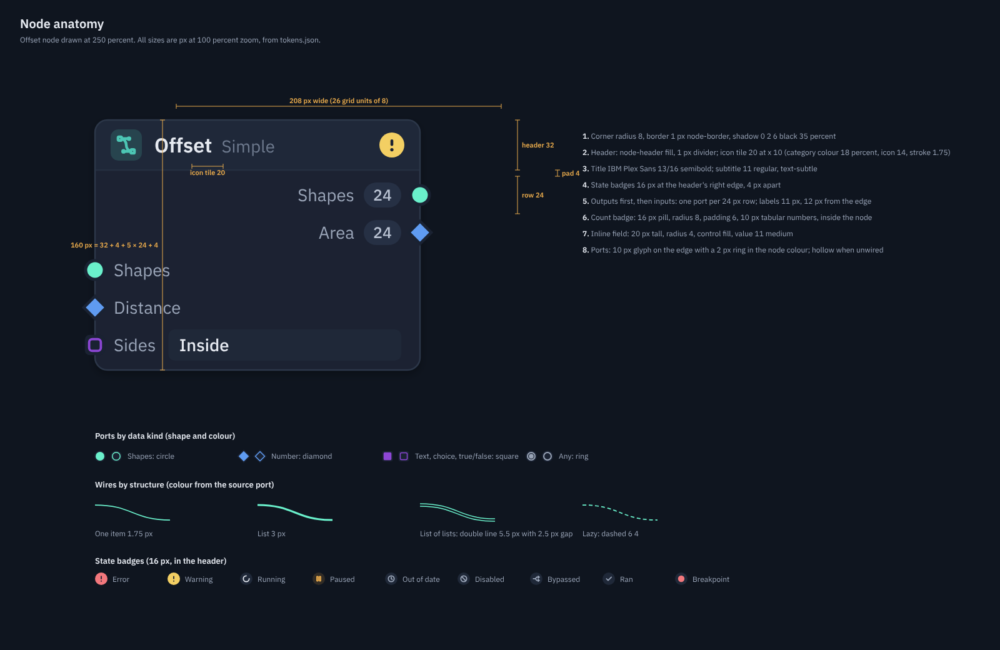

| Part | Value | Why or precedent |
|---|---|---|
| Grid | 8 px; widths 160, 208, 256 (20, 26, 32 units) | C5 decided whole grid units; n8n uses a 16 px grid ([nodeViewUtils.ts](https://raw.githubusercontent.com/n8n-io/n8n/master/packages/frontend/editor-ui/src/app/utils/nodeViewUtils.ts)) |
| Corner radius | 8 | React Flow's examples use 8 (measured, [Overview](https://reactflow.dev/examples/overview)), as does ComfyUI classic ([LiteGraphGlobal.ts](https://github.com/Comfy-Org/ComfyUI_frontend/blob/834cce976e330fedaa7f85f5aab930d7b8a205e8/src/lib/litegraph/src/LiteGraphGlobal.ts#L83-L135)); between Blender's 4 and ComfyUI Nodes 2.0's 12 |
| Border | 1 px `node-border` | Blender uses a 1 px outline ([theme](https://projects.blender.org/blender/blender/src/branch/blender-v5.2-release/release/datafiles/userdef/userdef_default_theme.c#L652-L698)) |
| Shadow | 0, 2, 6 px, black 35 percent (dark); 0, 1, 3 px, 12 percent (light) | Cheap; Avalonia `BoxShadows` can draw it, and a flat 0, 2 offset rectangle is the fallback |
| Header | 32 px, `node-header` fill, 1 px divider | One grid row of 32 |
| Icon tile | 20 x 20 at x 10, radius 5, category colour at 18 percent; 14 px Tabler icon, stroke 1.75, category colour | Category shown by icon tint, not a header colour (Blender muted its headers, see section 1) |
| Title | 13/16 IBM Plex Sans SemiBold, `text`; subtitle 11 regular, `text-subtle`, same line | C5: title 13 px |
| State badges | 16 px circles at the right of the header, 4 px apart | C5: state by badges |
| Rows | 24 px, one port per row, outputs first then inputs; body padding 4 top and 4 bottom | Height = 32 + 8 + 24 x rows, always a multiple of 8. Outputs first ends the label clashes in 01, 02, 04 and 07 |
| Port labels | 11/14 regular, `text-muted`, 12 px from the edge | C5: labels 11 px |
| Inline field | 20 px tall, radius 4, `control` fill, value 11 Medium with tabular figures, unit in `text-subtle` | C5: inline editors on unwired inputs |
| Count badge | 16 px pill, radius 8, padding 6, 10 px Medium tabular, inside the node left of the output label | Moves the badge off the wires |
| Selection | 2 px `selection`, 3 px outside the node, radius 11 | Node-RED 5.0 halo: 3 px outside, radius 8, stroke 2 ([flow.scss](https://raw.githubusercontent.com/node-red/node-red/master/packages/node_modules/@node-red/editor-client/src/sass/flow.scss)) |
| Hover | border becomes `node-border-hover` | |

### 3.4 Ports

| Data kind | Shape | Size | Colour token |
|---|---|---|---|
| Shapes | circle | 10 px | kind-shapes |
| Number | diamond | 11.8 px across | kind-number |
| Text, choice, true/false | rounded square, radius 2 | 9 px | kind-text |
| Any | ring, 2 px stroke | 10 px | kind-any |

- **Wired versus unwired.** A port is filled when wired and hollow (1.5 px stroke) when not, as in Unreal ([Nodes](https://dev.epicgames.com/documentation/en-us/unreal-engine/nodes-in-unreal-engine)).
- **Placement.** Each port sits centred on the node edge, with a 2 px ring in the node colour so it reads over the border.
- **Hit area.** 20 x 24 px.
- **Error.** An input in error turns its label `danger`.

### 3.5 Wires

| Property | Value |
|---|---|
| Path | Cubic curve. Horizontal handle length = 0.5 x horizontal distance, clamped to 24 to 120 px. A backward wire uses 80 + 0.25 x vertical distance |
| Colour | The source port's data-kind colour at 85 percent (dark) or 75 percent (light) |
| One item | 1.75 px solid |
| List | 3 px solid |
| List of lists | Double line: 5.5 px in the kind colour with a 2.5 px canvas-coloured line on top. Grasshopper 2 uses double lines for collections ([Wire](https://www.rhino3d.com/docs/grasshopper2/terms/wire.html)) |
| Lazy | 1.75 px dashed 6, 4 |
| Hover | Opacity 100 percent and width plus 1 |
| Selected (wire, or a wire of a selected node) | A 6 px `selection` underlay at 28 percent, then the wire at 100 percent |
| Flowing (running) | A 1.5 px `text` dash 4, 8 moving at 40 px per second along the wire. TouchDesigner shows cooking the same way ([Wire](https://docs.derivative.ca/Wire)) |
| Order | Wires draw under nodes (C5) and over group frames |
| Fading | With 40 or more wires on screen, wires not touching the selected node drop to 25 percent opacity. With 400 or more, every wire not touching the selection drops to 25 percent |
| Minimum width | 1 screen px at any zoom |

### 3.6 States

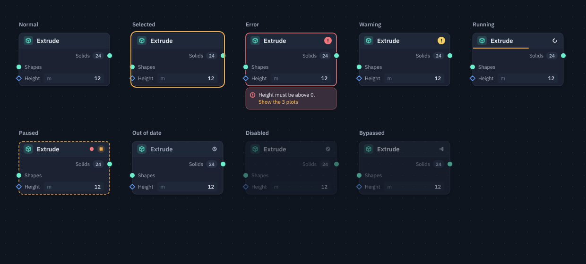

| State | Outline | Badge (header right) | Extra |
|---|---|---|---|
| Normal | 1 px `node-border` | none | |
| Selected | Normal plus a 2 px halo 3 px outside | none | |
| Error | 1.5 px `danger` | Filled `danger` circle with "!" | A tray 4 px under the node, same width: `danger-soft` over the node colour, 1 px `danger` at 55 percent, radius 8, padding 8, 11/15 text, at most 2 lines, then one action link in `accent`. Failed output labels turn `danger` |
| Warning | Unchanged | Filled `warning` circle with "!" | Warnings do not change the outline, so they never look like selection |
| Running | Unchanged | `loader-2` icon on a `control` circle | A 2 px `accent-line` progress strip under the header; flowing wires |
| Paused | 1.5 px `paused`, dashed 5, 3 | `player-pause` on `accent-soft` | A bar above the node: "Paused before Offset", Continue and Step |
| Breakpoint | Unchanged | A 4 px `danger` dot on a `control` circle | |
| Ran (while debugging) | Unchanged | `check` in `text-muted` | |
| Out of date | Unchanged | `clock-hour-4` in `stale` | Title in `text-muted` |
| Disabled | Unchanged | `ban` | Whole node at 45 percent opacity |
| Bypassed | Unchanged | `arrows-split` | Whole node at 60 percent opacity |

### 3.7 Groups, minimap and problem chip

**Groups.**
- **Frame.** Radius 12; fill is the group colour at 8 percent (dark) or 10 percent (light); a 1 px border at 35 percent.
- **Title.** 13 px SemiBold in the group colour, 16 px from the left edge.
- **No title bar.** The frame has no separate title bar.
- **Block mode.** The title moves just above the frame so it never covers nodes.

**Minimap.**
- **Card.** 200 x 136 px, radius 8, 12 px from the corner, `minimap` fill with a 1 px `border`.
- **Header.** A "Map" label and a close icon.
- **Contents.** Groups are tints, nodes are `minimap-node`, selected nodes use `selection` and error nodes use `danger`.
- **Viewport.** A 1 px `minimap-viewport` rectangle with an 8 percent fill.
- **When it shows.** Only when the flow is bigger than the view or the user pins it, as Houdini does ([navigation](https://www.sidefx.com/docs/houdini/network/navigate.html)).

**Problem chip.**
- **Card.** A 24 px pill bottom left: radius 12, `panel-raised` fill, 1 px `border`.
- **Contents.** An 8 px dot per kind and counts, for example "1 error". Clicking it frames the next problem.

### 3.8 Flow chrome

| Part | Spec |
|---|---|
| Toolbar | 40 px tall, `panel` fill, 1 px bottom `border`. 28 px buttons with radius 6 and 16 px icons. Groups split by 1 x 20 px dividers |
| Toolbar order | Flow name with chevron (opens the flow list), Run (the only filled button: `accent-fill`, play icon and "Run"), Stop (disabled unless running), run mode as a segmented control (Auto, Manual, Delay), undo and redo, a gap, search, zoom (minus, value, plus), fit, map, panel toggle, more |
| Left panel | 248 px. Tabs: Flows, Nodes, Library, Variants (a 2 px `accent` underline on the active tab). 12 px padding. 28 px search field with a "Tab" key hint. Chips: Start here, Recent, Starred. 28 px rows with 20 px icon tiles |
| Right inspector | 300 px. Node properties move here, replacing the separate Node properties column. Header: 24 px icon tile, name, one line of facts. Tabs: Inputs, Outputs, Info. Rows: a 96 px label column and 28 px controls. A wired input shows as a dashed `border-strong` box reading "from Layer" with a kind dot |
| Status bar | 28 px. Snap modes are text toggles, `accent` and SemiBold when on, not filled pills |
| Spacing | Panel padding 12, gaps 8, section gap 16, control radius 6 |

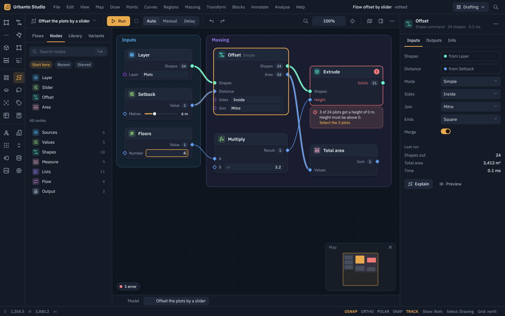

### 3.9 Typography

| Style | Size / line | Weight | Used for |
|---|---|---|---|
| node-title | 13 / 16 | 600 | Node titles |
| node-subtitle, port-label | 11 / 14 | 400 | Mode subtitle, port labels |
| inline-value | 11 / 14 | 500, tabular | Values in fields |
| badge | 10 / 12 | 500, tabular | Count badges |
| error-message | 11 / 15 | 400 | Error tray |
| group-title | 13 / 16 | 600 | Group frames |
| panel-title | 13 / 18 | 600 | Inspector header |
| section-label | 11 / 16 | 600 | Panel sections |
| body / body-strong | 12 / 16 | 400 / 500 | Panel text |
| toolbar | 12 / 16 | 500 | Toolbar labels |

The family is IBM Plex Sans throughout; Cascadia Mono is used only for expressions. Linear uses a similarly tight scale of 11, 12, 13, 15 and 18 px (measured on [linear.app](https://linear.app/)).

### 3.10 Zoom levels

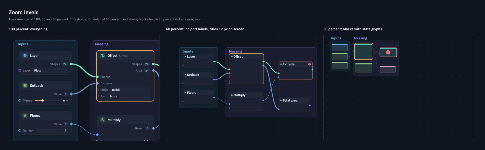

| Zoom | What is drawn |
|---|---|
| 65 percent and above | Everything. At 100 percent, titles are 13 px and port labels 11 px |
| 35 to 65 percent (drawn at 60) | Port labels and inline fields hidden. Ports become 6 px screen dots. Titles are drawn at a fixed 12 px screen size beside an 8 px category square. State badges stay. Wires keep colour and structure, never under 1 px |
| Below 35 percent (drawn at 30) | Each node is a block: node fill with a 14 percent category tint, a 4 px screen category strip on top, and a 16 px screen state glyph in the middle for error, warning, running, paused or stale. Titles are hidden. Group titles are 13 px screen size above each frame. Wires are 1 px at 35 percent. Minor dots are hidden |

The C5 decision said "below about 60 percent" and "below about 30 percent". The spec uses 65 and 35 so that the drawn 60 and 30 percent views fall clearly inside each level. ComfyUI's text-based rule switches at about 57 percent ([LGraphCanvas.ts](https://github.com/Comfy-Org/ComfyUI_frontend/blob/834cce976e330fedaa7f85f5aab930d7b8a205e8/src/lib/litegraph/src/LGraphCanvas.ts#L783-L801)). Dynamo's switches at 0.4 ([Configurations.cs](https://github.com/DynamoDS/Dynamo/blob/1a3eec9d69211fbc038cab531a6dcce211cb70c5/src/DynamoCore/Configuration/Configurations.cs#L142-L152)).

### 3.11 Hover card

The hover card replaces the bare thumbnail box:
- **Size.** 220 px wide, radius 8, `overlay` fill, 1 px `border-strong`, `shadow-overlay`.
- **Notch.** A 7 px notch points at the node.
- **Title.** For example "Offset · 2 shapes".
- **Plan.** A 120 px plan on `canvas`: inputs dashed in `text-subtle`, results in the kind colour with a 16 percent fill.
- **Facts.** One line, for example "Area 2,184 m² · ran in 0.1 ms".
- **Timing.** It appears after a 400 ms hover.

## 4. Mockups

Every "after" image is drawn from `tokens.json` by `tools/flowsvg.py`. The HTML pages are in [mockups/](mockups/) and the PNGs in [mockups/png/](mockups/png/). The "before" images are your screenshots.

### (a) The whole window, before and after

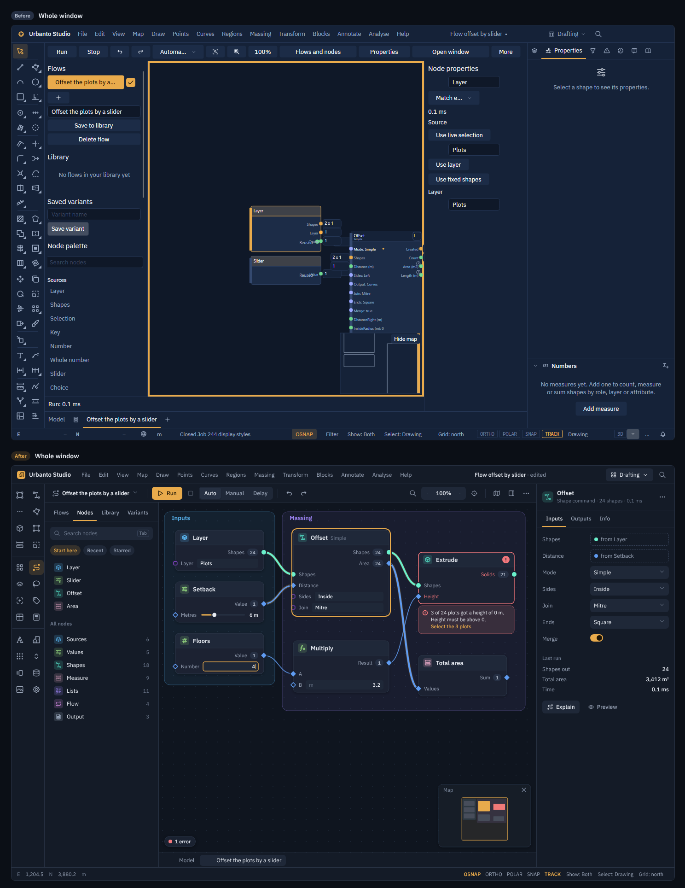

### (b) A small flow: 7 nodes, one error, one typed value

The Floors node has a focused field with "4" being typed. Extrude is in error with a plain message and one action. The before shown is screenshot 02.

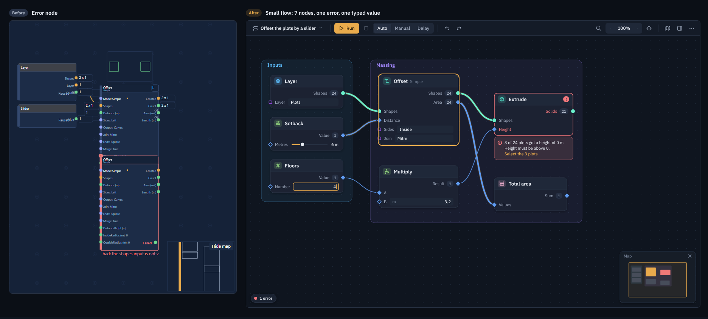

The same content as screenshot 02, at the same size:

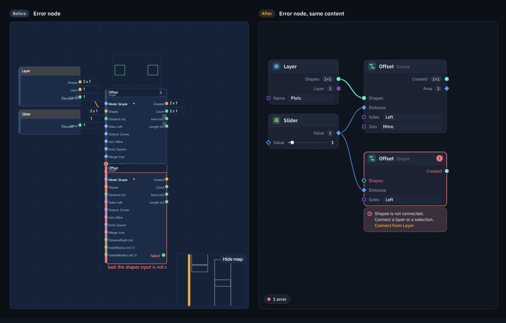

### (c) 500 nodes at 100 and 30 percent

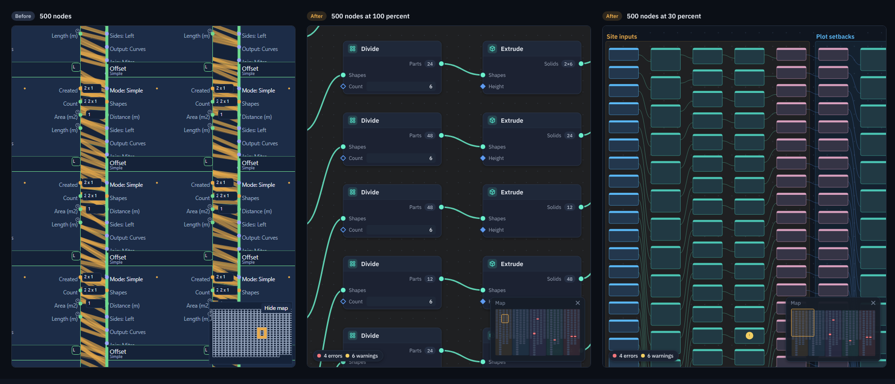

Larger versions: [100 percent](mockups/png/mock-500-nodes-100.png) and [30 percent](mockups/png/mock-500-nodes-30.png).

### (d) Node anatomy sheet

The anatomy sheet is in section 3.3, and the dark and light versions are [mock-anatomy-dark.png](mockups/png/mock-anatomy-dark.png) and [mock-anatomy-light.png](mockups/png/mock-anatomy-light.png). One node, before and after:

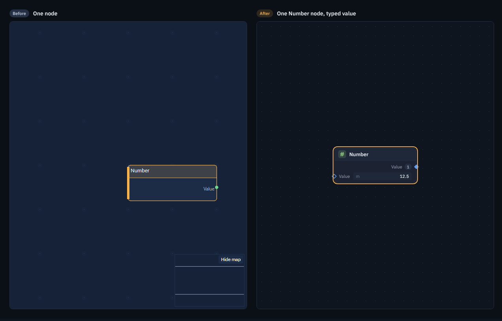

### (e) The light theme of (b)

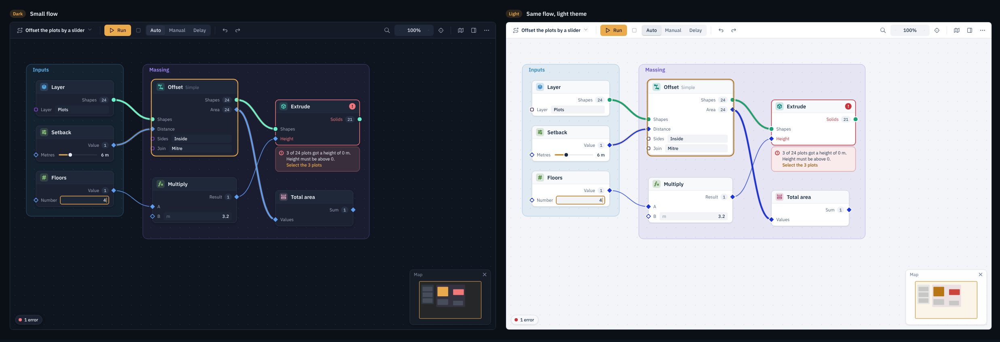

The whole window in light: [mock-whole-window-light.png](mockups/png/mock-whole-window-light.png).

### The other screenshots

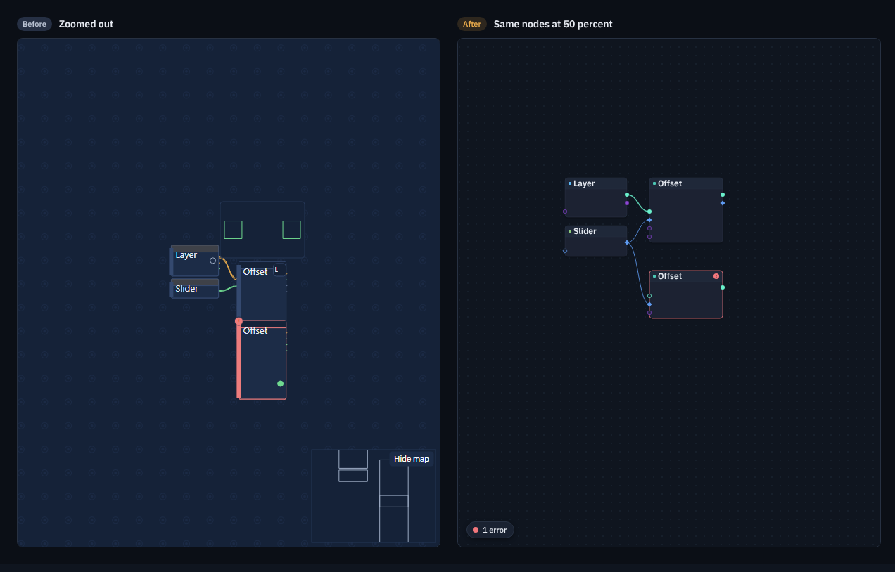

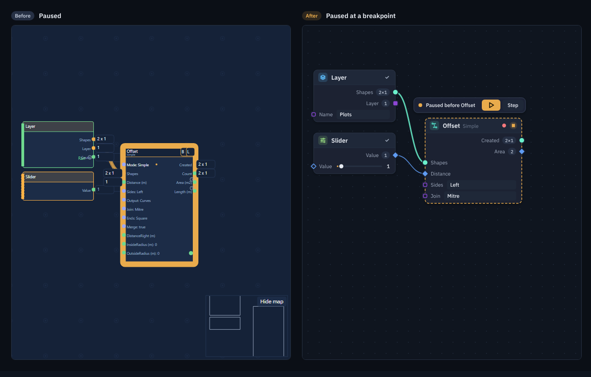

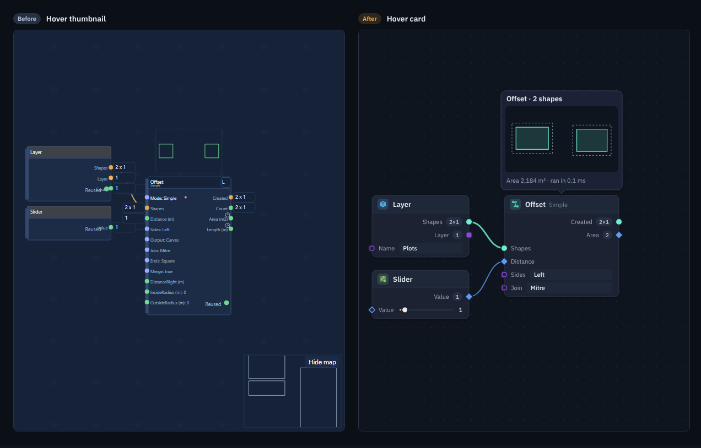

## 5. Ranked change list

Sizes:
- **S** means hours (up to about a day).
- **M** means days (2 to 10 working days).
- **L** means weeks.

The sizes are estimates for drawing changes in a custom-drawn canvas whose layout already exists. Studio's code was not seen. ★ marks the ten changes that give the biggest modern-look jump for the least work.

| Rank | Change | Size | Fixes |
|---|---|---|---|
| 1 ★ | Remove the 4 px orange canvas frame; use a 1 px `border` and show focus with a 2 px `focus-ring` only while the canvas has keyboard focus | S | 01 |
| 2 ★ | Swap the colour tokens to the table in 3.2 (calmer surfaces, one header colour) | S | 01, 02, 03, 04, 05, 06, 07 |
| 3 ★ | Use orange only for selection, focus and Run: move Shapes ports to `kind-shapes` and drop the orange left strips and filled status pills | S | 01, 04, 06 |
| 4 ★ | Draw node text at 13 and 11 px when the toolbar says 100 percent (01 shows about 8 px) | S | 01, 02 |
| 5 ★ | Show selection as a halo 3 px outside, and state as 16 px header badges; drop thick borders and side strips | S | 04, 06, 02 |
| 6 ★ | New port glyphs: 10 px, shape by kind, 2 px ring, hollow when unwired | S | 06, 01, 02 |
| 7 ★ | Replace the ring pattern with 1.5 px dots every 24 px | S | 02, 03, 06, 07 |
| 8 ★ | Category icon tile in the header (Tabler icon, category tint) instead of a coloured strip | S | 06, 05 |
| 9 ★ | Count badges as 16 px pills inside the node, left of the output label | M | 01, 02, 05, 07 |
| 10 ★ | Rows: outputs first, then inputs, one port per 24 px row | M | 01, 02, 04, 07 |
| 11 | Error tray under the node with a plain message and one action; drop the "bad:" wording | M | 02 |
| 12 | Inline value fields drawn as fields (C5 decision) | M | 01, 02, 06 |
| 13 | Toolbar: icons, Run as the only filled button, segmented run mode, compact zoom | M | 01 |
| 14 | Minimap card: 200 x 136, close icon, status colours, auto-hide when the flow fits | S | 01 to 07 |
| 15 | Never overlap: new and pasted nodes land on free space; tidy keeps 48 px gaps | M | 02, 03, 05 |
| 16 | Zoom levels at 65 and 35 percent with fixed-size titles and block mode | M | 03, 05 |
| 17 | Wires under nodes, coloured by kind, structure strokes, fading rules | M | 05, 01 |
| 18 | Paused bar with Continue and Step; breakpoint and ran badges | M | 04 |
| 19 | Hover card with title, plan and facts | S | 07 |
| 20 | Group frames: 8 percent tint, 35 percent border, title; named colours | S | 05 |
| 21 | Merge Node properties into the right inspector; left panel as tabs | L | 01 |
| 22 | Status bar toggles as text states | S | 01 |
| 23 | Problem chip with counts that frames the next problem | S | 02, 05 |
| 24 | Light theme from the same token table | S | all |
| 25 | Running state: progress strip and flowing wire dashes | M | none of the seven (new) |
| 26 | Generate the token table from base grey, accent and contrast in OKLCH, as Linear and Houdini 22 do ([Linear](https://linear.app/now/how-we-redesigned-the-linear-ui), [Houdini Theme Editor](https://www.sidefx.com/docs/houdini/ref/windows/theme_editor.html)) | L | future themes |

## 6. Ten things not to copy

1. **Saturated full-colour headers per category**
   - **Who:** Blender 4.x, ComfyUI presets, Unreal.
   - **Why not:** they shout louder than the wires and states. Blender itself muted them in 5.0 ([theme](https://projects.blender.org/blender/blender/src/branch/blender-v4.5-release/release/datafiles/userdef/userdef_default_theme.c#L843-L909)).
2. **Filling the whole node with a category or selection colour**
   - **Who:** Node-RED, Rete.js.
   - **Why not:** on a dark canvas it becomes a patchwork of bright bricks. It hides state and leaves no room for wire colours ([Rete Node.tsx](https://raw.githubusercontent.com/retejs/react-plugin/main/src/presets/classic/components/Node.tsx)).
3. **Glass and blur materials**
   - **Who:** Raycast 2.0.
   - **Why not:** they break the "plain 2D shapes" rule. Figma calls blurs "particularly expensive" ([Best Practices](https://developers.figma.com/docs/widgets/best-practices/), [Raycast deep dive](https://raycast.com/blog/a-technical-deep-dive-into-the-new-raycast)).
4. **Spinning gradient borders for "running"**
   - **Who:** n8n.
   - **Why not:** every running node redraws every frame, against the 60 fps goal at 1,000 nodes ([_canvasNodeStyles.scss](https://raw.githubusercontent.com/n8n-io/n8n/master/packages/frontend/editor-ui/src/features/workflows/canvas/components/elements/nodes/render-types/_canvasNodeStyles.scss)). Flow uses a static strip plus a moving dash on the wire.
5. **Decorative motion such as sparkles on connect**
   - **Who:** Grasshopper 2 beta.
   - **Why not:** a beta user called them "completely unnecessary visual noise" ([forum post #10, third party](https://discourse.mcneel.com/t/rhino-beta-feature-grasshopper-2-beta/221336/10)).
6. **Over-rounded, over-padded cards**
   - **Who:** ComfyUI Nodes 2.0, with a 12 px radius and 225 px minimum width.
   - **Why not:** readers called it "less compact and space efficient" (comments, third party, on the [Nodes 2.0 post](https://blog.comfy.org/p/comfyui-node-2-0)). Flow is already crowded.
7. **Bitmap grids and bitmap state glyphs**
   - **Who:** ComfyUI's PNG grid tile, Dynamo's 64 px PNG glyphs.
   - **Why not:** they blur when zoomed and cannot follow a theme ([dark.json](https://github.com/Comfy-Org/ComfyUI_frontend/blob/834cce976e330fedaa7f85f5aab930d7b8a205e8/src/assets/palettes/dark.json#L24)).
8. **A magenta wash for bypass**
   - **Who:** ComfyUI, `#FF00FF`.
   - **Why not:** it clashes with the orange and hides the node ([dark.json](https://github.com/Comfy-Org/ComfyUI_frontend/blob/834cce976e330fedaa7f85f5aab930d7b8a205e8/src/assets/palettes/dark.json#L35)). Flow dims instead and adds a badge.
9. **Titles below the node**
   - **Who:** n8n.
   - **Why not:** in dense flows the labels collide with wires and neighbours ([CanvasNodeDefault.vue](https://raw.githubusercontent.com/n8n-io/n8n/master/packages/frontend/editor-ui/src/features/workflows/canvas/components/elements/nodes/render-types/CanvasNodeDefault.vue)).
10. **Free-floating side panels**
    - **Who:** Figma UI3 beta.
    - **Why not:** Figma reversed them because "they slowed people down" ([2024 recap](https://www.figma.com/blog/figma-2024-we-shipped-it-you-shaped-it/)). CAD users need stable docked panels.

Also considered, but left out of the ten:
- hairline grey wires with 6 px handles (React Flow defaults);
- custom node silhouettes (Houdini);
- twelve or more named pin colours (Unreal).

The research notes cover each of them.

## Choices made

- **Branch.** Branch `report/C19` was made from `main`, which holds the brief and screenshots. No pull request was opened, because the request asked for a pushed branch.
- **Palette.**
  - **Surfaces.** They keep Studio's blue-grey hue with less saturation, rather than switching to neutral grey, so Flow still matches the rest of Studio until the whole app adopts the tokens (change 2).
  - **Shapes off orange.** Shapes ports moved off orange so that orange means selection only.
  - **Merged kinds.** Text, choices and true/false share one kind colour, as the brief describes today ("text/choices lilac").
- **Data-kind colours.**
  - **Method.** They came from a seeded, repeatable search (`tools/pick_kind_colours.py`). Its seed set was changed once to make it repeatable, and the final values come from that version.
  - **Light theme blue.** The light number blue `#1735DB` is strong. Wire opacity in light is 75 percent to soften it, rather than giving up colour-blind distance.
- **Ports and wires.** Port shape shows the data kind and wire stroke shows structure. Blender does the reverse (shape shows structure). Flow already has structure strokes on wires, and shapes per kind give a second cue next to colour.
- **Sizes.** Radius 8 and 24 px rows were chosen so a 20 px inline field fits a row. Blender is denser (20 px rows) and Dynamo looser (34 px ports).
- **Zoom thresholds.** 65 and 35 percent were used instead of "about 60" and "about 30", for the reason in 3.10.
- **Warnings.** A warning keeps the normal outline, so it cannot be mistaken for selection.
- **Minimap.** It is shown pinned in mockup (b) and the whole window, and hidden in the small views where the flow fits.
- **Mockup drawing.** The mockups are SVG inside HTML, generated by Python and rendered with headless Chromium at 1x, so they compare pixel for pixel with the 600 px screenshots. The "before" halves are the screenshots themselves, linked from `briefs/C19-images/`.
- **Bundled files.**
  - Fonts: IBM Plex Sans and Cascadia Mono, SIL Open Font License, licence files in `mockups/fonts/`.
  - Icons: Tabler 3.24.0, MIT, licence in `mockups/icons/`.
- **Research method.**
  - **Source reading.** The ComfyUI frontend and Dynamo source were read from shallow read-only clones of their public repositories, cited by commit.
  - **Blocked pages.** Make.com pages were blocked by a bot check, so no Make sizes are quoted. Retool needs a login, so its sizes are not verified.
  - **Linear's numbers.** These come from its website, not the app.
- **Measured values.** Colour and size claims about the screenshots were measured with Pillow from the PNGs, for example the 4 px frame, the 592 px canvas and the 1.36 and 0.37 percent orange shares. Font sizes are estimated from measured cap heights.

## Sources

Every external page linked in this report (45 pages), in order of first use, read on 2026-10-31 or 2026-11-01. Flags come from the research notes. The full list of 195 sources is in [research/sources.json](research/sources.json).

1. <https://github.com/Comfy-Org/ComfyUI_frontend/blob/834cce976e330fedaa7f85f5aab930d7b8a205e8/src/renderer/extensions/vueNodes/components/LGraphNode.vue#L15-L93>
2. <https://github.com/Comfy-Org/ComfyUI_frontend/blob/834cce976e330fedaa7f85f5aab930d7b8a205e8/src/lib/litegraph/src/LGraphCanvas.ts#L783-L801>
3. <https://projects.blender.org/blender/blender/src/branch/blender-v4.5-release/release/datafiles/userdef/userdef_default_theme.c#L843-L909>
4. <https://projects.blender.org/blender/blender/src/branch/blender-v5.2-release/release/datafiles/userdef/userdef_default_theme.c#L652-L698>
5. Blender 5.0 User Interface release notes. Blender Foundation. 2025. <https://developer.blender.org/docs/release_notes/5.0/user_interface/>
6. Nodes in Unreal Engine. Epic Games. UE 5.8 docs. <https://dev.epicgames.com/documentation/en-us/unreal-engine/nodes-in-unreal-engine> (images partly from UE4)
7. Network editor display options. SideFX. Houdini 22.0 docs. <https://www.sidefx.com/docs/houdini/network/options.html>
8. Network navigation. SideFX. Houdini 22.0 docs. <https://www.sidefx.com/docs/houdini/network/navigate.html>
9. Glossary: Wire. McNeel. undated. <https://www.rhino3d.com/docs/grasshopper2/terms/wire.html>
10. <https://github.com/DynamoDS/Dynamo/blob/1a3eec9d69211fbc038cab531a6dcce211cb70c5/src/DynamoCoreWpf/Views/Core/NodeView.xaml.cs#L866-L878>
11. <https://github.com/DynamoDS/Dynamo/blob/1a3eec9d69211fbc038cab531a6dcce211cb70c5/src/DynamoCore/Configuration/GroupStyleItem.cs#L18-L24>
12. Wire. Derivative wiki. 2022-08-06. <https://docs.derivative.ca/Wire>
13. n8n editor-ui source: _canvasNodeStyles.scss. n8n GmbH (GitHub, master branch). master as of 2026-10-31. <https://raw.githubusercontent.com/n8n-io/n8n/master/packages/frontend/editor-ui/src/features/workflows/canvas/components/elements/nodes/render-types/_canvasNodeStyles.scss> (primary; source code)
14. n8n editor-ui source: useZoomAdjustedValues.ts. n8n GmbH (GitHub, master branch). master as of 2026-10-31. <https://raw.githubusercontent.com/n8n-io/n8n/master/packages/frontend/editor-ui/src/features/workflows/canvas/composables/useZoomAdjustedValues.ts> (primary; source code)
15. Step 5. Test your scenario. Make help center. 2025-03-26. <https://help.make.com/step-5-test-your-scenario.md> (primary)
16. Version 5.0 released. Node-RED blog (Nick O'Leary). 2026-06-09. <https://nodered.org/blog/2026/06/09/version-5-0-released> (primary)
17. Node-RED editor-client source: flow.scss. OpenJS Foundation (GitHub, master = 5.0.9). master as of 2026-10-31. <https://raw.githubusercontent.com/node-red/node-red/master/packages/node_modules/@node-red/editor-client/src/sass/flow.scss> (primary; source code)
18. @xyflow/react 12.12.0 dist/style.css. xyflow (npm). 2026-09-24. <https://cdn.jsdelivr.net/npm/@xyflow/react@12.12.0/dist/style.css> (primary; source code)
19. Overview example. React Flow docs. undated. <https://reactflow.dev/examples/overview> (primary; measured with Playwright 2026-10-31 (iframe https://example-apps.xyflow.com/react/examples/misc/overview/index.html))
20. rete-react-plugin source: classic/vars.ts. Rete.js (GitHub, main = 2.1.2). main as of 2026-10-31 (2.1.2 published 2026-07-10). <https://raw.githubusercontent.com/retejs/react-plugin/main/src/presets/classic/vars.ts> (primary; source code)
21. rete-react-plugin source: classic/components/Socket.tsx. Rete.js (GitHub, main = 2.1.2). main as of 2026-10-31 (2.1.2 published 2026-07-10). <https://raw.githubusercontent.com/retejs/react-plugin/main/src/presets/classic/components/Socket.tsx> (primary; source code)
22. Workflow IDE. Retool docs. 2026 (copyright). <https://docs.retool.com/workflows/concepts/ide> (primary)
23. Configure workflow error handlers. Retool docs. undated. <https://docs.retool.com/workflows/guides/error-handlers> (primary)
24. How we redesigned the Linear UI (part II). Linear. 2024-03-28. <https://linear.app/now/how-we-redesigned-the-linear-ui> (primary)
25. A calmer interface for a product in motion. Linear (Charlie Aufmann, Maxime Heckel). 2026-03-12. <https://linear.app/now/behind-the-latest-design-refresh> (primary)
26. ray-so theme.ts (theme schema). Raycast (GitHub). main as of 2026-10-31. <https://raw.githubusercontent.com/raycast/ray-so/main/app/%28navigation%29/themes/lib/theme.ts> (primary; source code)
27. Colors. Raycast developer docs. undated. <https://developers.raycast.com/api-reference/user-interface/colors.md> (primary)
28. CSS Variables and Theming. Figma developer docs. undated. <https://developers.figma.com/docs/plugins/css-variables/> (primary; token table measured with Playwright (Light and Dark tabs))
29. Figma 2024: We shipped it, you shaped it. Figma blog. 2024-12-04. <https://www.figma.com/blog/figma-2024-we-shipped-it-you-shaped-it/> (primary)
30. widget-samples: WidgetCounter code.tsx. Figma (GitHub). main as of 2026-10-31 (sample from about 2021). <https://raw.githubusercontent.com/figma/widget-samples/main/WidgetCounter/widget-src/code.tsx> (primary; source code; older sample)
31. AutoLayout (Widget API). Figma developer docs. undated. <https://developers.figma.com/docs/widgets/api/component-AutoLayout/> (primary)
32. Best Practices (widgets). Figma developer docs. undated. <https://developers.figma.com/docs/widgets/best-practices/> (primary)
33. linear.app home page (root CSS variables). Linear. live 2026-10-31. <https://linear.app/> (primary; measured with Playwright; marketing site, may differ from the app)
34. <https://github.com/Comfy-Org/ComfyUI_frontend/blob/834cce976e330fedaa7f85f5aab930d7b8a205e8/src/assets/palettes/dark.json#L25-L83>
35. n8n editor-ui source: nodeViewUtils.ts. n8n GmbH (GitHub, master branch). master as of 2026-10-31. <https://raw.githubusercontent.com/n8n-io/n8n/master/packages/frontend/editor-ui/src/app/utils/nodeViewUtils.ts> (primary; source code)
36. <https://github.com/Comfy-Org/ComfyUI_frontend/blob/834cce976e330fedaa7f85f5aab930d7b8a205e8/src/lib/litegraph/src/LiteGraphGlobal.ts#L83-L135>
37. <https://github.com/DynamoDS/Dynamo/blob/1a3eec9d69211fbc038cab531a6dcce211cb70c5/src/DynamoCore/Configuration/Configurations.cs#L142-L152>
38. Theme Editor. SideFX. Houdini 22.0 docs. <https://www.sidefx.com/docs/houdini/ref/windows/theme_editor.html>
39. rete-react-plugin source: classic/components/Node.tsx. Rete.js (GitHub, main = 2.1.2). main as of 2026-10-31 (2.1.2 published 2026-07-10). <https://raw.githubusercontent.com/retejs/react-plugin/main/src/presets/classic/components/Node.tsx> (primary; source code)
40. A Technical Deep Dive Into the New Raycast. Raycast blog. 2026-05-14. <https://raycast.com/blog/a-technical-deep-dive-into-the-new-raycast> (primary)
41. Beta thread post #10. McNeel Forum (user ShynnSup). 2026-08-04. <https://discourse.mcneel.com/t/rhino-beta-feature-grasshopper-2-beta/221336/10> (third party opinion)
42. ComfyUI Nodes 2.0. Comfy Org. 2025-12-05. <https://blog.comfy.org/p/comfyui-node-2-0> (reader comments quoted are third party)
43. <https://github.com/Comfy-Org/ComfyUI_frontend/blob/834cce976e330fedaa7f85f5aab930d7b8a205e8/src/assets/palettes/dark.json#L24>
44. <https://github.com/Comfy-Org/ComfyUI_frontend/blob/834cce976e330fedaa7f85f5aab930d7b8a205e8/src/assets/palettes/dark.json#L35>
45. n8n editor-ui source: CanvasNodeDefault.vue. n8n GmbH (GitHub, master branch). master as of 2026-10-31. <https://raw.githubusercontent.com/n8n-io/n8n/master/packages/frontend/editor-ui/src/features/workflows/canvas/components/elements/nodes/render-types/CanvasNodeDefault.vue> (primary; source code)
