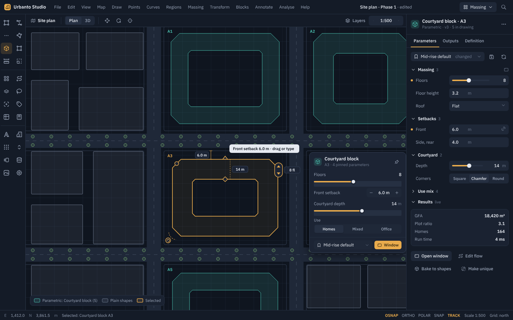
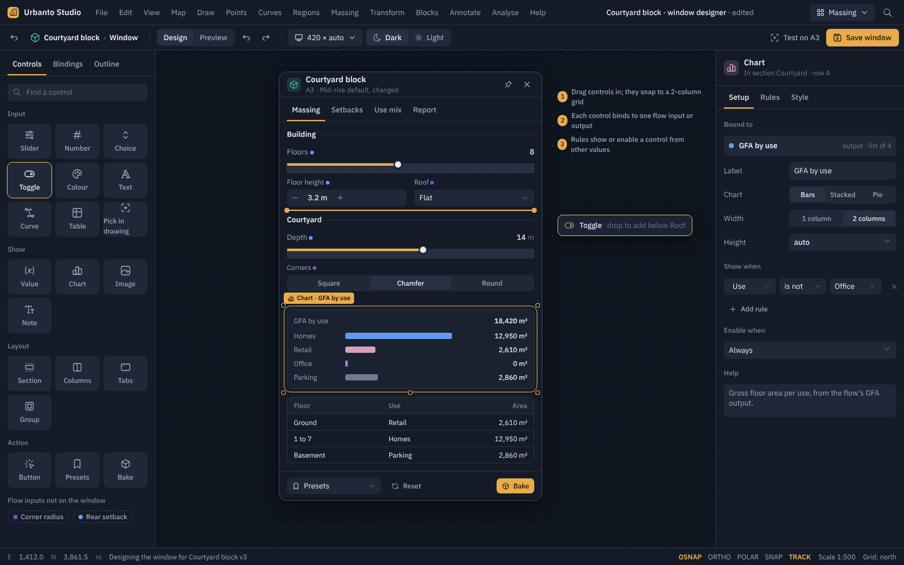
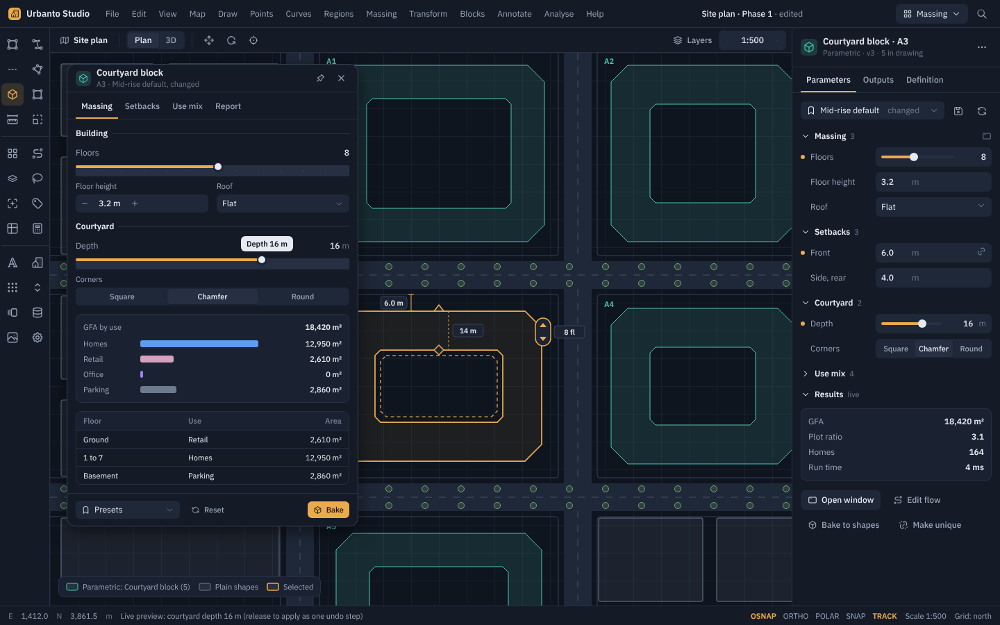
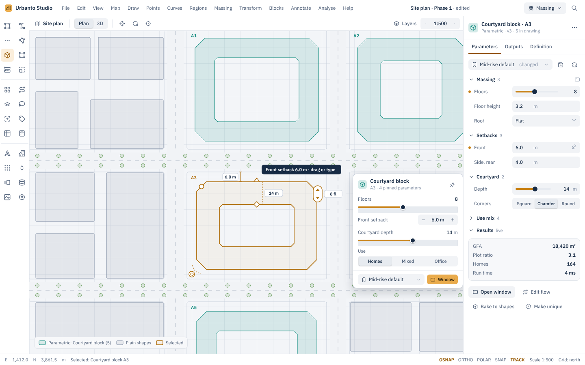
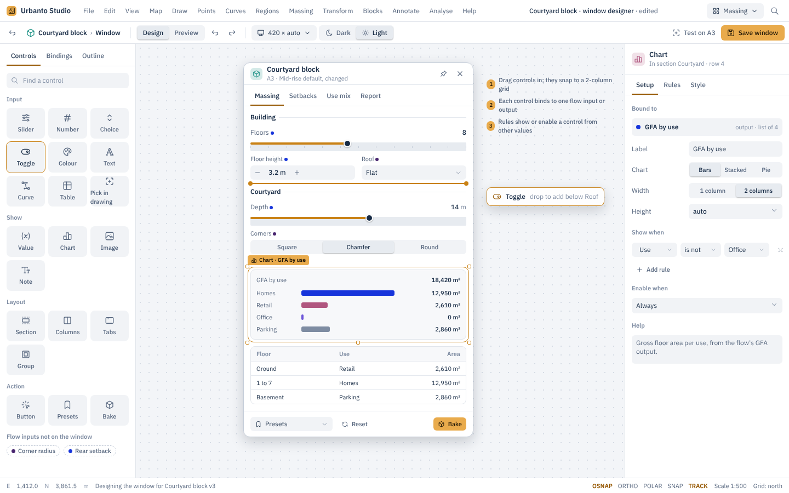
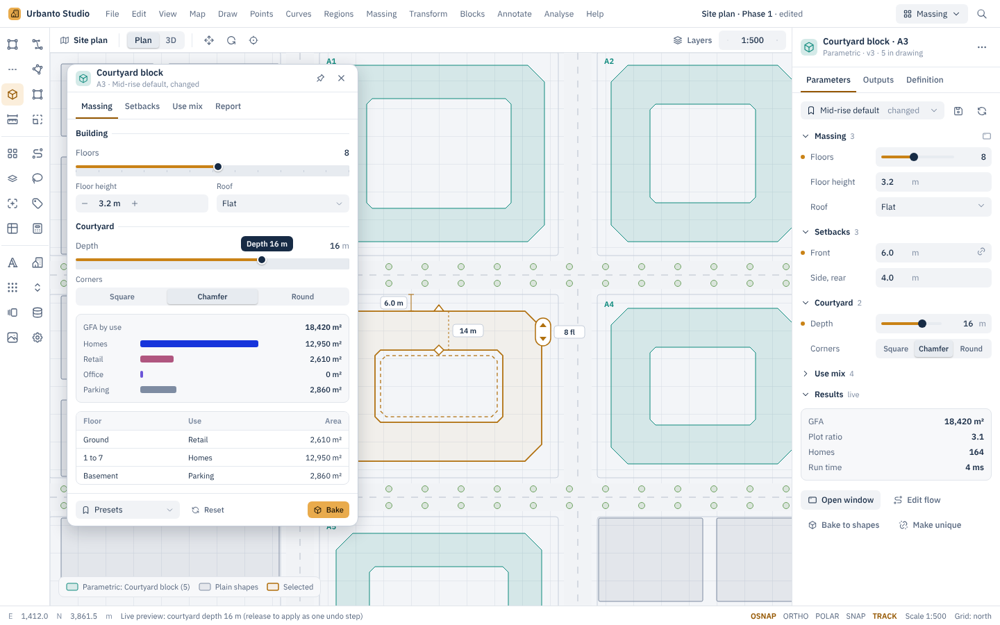

# C20: Parametric objects in the drawing, and a window designer for them

Researched and drawn on 2026-11-01. The brief is [briefs/C20-parametric-objects-and-window-designer.md](../../briefs/C20-parametric-objects-and-window-designer.md). No Studio code was asked for or seen. The look follows C19 (calm slate surfaces, amber only for selection and the main action, IBM Plex Sans, Tabler icons).

## Answer

Make the parametric object a real object in the drawing, not a flow you have to open.
- **One definition, many objects.** A flow that is already a tool becomes a definition. Each object placed in the drawing is an instance with its own values, and every instance updates when the definition changes. This is how Revit types and Houdini assets work, and nothing in Grasshopper does it.
- **Three places to change values.** Values are edited:
  - in the Properties panel, which is built for free from the flow's form;
  - in a small pop-over next to the object, showing the 3 to 6 parameters the author pinned;
  - with drag handles in the drawing.
- **An optional custom window.** For richer objects, the author builds a window in a drag-and-drop designer:
  - controls snap to a grid;
  - each control binds to one flow input or output;
  - show and enable rules are picked from lists, never typed.

  The window is saved as a plain, versioned file of data (no code), so it works under Native AOT.

This fixes what makes Grasshopper's route weak:
- Human UI builds windows from wired canvas nodes (users say it "made the script a bit messy").
- The Remote Control Panel stalled ("the perhaps hardest dropped ball in Grasshopper history").
- Grasshopper Player is a chain of command-line prompts.

The first build step, "place a flow tool as an object, edit it in Properties, one undo step, Bake", is useful on its own. The custom window designer comes later and builds on it.

## What is in this folder

| File | What it is |
|---|---|
| `C20-parametric-objects-and-window-designer.md` | This report |
| `mockups/*.html`, `mockups/png/*.png` | The mockups, dark and light, and their HTML sources |
| `mockups/c20.css`, `tokens.css`, `chrome.css` | Styles: C20 parts on top of the C19 tokens and chrome |
| `tools/build_c20.py`, `tools/render.js` | Generator and PNG export (`python3 tools/build_c20.py && node tools/render.js`) |
| `research/` | Full research notes for 25 tools ([R20A](research/R20A-grasshopper-houdini-blender-unreal.md), [R20B](research/R20B-revit-archicad-sketchup-web.md)) and `sources.json` (188 sources) |

## 1. How others do parametric objects and parameter UIs

The table gives one line per tool. The research notes have the detail, numbers and every link.

| Tool | How the object and its UI work | Good | Bad |
|---|---|---|---|
| Grasshopper + Human UI | Windows are built from canvas components: a Create node, a Value Listener and often a Set node per control. The repository holds 84 component source files (measured) ([discussion](https://discourse.mcneel.com/t/human-ui-vs-ui-your-thoughts-and-experiences-on-which-to-use/)) | Any WPF control, full custom layouts | The UI wiring lives in the logic graph ("made the script a bit messy"). No upstream commit from Feb 2022 to May 2026; Rhino 8 support only came on 9 Jun 2026 ([PR #9](https://github.com/andrewheumann/humanui/pull/9)) |
| Grasshopper Remote Control Panel | Groups of sliders and toggles shown in a docked panel ([forum](https://discourse.mcneel.com/t/the-future-of-grasshopper-user-interfaces/204466)) | Built in | Users call it "stuck in like version 0.1"; in Sep 2026 McNeel said "there isn't anything available to test" ([forum](https://discourse.mcneel.com/t/future-plans-for-a-more-robust-remote-control-panel-in-grasshopper-2/220904)) |
| Grasshopper Player | Runs a definition as a command: Get components ask for each input on the command line, then Context Bake ([forum](https://discourse.mcneel.com/t/bake-with-attributes-via-gh-player/135996)) | No canvas needed | One user's 7 prompts took 2 to 3 s each, and the script "runs 5 times and successfully bakes the curve 2 times" |
| ShapeDiver / Rhino.Compute | A web form generated from the definition; the node name becomes the label and "Canvas position sets parameter order" ([inputs and outputs](https://help.shapediver.com/doc/inputs-and-outputs)) | Shareable web configurators, an "Apply" validation mode ([parameters](https://help.shapediver.com/doc/parameters)) | Order and grouping come from the canvas; "the grouping is fixed after upload" ([settings](https://help.shapediver.com/doc/parameter-settings)) |
| VisualARQ Grasshopper styles | Each input is "Editable by" Definition (hidden), Style (shared) or Object (Properties panel) ([guide, staging site](https://stg.visualarq.com/tutorial/grasshopper-styles/get-started)) | The clearest scope model found | Third party; Rhino itself has had no native parametric object since the 2017 wish ([forum](https://discourse.mcneel.com/t/grasshopper-objects/42624)) |
| Houdini Digital Assets | Every instance locks to one .hda definition and all update together. The Type Properties editor has 5 folder types, list blocks, and Disable/Hide When rules with 8 operators ([optype](https://www.sidefx.com/docs/houdini/ref/windows/optype.html), [edit](https://www.sidefx.com/docs/houdini/assets/edit.html)) | The most complete form model | Rules are typed text with traps (spaces around operators are required). Engine hosts drop authored UI: Maya ignores Disable/Hide When ([Maya](https://www.sidefx.com/docs/maya/parameters.html)) |
| Blender Geometry Nodes | Exposed inputs show on the modifier panel. Since 4.4, "Input values that don't affect the output are grayed out" ([4.4 notes](https://developer.blender.org/docs/release_notes/4.4/user_interface/)). Node-group assets can be dragged onto objects; Apply bakes to a plain mesh | Automatic greying, assets by drag | Min/Max does not clamp the data. Gizmos are "unintuitive at first" to author ([gizmos](https://docs.blender.org/manual/en/latest/modeling/geometry_nodes/gizmos.html)) |
| Unreal construction scripts and UMG | A Blueprint actor re-runs its construction script on change. Editor Utility Widgets are designed in UMG: palette, hierarchy, canvas, details | The four-pane designer is familiar | With "Run Construction Script on Drag" scripts run "dozens of times per second while dragging" and there is no throttle ([forum, 2026](https://forums.unrealengine.com/t/feature-request-configurable-construction-script-preview-update-rate-throttling/2739648)) |
| Vectorworks Marionette | A Marionette object shows its parameters in the Object Info palette. Field order comes from number prefixes in node names ([2017 guide, old](https://app-help.vectorworks.net/2017/eng/VW2017_Guide/Marionette/Marionette_Networks.htm)) | Lives in the drawing like any object | Order by naming tricks |
| Revit families | Type parameters change every object of that type; instance parameters change one ([2023 help](https://help.autodesk.com/cloudhelp/2023/ENU/Revit-GetStarted/files/GUID-7AEC5D66-C2E0-40E2-9504-3CC13781B87A.htm)). Order with Move Up/Down; tooltips up to 250 characters ([2024 help](https://help.autodesk.com/cloudhelp/2024/ENU/Revit-Customize/files/GUID-921F7A15-D191-4F75-8243-4989C482E253.htm)). Authors can "flex" the family in the editor | The clearest shared versus per-object rule | A handle appears only after planes, dimensions, labels and locks are set up ([help](https://help.autodesk.com/cloudhelp/2024/ENU/Revit-Customize/files/GUID-C30A7EFC-3030-4E9D-A305-C66B50E1DF75.htm)) |
| Dynamo Player | Lists a graph's inputs as a form for non-authors | Simple to run | Inputs appear in the order they were added; users prefix names with "1 -", "2 -" ([forum 2017](https://forum.dynamobim.com/t/dynamo-player-input-order/13471), [forum 2024](https://forum.dynamobim.com/t/input-order-for-dynamo-player-2024-civil-3d/99923)) |
| Archicad GDL | The settings page is a fixed 444 x 296 px canvas with every control placed by x, y numbers in code ([GDL reference](https://gdl.graphisoft.com/reference-guide/the-user-interface-script)). "Lock" greys a field out, "hide" removes it ([GDL basics](https://gdl.graphisoft.com/gdl-basics/parameter-logic/)) | Lock versus hide; GLOB_MODPAR_NAME tells the object which value the user changed last, so linked values stay editable | Pixel layouts by hand. A length hotspot needs 3 calls with numeric role flags ([hotspots](https://gdl.graphisoft.com/gdl-basics/hotspots-graphical-editing)) |
| SketchUp Dynamic Components | Authors use the Attributes dialog, users the Options dialog. Each attribute is hidden, view only, text box or list ([help](https://help.sketchup.com/hu/sketchup/defining-attribute-values)) | Clean author versus user split | Formulas run in inches whatever the model units; users report 20 to 30 s lags ([forum 2019](https://forums.sketchup.com/t/30-second-lag-when-updating-a-formula-in-a-dc-why/100838)) and self-rescaling ([forum 2020](https://forums.sketchup.com/t/dynamic-component-error-automatic-re-scaling/122582)) |
| Fusion 360, Onshape | Parameter tables and configurations. Onshape: an input can only show or hide inputs below it, a hidden input uses its default, and rules can hide single options ([visibility](https://cad.onshape.com/help/Content/PartStudio/visibility_conditions.htm)) | Simple, predictable rules | Plain lists, no custom layout |
| Figma components | Component properties: boolean, text, instance swap, variant; drag to reorder; nested instances' properties shown in the parent ([help](https://help.figma.com/hc/en-us/articles/5579474826519-Explore-component-properties)) | Reorder by handle; nested inputs surfaced | Variant properties "always sit at the top" whatever the author wants ([forum 2026](https://forum.figma.com/ask-the-community-7/unable-to-reorder-boolean-and-variant-properties-49701)) |
| Hypar | The whole form comes from a JSON Schema with UI keywords: order, show-when, units, style, lock. Fractional order values slot a field between two others ([schema](https://hypar.io/Schemas/InputSchemaProperty.json), [example](https://github.com/hypar-io/HyparSpace/blob/master/LayoutFunctions/OpenOfficeLayout/hypar.json)) | Form as plain, versioned data | Show-when supports only "equals" and "does not equal" |
| Retool, Qt Designer, XAML Designer | Drag-and-drop form builders: a 12-column grid that snaps ([Retool](https://docs.retool.com/classic-apps/concepts/ide)), layout containers and Ctrl+R preview ([Qt](https://doc.qt.io/qt-6/designer-layouts.html)), a marker per property showing default, local or bound ([XAML Designer](https://learn.microsoft.com/en-us/visualstudio/xaml-tools/creating-a-ui-by-using-xaml-designer-in-visual-studio)) | Fast, familiar | General-purpose, not tied to a CAD object |

## 2. Why the Grasshopper approach is weak

1. **The UI is part of the logic graph.**
   - Human UI needs extra canvas components for every control ([discussion](https://discourse.mcneel.com/t/human-ui-vs-ui-your-thoughts-and-experiences-on-which-to-use/)).
   - Layout, bindings and logic are mixed, so the definition gets harder to read the more polished its UI gets.
2. **It is fragile and depends on one person.**
   - Human UI broke under Rhino 8's .NET Core, and users had to switch runtime ([forum](https://discourse.mcneel.com/t/grashopper-player-human-ui-not-working-rhino-8/)).
   - The 0.8.10 update then broke office scripts ([forum](https://discourse.mcneel.com/t/new-humanui-for-rhino-8-wip-for-testing/219339)).
3. **The built-in options stalled.**
   - The Remote Control Panel has not moved in years ([forum](https://discourse.mcneel.com/t/the-future-of-grasshopper-user-interfaces/204466)).
   - Player is a sequence of command-line prompts ([forum](https://discourse.mcneel.com/t/bake-with-attributes-via-gh-player/135996)).
4. **There is no object.** The result is baked geometry. Rhino has no native object that remembers its definition and can be edited later; the wish dates from 2017 ([forum](https://discourse.mcneel.com/t/grasshopper-objects/42624)).
5. **Order and grouping are implicit.** They come from canvas position (ShapeDiver) or are fixed at upload ([ShapeDiver](https://help.shapediver.com/doc/inputs-and-outputs)).

## 3. The Studio design

### 3.1 The parametric object



**Definition and instances.**
- **Definition.** A definition is a flow that is a tool (Flow already supports this) plus its form and optional window, with a version number.
- **Instance.** An object in the drawing that stores:
  - a link to the definition and its version;
  - its own input values;
  - a cache of its last result.
- **Rule for values.** This follows Revit's type and instance rule and VisualARQ's "Editable by" scope. Each input has one of three scopes, set by the author:

| Scope | Who changes it | Effect |
|---|---|---|
| Fixed | Author only, in the definition | Hidden from users |
| Shared | Anyone, with a "Changes all 5 objects" note | Changes every instance that uses the definition |
| Per object | Anyone | Changes only this object (the default) |

**In the drawing.**
- **Display.** An instance draws like any shape, and is selected, moved, copied and deleted like one.
- **Telling objects apart.** Parametric objects use the `cat-shape` tint and outline from the C19 tokens, so they are easy to tell from plain shapes. The legend in the mockup shows this.
- **Selection.** Selecting an instance shows its handles and the pop-over (3.2), and fills the Properties panel.
- **Edits.** Every edit is one undo step, including a whole drag of a handle.

**Handles bound to inputs.** A handle is declared in the flow by a Handle node that names the input it drives and the anchor it sits on (a point and a direction output by the flow). The flow places the handle, so the author never solves the "value and position depend on each other" problem by hand, which the Blender manual calls "unintuitive" ([gizmos](https://docs.blender.org/manual/en/latest/modeling/geometry_nodes/gizmos.html)). Four handle types cover urban design:

| Handle | Drives | Draws |
|---|---|---|
| Distance | A length input (a setback, a depth) | An arrow grip on an edge, plus a dimension label |
| Step | An integer input (floors) | A pill grip with up and down arrows |
| Angle | An angle input (rotation) | An arc and a round grip |
| Point | A 2D point input (an entrance) | A round grip |

Typing a value while dragging sets it exactly, as in CAD dimension input.

**Re-run, live preview and undo.**
- **While dragging.** The drawing shows a live preview at reduced detail. It re-runs at most every 100 ms, or when the previous run ends, whichever is later.
- **On release.** The full run happens on release, as one undo step.
- **Why throttle.** Unreal's construction scripts have no throttle and run "dozens of times per second while dragging" ([forum](https://forums.unrealengine.com/t/feature-request-configurable-construction-script-preview-update-rate-throttling/2739648)). Human UI added a 50 ms debounce to stop "solve storms" ([PR #9](https://github.com/andrewheumann/humanui/pull/9)).

**Copies and sharing.**
- **Copy.** Copying an instance makes a new instance of the same definition.
- **Make unique.** This copies the definition into the drawing as a new local definition (Flow already supports import as a copy).
- **Update.** When a library definition changes, linked instances show "Update available".
- **Migration.** Inputs are matched by a stable input ID. New inputs take their default, and removed inputs keep their last value in the object's history.

**Baking.** "Bake to shapes" replaces the object with plain shapes that keep their attributes. This matches Blender's Apply. It uses the managed Bake from C18 (CAD-01), so baking twice never stacks copies.

**Hundreds of instances.**
- **Caching.** Each instance caches its result, keyed by a hash of its input values and the definition version. Instances with identical inputs share one result.
- **When a definition changes.** Instances re-run off the interface thread, with a progress chip, visible ones first.
- **No run on pan or zoom.** Panning and zooming never re-run anything.
- **Verify the speed on real files.** There is no published reference for Blender evaluating identical modifiers once or once per object (not verified), so Studio should measure this on a 500-instance site plan before release.

### 3.2 The parameter panel

| Where | What it shows | When |
|---|---|---|
| Properties panel (right) | Every input the user may change, in the author's sections and order. Results (GFA, plot ratio, homes) are live. The panel also offers Open window, Edit flow, Bake and Make unique | Always, when one object is selected |
| Pop-over next to the object | The 3 to 6 inputs the author pinned (users can pin and unpin for themselves), a preset menu, and a Window button | When an object is selected; it can be turned off |
| Custom window | The author's designed window (3.3), floating or docked | From the pop-over, by double-clicking the object, or with the definition's own command |
| Handles | The inputs that have handles | In the drawing |

All four views edit the same values and stay in sync: the mockup in 3.4 shows the window, the drawing and the Properties panel updating together.

**Panel rules:**
- **Order and grouping.** Order and sections are stored explicitly by the author and never come from node positions. Dynamo Player and ShapeDiver are the warning ([forum](https://forum.dynamobim.com/t/input-order-for-dynamo-player-2024-civil-3d/99923), [ShapeDiver](https://help.shapediver.com/doc/inputs-and-outputs)). A control's type never forces its place, unlike Figma ([forum](https://forum.figma.com/ask-the-community-7/unable-to-reorder-boolean-and-variant-properties-49701)).
- **Changed values.** A small `accent-line` dot marks a value changed from its preset, following the XAML Designer's property marker ([docs](https://learn.microsoft.com/en-us/visualstudio/xaml-tools/creating-a-ui-by-using-xaml-designer-in-visual-studio)). Reset is one click per value or per section.
- **Presets.** Presets are named sets of values; "changed" shows next to the preset name when values differ from it.
- **Lock versus hide.** As in GDL, "lock" greys a field out, while "hide" removes it ([GDL](https://gdl.graphisoft.com/gdl-basics/parameter-logic/)).
- **Automatic greying.** Inputs that cannot affect any output under the current choices grey themselves out. Flow's lineage already knows this; Blender 4.4 does the same ([4.4 notes](https://developer.blender.org/docs/release_notes/4.4/user_interface/)).
- **Linked values.** When two inputs are linked (floors and height, or homes and plot ratio), the one the user changed last wins, as GDL's GLOB_MODPAR_NAME allows ([GDL](https://gdl.graphisoft.com/gdl-basics/parameter-logic/)).

### 3.3 The window designer



The designer uses the four-pane layout UMG users know: palette, canvas, properties, plus an outline tab.

**Palette.** Controls in four groups:
- **Input:** slider, number, choice, toggle, colour, text, curve, table, pick in drawing.
- **Show:** value, chart, image, note.
- **Layout:** section, columns, tabs, group.
- **Action:** button, presets, bake.

Below the controls, a "Flow inputs not on the window" list shows exposed inputs the author has not placed yet. Dragging one in creates the matching control.

**Canvas.**
- **Live preview.** The window is shown at its real size, live with the selected object's values.
- **Grid.** Controls snap to a 2-column grid in a 420 px window (a half or full row) and 3 columns above 600 px. Retool's 12-column grid is the precedent for snapping ([Retool](https://docs.retool.com/classic-apps/concepts/ide)).
- **Inserting.** An accent drop line shows where a control will go.
- **Selection.** The selected control has a tag and resize handles.
- **Preview mode.** Ctrl+R switches to preview, as in Qt Designer ([Qt](https://doc.qt.io/qt-6/designer-widget-mode.html)).

**Properties of a control:**
- **Setup:** what it is bound to (one flow input or output, with its kind dot), label, control options, width, height.
- **Rules:** show when and enable when, built from three pickers: input, comparison, value. Following Onshape ([visibility](https://cad.onshape.com/help/Content/PartStudio/visibility_conditions.htm)):
  - rules may only refer to inputs above the control;
  - a hidden input uses its default;
  - a choice control can hide single options.

  Rules can also depend on outputs, as in ShapeDiver's App Builder ([App Builder](https://help.shapediver.com/doc/shapediver-app-builder)).
- **Style:** from the app tokens only (C19), so a window follows the dark and light themes automatically. There is no free colour or font choice.
- **Help:** a tooltip of up to 250 characters, the same limit as Revit ([help](https://help.autodesk.com/cloudhelp/2024/ENU/Revit-Customize/files/GUID-921F7A15-D191-4F75-8243-4989C482E253.htm)).

**Toolbar:**
- Design and Preview;
- undo and redo;
- window size;
- a dark and light theme preview;
- Test on A3, which runs the window against the selected object;
- Save window.

**File format.** The window is saved in the definition as data: a schema-like JSON document listing sections, controls, bindings by input ID, order values and rules. Hypar does this for its whole form ([schema](https://hypar.io/Schemas/InputSchemaProperty.json)). The format needs no reflection or code loading, which Native AOT requires, and diffs cleanly. A sketch:

```json
{
  "window": { "version": 3, "width": 420, "columns": 2,
    "tabs": [
      { "title": "Massing", "items": [
        { "section": "Building" },
        { "control": "slider", "bind": "in:floors", "span": 2, "ticks": true },
        { "control": "stepper", "bind": "in:floorHeight", "span": 1 },
        { "control": "choice", "bind": "in:roof", "span": 1 },
        { "section": "Courtyard" },
        { "control": "slider", "bind": "in:courtyardDepth", "span": 2 },
        { "control": "segmented", "bind": "in:corners", "span": 2 },
        { "control": "chart", "bind": "out:gfaByUse", "chart": "bars", "span": 2,
          "showWhen": [ { "input": "in:use", "op": "isNot", "value": "Office" } ] },
        { "control": "table", "bind": "out:floorsByUse", "span": 2 }
      ] }
    ],
    "footer": [ { "control": "presets" }, { "control": "reset" }, { "control": "bake", "primary": true } ]
  }
}
```

### 3.4 The custom window in use



**Behaviour:**
- **Opening.** The window opens next to the object, never covering it if there is room. It can be pinned so that it follows the selection to other instances of the same definition.
- **Dragging a control.** The drawing shows a dashed live preview (here the courtyard at 16 m), and the Properties panel shows the same value.
- **Releasing.** Release applies the change as one undo step.
- **Sharing.** The same window file opens on every instance and in the Player, so the author's work is never dropped by one host. Houdini Engine hosts, by contrast, drop rules they do not support ([Maya](https://www.sidefx.com/docs/maya/parameters.html)).

### 3.5 Adding and removing parameters and controllers

**For the author:**
- **Adding a parameter.** Expose an input in the flow, as Flow already allows. It appears at the end of the Properties panel automatically, and in the designer's "not on the window" list.
- **Removing a control.** Removing a control from the window does not unexpose the input; it only goes back to the "not on the window" list.
- **Unexposing a bound input.** If the author unexposes an input that a window control is bound to, the control shows "Unbound" in the designer's problem list and is hidden from users until fixed.
- **Adding a handle.** Add a Handle node in the flow and bind it to an input. The handle then appears on every instance.
- **Changing scope.** Fixed, Shared or Per object, per input in the form editor.

**For the user:**
- **Pinning.** Pin and unpin inputs in the pop-over (a pin icon on each Properties row).
- **Viewing.** Collapse sections, and choose whether double-click opens the window or the Properties panel.
- **Presets.** Save personal presets.

None of these changes the definition. They are stored per user.

### 3.6 Light theme







## 4. Build plan

Sizes:
- **S** means hours to a day.
- **M** means days (2 to 10).
- **L** means weeks.

They are estimates; Studio's code was not seen.

| Step | What | Size | Useful alone because |
|---|---|---|---|
| 1 | Parametric object v1: place a flow tool as an object in the drawing; its inputs appear in the Properties panel from the flow's existing form; re-run on edit; one undo step; Bake to shapes | M | Users get editable parametric objects with no new UI to learn |
| 2 | Explicit order, sections, changed-value marker, reset, presets in the panel (reusing the flow form's sections and presets) | S | Makes step 1 tidy and predictable |
| 3 | Shared definitions: instances link to a library definition with a version; Update available; Make unique; the three input scopes | M | Change one definition, update every block on the plan |
| 4 | Throttled live preview and per-instance result cache; background re-run with progress | M | Keeps hundreds of instances fast |
| 5 | Pop-over with author-pinned inputs and user pins | M | The quickest way to change the 3 to 6 values that matter |
| 6 | Handles v1: Distance and Step handles from a Handle node | M | Direct editing in the drawing for setbacks, depths and floors |
| 7 | Window designer v1: palette, 2-column grid, bindings, sections and tabs, Preview, Test on selection, save as JSON | L | Authors can build polished windows without code |
| 8 | Window runtime: open from the pop-over, double-click or the definition's command; floating or docked; follow the selection | M | Users get the polished window wherever the object is |
| 9 | Rules: show and enable pickers with Onshape's limits, lock versus hide, automatic greying from lineage, last-edited-wins for linked inputs | M | Forms adapt to choices without typed rules |
| 10 | Output controls: value, chart, table and image bound to outputs | M | Windows show results (GFA by use) next to the inputs |
| 11 | Handles v2: Angle and Point handles, with typed values while dragging | M | Rotation and positions without the panel |
| 12 | Migration on definition update by stable input ID, with a report of changed and removed inputs | S | Safe library updates for offices |

## 5. Ten things not to copy

1. **Windows built from wired canvas nodes.**
   - **Who:** Human UI.
   - **Why not:** the UI wiring fills the logic graph ([discussion](https://discourse.mcneel.com/t/human-ui-vs-ui-your-thoughts-and-experiences-on-which-to-use/)).
2. **Form order taken from node positions or creation time.**
   - **Who:** Dynamo Player, ShapeDiver.
   - **Why not:** users end up renaming inputs "1 -", "2 -" ([forum](https://forum.dynamobim.com/t/input-order-for-dynamo-player-2024-civil-3d/99923)).
3. **A fixed-size settings page placed by pixel numbers in code.**
   - **Who:** Archicad GDL.
   - **Why not:** 444 x 296 px, every control by hand ([reference](https://gdl.graphisoft.com/reference-guide/the-user-interface-script)).
4. **A chain of command-line prompts as the interface.**
   - **Who:** Grasshopper Player.
   - **Why not:** slow and unreliable for users ([forum](https://discourse.mcneel.com/t/bake-with-attributes-via-gh-player/135996)).
5. **Several hand-wired points per drag handle.**
   - **Who:** GDL hotspots, Revit reference planes.
   - **Why not:** three calls with numeric flags for one length handle ([hotspots](https://gdl.graphisoft.com/gdl-basics/hotspots-graphical-editing)).
6. **Rules typed as text with syntax traps.**
   - **Who:** Houdini Disable/Hide When.
   - **Why not:** spaces around operators are required ([optype](https://www.sidefx.com/docs/houdini/ref/windows/optype.html)). Studio uses pickers.
7. **Re-running dozens of times per second while dragging, with no throttle.**
   - **Who:** Unreal construction scripts.
   - **Why not:** see the forum request ([forum](https://forums.unrealengine.com/t/feature-request-configurable-construction-script-preview-update-rate-throttling/2739648)).
8. **Hidden internal units leaking into formulas.**
   - **Who:** SketchUp Dynamic Components.
   - **Why not:** formulas run in inches ([help](https://help.sketchup.com/hu/sketchup/defining-attribute-values)).
9. **Control type overriding the author's order.**
   - **Who:** Figma variants.
   - **Why not:** they always sit at the top ([forum](https://forum.figma.com/ask-the-community-7/unable-to-reorder-boolean-and-variant-properties-49701)).
10. **Grouping frozen at publish time, and hosts that drop authored UI.**
    - **Who:** ShapeDiver and Houdini Engine in Maya.
    - **Why not:** ShapeDiver's grouping is fixed after upload ([ShapeDiver](https://help.shapediver.com/doc/parameter-settings)), and Maya does not support Disable/Hide When ([Maya](https://www.sidefx.com/docs/maya/parameters.html)).

## Choices made

- **Branch.** Branch `report/C20` was made from `main`, which holds the brief. No pull request was opened, because the request asked for a pushed branch.
- **Style.** The mockups reuse the C19 tokens, fonts and Tabler icons, copied into `mockups/`, because C19 is not merged into `main` yet.
- **The example object.** A "Courtyard block" (setback, courtyard depth, corner style, floors, use mix) was chosen as typical urban massing. Its numbers are illustrative.
- **Scopes.** Three input scopes (Fixed, Shared, Per object) were chosen to combine Revit's type and instance rule with VisualARQ's "Editable by". Per object is the default because most edits are local.
- **Grid.** A 2-column grid for a 420 px window was chosen over Retool's 12 columns: CAD parameter windows are narrow, and half or full rows cover nearly every layout.
- **Throttle.** The 100 ms live-preview throttle is a starting value to measure, not a quoted standard. Human UI's 50 ms debounce is the nearest public figure.
- **Window format.** The window is data (JSON), not a script, so it runs under Native AOT and stays reviewable in version control.
- **Research gaps.** Some pages were blocked (HTTP 403 or 405): food4rhino, the Autodesk forums, the Graphisoft community, the Vectorworks forum, and several Epic pages that rendered empty. The research notes list them. No claim here relies on them.

## Sources

Every external page linked in this report (40 pages), in order of first use, read on 2026-11-01. The full list of 188 sources is in [research/sources.json](research/sources.json).

1. Human UI vs UI+, your thoughts and experiences. McNeel Forum. 2023-01-13 to 2025-11-06. <https://discourse.mcneel.com/t/human-ui-vs-ui-your-thoughts-and-experiences-on-which-to-use/> (['forum', 'third-party'])
2. PR #9 Modernize HumanUI for Rhino 8 / .NET 7 + add test suite. andylebihan / Andrew Heumann (GitHub). 2026-06-09. <https://github.com/andrewheumann/humanui/pull/9> (['source-code', 'contributor'])
3. The future of Grasshopper User Interfaces?. McNeel Forum. 2025-05-14 to 2025-05-28. <https://discourse.mcneel.com/t/the-future-of-grasshopper-user-interfaces/204466> (['forum', 'third-party'])
4. Future plans for a more robust Remote Control Panel in Grasshopper 2?. McNeel Forum. 2026-07-16 to 2026-09-09. <https://discourse.mcneel.com/t/future-plans-for-a-more-robust-remote-control-panel-in-grasshopper-2/220904> (['forum'])
5. Bake with attributes via GH player?. McNeel Forum. 2022-01-08 to 2022-01-11. <https://discourse.mcneel.com/t/bake-with-attributes-via-gh-player/135996> (['forum'])
6. Inputs and outputs. ShapeDiver. n/a. <https://help.shapediver.com/doc/inputs-and-outputs> (['vendor-docs', 'third-party-to-Rhino'])
7. Parameters (model view panel). ShapeDiver. n/a. <https://help.shapediver.com/doc/parameters> (['vendor-docs', 'third-party-to-Rhino'])
8. Parameter settings. ShapeDiver. undated. <https://help.shapediver.com/doc/parameter-settings> (official)
9. Grasshopper Styles tutorial: get started. VisualARQ (Asuni). n/a. <https://stg.visualarq.com/tutorial/grasshopper-styles/get-started> (['third-party', 'staging-site'])
10. Grasshopper Objects?. McNeel Forum. 2017-03-29 to 2017-04-10. <https://discourse.mcneel.com/t/grasshopper-objects/42624> (['forum', 'old:2017'])
11. Type properties window. SideFX. current docs. <https://www.sidefx.com/docs/houdini/ref/windows/optype.html> (['vendor-docs'])
12. Editing digital assets. SideFX. current docs. <https://www.sidefx.com/docs/houdini/assets/edit.html> (['vendor-docs'])
13. Houdini Engine for Maya: parameters. SideFX. current docs. <https://www.sidefx.com/docs/maya/parameters.html> (['vendor-docs'])
14. Blender 4.4 release notes: user interface. Blender Foundation. 2025. <https://developer.blender.org/docs/release_notes/4.4/user_interface/> (['release-notes'])
15. Gizmos. Blender Foundation. 5.2 LTS manual. <https://docs.blender.org/manual/en/latest/modeling/geometry_nodes/gizmos.html> (['vendor-docs'])
16. Feature Request: Configurable Construction Script Preview Update Rate / Throttling. Epic Developer Community Forums. 2026-07-30. <https://forums.unrealengine.com/t/feature-request-configurable-construction-script-preview-update-rate-throttling/2739648> (['forum', 'third-party'])
17. Marionette Networks: naming nodes (Vectorworks 2017). Vectorworks. 2017 guide. <https://app-help.vectorworks.net/2017/eng/VW2017_Guide/Marionette/Marionette_Networks.htm> (['vendor-docs', 'old:2017'])
18. Families - Essential Skill (Revit 2023 help). Autodesk. 2022. <https://help.autodesk.com/cloudhelp/2023/ENU/Revit-GetStarted/files/GUID-7AEC5D66-C2E0-40E2-9504-3CC13781B87A.htm> (official)
19. Create Family Parameters (Revit 2024 help). Autodesk. 2023. <https://help.autodesk.com/cloudhelp/2024/ENU/Revit-Customize/files/GUID-921F7A15-D191-4F75-8243-4989C482E253.htm> (official)
20. Add Shape Handles to a Loadable Family (Revit 2024 help). Autodesk. 2023. <https://help.autodesk.com/cloudhelp/2024/ENU/Revit-Customize/files/GUID-C30A7EFC-3030-4E9D-A305-C66B50E1DF75.htm> (official)
21. Dynamo Player Input Order. Dynamo forum. 2017-07-26. <https://forum.dynamobim.com/t/dynamo-player-input-order/13471> (forum; user posts; read via Discourse JSON)
22. Input Order for Dynamo Player (2024 Civil 3D). Dynamo forum. 2024-04-10. <https://forum.dynamobim.com/t/input-order-for-dynamo-player-2024-civil-3d/99923> (forum; includes Autodesk staff reply; read via Discourse JSON)
23. The User Interface Script (GDL Reference Guide). Graphisoft. undated. <https://gdl.graphisoft.com/reference-guide/the-user-interface-script> (official)
24. 09. Parameter logic (GDL Basics). Graphisoft. undated. <https://gdl.graphisoft.com/gdl-basics/parameter-logic/> (official)
25. 12. Hotspots, graphical editing (GDL Basics). Graphisoft. undated. <https://gdl.graphisoft.com/gdl-basics/hotspots-graphical-editing> (official)
26. Defining Attribute Values. Trimble SketchUp. 2026-09-29. <https://help.sketchup.com/hu/sketchup/defining-attribute-values> (official; Hungarian locale URL, English text)
27. 30 second lag when updating a formula in a DC? WHY?!. SketchUp forum. 2019-08-12. <https://forums.sketchup.com/t/30-second-lag-when-updating-a-formula-in-a-dc-why/100838> (forum; read via Discourse JSON)
28. Dynamic Component Error - Automatic re-scaling. SketchUp forum. 2020-04-20. <https://forums.sketchup.com/t/dynamic-component-error-automatic-re-scaling/122582> (forum; read via Discourse JSON)
29. Visibility conditions. Onshape (PTC). undated (current). <https://cad.onshape.com/help/Content/PartStudio/visibility_conditions.htm> (official)
30. Explore component properties. Figma. undated (mentions March 2026). <https://help.figma.com/hc/en-us/articles/5579474826519-Explore-component-properties> (official)
31. Unable to reorder boolean and variant properties. Figma forum. 2026-01-15. <https://forum.figma.com/ask-the-community-7/unable-to-reorder-boolean-and-variant-properties-49701> (forum; answer from Figma Community Support 2026-04-10)
32. Hypar Function Input schema meta-schema. Hypar. undated. <https://hypar.io/Schemas/InputSchemaProperty.json> (official schema file; measured keyword counts)
33. OpenOfficeLayout hypar.json. Hypar (GitHub). undated. <https://github.com/hypar-io/HyparSpace/blob/master/LayoutFunctions/OpenOfficeLayout/hypar.json> (source code; read via raw.githubusercontent.com)
34. Classic app IDE. Retool. undated (current). <https://docs.retool.com/classic-apps/concepts/ide> (official)
35. Using Layouts in Qt Widgets Designer. The Qt Company. Qt 6.12 docs. <https://doc.qt.io/qt-6/designer-layouts.html> (official)
36. Create UIs with Visual Studio XAML Designer. Microsoft. 2026-02-24. <https://learn.microsoft.com/en-us/visualstudio/xaml-tools/creating-a-ui-by-using-xaml-designer-in-visual-studio> (official)
37. Grashopper player Human UI not working Rhino 8. McNeel Forum. 2024-05-21 to 2025-01-15. <https://discourse.mcneel.com/t/grashopper-player-human-ui-not-working-rhino-8/> (['forum', 'third-party'])
38. New HumanUI for Rhino 8/WIP for testing. McNeel Forum. 2026-05-25 to 2026-08-18. <https://discourse.mcneel.com/t/new-humanui-for-rhino-8-wip-for-testing/219339> (['forum'])
39. Qt Widgets Designer's Widget Editing Mode. The Qt Company. Qt 6.12 docs. <https://doc.qt.io/qt-6/designer-widget-mode.html> (official)
40. ShapeDiver App Builder. ShapeDiver. n/a. <https://help.shapediver.com/doc/shapediver-app-builder> (['vendor-docs'])
