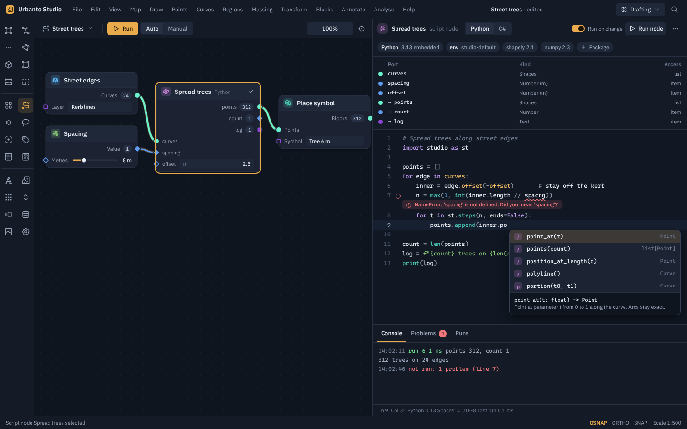
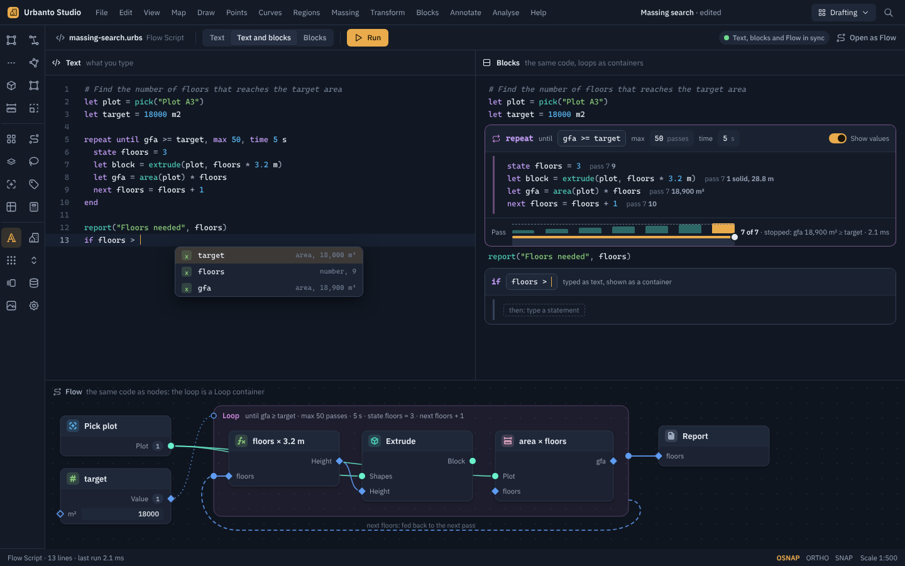
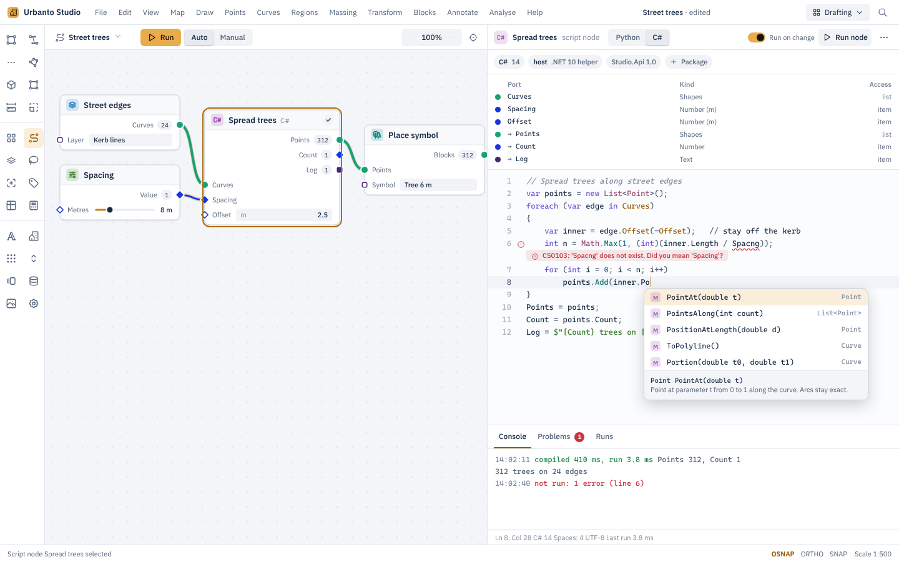
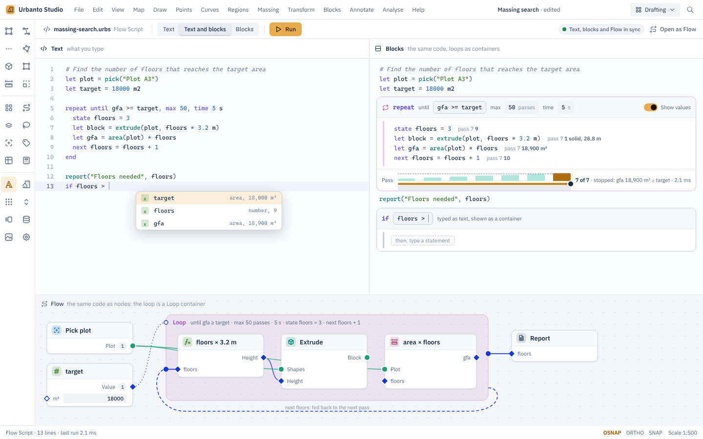

# C21: A script node (Python and C#), and a language that is text and blocks at once

Researched, measured and drawn on 2026-11-01. The brief is [briefs/C21-script-node-and-visual-text-language.md](../../briefs/C21-script-node-and-visual-text-language.md). No Studio code was asked for or seen. The look follows C19.

## Answer

Run user scripts outside Studio's process, and make the language text first with blocks as a view of it.

**Script hosts.**
- **Python** runs in a long-lived worker process: the python.org embeddable build, with packages managed by uv. It talks to Studio over a pipe, and shapes travel as flat columns of numbers, never one object at a time.
- **C#** runs in a small .NET helper process. The helper compiles each script once with Roslyn, keeps the result in a collectible load context, and uses the same pipe protocol.

**Why not in-process.** Neither can run inside the Native AOT process:
- Roslyn scripting fails under AOT with "Operation is not supported on this platform" ([roslyn #73689](https://github.com/dotnet/roslyn/issues/73689)).
- pythonnet and IronPython need `Reflection.Emit`.
- Embedding CPython in-process is possible but gives no crash isolation. It cannot be restarted cleanly after a package change ([interp-lifecycle](https://docs.python.org/3/c-api/interp-lifecycle.html)), and Python has no in-process sandbox ([sys](https://docs.python.org/3/library/sys.html)).

**Cost (measured here).** MEASURED_SUMMARY

**Editor.** AvaloniaEdit 12 (MIT) with TextMate highlighting for the two languages only. Completion and errors come from language servers in their own processes: Jedi and ruff for Python, Roslyn in the C# helper. Studio's API completes from generated `.pyi` stubs and reference assemblies.

**The language, "Flow Script" (working name).** Expressions are typed as plain text. Statements such as `repeat`, `for each`, `if` and `fn` are frames: containers whose header line holds their fields (a count, an until condition, a time limit). This is the frame-based design that, in a 2016 study, cut median time on syntax-only edits from 321 s in Java to 94 s ([Price et al. 2016, old](https://kar.kent.ac.uk/56259/1/icer027-priceA.pdf)).
- **Views.** Text and blocks are two views of one file. The view switch never refuses: code that does not parse yet stays visible as editable text with an error, not a locked block.
- **Flow.** Every `repeat` becomes Flow's Loop container and every `for each` its For-each container.

**First step.** A Python script node on its own is useful: named typed ports, print capture, errors on the right line.

## What is in this folder

| File | What it is |
|---|---|
| `C21-script-node-and-text-and-blocks-language.md` | This report |
| `mockups/*.html`, `mockups/png/*.png` | The mockups, dark and light, and their HTML sources |
| `mockups/c21.css`, `tokens.css`, `chrome.css` | Styles: C21 parts (including code syntax colours) on top of the C19 tokens and chrome |
| `tools/build_c21.py`, `tools/flowsvg.py`, `tools/render.js` | Generators and PNG export |
| `bench/` | The measurement programs and their raw output (section 2.3) |
| `research/` | Full research notes ([R21A hosting](research/R21A-script-nodes-and-hosting.md), [R21B editor](research/R21B-code-editor.md), [R21C languages](research/R21C-text-and-blocks-languages.md)) and `sources.json` (315 sources) |

## 1. How others do script nodes

| Host | How a script node works | Good | Bad |
|---|---|---|---|
| Rhino 8 ScriptEditor (Grasshopper Script) | One Script node with a language switch (Python 3, IronPython, C#). Named, typed inputs with Item, List or Tree access. Packages are declared in the script with `# r: numpy`, a PEP 723 block, or `#r "nuget: Name, ver"` ([packages](https://developer.rhino3d.com/guides/scripting/advanced-packages/)). One debugger covers both languages ([debugging](https://developer.rhino3d.com/guides/scripting/editor-debug/)) | Typed ports enable completion; package lines live in the script; a Terminal captures print ([Terminal](https://developer.rhino3d.com/guides/scripting/editor-terminal/)) | All Python shares "the same process, same memory, and same python interpretter state". Package versions clash, and Windows locks packages until restart ([pyvenvs](https://developer.rhino3d.com/guides/scripting/advanced-pyvenvs/)). A user reports Python 3 "about 10x slower" for RhinoCommon-heavy work ([forum, user](https://discourse.mcneel.com/t/python-3-about-10x-slower-than-old-python-component/215094)). Rhino 8 is stuck on Python 3.9 ([McNeel post](https://discourse.mcneel.com/t/rhino-beta-feature-python-3-13/205209)) |
| Dynamo Python Script | Positional `IN[0]` inputs and one `OUT` ([primer](https://primer2.dynamobim.org/8_coding_in_dynamo/8-3_python/1-python.md)). Dynamo 4.0 made PythonNet3 the default and auto-migrated older nodes ([4.0](https://dynamobim.org/dynamo-core-4-0-release/)) | Simple to start | The engine switch broke graphs: collections no longer converted, enums no longer integers, strict signatures ([migration](https://dynamobim.org/dynamo-pythonnet3-upgrade-a-practical-guide-to-migrating-your-dynamo-graphs/)). Completion works "only if you execute the import code first" ([forum](https://forum.dynamobim.com/t/intellisense-for-python/85040)) |
| Houdini Python SOP and VEX | Python reads and writes attributes in bulk; VEX runs "close to compiled C/C++" ([VEX](https://www.sidefx.com/docs/houdini/vex/index.html)). `pointFloatAttribValues` is "faster than looping" ([hou.Geometry](https://www.sidefx.com/docs/houdini/hom/hou/Geometry.html)) | Bulk array access is fast | Users buy third-party editors for autocomplete ([forum](https://www.sidefx.com/forum/topic/102715/lofi/)) |
| Blender Python | `foreach_get` / `foreach_set` move "flattened values" ([bpy_prop_collection](https://docs.blender.org/api/current/bpy.types.bpy_prop_collection.html)); auto-run of scripts in files is off by default | Flat arrays; safe default for files | One process, no isolation |
| Roslyn scripting, LINQPad | `CSharpScript.EvaluateAsync` compiles and runs a snippet. LINQPad runs each query in "a separate server" process so it can cancel safely ([LINQPad](https://www.linqpad.net/HowLINQPadWorks.aspx)) | Real C# with packages | Each evaluation creates an assembly that is never unloaded: "Unloading is currently not supported" ([roslyn #41722](https://github.com/dotnet/roslyn/issues/41722)) |

pyRevit, TouchDesigner and Unreal Python are covered in the [research notes](research/R21A-script-nodes-and-hosting.md). All three run Python inside the host process, with the same isolation and package problems.

## 2. Hosting Python and C# in a .NET 10 Native AOT app

### 2.1 The constraint

Native AOT allows "No dynamic loading, for example, Assembly.LoadFile" and "No runtime code generation, for example, System.Reflection.Emit" ([Native AOT](https://learn.microsoft.com/en-us/dotnet/core/deploying/native-aot/)). Anything that compiles or loads new .NET code at run time must therefore live in another process.

### 2.2 Options

| Option | Works in AOT | Crash isolation | Sandbox | Restart after package change | Debugging | Licence | Size |
|---|---|---|---|---|---|---|---|
| Python: own C API bindings in-process | Yes (plain P/Invoke) | No | None in-process ([sys](https://docs.python.org/3/library/sys.html)) | No: modules stay loaded after `Py_FinalizeEx` ([lifecycle](https://docs.python.org/3/c-api/interp-lifecycle.html)) | debugpy needs `configure(python=...)` ([#1097](https://github.com/microsoft/debugpy/issues/1097)) | PSF | 26.5 MB unpacked for the 3.15.2 embeddable build (measured by R21A) |
| Python: CSnakes | Claimed, with build-time bindings only ([CSnakes AOT](https://tonybaloney.github.io/CSnakes/v1/advanced/native-aot/)); net10.0 only in the 2.0 beta | No | None | No | As above | MIT | Python plus a 0.5 MB package |
| Python: pythonnet | No: Reflection.Emit ([ClassDerived.cs](https://github.com/pythonnet/pythonnet/blob/master/src/runtime/Types/ClassDerived.cs), [#997](https://github.com/pythonnet/pythonnet/issues/997)) | No | None | No | As above | MIT | n/a |
| Python: IronPython 3 | No: "almost none of IronPython is AOT safe" ([#1896](https://github.com/IronLanguages/ironpython3/issues/1896)); Python 3.4, no numpy | No | None | n/a | Limited | Apache-2.0 | n/a |
| **Python: worker process over a pipe** | **Yes** | **Yes: kill and restart** | **OS only: Job object and AppContainer** ([AppContainer](https://learn.microsoft.com/en-us/windows/win32/secauthz/appcontainer-isolation)) | **Yes: new process** | **Plain debugpy attach** | **PSF** | **Same Python, plus uv** |
| C#: Roslyn in the AOT process | No ([#73689](https://github.com/dotnet/roslyn/issues/73689)) | n/a | n/a | n/a | n/a | MIT | n/a |
| **C#: JIT helper process with Roslyn** | **Yes (the helper is a normal .NET process)** | **Yes** | **OS only** | **Yes: recycle the helper** | **netcoredbg (MIT) attach** | **MIT** | **About 102.6 MB unpacked: .NET 10.0.14 runtime 80.66 MB, Roslyn 10.35 MB, reference assemblies 11.64 MB (measured by R21A)** |
| C#: an expression interpreter | Yes | No | No | n/a | None | MIT | Small | 

### 2.3 Measured costs

MEASURED_SECTION

### 2.4 Recommendation for Python

- **Runtime.** Ship the python.org embeddable build of one current Python (3.13 or 3.14 at release), unpacked once into Studio's data folder. The embeddable zip is meant "for acting as part of another application" but has no pip ([Python on Windows](https://docs.python.org/3/using/windows.html)), so Studio ships `uv` for packages ([uv scripts](https://docs.astral.sh/uv/guides/scripts/)).
- **Process.** One long-lived worker per environment, started when the first Python node runs and kept warm. Nodes in that environment run one after another in it.
  - **Limits.** The worker sits in a Windows Job object with kill-on-close, a memory cap and a time limit per run. Cancel kills and restarts it.
  - **Untrusted flows.** An optional AppContainer mode removes network access and file access outside the project.
- **Data.**
  - **Format.** Shapes and attributes travel as columns: `kind`, start and end x and y, centre, radius and the two angles for arcs (NaN when unused), a lineage id, then one column per attribute. Columns arrive in Python as numpy arrays.
  - **Ease of use.** A thin `studio` package wraps them as `Line`, `Arc` and `Shape` objects, so simple scripts stay readable.
  - **Item mode.** Item access is the host looping over rows; the user never writes that loop.
  - **What to avoid.** Never marshal one element at a time; CSnakes copies lists that way ([performance](https://tonybaloney.github.io/CSnakes/v1/advanced/performance/)), and Dynamo had to move away from it ([migration](https://dynamobim.org/dynamo-pythonnet3-upgrade-a-practical-guide-to-migrating-your-dynamo-graphs/)).
- **Packages.**
  - **Declaring.** A node declares packages in its first lines, as Rhino does: `# r: shapely` or a PEP 723 block ([Rhino](https://developer.rhino3d.com/guides/scripting/advanced-packages/)).
  - **Installing.** uv installs them into the node's environment and writes a lock file.
  - **Environments.** Environments are named ("studio-default", or one per project). Two nodes needing different versions use two environments, so they never clash as they do in Rhino ([pyvenvs](https://developer.rhino3d.com/guides/scripting/advanced-pyvenvs/)).
  - **Offices.** Offices can point uv at an internal package mirror.
- **Trust.** Scripts in a flow from someone else do not run until the user trusts the flow. Python's docs say audit hooks are "not suitable for implementing a 'sandbox'" ([sys](https://docs.python.org/3/library/sys.html)), so the only real boundary is the process.
- **Upgrades.** One Python version at a time. When Studio moves to a newer Python, nodes keep their environment until the user upgrades it, with a report of failures. This avoids Dynamo's four engines ([4.0](https://dynamobim.org/dynamo-core-4-0-release/)) and Rhino's ageing 3.9.

### 2.5 Recommendation for C#

- **Helper.** A framework-dependent .NET 10 helper, `Studio.ScriptHost.exe`, installed with Studio. It holds Roslyn and is started on first use.
- **Compiling.**
  - **Method.** Each node's code is compiled with `CSharpCompilation`, not the scripting API, into an assembly cached by a hash of the source and references.
  - **Loading.** The assembly loads into a collectible `AssemblyLoadContext`.
  - **Recycling.** The helper recycles itself after a set number of compiles or above a memory limit, because Roslyn cannot unload scripting assemblies ([#41722](https://github.com/dotnet/roslyn/issues/41722)).
- **Same pipe, same columns.** The protocol and data layout are the ones Python uses, so Studio has one script bridge with two back ends.
- **Packages.** `#r "nuget: Name, ver"` lines, as Rhino supports. NuGet restores them into a per-node cache.
- **Editor services.** The same helper runs Roslyn completion, quick info, formatting and diagnostics for the editor (2.6). Signature help is internal in Roslyn ([source](https://raw.githubusercontent.com/dotnet/roslyn/main/src/Features/Core/Portable/SignatureHelp/ISignatureHelpProvider.cs)), so Studio builds a small one from symbol information.
- **Debugging.** netcoredbg (MIT) attaches to the helper, not to Studio. vsdbg and the VS Code C# extension may not be shipped: the extension "may only" be used with Microsoft's tools ([licence](https://raw.githubusercontent.com/dotnet/vscode-csharp/main/RuntimeLicenses/license.txt)).

### 2.6 The editor



| Need | How | Source |
|---|---|---|
| Text editing, search and replace, folding, completion window | AvaloniaEdit 12.0.0 (MIT, released 2026-04-08, 2,272,350 downloads); it has no minimap and no built-in squiggles, so Studio draws its own error underline layer | [R21B notes](research/R21B-code-editor.md), [discussion #279](https://github.com/AvaloniaUI/AvaloniaEdit/discussions/279) |
| Highlighting | TextMateSharp with only the Python and C# grammars; the bundled package is 6.75 MB with 51 grammars, so Studio supplies its own two. AOT fixes merged in 2023 | [PR #42](https://github.com/danipen/TextMateSharp/pull/42) |
| Named, typed ports | The ports table above the code (name, kind, item or list), synced both ways with a generated hidden header that declares them, as Rhino does with its signature | [Rhino guide](https://developer.rhino3d.com/guides/scripting/scripting-gh-python/) |
| Python completion and errors | Language servers over stdio: ruff 0.17.3 for lint and format (`ruff server`, MIT) and Jedi for completion. ty (Beta) and basedpyright (pulls a 42.4 MB Node wheel) are later options. Pylance is closed source | [ruff](https://docs.astral.sh/ruff/editors/), [Jedi](https://jedi.readthedocs.io/en/latest/docs/features.html), [ty](https://docs.astral.sh/ty/) |
| C# completion and errors | Roslyn in the C# helper (2.5) | [Native AOT](https://learn.microsoft.com/en-us/dotnet/core/deploying/native-aot/) |
| Studio's API | `.pyi` stub files generated in Studio's build (McNeel does this for RhinoCommon) and reference assemblies with XML docs | [pythonstubs](https://github.com/mcneel/pythonstubs), [PEP 561](https://peps.python.org/pep-0561/), [reference assemblies](https://learn.microsoft.com/en-us/dotnet/standard/assembly/reference-assemblies) |
| Console | Print captured per run with time and duration, a Problems tab, and a Runs tab with the last runs' outputs | Rhino's Terminal ([docs](https://developer.rhino3d.com/guides/scripting/editor-terminal/)) |
| Run | "Run on change" (default on, with the flow's run mode) or Run node on demand; a run never starts while the code has errors | |
| Debugging | debugpy attach for Python (a plain `python.exe` worker needs no workaround) and netcoredbg for C# | [debugpy](https://github.com/microsoft/debugpy) |

Two risks need tests:
- **AOT.** AvaloniaEdit has no `IsAotCompatible` marker, so it must be tested in a published AOT build.
- **Screen readers.** They cannot read AvaloniaEdit today, and the maintainer has "no immediate plans" ([#541](https://github.com/AvaloniaUI/AvaloniaEdit/issues/541)).

  Until that changes, Studio should:
  - announce problems and run results as UI Automation notifications (C16);
  - offer a "read current line" command.

A Monaco web view would read well with screen readers ([guide](https://github.com/microsoft/monaco-editor/wiki/Monaco-Editor-Accessibility-Guide)), but it brings its own browser processes and a 25 MB bundle, so it is the fallback, not the plan.

## 3. A language that is text and blocks at once

### 3.1 What the study found

| Approach | Lesson | Source |
|---|---|---|
| JetBrains MPS (projectional) | Basic editing reached text speed after 45 minutes of training (19 people, 2016, old), but "Editing expressions with their fine-grained tree structure is one of the major challenges". The vendor calls typing an "illusion of editing text" | [Berger et al. 2016](https://gup.ub.gu.se/file/206790), [MPS docs](https://www.jetbrains.com/help/mps/commanding-the-editor.html) |
| Dark (structured editor) | Removed in Feb 2023: users could not "just type their code" | [Darklang blog](https://blog.darklang.com/gpt/) |
| Stride / frame-based editing | Statements are frames entered with one key; expressions are typed text. Median time on syntax-only edits was 321 s in Java against 94 s in Stride (32 students, p < 0.001; 2016, old) | [Price et al. 2016](https://kar.kent.ac.uk/56259/1/icer027-priceA.pdf) |
| MakeCode, Pencil Code (dual mode) | "Complex errors can prevent mode switching"; MakeCode users are told "Oops, something went wrong trying to convert your code". Unconvertible code becomes a grey block that "cannot be edited" | [Bau et al. 2017](https://arxiv.org/abs/1705.09413), [forum](https://forum.makecode.com/t/im-stuck-in-javascript-and-cant-convert-back-to-blocks/18177), [MakeCode](https://arcade.makecode.com/blocks/javascript-blocks) |
| Blockly | No text-to-blocks; the request is open since 2024-05-29 | [issue #8183](https://github.com/RaspberryPiFoundation/blockly/issues/8183) |
| Unison, Snap! | Comments are lost when text is rebuilt from a tree (Unison calls it "by design") | [Unison #6262](https://github.com/unisonweb/unison/issues/6262), [Snap! syntax](https://github.com/jmoenig/Snap/blob/master/docs/Syntax.md) |
| Enso | Plain text plus a metadata trailer mapping text spans to node IDs and positions; its own docs warn one extra newline can break the offsets | [ensoFile.ts](https://github.com/enso-org/enso/blob/4135f929f1046ee4ab62d9d09c155377e8542a1f/app/ydoc-shared/src/ensoFile.ts) |
| Hazel, tylr | Holes keep half-typed code running; 7 of 9 said holes helped while writing, but 5 of 9 said they got in the way when changing code | [Hazel](https://hazel.org/), [tylr study](https://arxiv.org/pdf/2508.16848) |
| ShellVis, Houdini loops | Showing every pass side by side was dropped because it "disrupt[s] the visual correspondence" with the code; a slider on the loop line replaced it. Houdini steps a single pass and advises starting with "1 or 2 iterations" | [ShellVis](https://arxiv.org/pdf/2609.11000), [Houdini](https://www.sidefx.com/docs/houdini/model/looping.html) |
| Pencil Code | Students used blocks to discover new statements: 65.4 percent of 217 text-to-blocks switches were to add a command (2017, old) | [Pencil Code study, 2017](https://ccl.netlogo.org/2017/Blocks.pdf) |
| Jupyter | Of 863,878 notebooks re-run, 24.11 percent ran without errors and 4.03 percent gave the same results; hidden run order is the cause (2019, old) | [Pimentel et al. 2019](http://www.ic.uff.br/~leomurta/papers/pimentel2019a.pdf) |
| Houdini VEX, Rhino 8 | Code can create UI: `ch()` calls create parameters with one button, but no range can be written in code ("There is none"). Rhino keeps the ports and the RunScript signature in sync both ways | [spare parameters](https://www.sidefx.com/docs/houdini/network/spare.html), [forum](https://www.sidefx.com/forum/topic/86085), [Rhino](https://developer.rhino3d.com/guides/scripting/scripting-gh-python/) |

### 3.2 Design principles

1. **Text is the source of truth.** The file is plain text, so it diffs, merges and pastes, and typing always works (the Dark lesson).
2. **Statements are frames; expressions stay text.** Only `repeat`, `for each`, `if` and `fn` become containers. Formulas are typed left to right, never as trees (the MPS and Stride lessons).
3. **A container's header is one line of text.** Its fields (count, until condition, limits) are projections of that line, so editing the field edits the text and vice versa.
4. **The view switch never refuses, and nothing is lost.**
   - A region that does not parse shows in the blocks view as an editable text frame with the error.
   - Comments are part of the syntax tree and round-trip in both directions (the MakeCode and Unison lessons).
5. **Run order is data order.** As in Flow and Observable, a statement runs when its inputs are ready, not in the order cells were clicked (the Jupyter lesson).
6. **One pass at a time.** A loop container shows a pass scrubber and the chosen pass's values inline, not every pass side by side (the ShellVis lesson).
7. **Holes only for new code.** An empty container shows a hole ("then: type a statement"). Editing existing code never inserts holes (the tylr lesson).
8. **Code can declare inputs with their range.** `input("Spacing", 8 m, range: 4 m .. 20 m)` creates a port and slider with its range written in the code (the Houdini lesson).

### 3.3 Grammar sketch

```ebnf
program     = { statement NEWLINE } ;
statement   = let | input | state | next | yield | repeat | each | if | fn | expr | comment ;
let         = "let" name [ ":" type ] "=" expr ;
input       = "let" name "=" "input" "(" string "," expr { "," option } ")" ;   (* becomes a port *)
state       = "state" name "=" expr ;          (* inside repeat: value on pass 1 *)
next        = "next" name "=" expr ;           (* inside repeat: value for the next pass *)
yield       = "yield" expr ;                   (* inside for each: adds to the collected list *)
repeat      = "repeat" ( expr "times" | "until" expr ) { "," limit } NEWLINE body "end" ;
limit       = "max" integer | "time" quantity ;
each        = "for" "each" name "in" expr [ "collect" name ] NEWLINE body "end" ;
if          = "if" expr NEWLINE body { "else" "if" expr NEWLINE body } [ "else" NEWLINE body ] "end" ;
fn          = "fn" name "(" [ param { "," param } ] ")" [ "->" type ] NEWLINE body "end" ;
body        = { statement NEWLINE } ;
expr        = compare { "|>" call } ;
compare     = sum [ ( "==" | "!=" | "<" | "<=" | ">" | ">=" ) sum ] ;
sum         = term { ( "+" | "-" ) term } ;
term        = unary { ( "*" | "/" | "//" | "%" ) unary } ;
unary       = [ "-" | "not" ] postfix ;
postfix     = atom { "." name | "(" [ args ] ")" } ;
atom        = quantity | number | string | name | list | "(" expr ")" ;
quantity    = number unit ;                    (* 3.2 m, 18000 m2, 5 s, 45 deg *)
comment     = "#" { any character } ;
```

**Design rules.**
- **Blocks end with `end`.** Indentation is free, so pasting and half-typed code never change meaning.
- **Every block statement has exactly one header line.**
- **Names bound with `let` are fixed.** A loop carries state only through `state` and `next`, which is exactly a Loop container's feedback port.
- **Calls are Studio commands**, the same commands Flow's nodes are made of. `offset(edge, 2.5 m)` is the Offset node.
- **Numbers carry units**, like Flow's typed ports.

### 3.4 Text, blocks and Flow

| Text | Block view | Flow |
|---|---|---|
| `let x = expr` | A text line; with "Show values" on, the current value follows the line | An expression node, or the command node a call names |
| `let s = input("Spacing", 8 m, range: 4 m .. 20 m)` | A text line with a slider chip | An exposed value port with that range |
| `repeat until cond, max N, time T` ... `end` | A Loop container. Header fields: until (an expression field), max passes, time. Body: the statements. Footer: the pass scrubber and stop message | A Loop container with pass count, stop expression and time limit, which Flow already has |
| `state v = a` / `next v = b` | Lines inside the loop container | The loop's feedback port for `v`: initial value `a`, next value `b` |
| `repeat N times` | A Loop container with a count field | A Loop container with a pass count only |
| `for each e in list collect out` ... `yield x` ... `end` | A For-each container: the list field, the item name, the collected output | A For-each container whose output port is `out` |
| `if cond` ... `else` ... `end` | An If container with a condition field and then/else bodies | A branch (a choose node) |
| `fn name(params)` ... `end` | A Function container | A sub-flow, which Flow already opens in place |
| `# comment` | A comment line | A sticky note attached to the node made by the next statement |

**Round trip with Flow.**
- **Text to Flow** always works: every statement maps to a node or container.
- **Flow to text** works for flows that use only these constructs. Other nodes become `node("Name", ...)` calls, so nothing is dropped.
- **Layout.** Node positions are stored in a side file keyed by a stable statement ID and re-matched by name and structure after edits, never by character offsets. Enso's own docs warn that one extra newline breaks offsets ([ensoFile.ts](https://github.com/enso-org/enso/blob/4135f929f1046ee4ab62d9d09c155377e8542a1f/app/ydoc-shared/src/ensoFile.ts)).

### 3.5 Editor interactions



- **Typing.**
  - Typing `rep` and Tab inserts `repeat until _, max 50` and `end`, with the cursor in the condition. The block view shows the container at once.
  - Typing `if floors > ` shows an If container whose condition field holds the text being typed, and completion offers names in scope with their current values (`target`, area, 18,000 m²).
- **Fields edit text.** Changing "max 50" in a header field rewrites the header line; editing the line updates the field.
- **Moving and deleting.** Blocks drag by their handle to move a whole statement. Deleting a container header with its `end` keeps the body, unwrapped (the MPS "clear the if" gesture, without over-deletion).
- **Views.** Text, Text and blocks, and Blocks are views of one file (Ctrl+Shift+B cycles). "Open as Flow" shows the same program as nodes, with a sync indicator.
- **Passes.** The scrubber picks a pass. Each line then shows its value for that pass, for example "pass 7: 18,900 m²". The default pass is the last one, because that is where the loop stopped.
- **Errors.** An error shows in place under its line, as in the script editor. The block view never hides code that does not parse.

## 4. Mockups

**The script node.**
- Python, dark: [c21-script-node-python-dark.png](mockups/png/c21-script-node-python-dark.png), shown in 2.6.
- C#, light:

  

- Also rendered: [Python, light](mockups/png/c21-script-node-python-light.png) and [C#, dark](mockups/png/c21-script-node-csharp-dark.png).

**The text-and-blocks editor.** Dark is shown in 3.5. Light:



## 5. Build plan

Sizes:
- **S** means hours to a day.
- **M** means days (2 to 10).
- **L** means weeks.

They are estimates; Studio's code was not seen.

| Step | What | Size | Useful alone because |
|---|---|---|---|
| 1 | Python script node v1: worker process with the embeddable Python; ports table (name, kind, item or list); run on change or on demand; print capture; errors on their line; AvaloniaEdit with TextMate highlighting; trust prompt for other people's flows; Job object limits and cancel | M | Designers can script anything Flow lacks, safely |
| 2 | Column data bridge and the `studio` Python package, with `.pyi` stubs for completion | M | Fast for thousands of shapes; readable scripts |
| 3 | Packages: named environments, `# r:` and PEP 723 lines, uv installs and lock files, office mirror | M | numpy, shapely and the rest, without clashes |
| 4 | Editor services: ruff and Jedi language servers, Studio API completion, Problems tab, Runs tab | M | Completion and live errors |
| 5 | C# script node: .NET helper with Roslyn compile, cache and collectible load context, the same bridge, Roslyn completion | L | C# for offices that prefer it, with the same node and editor |
| 6 | Debugging: debugpy and netcoredbg attach; a "values per run" panel | M | Hard bugs become fixable |
| 7 | Flow Script v1: parser, text editor with highlighting and completion, run as a flow (text to Flow) with no blocks view yet | L | A quick text way to build flows |
| 8 | Block view: frames with header fields, Show values, the pass scrubber, never-refusing switch, comment round trip | L | The "text with UI" the owner asked for |
| 9 | Flow to text for supported flows, the layout side file, round-trip tests on every saved flow | L | One program in three views |
| 10 | `input()` ports with ranges, and calling script nodes from Flow Script | M | Code creates its own UI |

**Risks:**
- **AvaloniaEdit under AOT.** It is not marked AOT-compatible; test a published build early.
- **Screen readers.** AvaloniaEdit has no screen-reader support ([#541](https://github.com/AvaloniaUI/AvaloniaEdit/issues/541)). This conflicts with C16's goals, so plan notifications as a workaround and budget an upstream contribution.
- **Python version upgrades** break scripts, as Dynamo found. Keep one version per environment and upgrade deliberately.
- **Antivirus software** can slow or block spawned worker processes on office PCs. Sign `Studio.ScriptHost.exe` and the Python launcher, and test on a locked-down Windows image.
- **Small calls.** Per-call overhead hurts scripts called once per item. The host runs item mode inside one call over all rows.
- **Untrusted code.** Python cannot be sandboxed in-process, so flows from others must stay untrusted until the user agrees, and AppContainer mode must be tested.
- **The C# helper's size** is about 103 MB unpacked. Download it on first use for users who never write C#.
- **Round-trip edge cases.** The text-to-Flow mapping must stay total. Keep a test corpus of every construct and every saved flow.

## 6. Ten things not to copy

1. **Hosting Roslyn, pythonnet or IronPython inside the AOT process.**
   - **Who:** RoslynPad in-process, Dynamo, IronPython.
   - **Why not:** they need dynamic loading or Reflection.Emit ([#73689](https://github.com/dotnet/roslyn/issues/73689), [#1896](https://github.com/IronLanguages/ironpython3/issues/1896)).
2. **One shared interpreter and package folder for every script.**
   - **Who:** Rhino 8, pyRevit.
   - **Why not:** versions clash and packages stay locked until restart ([pyvenvs](https://developer.rhino3d.com/guides/scripting/advanced-pyvenvs/)).
3. **Several Python engines side by side, or a bundled Python left to age.**
   - **Who:** Dynamo's four engines, Rhino's 3.9.
   - **Why not:** see the [migration guide](https://dynamobim.org/dynamo-pythonnet3-upgrade-a-practical-guide-to-migrating-your-dynamo-graphs/).
4. **Passing lists one element at a time.**
   - **Who:** CSnakes lists, the old Dynamo and Rhino bridges.
   - **Why not:** it is slow for large lists ([performance](https://tonybaloney.github.io/CSnakes/v1/advanced/performance/)).
5. **Untyped positional inputs, and completion that needs a run first.**
   - **Who:** Dynamo's `IN[0]` and `OUT`.
   - **Why not:** see the [forum](https://forum.dynamobim.com/t/intellisense-for-python/85040).
6. **Running scripts from opened files without asking.**
   - **Who:** anything that auto-runs. Blender keeps auto-run off by default.
   - **Why not:** Python cannot be sandboxed in-process ([sys](https://docs.python.org/3/library/sys.html)).
7. **A view switch that can refuse.**
   - **Who:** MakeCode.
   - **Why not:** see the [forum](https://forum.makecode.com/t/im-stuck-in-javascript-and-cant-convert-back-to-blocks/18177).
8. **Uneditable fallback blocks, or comments lost on the round trip.**
   - **Who:** MakeCode's grey blocks, Unison and Snap! for comments.
   - **Why not:** see [MakeCode](https://arcade.makecode.com/blocks/javascript-blocks) and [Unison #6262](https://github.com/unisonweb/unison/issues/6262).
9. **Strict tree editing for expressions.**
   - **Who:** MPS, Dark.
   - **Why not:** see [Berger et al.](https://gup.ub.gu.se/file/206790) and the [Darklang blog](https://blog.darklang.com/gpt/).
10. **Hidden run order, and every loop pass shown side by side.**
    - **Who:** Jupyter, early ShellVis.
    - **Why not:** see [Pimentel et al.](http://www.ic.uff.br/~leomurta/papers/pimentel2019a.pdf) and [ShellVis](https://arxiv.org/pdf/2609.11000).

Also considered: parameters created from code with no range (Houdini), and shipping Microsoft's C# extension or vsdbg (licence).

## Choices made

- **Branch.** Branch `report/C21` was made from `main`, which holds the brief. No pull request was opened, because the request asked for a pushed branch.
- **Style.** The mockups reuse the C19 tokens, fonts, Tabler icons and Flow node drawing, copied into this folder, because C19 is not merged into `main` yet. Code syntax colours are new tokens in `mockups/c21.css`; amber stays for selection and the caret only.
- **Hosting.**
  - **Python.** A worker process was chosen over in-process embedding, although embedding works under AOT. Crash isolation, clean restarts after package changes and a real security boundary matter more for a desktop CAD program than the lower per-call cost of embedding. The measured costs are in 2.3.
  - **C#.** `CSharpCompilation` in a helper was chosen over the scripting API, because scripting assemblies cannot be unloaded.
- **Editor engines.** Jedi was chosen over ty or basedpyright for completion today: ty is still Beta and basedpyright needs Node. This should be reviewed when ty is stable.
- **The language.** The name "Flow Script" and the `.urbs` file extension are working names. The syntax is keyword-led with `end`, rather than indentation-based like Python, so that half-typed and pasted code never changes meaning while the block view is live. Python itself remains available in the script node.
- **The example.** The loop example (floors needed to reach a target area) and its numbers are illustrative: a 2,100 m² plot, 3 to 9 floors.
- **Measurements.** They ran on this Linux x64 VM (4 cores, shared). Windows numbers will differ; section 2.3 says how they were taken.
- **Research gaps.** Some pages were blocked (food4rhino, the ACM Digital Library, the MPS forum, the Scratch Wiki, parts of Observable's docs). The research notes list them, and no claim here relies on them.
