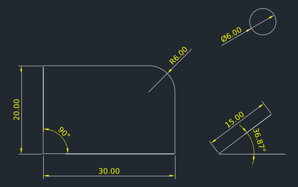
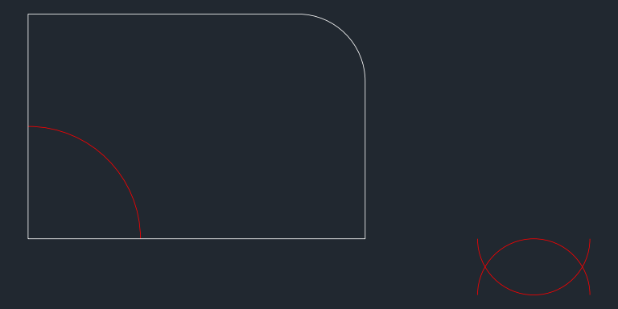

# C6: DWG and DXF interchange

Researched 2026-10-30. Brief file unavailable; scope taken from the task line. All measurements ran on Linux x64 with ezdxf 1.4.5 and the .NET 8 SDK. No Windows or AutoCAD was available.

## Answer

Write DXF R2000 with Studio's own code (or ACadSharp), use ACadSharp for DWG, and keep the ODA Drawings SDK as the paid fallback. A DXF R2000 (AC1015) file needs a HEADER with `$ACADVER` and `$HANDSEED`, a CLASSES section (may be empty), nine TABLES (ByBlock, ByLayer and Continuous line types, layer `0`, `Standard` text and dimension styles, the `ACAD` appid, and `*Model_Space` and `*Paper_Space` block records), the two layout blocks, ENTITIES, and OBJECTS whose root dictionary holds `ACAD_GROUP` [[1]](https://ezdxf.mozman.at/docs/dxfinternals/filestructure.html). My hand-written version of that file is 3,041 bytes, and every DIMENSION must carry its rendered block because "AutoCAD refuses to open DXF files containing DIMENSION entities without a content BLOCK" [[5]](https://ezdxf.readthedocs.io/en/stable/dxfentities/dimension.html). ACadSharp 3.8.35 (MIT, free) was the only DWG option that met Studio's constraints in my tests. It wrote AC1015, AC1018 and AC1024 DWG files that Aspose.CAD, an independent reader, reopened with the same entity counts, and it runs under Native AOT once the assembly is rooted (`<TrimmerRootAssembly Include="ACadSharp" />`: 12.1 MB linux-x64 executable, 19 warnings; the default 8.1 MB AOT build failed at run time). Its measured gaps: Arabic becomes `?` in R2000 unless `$DWGCODEPAGE` is `ANSI_1256`, layer plot-style handles are lost, and `\U+` escapes are not decoded. RealDWG costs USD 8,000 or EUR 7,500 per year for up to 10,000 end users and is "a Windows desktop application only" (read 2026-10-30) [[19]](https://www.techsoft3d.com/products/realdwg/). ODA publishes no price, only a plan calculator and a 60-day trial [[21]](https://www.opendesign.com/free-trial)[[22]](https://www.opendesign.com/pricing/plan-calculator). Aspose.CAD (from USD 799 [[26]](https://purchase.aspose.com/pricing/cad/net)) and CadLib (from EUR 382 [[28]](https://www.woutware.com/cadlib-net), both read 2026-10-30) failed at run time under Native AOT, and LibreDWG is GPL-3.0 [[25]](https://github.com/LibreDWG/libredwg). Main caveat: no AutoCAD was available, so "opens without RECOVER" is inferred from Autodesk's DXF reference, ezdxf's documentation and four independent readers; open the sample set in AutoCAD or DWG TrueView 2024+ on Windows before shipping.

## DWG library decision table

"Measured" means I built and ran a linux-x64 Native AOT console app that reads the sample DXFs and writes DXF/DWG (sources in [assets/C6/dotnet](assets/C6/dotnet)). A baseline "hello world" AOT executable is 1.58 MB. Executable sizes exclude the separate `.dbg` symbol file. These are Linux numbers; Windows sizes will differ.

| Option | Read DWG | Write DWG | DXF | Licence | Price (read 2026-10-30) | Native AOT | Package / binary size | Platform | Maturity |
|---|---|---|---|---|---|---|---|---|---|
| **ACadSharp 3.8.35** (DomCR) | AC1014 to AC1032 [[30]](https://github.com/DomCR/ACadSharp) | AC1014, AC1015, AC1018, AC1024, AC1027, AC1032; not AC1021 [[30]](https://github.com/DomCR/ACadSharp) | Read AC1009+, write AC1012+ [[30]](https://github.com/DomCR/ACadSharp) | MIT [[34]](https://api.nuget.org/v3/registration5-gz-semver2/acadsharp/index.json) | Free | **Measured.** Default build: 7 warnings, fails at run time (`KeyNotFoundException`, `MissingMethodException`). With `TrimmerRootAssembly`: 19 warnings, **runs correctly** on all samples | nupkg 4.0 MB; net8.0 DLL 1.48 MB; AOT exe 8.1 MB (broken) / **12.1 MB (working)** | netstandard2.0/2.1, net48, net8/9/10 | 908 stars, 4,814 commits [[30]](https://github.com/DomCR/ACadSharp); 3.8.35 published 2026-10-28 [[34]](https://api.nuget.org/v3/registration5-gz-semver2/acadsharp/index.json) |
| **ODA Drawings SDK** (formerly Teigha) | AC1009 to AC1032 [[20]](https://www.opendesign.com/products/drawings) | "Save to any supported version" [[20]](https://www.opendesign.com/products/drawings) | Yes (ODA's own converter converts .dxf too [[23]](https://www.opendesign.com/guestfiles/oda_file_converter)) | Commercial, annual membership per company [[22]](https://www.opendesign.com/pricing/plan-calculator)[[24]](https://en.wikipedia.org/wiki/Open_Design_Alliance) | **Not published.** The calculator page only showed a placeholder "$ 99,999" when fetched, not a quote [[22]](https://www.opendesign.com/pricing/plan-calculator). 60-day trial [[21]](https://www.opendesign.com/free-trial) | Not tested (C++ libraries; the trial ships C++ and SWIG-based .NET samples [[21]](https://www.opendesign.com/free-trial)) | Not measured | Windows, Linux, macOS, Android, iOS [[20]](https://www.opendesign.com/products/drawings) | Industry SDK; lower plans cap commercial distribution at 100 seats [[22]](https://www.opendesign.com/pricing/plan-calculator) |
| **Autodesk RealDWG** | "since AutoCAD Release 14" [[18]](https://aps.autodesk.com/developer/overview/realdwg) | Same [[18]](https://aps.autodesk.com/developer/overview/realdwg) | Yes [[18]](https://aps.autodesk.com/developer/overview/realdwg) | Annual, maximum 12-month term, royalty-free distribution [[19]](https://www.techsoft3d.com/products/realdwg/) | USD 8,000 or EUR 7,500 per year for up to 10,000 end users. EUR applies to EMEA, which includes the Middle East [[19]](https://www.techsoft3d.com/products/realdwg/) | Not tested. Likely not usable: its managed API is a ".NET Framework API" [[19]](https://www.techsoft3d.com/products/realdwg/), while Native AOT targets .NET 7 or later and has "No C++/CLI" [[35]](https://learn.microsoft.com/en-us/dotnet/core/deploying/native-aot/) | Not measured (download only) | "Windows desktop application only"; no server hosting [[19]](https://www.techsoft3d.com/products/realdwg/) | Autodesk's own library; no trial [[19]](https://www.techsoft3d.com/products/realdwg/) |
| **Aspose.CAD for .NET 26.10.0** | R11 to 2024 (input) [[27]](https://products.aspose.com/cad/net/) | Product page lists only "DWG Release 2015" as bidirectional [[27]](https://products.aspose.com/cad/net/). Measured: `DwgOptions` wrote AC1032, but everything was exploded into LWPOLYLINEs (104 polylines for a one-line drawing; evaluation mode) | Read/write. Measured: the default `DxfOptions` wrote R12 (AC1009) | Proprietary | USD 799 Developer Small Business (1 developer, 1 location); USD 2,397 Developer OEM; USD 11,186 Site OEM; all perpetual with 1 year of updates [[26]](https://purchase.aspose.com/pricing/cad/net) | **Measured: fails.** 58 warnings, including 13 IL3050 (runtime code generation); `TypeInitializationException` on every file | nupkg 71.7 MB; net6.0 DLL 30.3 MB; AOT exe 11.2 MB | netstandard2.0, net6.0, net48 | Frequent releases: 26.6, 26.7, 26.9 and 26.10 in 2026; 26.10.0 published 2026-10-21 [[34]](https://api.nuget.org/v3/registration5-gz-semver2/acadsharp/index.json) |
| **CadLib.NET** (WoutWare), trial package 2026.9.18.1 | Yes; versions not listed [[28]](https://www.woutware.com/cadlib-net) | Yes [[28]](https://www.woutware.com/cadlib-net) | Yes [[28]](https://www.woutware.com/cadlib-net) | Proprietary | "starting at €382" [[28]](https://www.woutware.com/cadlib-net) | **Measured: fails.** 10 warnings plus an assembler error ("symbol 'WW_Cad_____' is already defined"); the executable segfaults (exit 139). The JIT build needs a trial licence key, so functions were not tested | nupkg 5.6 MB + WW_trial 2.2 MB; AOT exe 24.9 MB | .NET 8/10; Windows, Linux, macOS (NuGet description) | Commercial |
| **CAD .NET 16.2** (CADSoftTools) | Yes [[29]](https://cadsofttools.com/products/cad-net/) | "read, edit, and write CAD files" (NuGet description) | Yes | Proprietary | "Get a quote" [[29]](https://cadsofttools.com/products/cad-net/) | Not tested: targets `net8.0-windows`, and AOT cannot cross-compile to Windows from Linux | nupkg 10.1 MB | Windows only (net8.0-windows, .NET Framework) | Commercial |
| **LibreDWG** | All versions; some advanced R2010+ objects skipped [[25]](https://github.com/LibreDWG/libredwg) | Up to R2004; R2007 not; R2010 to R2018 "leads to CRC errors still" [[25]](https://github.com/LibreDWG/libredwg) | Yes; dxf2dwg "r2000 only so far", about 80% coverage [[25]](https://github.com/LibreDWG/libredwg) | GPL-3.0-or-later [[25]](https://github.com/LibreDWG/libredwg) | Free | Not tested (C library) | Not measured | C, cross-platform | Writer immature [[25]](https://github.com/LibreDWG/libredwg) |
| **IxMilia.Dxf 0.8.4** | No | No | R10 to R2014, except MESH, MLEADER, SURFACE, TABLE, VIEWPORT [[31]](https://github.com/ixmilia/dxf) | MIT [[31]](https://github.com/ixmilia/dxf) | Free | **Measured: works.** 0 warnings | nupkg 0.40 MB; DLL 0.90 MB; AOT exe 5.9 MB | netstandard2.0 | Last release 2024-06-13 [[34]](https://api.nuget.org/v3/registration5-gz-semver2/acadsharp/index.json); measured defects in section 1 |
| **netDxf.netstandard 3.0.1** | No | No | AutoCAD 2000 and later only [[32]](https://github.com/haplokuon/netDxf) | MIT [[32]](https://github.com/haplokuon/netDxf) | Free | **Measured: fails.** 2 warnings; `DxfVersionNotSupportedException` on every file, even with the assembly rooted and an rd.xml | nupkg 1.8 MB; DLL 0.77 MB; AOT exe 5.2 to 6.4 MB | net6/8, netstandard2.0, net48 | Repository archived 2023-10-11 [[32]](https://github.com/haplokuon/netDxf) |
| **libdxfrw** (LibreCAD) | Experimental [[33]](https://github.com/LibreCAD/libdxfrw) | Experimental [[33]](https://github.com/LibreCAD/libdxfrw) | ASCII and binary read/write [[33]](https://github.com/LibreCAD/libdxfrw) | GPL-2.0-or-later [[33]](https://github.com/LibreCAD/libdxfrw) | Free | Not tested (C++) | Not measured | C++17 | 295 stars [[33]](https://github.com/LibreCAD/libdxfrw) |
| **Converter: ODA File Converter** | All versions, ACAD9 to ACAD2018 targets [[6]](https://ezdxf.mozman.at/docs/addons/odafc.html) | Same | DWG ↔ DXF, batch, GUI and command line [[23]](https://www.opendesign.com/guestfiles/oda_file_converter) | Terms not stated on the download page [[23]](https://www.opendesign.com/guestfiles/oda_file_converter). Free trial downloads reportedly removed in September 2024 (citation needed on Wikipedia) [[24]](https://en.wikipedia.org/wiki/Open_Design_Alliance) | Not stated | Not applicable (external process). ezdxf calls running it "a major security risk" if the path can change [[6]](https://ezdxf.mozman.at/docs/addons/odafc.html) | Not measured | Windows 10+, Linux x64 (RPM/DEB/AppImage), macOS 13+ [[23]](https://www.opendesign.com/guestfiles/oda_file_converter) | Linux needs `xvfb` to hide the GUI [[6]](https://ezdxf.mozman.at/docs/addons/odafc.html) |

### Minimum R2000 DXF: what each piece does, and how four readers reacted when it was missing

I built a 3,041-byte R2000 file by hand from the ezdxf minimum list ([mini_r2000.py](assets/C6/mini_r2000.py)). I then removed one piece at a time, giving 19 variants in [assets/C6/minimal](assets/C6/minimal), and ran each through four readers:

- ezdxf `readfile()` + `audit()`;
- netDxf 3.0.1 (JIT build, because it fails under AOT);
- ACadSharp 3.8.35 (rooted Native AOT build);
- IxMilia.Dxf 0.8.4 (Native AOT build).

"Silent" means ezdxf loaded the file, reported 0 errors and 0 fixes, and recreated the missing piece in memory without logging it.

| Piece | Required per ezdxf docs [[1]](https://ezdxf.mozman.at/docs/dxfinternals/filestructure.html) / Autodesk | ezdxf 1.4.5 | netDxf | ACadSharp | IxMilia | Studio should write it |
|---|---|---|---|---|---|---|
| HEADER `$ACADVER` = `AC1015` | Yes. AC1015 = AutoCAD 2000 [[8]](https://help.autodesk.com/cloudhelp/2016/ENU/AutoCAD-DXF/files/GUID-A85E8E67-27CD-4C59-BE61-4DC9FADBE74A.htm) | Without HEADER: `readfile` raises DXFTypeError; `recover` treats the file as R12 and deletes CLASSES, OBJECTS and BLOCK_RECORD | Rejects ("version Unknown") | Assumes AC1032 | Assumes R12 | Yes |
| `$HANDSEED` above the largest handle | Yes [[1]](https://ezdxf.mozman.at/docs/dxfinternals/filestructure.html). "Next available handle" [[8]](https://help.autodesk.com/cloudhelp/2016/ENU/AutoCAD-DXF/files/GUID-A85E8E67-27CD-4C59-BE61-4DC9FADBE74A.htm). ezdxf: "AutoCAD ignores this value" [[3]](https://ezdxf.mozman.at/docs/dxfinternals/handles.html) | Silent (missing or too low) | **Rejects both** missing and too low | Reads | Reads | Yes, correct value |
| CLASSES (may be empty) | Yes [[1]](https://ezdxf.mozman.at/docs/dxfinternals/filestructure.html) | Silent | Reads | Reads | Reads | Yes, empty |
| TABLES: VPORT, VIEW, UCS (may be empty); LTYPE ByBlock/ByLayer/Continuous; LAYER `0`; STYLE `Standard`; APPID `ACAD`; DIMSTYLE `Standard` | Yes [[1]](https://ezdxf.mozman.at/docs/dxfinternals/filestructure.html) | Silent for every one | Reads all | Reads all | Reads all | Yes, all of them |
| BLOCK_RECORD `*Model_Space`, `*Paper_Space` | Yes [[1]](https://ezdxf.mozman.at/docs/dxfinternals/filestructure.html) | Silent | **Rejects** | Reads but finds **0 entities** (8 warnings) | Reads | Yes |
| BLOCKS `*Model_Space`, `*Paper_Space` | Yes [[1]](https://ezdxf.mozman.at/docs/dxfinternals/filestructure.html) | Silent | **Rejects** | Reads | Reads | Yes |
| OBJECTS: root DICTIONARY with `ACAD_GROUP` | Yes [[1]](https://ezdxf.mozman.at/docs/dxfinternals/filestructure.html). The ezdxf data-model page also marks `ACAD_LAYOUT` and `ACAD_PLOTSTYLENAME` as required [[2]](https://ezdxf.readthedocs.io/en/stable/dxfinternals/datamodel.html) | Creates the dictionaries (logged at INFO level) | No OBJECTS: **rejects**. No ACAD_GROUP: reads | Reads | Reads | Yes, plus ACAD_LAYOUT and ACAD_PLOTSTYLENAME |
| Entity handle (5), owner (330), `100 AcDbEntity`, layer (8) | Autodesk: "not omitted" for each [[9]](https://help.autodesk.com/cloudhelp/2024/ENU/AutoCAD-DXF/files/GUID-3610039E-27D1-4E23-B6D3-7E60B22BB5BD.htm). Handles are mandatory from R13 [[3]](https://ezdxf.mozman.at/docs/dxfinternals/handles.html) | Silent | No subclass markers: **rejects**. Others: reads | No handle: the LINE is **silently dropped** | Reads | Yes, every entity |
| Unique handles | (implied by [[3]](https://ezdxf.mozman.at/docs/dxfinternals/handles.html)) | Audit fix 12: the LINE is deleted | Reads | Reads (1 warning) | Reads | Never duplicate |
| DIMENSION geometry block (group 2) | "AutoCAD refuses to open" without it [[5]](https://ezdxf.readthedocs.io/en/stable/dxfentities/dimension.html) | Audit fix 103: the DIMENSION is deleted | Reads | Writes it to DWG unchanged | Reads | Always render the block |

The full logs are in [logs/minimal_ezdxf_repairs.log](assets/C6/logs/minimal_ezdxf_repairs.log), [logs/audit_samples_and_minimal.log](assets/C6/logs/audit_samples_and_minimal.log) and [logs/dotnet_runs_linux_x64.log](assets/C6/logs/dotnet_runs_linux_x64.log).

## Detail

### 1. DWG library decision

**What Studio needs, by inference.** Studio is a Windows .NET desktop app that may ship as Native AOT, and it sells into the GCC. So the library must:

- write DWG that AutoCAD users accept;
- carry Arabic text;
- keep layers and plot styles;
- compile under Native AOT;
- not force copyleft terms on a closed product.

**Native AOT method.** For each library I wrote a console program that does three things:

1. reads every sample DXF;
2. writes it back as DXF and, where possible, as AC1015 DWG;
3. reads the DWG back.

Each program also builds a small drawing from code: a LINE, an LWPOLYLINE with bulge 0.41421356, and an Arabic TEXT. I published each one with:

```
export DOTNET_ROOT=/opt/dotnet PATH=/opt/dotnet:$PATH
dotnet publish -c Release -r linux-x64 -p:PublishAot=true -p:TrimmerSingleWarn=false
```

`TrimmerSingleWarn=false` shows every warning instead of one per assembly [[36]](https://learn.microsoft.com/en-us/dotnet/core/deploying/trimming/trimming-options). Microsoft states that Native AOT has "No runtime code generation, for example, `System.Reflection.Emit`" and requires trimming. It also says warnings are issued "for each limitation the published app might encounter at runtime" [[35]](https://learn.microsoft.com/en-us/dotnet/core/deploying/native-aot/). The run results confirmed that these warnings matter:

| Build (linux-x64, .NET SDK 8.0.427) | Unique AOT/trim warnings | Executable | Ran correctly on the samples? |
|---|---|---|---|
| Hello world (baseline) | 0 | 1,576,440 B | n/a |
| ACadSharp 3.8.35, default | 7 (IL2070, IL2072, IL2075, IL2087, IL2090) | 8,085,704 B | **No.** `KeyNotFoundException: '5'` on every read; `MissingMethodException ... AppId` when creating a document |
| ACadSharp 3.8.35, `<TrimmerRootAssembly Include="ACadSharp" />` | 19 | 12,141,320 B | **Yes.** All 12 DXFs read, written to DXF and AC1015 DWG, and read back; same output as the JIT run |
| IxMilia.Dxf 0.8.4 | 0 | 5,921,384 B | **Yes** (reads and writes; see the defects below) |
| netDxf.netstandard 3.0.1, default | 2 (IL2075, IL2090) | 5,182,248 B | **No.** `DxfVersionNotSupportedException` on every file (the JIT build reads them all) |
| netDxf, rooted (`TrimmerRootAssembly`) | 4 | 6,243,224 B | **No.** Same exception |
| netDxf, rooted + rd.xml `Dynamic="Required All"` | not counted separately | 6,420,808 B | **No.** Same exception |
| Aspose.CAD 26.10.0 | 58 (13 × IL3050 "RequiresDynamicCode", including `DynamicMethod`) | 11,166,320 B | **No.** `TypeInitializationException` on every file (the JIT build works in evaluation mode) |
| CadLib.NET trial 2026.9.18.1 | 10, plus an assembler error | 24,940,352 B | **No.** Segmentation fault, exit 139 |

Rooting an assembly tells the trimmer to keep and analyse every code path in it [[37]](https://learn.microsoft.com/en-us/dotnet/core/deploying/trimming/prepare-libraries-for-trimming). For ACadSharp this costs 4.1 MB but turns a broken build into a working one. The remaining warnings mean any new ACadSharp version must be re-tested under AOT. Full warning lists are in [logs/aot_warnings_*.txt](assets/C6/logs) and [logs/aot_publish_summary.txt](assets/C6/logs/aot_publish_summary.txt).

**Independent DWG check.** I could not open DWG in AutoCAD here. As the next-best check, I opened the 16 DWG files that ACadSharp wrote (12 sample round trips plus 4 new drawings in AC1015, AC1018 and AC1024) with Aspose.CAD, a separate implementation. All 16 opened, with the same entity types and counts as the source ([logs/aspose_reads_acadsharp_dwg.log](assets/C6/logs/aspose_reads_acadsharp_dwg.log)). For example, `04-dimensions` read as CIRCLE=1, DIMENSION=7, LINE=2, LWPOLYLINE=1 in both. The reverse check was weak: the DWG Aspose.CAD wrote from the same DXFs (evaluation mode, default `DwgOptions`) contained only LWPOLYLINEs. ACadSharp counted 104 of them for a drawing with one LINE, so the entities had been exploded.

**ACadSharp defects found with the samples (JIT and rooted AOT behaved the same):**

- **Arabic in R2000.** A new AC1015 document with the default `$DWGCODEPAGE = ANSI_1252` stored `مخطط` as `????` (U+003F) in both DXF and DWG. With `doc.Header.CodePage = "ANSI_1256"` the text survived. It also survived in AC1018 + ANSI_1256, and in AC1024 even with ANSI_1252.
- **`\U+` escapes.** Reading `05b` (Arabic stored as `\U+0645...`) returned the literal backslash sequence.
- **Plot styles.** On round trip, layer group 390 was written as `0` (null) on every layer in both DXF and DWG, so named plot-style assignments were lost. Entity 380/390 were dropped. `$PSTYLEMODE` is absent because the DXF writer writes only 40 header variables by default; its own docs say to add more with `DxfWriterConfiguration.AddHeaderVariable` or `WriteAllHeaderVariables`. The `ACAD_PLOTSTYLENAME` dictionary and the layout style-sheet names survived.
- **DXF output gaps.** It omits group 8 (layer) on entities that sit on layer `0`, which Autodesk lists as "not omitted" [[9]](https://help.autodesk.com/cloudhelp/2024/ENU/AutoCAD-DXF/files/GUID-3610039E-27D1-4E23-B6D3-7E60B22BB5BD.htm). It drops `ACAD_GROUP` from the root dictionary, which [[1]](https://ezdxf.mozman.at/docs/dxfinternals/filestructure.html) lists as required. ezdxf still audits these files clean, but my raw-tag lint flags them.
- **No validation.** It wrote a DIMENSION with no block (`04b`) to DWG without complaint.
- **Writer exceptions.** It threw `KeyNotFoundException: 'ISO-25'` when saving any ezdxf 1.4.5 default document. ezdxf writes `$DIMSTYLE = ISO-25` while its DIMSTYLE table holds only `Standard`, and ezdxf's audit does not flag this; my sample script sets `$DIMSTYLE` explicitly. ACadSharp also could not re-save the 19 hand-written minimal files (`KeyNotFoundException: 'Standard'`, cause not diagnosed). These matter only if Studio round-trips foreign files through ACadSharp.
- **Angular dimensions.** The measurement is returned in radians (0.644 for 36.87°).

**IxMilia defects:**

- It does not decode `\U+` escapes when reading. It writes Arabic in R2000 as `\U+` escapes but reads its own file back as the literal escapes.
- Every ezdxf sample it re-saved as R2000 became unreadable to ezdxf, even with `recover`: `DXFStructureError: required BLOCK_RECORD #0 for layout 'Layout1' does not exist`.
- A new file it wrote has entities with no owner handle (330).
- Its README warns: "AutoCAD is rather fussy with what it will accept as valid DXF, even though the official spec is rather loose", and "AutoCAD doesn't seem to like R13 files written by IxMilia" [[31]](https://github.com/ixmilia/dxf).

**netDxf (JIT only).** It reads everything correctly, including `\U+` decoding, and its output audits clean apart from a RASTERVARIABLES owner handle that ezdxf fixed. But it is archived [[32]](https://github.com/haplokuon/netDxf) and failed under AOT.

**Converters.** ezdxf's `odafc` add-on wraps ODA File Converter as a subprocess to read and write DWG [[6]](https://ezdxf.mozman.at/docs/addons/odafc.html). It is fine for a user-installed "convert my DXF to DWG" helper, but not for a shipped dependency: the licence terms are not on the download page [[23]](https://www.opendesign.com/guestfiles/oda_file_converter), and a subprocess is a security surface [[6]](https://ezdxf.mozman.at/docs/addons/odafc.html). Autodesk Platform Services Design Automation is a cloud conversion option. Its pricing page returned 403, so it is not assessed.

**Decision:**

1. Use ACadSharp, pinned to a tested version and rooted for AOT, for DWG read and write.
2. Prefer AC1024 (AutoCAD 2010) DWG for Arabic projects; in the test, Arabic survived in AC1024 even with the default ANSI_1252 code page. Use AC1015 with ANSI_1256 when R2000 is mandated.
3. Keep Studio's own DXF writer, or ACadSharp's, behind the lint in section 2.
4. If an AutoCAD acceptance test fails, or customers report DWG fidelity problems, buy ODA. RealDWG does not fit Native AOT or server use. GPL libraries are not suitable for a closed product.

### 2. The minimum R2000 DXF that AutoCAD opens without RECOVER

**What the sources say.** Autodesk's DXF reference does not publish a "minimum file". It does define these pieces:

- `$ACADVER` AC1015 = AutoCAD 2000 and `$HANDSEED` = "Next available handle" [[8]](https://help.autodesk.com/cloudhelp/2016/ENU/AutoCAD-DXF/files/GUID-A85E8E67-27CD-4C59-BE61-4DC9FADBE74A.htm);
- handle (5), owner (330), `100 AcDbEntity` and layer (8) on every entity, each marked "not omitted" [[9]](https://help.autodesk.com/cloudhelp/2024/ENU/AutoCAD-DXF/files/GUID-3610039E-27D1-4E23-B6D3-7E60B22BB5BD.htm).

The ezdxf documentation gives the practical list used in the table above [[1]](https://ezdxf.mozman.at/docs/dxfinternals/filestructure.html), and its handles page says "For DXF R13 and later the usage of handles is mandatory" [[3]](https://ezdxf.mozman.at/docs/dxfinternals/handles.html). The two ezdxf pages disagree on OBJECTS. The file-structure page needs only the root dictionary with `ACAD_GROUP` [[1]](https://ezdxf.mozman.at/docs/dxfinternals/filestructure.html). The data-model page also marks `ACAD_LAYOUT` and `ACAD_PLOTSTYLENAME` ("points to ACDBDICTIONARYWDFLT with one entry: 'Normal'") as required [[2]](https://ezdxf.readthedocs.io/en/stable/dxfinternals/datamodel.html). I recommend writing all three: it costs a few hundred bytes and covers both readings.

**What I built.** [mini_r2000.py](assets/C6/mini_r2000.py) writes the documented minimum with fixed handles and no library. The result is [00-full-minimum.dxf](assets/C6/minimal/00-full-minimum.dxf), 3,041 bytes. Two details are easy to get wrong:

- DIMSTYLE records carry their handle in group **105**, not 5 ("Object handle for DIMVAR symbol table entry" [[10]](https://help.autodesk.com/cloudhelp/2020/ENU/AutoCAD-DXF/files/GUID-3F0380A5-1C15-464D-BC66-2C5F094BCFB9.htm)).
- The DIMSTYLE table has an extra `100 AcDbDimStyleTable` subclass marker (ezdxf writes it the same way in [01-minimum-ezdxf-R2000.dxf](assets/C6/samples/01-minimum-ezdxf-R2000.dxf)).

The single LINE looks like this:

```
  0
LINE
  5
1D          <- handle, unique, below $HANDSEED (20)
330
17          <- owner = *Model_Space BLOCK_RECORD
100
AcDbEntity
  8
0
100
AcDbLine
 10 / 20 / 30   0.0 0.0 0.0
 11 / 21 / 31   25.0 0.0 0.0
```

For comparison, `ezdxf.new("R2000")` writes 13,995 bytes: 259 header variables, 12 root-dictionary entries, and layouts ([01-minimum-ezdxf-R2000.dxf](assets/C6/samples/01-minimum-ezdxf-R2000.dxf)).

**What the ablation showed.** ezdxf repairs almost everything silently. It recreated layer `0`, the line types, the styles, the block records and the blocks without an audit message. It logged only the dictionaries it created at INFO level ([logs/minimal_ezdxf_repairs.log](assets/C6/logs/minimal_ezdxf_repairs.log)). So "**passes ezdxf audit**" does not prove "**the file on disk is complete**". netDxf was the strictest reader. It rejected files without OBJECTS, BLOCKS or BLOCK_RECORD, with a missing or too-low `$HANDSEED`, or with entities lacking subclass markers.

**The lint.** To cover the gap I wrote [check_min_r2000.py](assets/C6/check_min_r2000.py). It reads the raw group codes and checks:

- the required sections, tables and table entries;
- the two blocks;
- the root dictionary with `ACAD_GROUP`;
- handle on every record (105 for DIMSTYLE) and uniqueness;
- owner, `AcDbEntity` and layer on every entity;
- `$HANDSEED` above the largest handle;
- header variables that name a missing table entry;
- DIMENSION entities without a geometry block.

It flags all 18 ablated variants and passes the full minimum ([logs/lint_samples_and_minimal.log](assets/C6/logs/lint_samples_and_minimal.log)). It also caught real defects in output from ezdxf (`$DIMSTYLE = ISO-25` with no such style), ACadSharp (missing layer 8 and `ACAD_GROUP`) and IxMilia (missing owner 330).

**Inference about AutoCAD.** No AutoCAD was available. A file that passes this lint, has its DIMENSION blocks rendered, and passes `ezdxf audit` with 0 errors and 0 fixes satisfies every requirement in the two documentation sources. It also loaded in all four readers. That is the best available evidence that AutoCAD will open it without RECOVER. It is not proof.

### 3. DIMENSION entities, with a worked example

**Structure.** A DIMENSION entity stores its definition points, and AutoCAD draws whatever is in the anonymous block named in group 2: "Name of the block that contains the entities that make up the dimension picture" [[12]](https://help.autodesk.com/cloudhelp/2024/ENU/AutoCAD-DXF/files/GUID-EDD54EAC-A339-4EBA-AEA6-EC8066505E2B.htm). Two Autodesk rules matter:

- Group 70 = type (0 rotated/horizontal/vertical, 1 aligned, 2 angular, 3 diameter, 4 radius, 5 angular 3-point, 6 ordinate) plus bit 32, and "value 32 is always set in R13 and later releases" [[12]](https://help.autodesk.com/cloudhelp/2024/ENU/AutoCAD-DXF/files/GUID-EDD54EAC-A339-4EBA-AEA6-EC8066505E2B.htm).
- ezdxf: "For AutoCAD this graphical representation is mandatory, otherwise AutoCAD will not open the DXF document". AutoCAD "does not render DIMENSION entities automatically", while BricsCAD will [[5]](https://ezdxf.readthedocs.io/en/stable/dxfentities/dimension.html).

**What I built.** [04-dimensions.dxf](assets/C6/samples/04-dimensions.dxf) uses a custom dimension style `URB500`, made for a 1:500 plan drawn in metres. Sizes are in paper millimetres (DIMTXT 2.5, DIMASZ 2.5, DIMEXE 1.25, DIMEXO 0.625, DIMGAP 0.625). DIMSCALE 0.5 turns 2.5 mm into 1.25 m in the model. DIMDEC is 2, DIMDSEP is ".", and DIMTAD is 1 (text above the line). Seven dimensions, all rendered by ezdxf:

| Dimension | Group 70 | Measured | Block text | Block content |
|---|---|---|---|---|
| Linear horizontal, plot frontage (0,0)–(30,0) | 32 (0 + 32) | 30.0 | `30.00` | 3 LINE, 2 INSERT (arrows), 1 MTEXT, 3 POINT |
| Linear vertical, depth (0,0)–(0,20) | 32 | 20.0 | `20.00` | same |
| "Aligned" boundary (40,0)–(52,9) | 32: ezdxf writes this as a rotated dimension with angle 36.87°, not type 1 | 15.0 | `15.00` | same |
| Radius, corner splay, centre (24,14) | 36 (4 + 32) | 6.0 | `R6.00` | 1 INSERT, 2 LINE, 1 MTEXT, 2 POINT |
| Diameter, fountain r = 3 | 35 (3 + 32) | 6.0 | `%%c6.00` (Ø) | 2 INSERT, 2 LINE, 1 MTEXT, 2 POINT |
| Angular 2-line at (40,0) | 34 (2 + 32) | 36.87° | `36.87°` | 2 LINE, 2 INSERT, 1 MTEXT, 3 ARC, 5 POINT |
| Angular 3-point at (0,0) | 37 (5 + 32) | 90° | `90°` | 2 LINE, 2 INSERT, 1 MTEXT, 1 ARC, 4 POINT |



**Worked example: the 15.00 m aligned dimension.** The boundary runs from p1 = (40, 0) to p2 = (52, 9), and the dimension line is offset 3 m.

1. **Length.** √(12² + 9²) = 15.00. Unit direction d = (0.8, 0.6); left normal n = (−0.6, 0.8).
2. **Dimension line.** It runs from p1 + 3n = **(38.2, 2.4)** to p2 + 3n = **(50.2, 11.4)**. ezdxf stored group 10 = (38.2, 2.4), group 13 = (40, 0) and group 14 = (52, 9), and the block's arrow INSERTs sit at (38.2, 2.4) and (50.2, 11.4).
3. **Extension lines.** Each starts DIMEXO × DIMSCALE = 0.3125 m from the measured point: (40, 0) + 0.3125n = **(39.8125, 0.25)**. Each ends DIMEXE × DIMSCALE = 0.625 m past the dimension line: (38.2, 2.4) + 0.625n = **(37.825, 2.9)**. Both values are in the block.
4. **Dimension line between the arrows.** It is shortened by the arrow length 1.25 m at each end: (38.2, 2.4) + 1.25d = **(39.2, 3.15)** to **(49.2, 10.65)**. Both values are in the block.
5. **Text.** The text sits at the midpoint of the dimension line (44.2, 6.9). It is lifted along n by gap + half the text height, 0.3125 + 0.625 = 0.9375 m, to **(43.6375, 7.65)**, rotated 36.87°. This is group 11 and the MTEXT insert point.

The entity as written:

```
0=DIMENSION 5=38 330=17 100=AcDbEntity 8=DIM 100=AcDbDimension 2=*D3 3=URB500
10=38.2 20=2.4 11=43.6375 21=7.65 70=32 71=5 1=<> 100=AcDbAlignedDimension
13=40.0 23=0.0 14=52.0 24=9.0 50=36.87 100=AcDbRotatedDimension
```

**Audit result.** `ezdxf audit 04-dimensions.dxf` gives "No errors found". The control file [04b-dimension-without-block.dxf](assets/C6/samples/04b-dimension-without-block.dxf) holds the same dimension without `render()`. Audit reports "Issue [103] fixed. Removed DIMENSION(#30) without valid geometry block" ([logs/ezdxf_cli_audit_samples.log](assets/C6/logs/ezdxf_cli_audit_samples.log)), and my lint flags it.

**ezdxf quirks (1.4.5) a Studio writer should not copy:**

1. `add_aligned_dim` writes type 0 (rotated) with angle 36.87°, not AutoCAD's type 1 aligned. It displays the same; AutoCAD will presumably edit it as a rotated dimension (not tested).
2. For `add_angular_dim_2l`, the order of the two legs decides which angle is drawn. With line1 = the x-axis leg, the block showed the reflex angle **323.13°**. Swapping the legs drew the correct 36.87° arc. `get_measurement()` returns the other angle from the one drawn in both cases. The ezdxf docstring warns: "This does not always match the result in CAD applications!"
3. ezdxf does not write group 42 (actual measurement), which Autodesk marks optional [[12]](https://help.autodesk.com/cloudhelp/2024/ENU/AutoCAD-DXF/files/GUID-EDD54EAC-A339-4EBA-AEA6-EC8066505E2B.htm).

ACadSharp read back the same seven measurements (30, 20, 15, 6, 6, 0.644 rad, 1.571 rad).

### 4. HATCH

**Structure.** The HATCH entity holds:

- group 70 solid-fill flag, 71 associativity, 91 number of boundary paths, 75 hatch style (0 = "odd parity" normal), 76 pattern type, 52/41 pattern angle and scale, 78 pattern lines, 98 seed points [[13]](https://help.autodesk.com/cloudhelp/2024/ENU/AutoCAD-DXF/files/GUID-C6C71CED-CE0F-4184-82A5-07AD6241F15B.htm);
- in each boundary path: 92 flags (1 External, 2 Polyline, 16 Outermost); for polyline paths, 72 has-bulge, 73 closed, 93 vertex count and 42 bulge; for edge paths, 72 edge type (1 line, 2 arc, 3 ellipse, 4 spline), and arc edges store 10 centre, 40 radius, 50/51 angles and 73 counter-clockwise [[14]](https://help.autodesk.com/cloudhelp/2024/ENU/AutoCAD-DXF/files/GUID-DC5215D6-E73F-4DFF-8BE9-01CA9610FAEE.htm).

**What I built.** [03-hatch.dxf](assets/C6/samples/03-hatch.dxf) has two non-associative hatches:

1. A **solid** fill of the 30 × 20 m plot. Its **polyline** boundary path has flags 1 + 16 and one bulge of 0.41421356 for the 6 m corner splay.
2. An **ANSI31 pattern** fill (scale 0.5, so 1.5875 m line spacing) of a plaza. The outer **edge** path has three lines and a 10 m semicircular arc (72 = 2, 50 = 0, 51 = 180, 73 = 1). A circular **island** (an edge path made of one 0–360° arc) cuts out a fountain. Style 0 (normal) is set explicitly. With ezdxf's default style 1 ("outer"), ezdxf's own renderer hatched through the un-flagged island.

The plaza boundary as written:

```
92=1 93=4  72=1 (40,0)-(60,0)  72=1 (60,0)-(60,10)  72=2 c=(50,10) r=10 50=0 51=180 73=1  72=1 (40,10)-(40,0)
92=0 93=1  72=2 c=(50,8) r=3 50=0 51=360 73=1
75=0 76=1 52=0 41=0.5 77=0 78=1  53=45 43=0 44=0 45=-1.1225 46=1.1225  98=1 (42,2)
```

**Checks.** The net plaza area is 20 × 10 + π·10²/2 − π·3² = **328.81 m²**. The pattern offset (−1.1225, 1.1225) has length 1.5875 = 3.175 × 0.5. `ezdxf audit` reports "No errors found".


**Advice for Studio's writer:**

- Write pattern definition lines (78 and onward) for predefined patterns, as ezdxf does.
- Write at least one seed point.
- Keep hatches non-associative (71 = 0, 97 = 0) unless Studio also writes the source boundary objects (97/330 [[14]](https://help.autodesk.com/cloudhelp/2024/ENU/AutoCAD-DXF/files/GUID-DC5215D6-E73F-4DFF-8BE9-01CA9610FAEE.htm)).

### 5. LWPOLYLINE bulges

**Definition.** Autodesk: "The bulge is the tangent of one fourth the included angle for an arc segment, made negative if the arc goes clockwise from the start point to the endpoint. A bulge of 0 indicates a straight segment, and a bulge of 1 is a semicircle" [[11]](https://help.autodesk.com/cloudhelp/2024/ENU/AutoCAD-DXF/files/GUID-0741E831-599E-4CBF-91E1-8ADBCFD6556D.htm). The bulge (group 42) belongs to the vertex that **starts** the segment.

**Worked check** ([make_samples.py](assets/C6/make_samples.py), output in [logs/make_samples.log](assets/C6/logs/make_samples.log)). The arc is a quarter circle of radius 10 about (0, 0), from (10, 0) to (0, 10), counter-clockwise, so the included angle θ = 90°.

```
bulge = tan(90° / 4) = tan(22.5°) = 0.414213562
ezdxf.math.bulge_to_arc((10,0), (0,10), 0.414213562)
  -> centre (0, 0), start 0.000°, end 90.000°, radius 10.000000
sagitta check: chord = 10·√2 = 14.142136, sagitta s = r − r·cos(θ/2) = 2.928932,
  bulge = 2·s / chord = 0.414213562        (same value)
arc_to_bulge(centre (0,0), 0°..90°, r 10) -> (10,0), (0,10), 0.414213562
```

**Direction.** I flattened one-segment polylines from (40, 0) to (50, 0) to check the sign. Bulge **+1** passes through **(45, −5)**: counter-clockwise, so the arc lies to the right of the direction of travel. Bulge **−1** passes through **(45, +5)**.

**Area check.** The 30 × 20 m plot with a 6 m quarter-circle splay (vertex (30, 14) carries bulge 0.41421356) has an analytic area of 600 − (36 − 9π) = **592.2743 m²**. Flattening to a 0.5 mm sagitta (71 points) and applying the shoelace formula gives 592.2795 m². The 0.005 m² difference comes from the flattening, which is why areas should be computed from the arc formula, not from flattened points. ACadSharp's DWG round trip returned the bulge as 0.41421356.



### 6. Arabic text in TEXT and MTEXT

**Encoding in R2000.** R2000 is older than UTF-8 DXF. ezdxf: DXF R2004 and earlier are "saved as ASCII files with the encoding set by the header variable $DWGCODEPAGE", "which is ANSI_1252 by default". Characters missing from that code page are written as `\U+nnnn`. "Starting with DXF R2007 (AC1021) the drawing file is UTF-8 encoded" [[4]](https://ezdxf.mozman.at/docs/dxfinternals/fileencoding.html). `ANSI_1256` maps to cp1256, Arabic [[4]](https://ezdxf.mozman.at/docs/dxfinternals/fileencoding.html). Autodesk describes `$DWGCODEPAGE` as "set to the system code page when a new drawing is created, but not otherwise maintained by AutoCAD" [[8]](https://help.autodesk.com/cloudhelp/2016/ENU/AutoCAD-DXF/files/GUID-A85E8E67-27CD-4C59-BE61-4DC9FADBE74A.htm). The same `\U+nnnn` notation is AutoCAD's text-level Unicode escape (for example `\U+2205` for the diameter sign) [[41]](https://help.autodesk.com/cloudhelp/2016/ENU/AutoCAD-NET/files/GUID-5DB14D3C-E778-42AA-8560-57A67900C515.htm).

**Samples.** I wrote four samples. Each has a TEXT `مخطط رئيسي - قطعة 12` ("Masterplan - plot 12": right-to-left Arabic with left-to-right digits) and a two-paragraph MTEXT. Both use a STYLE `ARABIC` with font `arial.ttf` and the extended font data (family "Arial"). Raw bytes of the TEXT group 1, measured:

| File | `$DWGCODEPAGE` | Raw bytes on disk | ezdxf `readfile` | ezdxf `recover` | ACadSharp | IxMilia | netDxf |
|---|---|---|---|---|---|---|---|
| [05a](assets/C6/samples/05a-arabic-ansi1256.dxf) | ANSI_1256 | `e3 ce d8 d8 20 d1 c6 ed d3 ed ...` (one byte per letter) | correct | correct | correct | correct | correct |
| [05b](assets/C6/samples/05b-arabic-ansi1252-uplus.dxf) | ANSI_1252 | `\U+0645\U+062e\U+0637\U+0637 ...` | **literal `\U+`** | correct | **literal `\U+`** | **literal `\U+`** | correct |
| [05c](assets/C6/samples/05c-arabic-preshaped-visual.dxf) | ANSI_1256 | `12 \U+fe94\U+fecc ...` (pre-shaped, visual order) | literal | correct | literal | literal | correct |
| [05d](assets/C6/samples/05d-arabic-R2007-utf8.dxf) (R2007) | (UTF-8 file) | `d9 85 d8 ae ...` | correct | correct | correct | correct | correct |

Conclusions:

- For R2000, **set `$DWGCODEPAGE = ANSI_1256` and write Arabic as cp1256 bytes**. Three of the five readers tested (ezdxf `readfile`, ACadSharp, IxMilia) do not decode `\U+`.
- In ezdxf, set `doc.encoding = "cp1256"`. ezdxf overwrites `$DWGCODEPAGE` from `doc.encoding` on save, so setting the header variable alone does nothing (measured).
- ezdxf's normal loader leaves `\U+` sequences undecoded; only `ezdxf.recover` decodes them (ezdxf 1.4.5 source, `recover.py`).
- The Arabic presentation forms (U+FE70–U+FEFF) are **not in cp1256** (`UnicodeEncodeError` at U+FE94), so pre-shaped text always becomes `\U+` escapes in R2000.

**What AutoCAD does with shaping and direction.** I could not test this; the evidence is thin and mostly third-party:

- An AutoCAD App Store add-on for "Single Line Text in Arabic" works by using "all the characters from the Unicode 'Arabic Presentation Forms B'", and says "contextuality is done by the Program and not the TTF Font being used" [[38]](https://marketplace.autodesk.com/apps/6308ba97-6815-454b-9616-cd92befb3a07). That implies single-line TEXT does not join letters by itself. It also notes Arial, the default font of AutoCAD's Standard style, contains Arabic glyphs [[38]](https://marketplace.autodesk.com/apps/6308ba97-6815-454b-9616-cd92befb3a07).
- An old AutoCAD LT 2000 forum thread reports that "with mtext I can write text from right to left" but pasted text displayed reversed [[40]](https://eng-tips.com/threads/arabic-text.137865). This is third-party, old, and seen only as a search snippet.
- An Autodesk support article describes Arabic text that looks right on screen but prints reversed or separated. Its fix is to use AutoCAD, AutoCAD LT or DWG TrueView 2024 or newer, or to plot to DWF [[39]](https://knowledge.autodesk.com/support/autocad/troubleshooting/caas/sfdcarticles/sfdcarticles/Arabic-fonts-printed-incorrectly-from-AutoCAD.html). The page was blocked; this is from the search-result text.

**Recommendation:**

1. Put Arabic in **MTEXT**, in logical order, with a TrueType font that has Arabic glyphs (Arial or Tahoma), right-aligned (attachment point 3 or 9).
2. Do not pre-shape by default. Pre-shaped text cannot be searched or edited, copies out reversed, and costs seven bytes per letter as `\U+FExx` escapes.
3. Offer pre-shaped TEXT only as an export option for consumers known to lack shaping.
4. Verify on AutoCAD 2024+ on Windows; see the open questions.

### 7. Plot style codes

**The codes:**

- **`$PSTYLEMODE`** (group 290): "0 = Uses named plot style tables in the current drawing; 1 = Uses color-dependent plot style tables" [[8]](https://help.autodesk.com/cloudhelp/2016/ENU/AutoCAD-DXF/files/GUID-A85E8E67-27CD-4C59-BE61-4DC9FADBE74A.htm). It is a per-drawing switch, so a drawing is either CTB or STB.
- **CTB vs STB files.** "CTB files contain color dependent plot style tables, STB files contain named plot style tables." CTB entries are indexed by ACI colour 1 to 255. A style sets pen, screening, line type and lineweight overrides, end and join styles, and fill [[7]](https://ezdxf.mozman.at/docs/addons/acadctb.html). The DXF only names the file.
- **Layout / PLOTSETTINGS** group 7 = "Current style sheet" (for example `monochrome.ctb` or `acad.stb`). Group 70 bit 32 = PlotPlotStyles and bit 2 = ShowPlotStyles [[17]](https://help.autodesk.com/cloudhelp/2021/ENU/AutoCAD-DXF/files/GUID-1113675E-AB07-4567-801A-310CDE0D56E9.htm).
- **`ACAD_PLOTSTYLENAME`** in the root dictionary points to an `ACDBDICTIONARYWDFLT`: entries are group 3 name / 350 handle, and 340 is the default ("currently only used for plot style dictionary's default entry, named 'Normal'") [[16]](https://help.autodesk.com/cloudhelp/2024/ENU/AutoCAD-DXF/files/GUID-A6605C05-1CF4-42A4-95EC-42190B2424EE.htm). In the files ezdxf and ACadSharp wrote, each entry is an `ACDBPLACEHOLDER` object, which ezdxf describes as "just a place holder" [[2]](https://ezdxf.readthedocs.io/en/stable/dxfinternals/datamodel.html).
- **LAYER group 390**: "Hard-pointer ID/handle of PlotStyleName object" [[15]](https://help.autodesk.com/cloudhelp/2024/ENU/AutoCAD-DXF/files/GUID-D94802B0-8BE8-4AC9-8054-17197688AFDB.htm).
- **Entity groups.** 390 is the "Hard-pointer ID/handle to the plot style object" [[9]](https://help.autodesk.com/cloudhelp/2024/ENU/AutoCAD-DXF/files/GUID-3610039E-27D1-4E23-B6D3-7E60B22BB5BD.htm). 380 is the "PlotStyleName type enum (AcDb::PlotStyleNameType). Stored and moved around as a 16-bit integer" [[10]](https://help.autodesk.com/cloudhelp/2020/ENU/AutoCAD-DXF/files/GUID-3F0380A5-1C15-464D-BC66-2C5F094BCFB9.htm).

**Samples (measured):**

- [06a-plotstyles-ctb.dxf](assets/C6/samples/06a-plotstyles-ctb.dxf): `$PSTYLEMODE = 1` and layout style sheet `monochrome.ctb`. PLOTSETTINGS group 70 is 1712 for Model (1024 ModelType + 512 DrawViewportsFirst + 128 PrintLineweights + 32 PlotPlotStyles + 16 UseStandardScale [[17]](https://help.autodesk.com/cloudhelp/2021/ENU/AutoCAD-DXF/files/GUID-1113675E-AB07-4567-801A-310CDE0D56E9.htm)) and 688 for Layout1 (the same without ModelType). Even in CTB mode, ezdxf points every layer's 390 at the `Normal` placeholder (handle 13).
- [06b-plotstyles-stb.dxf](assets/C6/samples/06b-plotstyles-stb.dxf): `$PSTYLEMODE = 0`, style sheet `acad.stb`, and `ACAD_PLOTSTYLENAME` with entries `Normal` → 13, `Road-Edge` → 34, `Plot-Boundary` → 35 (placeholders, default 340 → 13). Layer `ROADS` 390 → 34 and `PLOT-BOUNDARY` 390 → 35.
- [06c-plotstyles-stb-entity390-R2007.dxf](assets/C6/samples/06c-plotstyles-stb-entity390-R2007.dxf): the same drawing as R2007, with one LINE carrying `380 = 3` and `390 = 35`.

All three audit clean.

**Sources disagree on entity-level plot styles in R2000.** Autodesk's entity table lists 390 with no version note [[9]](https://help.autodesk.com/cloudhelp/2024/ENU/AutoCAD-DXF/files/GUID-3610039E-27D1-4E23-B6D3-7E60B22BB5BD.htm). ezdxf 1.4.5 declares entity 380/390 as `dxfversion=DXF2007` (`ezdxf/entities/dxfgfx.py`, read locally), so it will not write them into an R2000 file. Studio should therefore assign named plot styles **by layer** in R2000 output. The value list of `AcDb::PlotStyleNameType` was not found in the pages read; I used 3 for "by handle" only in the R2007 sample.

**Round-trip warning.** ACadSharp 3.8.35 writes layer 390 as `0` on round trip (section 1). If Studio uses it for STB drawings, it must set the layer plot-style handles itself, or verify a newer version.

## Risks and open questions

- **No AutoCAD test.** "Opens without RECOVER" is inferred. The sample set (12 files plus 19 minimal variants) and the ACadSharp DWG outputs should be opened in AutoCAD and DWG TrueView 2024+ on Windows, noting any AUDIT or RECOVER prompt.
- **ODA price not found.** The plan calculator rendered placeholder values when fetched [[22]](https://www.opendesign.com/pricing/plan-calculator), and the membership page requires a login. Ask ODA for a quote covering Drawings SDK .NET with commercial distribution in the GCC.
- **ODA File Converter terms.** Neither the licence nor the price was found [[23]](https://www.opendesign.com/guestfiles/oda_file_converter). Wikipedia reports that free trial downloads were removed in September 2024, marked "citation needed" [[24]](https://en.wikipedia.org/wiki/Open_Design_Alliance).
- **RealDWG platform.** Sources conflict. Tech Soft 3D says ".NET Framework API" and Windows desktop only [[19]](https://www.techsoft3d.com/products/realdwg/). Autodesk's page lists Visual Studio 2026 with .NET 10 [[18]](https://aps.autodesk.com/developer/overview/realdwg). Native AOT compatibility is unverified either way.
- **Aspose.CAD DWG writing.** Under evaluation mode with default options, DXF to DWG exploded all geometry. Whether a licence or other options preserve entities was not tested. The product page lists DWG output only as "Release 2015" [[27]](https://products.aspose.com/cad/net/), while the measured output header was AC1032.
- **CadLib** could not be tested without a trial key, and its trial AOT build segfaulted. A licensed build may differ.
- **ACadSharp still has 19 AOT warnings** after rooting, and it changes often (3.8.35 was published two days before this research). Pin the version and re-run the AOT sample suite on every upgrade. The ACadSharp defects in section 1 (Arabic under ANSI_1252, layer 390, layer-0 group 8, `ACAD_GROUP`) need either workarounds in Studio or upstream fixes.
- **Arabic in AutoCAD.** No first-party Autodesk documentation on right-to-left shaping in TEXT versus MTEXT was readable. The Autodesk forum and KB pages returned 403. Test MTEXT and TEXT rendering, plotting and editing on AutoCAD 2024+ with Arial and Tahoma.
- **Entity-level plot styles in R2000 DXF** (380/390): Autodesk and ezdxf disagree, as described in section 7. The `AcDb::PlotStyleNameType` values were not found.
- **Windows sizes and warnings.** All AOT sizes and warnings are linux-x64. Windows sizes and warnings were not measured.
- **Search budget.** The shared web-search budget ran out during the research. Later sources were reached only by direct page fetches, so some vendor pages (CadLib price list, APS pricing) were not found.

## Sources

1. DXF File Structure (Minimal DXF Content). ezdxf 1.4.5 documentation, Manfred Moitzi. https://ezdxf.mozman.at/docs/dxfinternals/filestructure.html. Read 2026-10-30. Third party.
2. Data Model. ezdxf documentation. https://ezdxf.readthedocs.io/en/stable/dxfinternals/datamodel.html. Read 2026-10-30. Third party.
3. Handles. ezdxf documentation. https://ezdxf.mozman.at/docs/dxfinternals/handles.html. Read 2026-10-30. Third party.
4. File Encoding. ezdxf documentation. https://ezdxf.mozman.at/docs/dxfinternals/fileencoding.html. Read 2026-10-30. Third party.
5. Dimension. ezdxf documentation. https://ezdxf.readthedocs.io/en/stable/dxfentities/dimension.html. Read 2026-10-30. Third party.
6. ODA File Converter Support (odafc add-on). ezdxf documentation. https://ezdxf.mozman.at/docs/addons/odafc.html. Read 2026-10-30. Third party.
7. Plot Style Files (CTB/STB), acadctb add-on. ezdxf documentation. https://ezdxf.mozman.at/docs/addons/acadctb.html. Read 2026-10-30. Third party.
8. HEADER Section Group Codes (DXF Reference 2016). Autodesk. https://help.autodesk.com/cloudhelp/2016/ENU/AutoCAD-DXF/files/GUID-A85E8E67-27CD-4C59-BE61-4DC9FADBE74A.htm. Read 2026-10-30.
9. Common Group Codes for Entities (DXF Reference 2024). Autodesk. https://help.autodesk.com/cloudhelp/2024/ENU/AutoCAD-DXF/files/GUID-3610039E-27D1-4E23-B6D3-7E60B22BB5BD.htm. Read 2026-10-30.
10. DXF Group Codes in Numerical Order Reference (2020). Autodesk. https://help.autodesk.com/cloudhelp/2020/ENU/AutoCAD-DXF/files/GUID-3F0380A5-1C15-464D-BC66-2C5F094BCFB9.htm. Read 2026-10-30.
11. VERTEX (DXF), 2024. Autodesk. https://help.autodesk.com/cloudhelp/2024/ENU/AutoCAD-DXF/files/GUID-0741E831-599E-4CBF-91E1-8ADBCFD6556D.htm. Read 2026-10-30.
12. DIMENSION (DXF), 2024. Autodesk. https://help.autodesk.com/cloudhelp/2024/ENU/AutoCAD-DXF/files/GUID-EDD54EAC-A339-4EBA-AEA6-EC8066505E2B.htm. Read 2026-10-30.
13. HATCH (DXF), 2024. Autodesk. https://help.autodesk.com/cloudhelp/2024/ENU/AutoCAD-DXF/files/GUID-C6C71CED-CE0F-4184-82A5-07AD6241F15B.htm. Read 2026-10-30.
14. Boundary Path Data (DXF), 2024. Autodesk. https://help.autodesk.com/cloudhelp/2024/ENU/AutoCAD-DXF/files/GUID-DC5215D6-E73F-4DFF-8BE9-01CA9610FAEE.htm. Read 2026-10-30.
15. LAYER (DXF), 2024. Autodesk. https://help.autodesk.com/cloudhelp/2024/ENU/AutoCAD-DXF/files/GUID-D94802B0-8BE8-4AC9-8054-17197688AFDB.htm. Read 2026-10-30.
16. ACDBDICTIONARYWDFLT (DXF), 2024. Autodesk. https://help.autodesk.com/cloudhelp/2024/ENU/AutoCAD-DXF/files/GUID-A6605C05-1CF4-42A4-95EC-42190B2424EE.htm. Read 2026-10-30.
17. PLOTSETTINGS (DXF), 2021. Autodesk. https://help.autodesk.com/cloudhelp/2021/ENU/AutoCAD-DXF/files/GUID-1113675E-AB07-4567-801A-310CDE0D56E9.htm. Read 2026-10-30.
18. RealDWG overview. Autodesk Platform Services. https://aps.autodesk.com/developer/overview/realdwg. Read 2026-10-30.
19. RealDWG (licensing and pricing). Tech Soft 3D. https://www.techsoft3d.com/products/realdwg/. Read 2026-10-30. Third party: Autodesk's licensing partner, linked from [18].
20. Drawings SDK. Open Design Alliance. https://www.opendesign.com/products/drawings. Read 2026-10-30.
21. Free Trial. Open Design Alliance. https://www.opendesign.com/free-trial. Read 2026-10-30.
22. Membership plan calculator. Open Design Alliance. https://www.opendesign.com/pricing/plan-calculator. Read 2026-10-30. Not verified: prices render by script; the fetched page showed placeholders.
23. ODA File Converter download page. Open Design Alliance. https://www.opendesign.com/guestfiles/oda_file_converter. Read 2026-10-30.
24. Open Design Alliance. Wikipedia. https://en.wikipedia.org/wiki/Open_Design_Alliance. Read 2026-10-30. Third party; some claims marked "citation needed".
25. LibreDWG (README). GNU / LibreDWG on GitHub. https://github.com/LibreDWG/libredwg. Read 2026-10-30. The gnu.org page returned 503.
26. Aspose.CAD for .NET pricing. Aspose. https://purchase.aspose.com/pricing/cad/net. Read 2026-10-30.
27. Aspose.CAD for .NET product page. Aspose. https://products.aspose.com/cad/net/. Read 2026-10-30.
28. CadLib.NET. WoutWare. https://www.woutware.com/cadlib-net. Read 2026-10-30.
29. CAD .NET. CADSoftTools. https://cadsofttools.com/products/cad-net/. Read 2026-10-30.
30. ACadSharp (README, version table). DomCR on GitHub. https://github.com/DomCR/ACadSharp. Read 2026-10-30. Also read from the restored package README and nuspec.
31. IxMilia.Dxf (README). IxMilia on GitHub. https://github.com/ixmilia/dxf. Read 2026-10-30.
32. netDxf (README). haplokuon on GitHub. https://github.com/haplokuon/netDxf. Read 2026-10-30.
33. libdxfrw (README). LibreCAD on GitHub. https://github.com/LibreCAD/libdxfrw. Read 2026-10-30.
34. NuGet registration and flat-container API: licence expressions, publish dates, dependencies and `.nupkg` sizes for ACadSharp 3.8.35, IxMilia.Dxf 0.8.4, netDxf.netstandard 3.0.1, Aspose.CAD 26.10.0, CadLib.NET_trial and WW_trial 2026.9.18.1, CAD.NET 16.2.0.66579. NuGet.org. https://api.nuget.org/v3/registration5-gz-semver2/acadsharp/index.json (and the same path per package; sizes from https://api.nuget.org/v3-flatcontainer/). Read 2026-10-30.
35. Native AOT deployment overview. Microsoft Learn. https://learn.microsoft.com/en-us/dotnet/core/deploying/native-aot/. Read 2026-10-30.
36. Trimming options. Microsoft Learn. https://learn.microsoft.com/en-us/dotnet/core/deploying/trimming/trimming-options. Read 2026-10-30.
37. Prepare .NET libraries for trimming. Microsoft Learn. https://learn.microsoft.com/en-us/dotnet/core/deploying/trimming/prepare-libraries-for-trimming. Read 2026-10-30.
38. The Arabic Keyboard Extension. MMConsulting on Autodesk App Store. https://marketplace.autodesk.com/apps/6308ba97-6815-454b-9616-cd92befb3a07. Read 2026-10-30. Third party.
39. Arabic fonts printed incorrectly from AutoCAD. Autodesk Support. https://knowledge.autodesk.com/support/autocad/troubleshooting/caas/sfdcarticles/sfdcarticles/Arabic-fonts-printed-incorrectly-from-AutoCAD.html. Read 2026-10-30. Not verified: page blocked (403); content from search-result text.
40. Arabic text (forum thread). Eng-Tips. https://eng-tips.com/threads/arabic-text.137865. Read 2026-10-30. Third party, old (AutoCAD LT 2000); page blocked (403); search-result text only.
41. Use Unicode Characters, Control Codes, and Special Characters (.NET), AutoCAD 2016. Autodesk. https://help.autodesk.com/cloudhelp/2016/ENU/AutoCAD-NET/files/GUID-5DB14D3C-E778-42AA-8560-57A67900C515.htm. Read 2026-10-30. Search-result text only.

## Choices made

- I inferred that Studio is a Windows C#/.NET desktop urban-design app for the GCC that is considering Native AOT, and that it already exports some DXF (the C6 task implies an interchange feature). I did not see Studio's code.
- I treated "opens without RECOVER" as "satisfies Autodesk's DXF reference and ezdxf's documented AutoCAD minimum, passes `ezdxf audit` with 0 errors and 0 fixes, passes my raw-tag lint, and loads in four independent readers", because no AutoCAD was available.
- I recommended writing `ACAD_LAYOUT` and `ACAD_PLOTSTYLENAME` as well as `ACAD_GROUP`, because two ezdxf pages disagree and the extra objects are cheap.
- I tested ACadSharp, IxMilia.Dxf, netDxf, Aspose.CAD and CadLib under Native AOT. I did not test ODA, RealDWG or LibreDWG (native or Windows-only binaries, licence and download restrictions), or CAD .NET (a `net8.0-windows` target cannot be AOT-compiled from Linux). I used Aspose.CAD in evaluation mode and CadLib without a trial key.
- When ACadSharp failed under default AOT, I tried `TrimmerRootAssembly` (the documented way to keep a whole assembly) rather than writing per-type rd.xml for it. For netDxf I tried both rooting and an rd.xml `Dynamic="Required All"`.
- I used Aspose.CAD as the "independent DWG reader" for ACadSharp's output because it was the only other DWG reader I could run here.
- The dimension style is a 1:500 metric plan in metres (DIMSCALE 0.5, 2.5 mm text). The geometry is a 30 × 20 m plot with a 6 m corner splay, a typical GCC plot frontage case of my own choosing.
- The Arabic test string is my own short label mixing Arabic and digits, chosen to exercise bidirectional text. The font is Arial, because a third-party source says it is AutoCAD's Standard-style default and contains Arabic.
- I report prices exactly as the vendor states them, with currency and read date. ODA's price is "not published", not estimated.
- The sample-building, audit and lint scripts live in `reports/assets/C6/`. The C# test programs were built and run in the scratch folder, and their sources were copied to `assets/C6/dotnet/`.

## What Studio should do

1. **[S COMPLETES]** Add [check_min_r2000.py](assets/C6/check_min_r2000.py) and `ezdxf audit` (expecting 0 errors and 0 fixes) as a CI gate on every DXF that Studio's exporter writes. ezdxf alone silently repairs missing tables, so it cannot be the only check. Supports: section 2 and the minimum table.
2. **[S COMPLETES]** Make the R2000 writer emit the full minimum: HEADER (`$ACADVER`, a correct `$HANDSEED`, and `$DIMSTYLE`/`$TEXTSTYLE` that name existing entries), empty CLASSES, nine tables with their required entries (DIMSTYLE handle in group 105), two blocks, and OBJECTS with `ACAD_GROUP`, `ACAD_LAYOUT` and `ACAD_PLOTSTYLENAME`. Write handle, owner, `AcDbEntity` and layer on every entity. Supports: section 2.
3. **[M COMPLETES]** Render a geometry block for every DIMENSION, following the URB500 worked example, and use true type 1 for aligned dimensions. AutoCAD refuses DIMENSIONs without a block, and ezdxf deletes them. Supports: section 3.
4. **[S COMPLETES]** For Arabic: write MTEXT in logical order with a TrueType Arabic font. For R2000, set `$DWGCODEPAGE = ANSI_1256` and write cp1256 bytes, not `\U+` escapes. For DWG, prefer AC1024, where Arabic survived even with the default code page. Never pre-shape by default. Supports: section 6.
5. **[S COMPLETES]** Write plot styles explicitly: `$PSTYLEMODE` and the layout style sheet in group 7. For STB, add `ACDBPLACEHOLDER` entries under `ACAD_PLOTSTYLENAME` and point layer 390 at them. In R2000, assign named styles by layer, not by entity. Supports: section 7.
6. **[S COMPLETES]** Store arcs in LWPOLYLINE and HATCH boundaries as bulges, using bulge = tan(θ/4) with the sign set by direction. Compute plot areas from the arc formula, not from flattened points. Supports: sections 4 and 5.
7. **[M NEW]** Add DWG export (and import) with ACadSharp, which is MIT-licensed:
   - pin the version and root it for Native AOT with `<TrimmerRootAssembly Include="ACadSharp" />`;
   - set the code page and layer plot styles yourself;
   - run the 12-sample round-trip suite under AOT on every upgrade.

   Supports: section 1.
8. **[S NEW]** Before release, open every sample and every ACadSharp DWG in AutoCAD or DWG TrueView 2024+ on Windows, including Arabic MTEXT plotting. Record any AUDIT or RECOVER prompt. This is the one check this research could not do. Supports: risks.
9. **[S NEW]** Request an ODA Drawings SDK quote and use the 60-day trial as a fallback, in case the AutoCAD test or customers reveal ACadSharp fidelity gaps. Do not plan on RealDWG (Windows desktop only, no server use, unlikely to fit Native AOT), Aspose.CAD or CadLib (both failed under AOT here), or GPL libraries (LibreDWG, libdxfrw). Supports: the decision table.
