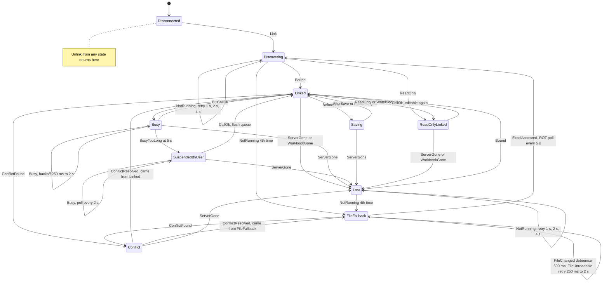

# C7: Excel live link robustness

Researched 2026-10-30. Brief file unavailable; scope taken from the task line. There is no Windows or Excel on this machine, so every COM (Component Object Model) behaviour below is quoted from sources, not measured. File-level behaviour was measured on Linux with .NET 8 and Python 3.13.

## Answer

Treat the live Excel link as an optional, fragile channel on top of a file-based core, and drive it with an explicit reconnection state machine. Make every COM call to Excel from one dedicated single-threaded apartment (STA) thread, ideally in a small helper process, because built-in COM is not supported under Native AOT ([[21]](https://learn.microsoft.com/en-us/dotnet/core/deploying/native-aot/)). Register an `IMessageFilter` on that thread that retries "busy" rejections with waits of 100 ms or more for about 2 s per call, then hands over to the state machine ([[1]](https://learn.microsoft.com/en-us/windows/win32/api/objidl/nf-objidl-imessagefilter-retryrejectedcall)). The state machine goes Busy (retries every 250 ms, doubling to 2 s), then Suspended-by-user after 5 s of rejections (the user is editing a cell or has a dialog open, so queue writes and poll every 2 s), then Lost on `RPC_S_SERVER_UNAVAILABLE` 0x800706BA or `RPC_E_DISCONNECTED` 0x80010108 ([[4]](https://learn.microsoft.com/en-us/windows/win32/com/com-error-codes-3)[[6]](https://learn.microsoft.com/en-us/windows/win32/debug/system-error-codes--1700-3999-)), then a Running Object Table (ROT) search after 1, 2 and 4 s, then FileFallback. In FileFallback, copy the workbook into memory through a `FileStream` opened with `FileShare.ReadWrite | FileShare.Delete`, close it at once, and parse the copy with the Open XML SDK (MIT licence). Excel saves by writing a temp file, deleting the original and renaming the temp file ([[30]](https://learn.microsoft.com/en-us/troubleshoot/microsoft-365-apps/excel/issue-when-save-excel-workbooks)). A reader that blocks the delete can make that save fail, and a read during a save fails (measured: `FileFormatException`). Give every row an identity key (never a row number), keep the last-synced value of every keyed cell for a three-way merge, and give each column an owner, so true conflicts are rare and visible. Excel co-authoring itself settles same-cell edits by "last change saved wins" ([[15]](https://support.microsoft.com/en-us/office/collaborate-on-excel-workbooks-at-the-same-time-with-co-authoring-7152aa8b-b791-414c-a3bb-3024e46fb104)). When writing files, the Open XML SDK kept all 22 package parts in our round trip, but it leaves stale cached formula results: LibreOffice showed 3,000 where the true value was 12,500. So clear the cached values or set `fullCalcOnLoad`. openpyxl dropped sparklines, calcChain and customXml parts, and all cached values. Google Sheets works as a second backend: 60 read and 60 write requests per minute per user, 300 per project ([[53]](https://developers.google.com/workspace/sheets/api/limits)). It has no conditional writes, and push notifications need a public HTTPS endpoint ([[56]](https://developers.google.com/workspace/drive/api/guides/push)), so a desktop app should poll and key its rows with developer metadata. Main caveat: none of the COM HRESULTs or timings were tested against real Excel. Test them on Windows with Microsoft 365 Excel, including OneDrive AutoSave, before release.

## Failure-mode table and tool comparison

### How a live Excel link breaks

"Host" means the program driving Excel (Studio, if it has a live link). HRESULT values come from the Windows error-code pages ([[4]](https://learn.microsoft.com/en-us/windows/win32/com/com-error-codes-3)[[5]](https://learn.microsoft.com/en-us/windows/win32/com/com-error-codes-1)[[6]](https://learn.microsoft.com/en-us/windows/win32/debug/system-error-codes--1700-3999-)). Each row also cites the source that ties the code to the Excel situation. "Measured" means tested here on Linux, without Excel.

| # | What the user does | What the host sees | How to detect | How to recover |
|---|---|---|---|---|
| 1 | Types in a cell and leaves it in edit mode | `COMException` 0x800AC472 (`VBA_E_IGNORE`): Excel puts user interaction first and rejects the call ([[40]](https://support.pyxll.com/hc/en-gb/articles/360036822393-I-m-seeing-error-pywintypes-com-error-2146777998-OLE-error-0x800ac472-None-None), not verified; that cell edit mode counts as such interaction is our inference). After a message filter gives up: `RPC_E_CALL_REJECTED` 0x80010001 ([[1]](https://learn.microsoft.com/en-us/windows/win32/api/objidl/nf-objidl-imessagefilter-retryrejectedcall)) | HRESULT is "busy" class; rejections last longer than 5 s | Retry inside the filter (waits of 100 ms or more), then Busy, then Suspended state. Queue writes, poll every 2 s, show a quiet status. Never inject keystrokes to end the edit |
| 2 | Opens a modal dialog (Format Cells, a macro `MsgBox`, any Office prompt) | Callee answers `SERVERCALL_RETRYLATER`, so the filter is called. If it cancels, `RPC_E_CALL_REJECTED` 0x80010001 ([[1]](https://learn.microsoft.com/en-us/windows/win32/api/objidl/nf-objidl-imessagefilter-retryrejectedcall)). Also 0x800AC472, "usually ... an opened dialog box" ([[39]](https://kr.mathworks.com/matlabcentral/answers/144394), third party) | Same as row 1 | Same as row 1. Microsoft suggests showing a busy notice after about 30 s ([[1]](https://learn.microsoft.com/en-us/windows/win32/api/objidl/nf-objidl-imessagefilter-retryrejectedcall)) |
| 3 | Runs a long macro or recalculation | Excel "not responsive to user interaction while add-in or macro code is being run" ([[8]](https://learn.microsoft.com/en-us/office/vba/library-reference/concepts/how-autosave-impacts-addins-and-macros)). Calls are expected to be refused as busy: `RPC_E_SERVERCALL_RETRYLATER` 0x8001010A, "the application is busy" ([[4]](https://learn.microsoft.com/en-us/windows/win32/com/com-error-codes-3)) (inference; not verified with Excel) | Busy class | Busy backoff (250 ms to 2 s) |
| 4 | Presses Save (Ctrl+S) | `WorkbookBeforeSave(Wb, SaveAsUI=False, Cancel)`, then `WorkbookAfterSave(Wb, Success)` ([[9]](https://learn.microsoft.com/en-us/office/vba/api/excel.application.workbookbeforesave)[[10]](https://learn.microsoft.com/en-us/office/vba/api/excel.application.workbookaftersave)). On disk: temp file written, original deleted, temp renamed ([[29]](https://support.microsoft.com/en-US/Excel/description-of-the-way-that-excel-saves-files)[[30]](https://learn.microsoft.com/en-us/troubleshoot/microsoft-365-apps/excel/issue-when-save-excel-workbooks)) | Events. In file mode, a burst of Created/Changed/Deleted/Renamed file-watcher events (measured) | Enter Saving and hold writes until AfterSave. Do no heavy work and no writes inside the handlers ([[8]](https://learn.microsoft.com/en-us/office/vba/library-reference/concepts/how-autosave-impacts-addins-and-macros)) |
| 5 | Save As, or renames the workbook through Save As | `WorkbookBeforeSave` with `SaveAsUI=True` ("the Save As dialog box will be displayed") ([[9]](https://learn.microsoft.com/en-us/office/vba/api/excel.application.workbookbeforesave)). The dialog itself makes calls busy (row 2) | On `WorkbookAfterSave`, compare `Wb.FullName` with the stored path (inference: the event passes the workbook) | Rebind to the new path. Ask whether the link should follow the new copy or stay on the old file |
| 6 | Renames or moves the file in Explorer while Excel is closed | No COM signal. The file path is missing (`FileNotFoundException` in .NET) | Path check at fallback read | Look in the folder for a workbook whose custom document property holds the link id (it survived openpyxl, the Open XML SDK and ClosedXML in our test). Ask the user to confirm |
| 7 | Closes the workbook; Excel stays open | `WorkbookBeforeClose(Wb, Cancel)` "immediately before" the close ([[11]](https://learn.microsoft.com/en-us/office/vba/api/excel.application.workbookbeforeclose)). Later calls on the old workbook object are expected to fail with `RPC_E_DISCONNECTED` 0x80010108, "object invoked has disconnected from its clients" ([[4]](https://learn.microsoft.com/en-us/windows/win32/com/com-error-codes-3)) (not verified with Excel) | BeforeClose, then confirm by looking for the path in the ROT ([[16]](https://learn.microsoft.com/en-us/windows/win32/api/objidl/nn-objidl-irunningobjecttable)). Treat BeforeClose alone as "closing, not certain": any handler can set `Cancel` ([[11]](https://learn.microsoft.com/en-us/office/vba/api/excel.application.workbookbeforeclose)) | Lost state, then rebind by path. If the workbook is not open, go to FileFallback |
| 8 | Quits Excel | `RPC_S_SERVER_UNAVAILABLE` 0x800706BA (error 1722, "The RPC server is unavailable") ([[6]](https://learn.microsoft.com/en-us/windows/win32/debug/system-error-codes--1700-3999-)). A Stack Overflow answer says the RPC server closes "without your application knowing about it" ([[37]](https://windows-hexerror.linestarve.com/q/so720708-the-rpc-server-is-unavailable-exception-from-hresult-0x800706ba), third party) | "Server gone" class | Release all Runtime Callable Wrappers (RCWs). Rediscover; `GetActiveObject` then fails with `MK_E_UNAVAILABLE` 0x800401E3 ([[5]](https://learn.microsoft.com/en-us/windows/win32/com/com-error-codes-1)[[18]](https://support.microsoft.com/kb/238610)). Go to FileFallback |
| 9 | Excel crashes or is killed | `RPC_E_SERVER_DIED` 0x80010007 ("the call may have executed") or `RPC_E_SERVER_DIED_DNE` 0x80010012 ("did not execute") ([[4]](https://learn.microsoft.com/en-us/windows/win32/com/com-error-codes-3)), or 0x800706BA. An orphaned `~$` owner file can stay behind ([[31]](https://learn.microsoft.com/id-id/archive/blogs/the_microsoft_excel_support_team_blog/the-definitive-locked-file-post-updated-772014)) | "Server gone" class | As row 8. After `_DIED` (not `_DNE`), re-read before any retry, because the write may have landed |
| 10 | Restarts Excel, or runs two Excel instances | `GetActiveObject` fails with 429 / 0x800401E3 until Office "loses focus" and registers in the ROT ([[18]](https://support.microsoft.com/kb/238610), not verified). It returns only one instance | Discovery failures | Bind by file moniker (`GetObject(path)`) ([[17]](https://learn.microsoft.com/en-us/office/vba/language/reference/user-interface-help/getobject-function)) or enumerate the ROT ([[16]](https://learn.microsoft.com/en-us/windows/win32/api/objidl/nn-objidl-irunningobjecttable)). Retry after 1, 2, 4 s |
| 11 | Protects the sheet or the workbook structure | Writing a locked cell raises a `COMException`. The exact HRESULT was not verified | Any write failure that is not in the busy or gone class | ReadOnlyLinked: keep reading, stop writing, tell the user. If Studio owns the template, re-apply `Protect(UserInterfaceOnly:=True)` after each open; it "protect[s] the user interface, but not macros" and is not kept on save ([[25]](https://learn.microsoft.com/en-us/office/vba/api/excel.worksheet.protect)) |
| 12 | Opens the file read-only, or another user holds it | Excel shows "File in Use ... locked for editing by 'another user'" ([[31]](https://learn.microsoft.com/id-id/archive/blogs/the_microsoft_excel_support_team_blog/the-definitive-locked-file-post-updated-772014)). `Workbook.ReadOnly` is True ([[28]](https://learn.microsoft.com/en-us/office/vba/api/excel.workbook.readonly)). File-level opens fail with sharing violation 0x80070020 ([[34]](https://windows-hexerror.linestarve.com/q/so49885226-Open-locked-file-with-OpenXML-in-read-only-mode)) | `ReadOnly` property; `~$` owner file next to the workbook ([[31]](https://learn.microsoft.com/id-id/archive/blogs/the_microsoft_excel_support_team_blog/the-definitive-locked-file-post-updated-772014)) | ReadOnlyLinked. Show who holds the file (the owner file records the user) |
| 13 | Opens a downloaded or emailed file (Protected View) | The window is in `Application.ProtectedViewWindows` ([[26]](https://learn.microsoft.com/en-us/office/vba/api/excel.protectedviewwindows)); `ProtectedViewWindow.Edit` returns a `Workbook` ([[27]](https://learn.microsoft.com/en-us/office/vba/api/excel.protectedviewwindow.edit)) | Path not found in `Workbooks`, but found among Protected View windows (inference) | ReadOnlyLinked. Ask the user to click Enable Editing. Do not call `Edit` silently: Protected View is a security boundary |
| 14 | Works in a OneDrive or SharePoint file with AutoSave on | `BeforeSave`/`AfterSave` "fire automatically on a periodic basis without user interaction" ([[8]](https://learn.microsoft.com/en-us/office/vba/library-reference/concepts/how-autosave-impacts-addins-and-macros)) | Event rate; `Workbook.AutoSaveOn` ([[8]](https://learn.microsoft.com/en-us/office/vba/library-reference/concepts/how-autosave-impacts-addins-and-macros)) | Saving must be a cheap state. Never cancel a save: with AutoSave on, a cancelled save is retried for as long as the file is open ([[8]](https://learn.microsoft.com/en-us/office/vba/library-reference/concepts/how-autosave-impacts-addins-and-macros)) |
| 15 | A co-author edits the same workbook | Remote edits are merged; change events are *not* raised for them by default; `Workbook.AfterRemoteChange` fires after the merge ([[12]](https://learn.microsoft.com/en-us/office/vba/excel/concepts/about-coauthoring-in-excel)[[13]](https://learn.microsoft.com/en-us/office/vba/api/excel.workbook.afterremotechange)) | AfterRemoteChange | Re-read the keyed rows and run the three-way merge. The last change saved wins ([[15]](https://support.microsoft.com/en-us/office/collaborate-on-excel-workbooks-at-the-same-time-with-co-authoring-7152aa8b-b791-414c-a3bb-3024e46fb104)) |
| 16 | The network drive or VPN drops | Excel: "Cannot access read-only document" when "you save the file to an external or network drive, and the connection fails", or "Document not saved" ([[30]](https://learn.microsoft.com/en-us/troubleshoot/microsoft-365-apps/excel/issue-when-save-excel-workbooks)). Host file reads: `IOException` (not measured on SMB) | IOExceptions; path unreachable | Keep the in-memory copy. Back off, then re-read. Never write a partial file |
| 17 | Antivirus or a sync client touches the temp file during a save | Excel save errors ([[30]](https://learn.microsoft.com/en-us/troubleshoot/microsoft-365-apps/excel/issue-when-save-excel-workbooks)). Host: short-lived sharing violations | IOException that clears within seconds | Retry 250 ms, 500 ms, 1 s, 2 s |
| 18 | Host reads the file while Excel is saving | Measured on a truncated file: Open XML SDK and ClosedXML throw `FileFormatException` "File contains corrupted data"; ExcelDataReader and MiniExcel throw `InvalidDataException` "End of Central Directory record could not be found" | Those exception types | Wait 500 ms after the last file event, then retry with backoff |
| 19 | Host holds the file open without `FileShare.Delete` while the user saves | Excel cannot delete the original, so the save fails with an error ([[29]](https://support.microsoft.com/en-US/Excel/description-of-the-way-that-excel-saves-files)). `FileShare.Delete` is what "allows subsequent deleting" ([[32]](https://learn.microsoft.com/en-us/dotnet/api/system.io.fileshare)). Inference from the docs; not measured on Windows | User reports "Document not saved" | Never keep a handle open. Copy to memory with `ReadWrite \| Delete`, then close |

### How Revit + Dynamo, Grasshopper and Vectorworks link to spreadsheets

| Tool | How it links | Live or file | Needs Excel? | Direction | Conflict handling and row identity |
|---|---|---|---|---|---|
| Revit (no add-ins) | No native live Excel link found. A Revit Ideas thread asks for one, saying users must buy a plug-in or use Dynamo ([[70]](https://forums.autodesk.com/t5/revit-ideas/revit-integration-with-excel/idc-p/6554467/highlight/true), search text only) | n/a | n/a | n/a | n/a |
| Revit + Ideate BIMLink | Exports a "link" to a worksheet, the user edits in Excel, and the data is imported back ([[42]](https://ideatesoftware.com/export-to-excel-ideate-bimlink)) | File | Not stated | Both ways, one batch at a time | Rows are keyed by Revit element id: "The first Excel column must contain a valid Revit element id" ([[44]](https://support.ideatesoftware.com/support/help/ideate-bimlink/troubleshooting/frequently-asked-questions), search text only). Read-only properties are greyed out, and changing them "will result in a warning message" ([[43]](https://ideatesoftware.com/support/help/ideate-bimlink/using-ideate-bimlink/link-properties/properties-tab/read-only-properties)). Re-exporting to the same file keeps "only ... the most recent exported link data" ([[42]](https://ideatesoftware.com/export-to-excel-ideate-bimlink)) |
| Dynamo `Data.ImportExcel` / `ExportExcel` | COM interop. "This node requires Microsoft Excel to be installed"; the nodes are marked obsolete (`ExcelInteropObsoleteNode`) ([[41]](https://raw.githubusercontent.com/DynamoDS/Dynamo/master/src/Libraries/DSOffice/Excel.cs)) | File path, opened through Excel | Yes | Read or write on each graph run | None. `overWrite` toggle ([[41]](https://raw.githubusercontent.com/DynamoDS/Dynamo/master/src/Libraries/DSOffice/Excel.cs)) |
| Dynamo `Data.OpenXMLImportExcel` / `OpenXMLExportExcel` | Reads and writes "by using the Open XML standard" ([[41]](https://raw.githubusercontent.com/DynamoDS/Dynamo/master/src/Libraries/DSOffice/Excel.cs)) | File | No | Read or write on each graph run | None. `overWrite` is a "Toggle to clear spreadsheet before writing"; `startRow`/`startColumn` place the block ([[41]](https://raw.githubusercontent.com/DynamoDS/Dynamo/master/src/Libraries/DSOffice/Excel.cs)) |
| Grasshopper + LunchBox | `Excel Reader` (toggle, file path, sheet name) and `Excel Write`, which "Creates an Excel document with the specified data" ([[45]](https://apps.provingground.io/docs/lunchbox-documentation/grasshopper-components/workflow/)) | File | Not stated | One way per component | None (heading list plus values) |
| Grasshopper + TT Toolbox | Excel read and write components. They call `Marshal.GetActiveObject`, so they attach to a running Excel through COM; this broke under Rhino 8's .NET Core runtime ([[46]](https://discourse.mcneel.com/t/read-from-excel-tt-toolbox-not-working/173092/16)) | Live (attaches to a running instance) | Yes (inference from COM use) | Both | None documented |
| Grasshopper + Bumblebee | "A set of User Objects that create a link to Microsoft Excel"; a live component updates Grasshopper when Excel changes ([[47]](https://www.food4rhino.com/en/app/bumblebee), not verified: page blocked) | Live | Yes (inference) | Both | None documented |
| Grasshopper + GhExcel / Excel+ | GhExcel has static read, dynamic read and write components ([[48]](https://www.food4rhino.com/en/app/ghexcel-interface-excel)). Excel+ builds workbooks "without the need to have Excel installed" ([[49]](https://food4rhino.com/en/app/excel)). Both not verified: pages blocked | GhExcel: live and file; Excel+: file | GhExcel: not stated; Excel+: no | Both | None documented |
| Vectorworks worksheet with an Excel reference | Import an Excel sheet as a worksheet "with the option to create a reference link". It can update automatically when the file is opened, and the names turn red when Excel has changed. **File > Push Data to Excel File** sends edits back ([[50]](https://app-help.vectorworks.net/2024/eng/VW2024_Guide/Worksheets/Microsoft_Excel_references.htm)) | File | Not stated | Both | Explicit. If you update before pushing, an alert offers update (overwrites Vectorworks edits), push, or cancel ([[50]](https://app-help.vectorworks.net/2024/eng/VW2024_Guide/Worksheets/Microsoft_Excel_references.htm)). Vectorworks warns "not to update the reference before pushing" ([[51]](https://www.vectorworks.net/newsroom/how-to-work-with-excel-in-vectorworks)). Rows are joined to objects through an "anchor", a unique identifier such as a product code, using `VLOOKUP`/`XLOOKUP` ([[51]](https://www.vectorworks.net/newsroom/how-to-work-with-excel-in-vectorworks)). Cannot pass Excel data on into object records ([[50]](https://app-help.vectorworks.net/2024/eng/VW2024_Guide/Worksheets/Microsoft_Excel_references.htm)) |
| Vectorworks Data Manager | Controls which data fields attach to objects and how they show in the Object Info palette; its help page does not mention Excel ([[52]](https://app-help.vectorworks.net/2023/eng/VW2023_Guide/DataManager/Using_the_Data_Manager.htm)) | n/a | n/a | n/a | n/a |

The pattern across all three ecosystems: the tools that survive in production are file-based with an explicit, user-triggered sync and a stable row key (Ideate, the Dynamo OpenXML nodes, Vectorworks references). The live COM tools (TT Toolbox, Bumblebee, the old Dynamo nodes) are the ones that break: Dynamo marked its COM nodes obsolete, and TT Toolbox failed on Rhino 8 ([[41]](https://raw.githubusercontent.com/DynamoDS/Dynamo/master/src/Libraries/DSOffice/Excel.cs)[[46]](https://discourse.mcneel.com/t/read-from-excel-tt-toolbox-not-working/173092/16)).

## Detail

### 1. How live links fail

The failure table groups into five families, and each family maps to one state of the machine in section 12.

**Busy (rows 1 to 3).** COM gives a server two ways to refuse a call: `SERVERCALL_RETRYLATER` and `SERVERCALL_REJECTED`. "If a called task rejects a call, the application is probably in a state where it cannot handle such calls, possibly only temporarily" ([[1]](https://learn.microsoft.com/en-us/windows/win32/api/objidl/nf-objidl-imessagefilter-retryrejectedcall)). Without a message filter, the caller gets the error at once. Excel adds its own code, 0x800AC472 (`VBA_E_IGNORE`), which appears when a dialog is open or the user is interacting ([[39]](https://kr.mathworks.com/matlabcentral/answers/144394)[[40]](https://support.pyxll.com/hc/en-gb/articles/360036822393-I-m-seeing-error-pywintypes-com-error-2146777998-OLE-error-0x800ac472-None-None)). Third-party reports also blame add-ins: one Stack Overflow answer traced random `RPC_E_CALL_REJECTED` errors to a Webex COM add-in ([[38]](https://windows-hexerror.linestarve.com/q/so59144474-how-to-solve-hresult-0x80010001-rpcecallrejected-in-c-excel-interop)). `Application.Interactive = False` blocks keyboard and mouse input and is "useful if you are using DDE or OLE Automation" ([[24]](https://learn.microsoft.com/en-us/office/vba/api/excel.application.interactive)). A live link must not use it, though: it takes Excel away from the user, and Excel "won't automatically set this property back". `Application.Ready` returns whether Excel "is ready" ([[23]](https://learn.microsoft.com/en-us/office/vba/api/excel.application.ready)). Reading it is itself a COM call that can be rejected, so treat it as a hint, not a gate.

Sources disagree on the labels. Microsoft's Visual Studio article maps "Application is busy" to `RPC_E_CALL_REJECTED` 0x80010001 and "Call was rejected by callee" to `RPC_E_SERVERCALL_RETRYLATER` 0x8001010A ([[2]](https://learn.microsoft.com/en-us/previous-versions/ms228772%28v=vs.140%29), old (2014)). The winerror.h table says the opposite: 0x80010001 is "Call was rejected by callee" and 0x8001010A is "The message filter indicated that the application is busy" ([[4]](https://learn.microsoft.com/en-us/windows/win32/com/com-error-codes-3)). Classify by the numeric value and treat both as Busy.

**Save, Save As and rename (rows 4 to 6).** Excel's save is not an in-place write. Excel "creates a randomly named temporary file (for example, Cedd4100 without a file name extension) in the destination folder ... deletes the original file ... renames the temporary file" ([[30]](https://learn.microsoft.com/en-us/troubleshoot/microsoft-365-apps/excel/issue-when-save-excel-workbooks)). A first save of a new file skips the temp file ([[29]](https://support.microsoft.com/en-US/Excel/description-of-the-way-that-excel-saves-files)). Three things follow:

1. A file watcher sees a burst of events, and the file's identity changes.
2. A handle opened before the save still points at the old content.
3. Anything that stops the delete or the rename breaks the user's save. Microsoft names antivirus that "locks the temporary file for scanning" ([[30]](https://learn.microsoft.com/en-us/troubleshoot/microsoft-365-apps/excel/issue-when-save-excel-workbooks)).

We reproduced the sequence with .NET (`excelsave` mode in [XlsxShareProbe](assets/C7/XlsxShareProbe/Program.cs)). A reader held the file open with `FileShare.ReadWrite | FileShare.Delete`; we wrote an 8-character temp file, deleted the original and renamed the temp:

```
   5 ms Created A1B2C3D4
   7 ms Changed A1B2C3D4
 153 ms Changed A1B2C3D4   (x12 within 1 ms while the 50-row workbook was written)
 155 ms Deleted book.xlsx
 155 ms Renamed A1B2C3D4 -> book.xlsx
old handle: length 1813 bytes, 4 rows; reopened by path: 51 rows
```

On Linux the delete succeeded even though a handle was open, and the old handle kept reading the old 4-row file. On Windows the delete succeeds only if every open handle allowed it (`FileShare.Delete`) ([[32]](https://learn.microsoft.com/en-us/dotnet/api/system.io.fileshare)). If Excel "cannot delete the existing file, you get an error" ([[29]](https://support.microsoft.com/en-US/Excel/description-of-the-way-that-excel-saves-files)). That is why row 19 says: copy and close, never hold a handle.

**Close, quit, crash (rows 7 to 10).** After the server process ends, every RCW the host holds is dead. The host sees 0x800706BA (`RPC_S_SERVER_UNAVAILABLE`, Win32 error 1722) ([[6]](https://learn.microsoft.com/en-us/windows/win32/debug/system-error-codes--1700-3999-)), or one of `RPC_E_DISCONNECTED` 0x80010108, `RPC_E_SERVER_DIED` 0x80010007 or `RPC_E_SERVER_DIED_DNE` 0x80010012 ([[4]](https://learn.microsoft.com/en-us/windows/win32/com/com-error-codes-3)). The `_DIED` variant says "the call may have executed", so after a crash, re-read before you replay a write. The community fix for 0x800706BA is "to trap an error and re-initialise your Excel object" ([[37]](https://windows-hexerror.linestarve.com/q/so720708-the-rpc-server-is-unavailable-exception-from-hresult-0x800706ba), third party). The state machine does exactly that.

**Protection, read-only and locks (rows 11 to 13).** Sheet protection protects "the locked cells" ([[25]](https://learn.microsoft.com/en-us/office/vba/api/excel.worksheet.protect)). `UserInterfaceOnly:=True` lets code write while the user cannot. But after a save and reopen "the entire worksheet ... will be fully protected", so it has to be applied again on every open ([[25]](https://learn.microsoft.com/en-us/office/vba/api/excel.worksheet.protect)). A file opened by another user produces the "File in Use" prompt with Read-Only and Notify choices. The `~$` owner file "contains the user information for who had the file open" and can be orphaned when the connection breaks ([[31]](https://learn.microsoft.com/id-id/archive/blogs/the_microsoft_excel_support_team_blog/the-definitive-locked-file-post-updated-772014), old (2012, updated 2017)).

**Network and other processes (rows 16 to 19).** These hit the file path, not COM. They are covered by the file fallback rules in section 10.

### 2. COM automation versus file-based reading

There are two ways to link to a spreadsheet.

**COM automation** drives the running `Excel.Application`. It sees unsaved edits, events and the user's current selection. Excel calculates the formulas. But Excel is a single-user desktop program: Microsoft calls Office applications "non-reentrant, STA-based Automation servers" and warns that "a modal dialog box on a non-interactive desktop cannot be dismissed" ([[7]](https://support.microsoft.com/en-us/help/257757)). Every call is a cross-process remote procedure call (RPC) that the user can block simply by typing in a cell.

**File-based reading** parses the `.xlsx` package (a ZIP of XML parts) with no Excel at all. Microsoft calls Open XML the "recommended and supported method for handling changes to Office files from a service" ([[7]](https://support.microsoft.com/en-us/help/257757)). It sees only what has been saved, and formula results only as the cached values Excel last wrote (section 10). It must also cope with Excel's save sequence and its file lock (rows 4, 18 and 19 above).

For Studio there is also a .NET constraint. Built-in COM interop generates IL stubs at run time, so it "is incompatible with NativeAOT and IL trimming" ([[22]](https://learn.microsoft.com/en-us/dotnet/standard/native-interop/comwrappers-source-generation)). The Native AOT page lists "Windows: No built-in COM" ([[21]](https://learn.microsoft.com/en-us/dotnet/core/deploying/native-aot/)). The .NET 8 COM source generator is AOT-friendly, but "the only supported interface base is `IUnknown`" ([[22]](https://learn.microsoft.com/en-us/dotnet/standard/native-interop/comwrappers-source-generation)), while the Excel object model is normally used through `IDispatch` (late binding, `dynamic`, or the dual interfaces of the primary interop assemblies). This is our inference, not a quoted statement. If Studio ships as Native AOT, the practical path is to keep the COM bridge in a small framework-dependent helper process and talk to it over a named pipe. That also stops a hung Excel call from freezing Studio's interface.

### 3. Microsoft's guidance: IMessageFilter and the server-side warning

Microsoft's fix for busy errors is to register an `IOleMessageFilter` (COM's `IMessageFilter`). When the callee returns "retry later", COM calls `RetryRejectedCall` on the caller's filter "immediately after receiving SERVERCALL_RETRYLATER or SERVERCALL_REJECTED" ([[1]](https://learn.microsoft.com/en-us/windows/win32/api/objidl/nf-objidl-imessagefilter-retryrejectedcall)). The return value controls what happens next:

| Return value | Effect ([[1]](https://learn.microsoft.com/en-us/windows/win32/api/objidl/nf-objidl-imessagefilter-retryrejectedcall)) |
|---|---|
| -1 | Cancel. "COM then returns RPC_E_CALL_REJECTED from the original method call." |
| 0 to 99 | "The call is to be retried immediately." |
| 100 or more | "COM will wait for this many milliseconds and then retry the call." |

Microsoft's guidance: "Applications should silently retry calls that have returned with SERVERCALL_RETRYLATER. If, after a reasonable amount of time has passed, say about 30 seconds, the application should display the busy dialog box" ([[1]](https://learn.microsoft.com/en-us/windows/win32/api/objidl/nf-objidl-imessagefilter-retryrejectedcall)). Three constraints matter:

- The filter is per thread: "Only one message filter can be registered for each thread. Threads in multithreaded apartments cannot have message filters" ([[3]](https://learn.microsoft.com/en-us/windows/win32/api/objbase/nf-objbase-coregistermessagefilter)). So all Excel calls must run on an STA thread that owns the filter.
- The filter does nothing for cross-machine Distributed COM (DCOM) calls ("RetryRejectedCall will not be called") ([[1]](https://learn.microsoft.com/en-us/windows/win32/api/objidl/nf-objidl-imessagefilter-retryrejectedcall)).
- Microsoft's own C# sample returns `99` for `SERVERCALL_RETRYLATER` ([[2]](https://learn.microsoft.com/en-us/previous-versions/ms228772%28v=vs.140%29)). That is an immediate retry with no wait: in effect a busy loop for as long as a dialog stays open (our inference). Our sketch returns 100 to 500 ms instead (section 12).

The second Microsoft warning is about where automation runs. Microsoft "does not currently recommend, and does not support, Automation of Microsoft Office applications" from unattended, non-interactive components ([[7]](https://support.microsoft.com/en-us/help/257757)). The reasons: non-reentrancy, modal dialogs nobody can dismiss, "little scalability", and licensing that prevents "Office applications from being used on a server to service client requests" ([[7]](https://support.microsoft.com/en-us/help/257757)). For Studio this rules out any cloud or render-farm feature that drives Excel. Server-side work on spreadsheets must use Open XML or Google Sheets.

### 4. Excel events: WorkbookBeforeSave, WorkbookAfterSave, WorkbookBeforeClose

These application-level events let a COM client follow the workbook's lifecycle without polling:

- `WorkbookBeforeSave(Wb, SaveAsUI, Cancel)` occurs "before any open workbook is saved". `SaveAsUI` is True "if the Save As dialog box will be displayed", and setting `Cancel` stops the save ([[9]](https://learn.microsoft.com/en-us/office/vba/api/excel.application.workbookbeforesave)).
- `WorkbookAfterSave(Wb, Success)` "occurs after the workbook is saved"; `Success` says whether it worked ([[10]](https://learn.microsoft.com/en-us/office/vba/api/excel.application.workbookaftersave)).
- `WorkbookBeforeClose(Wb, Cancel)` "occurs immediately before any open workbook closes" ([[11]](https://learn.microsoft.com/en-us/office/vba/api/excel.application.workbookbeforeclose)).

How to use them in a link:

1. **BeforeSave**: enter Saving, stop sending writes, note `SaveAsUI`. Do not cancel. Under AutoSave a cancelled save is retried "for as long as the file is open, potentially degrading performance and battery life" ([[8]](https://learn.microsoft.com/en-us/office/vba/library-reference/concepts/how-autosave-impacts-addins-and-macros)).
2. **AfterSave**: compare `Wb.FullName` with the stored path (catches Save As), then return to Linked. Do not write to the workbook here. With AutoSave, code that "dirties the workbook" in AfterSave can make the events "fire again indefinitely", and VBA cell writes clear the user's undo stack ([[8]](https://learn.microsoft.com/en-us/office/vba/library-reference/concepts/how-autosave-impacts-addins-and-macros)). Whether writes from an external COM client also clear the undo stack was not found. Assume they do.
3. **BeforeClose**: treat it as "closing, not yet certain", because any handler (another add-in, a workbook macro) can set `Cancel` ([[11]](https://learn.microsoft.com/en-us/office/vba/api/excel.application.workbookbeforeclose)). Then confirm with a ROT lookup or the next failing call.
4. Keep every handler short and never show a modal dialog from one. Under AutoSave these events run "even if the user is in the middle of something else (such as typing data into a cell)" ([[8]](https://learn.microsoft.com/en-us/office/vba/library-reference/concepts/how-autosave-impacts-addins-and-macros)).

Events reach a .NET client only while its STA thread pumps messages. A helper process with a message loop on its STA thread (section 2) gives both the event delivery and the message filter a home.

### 5. Running Object Table lookups

The ROT is "a globally accessible look-up table on each workstation" that "keeps track of those objects that can be identified by a moniker and that are currently running". When a client binds a moniker, it "checks the ROT to see if the object is already running" ([[16]](https://learn.microsoft.com/en-us/windows/win32/api/objidl/nn-objidl-irunningobjecttable)). Because a file moniker binds to an already-running object through the ROT, `GetObject(path)` can reach a workbook that is already open (inference from [[16]](https://learn.microsoft.com/en-us/windows/win32/api/objidl/nn-objidl-irunningobjecttable) and [[17]](https://learn.microsoft.com/en-us/office/vba/language/reference/user-interface-help/getobject-function)). That gives three ways to attach:

| Method | What it finds | Pitfalls |
|---|---|---|
| `GetActiveObject("Excel.Application")` (oleaut32) | One running instance | Office registers "once it loses focus", so the call can fail with 429 / 0x800401E3 right after Excel starts ([[18]](https://support.microsoft.com/kb/238610), not verified: page gone, text from search results). With two instances you get one of them |
| `GetObject(path)` / `BindToMoniker(path)` | The workbook itself, in whichever instance has it open | If no instance has it open, Excel is started and the file loaded ([[17]](https://learn.microsoft.com/en-us/office/vba/language/reference/user-interface-help/getobject-function)). Not what a passive link wants, so check the ROT first |
| `GetRunningObjectTable` + `EnumRunning` | Every registered moniker | Compare display names with the stored path. Normalise case, and expect URL forms for cloud files (open question) |

The VBA `GetObject` documentation even sends `WM_USER + 18` to Excel's `XLMAIN` window "to enter it in the Running Object Table" ([[17]](https://learn.microsoft.com/en-us/office/vba/language/reference/user-interface-help/getobject-function)). This confirms that registration can lag behind a running Excel.

On .NET 8, `Marshal.GetActiveObject` is not available: its documentation lists only .NET Framework 1.1 to 4.8.1 ([[19]](https://learn.microsoft.com/en-us/dotnet/api/system.runtime.interopservices.marshal.getactiveobject)). The .NET team said "It is unlikely that we will bring this API back" and pointed to a P/Invoke of the Win32 `GetActiveObject` ([[20]](https://github.com/dotnet/runtime/issues/37617)). The TT Toolbox breakage on Rhino 8 is the same API ([[46]](https://discourse.mcneel.com/t/read-from-excel-tt-toolbox-not-working/173092/16)). A minimal replacement:

```csharp
[DllImport("ole32.dll")] static extern int CLSIDFromProgID([MarshalAs(UnmanagedType.LPWStr)] string progId, out Guid clsid);
[DllImport("oleaut32.dll")] static extern int GetActiveObject(ref Guid clsid, IntPtr reserved, [MarshalAs(UnmanagedType.IUnknown)] out object obj);

static object? TryGetRunningExcel()
{
    if (CLSIDFromProgID("Excel.Application", out var clsid) < 0) return null;
    int hr = GetActiveObject(ref clsid, IntPtr.Zero, out var app);
    return hr >= 0 ? app : null;            // MK_E_UNAVAILABLE 0x800401E3: not (yet) in the ROT
}
```

### 6. The co-authoring model and what it means for COM clients

Co-authoring lets users edit "a workbook hosted in the cloud (that is, OneDrive, OneDrive for Business, or SharePoint Online) simultaneously" ([[12]](https://learn.microsoft.com/en-us/office/vba/excel/concepts/about-coauthoring-in-excel)). It needs a Microsoft 365 subscription and `.xlsx`, `.xlsm` or `.xlsb` files ("does not support the Strict Open XML Spreadsheet format"). SharePoint on-premises sites "do not support co-authoring" ([[15]](https://support.microsoft.com/en-us/office/collaborate-on-excel-workbooks-at-the-same-time-with-co-authoring-7152aa8b-b791-414c-a3bb-3024e46fb104)). If someone opens the file in an Excel version that cannot co-author, "everyone else will get the 'locked' error" ([[15]](https://support.microsoft.com/en-us/office/collaborate-on-excel-workbooks-at-the-same-time-with-co-authoring-7152aa8b-b791-414c-a3bb-3024e46fb104)).

What it means for a COM client such as Studio's link:

1. **Workbook content syncs; your memory does not.** "Excel will automatically synchronize changes that are made to the workbook (whether by a user or your code)", but "will *not* automatically synchronize any variables created by your code outside of the workbook content" ([[12]](https://learn.microsoft.com/en-us/office/vba/excel/concepts/about-coauthoring-in-excel)). Studio's cached copy of the linked range is exactly such a variable.
2. **Remote edits are silent by default.** Microsoft describes "the default behavior of *not* firing change events" for remote changes and added `BeforeRemoteChange`/`AfterRemoteChange` ([[12]](https://learn.microsoft.com/en-us/office/vba/excel/concepts/about-coauthoring-in-excel)). `AfterRemoteChange` "occurs after a remote user's edits to the workbook are merged" ([[13]](https://learn.microsoft.com/en-us/office/vba/api/excel.workbook.afterremotechange)). A link that listens only to `SheetChange` will miss every co-author edit.
3. **Saves are periodic.** With AutoSave, BeforeSave and AfterSave fire on a timer (section 4).
4. **Table structure changes conflict.** The Office Add-ins guide warns that adding table rows with `TableRowCollection.add` while others edit makes Excel detect "a merge conflict. Users see a yellow bar prompting them to refresh, and recent changes might be lost". The fix is to write values directly below the table so it auto-expands ([[14]](https://learn.microsoft.com/en-us/office/dev/add-ins/excel/co-authoring-in-excel-add-ins)). That page covers Office.js, not COM. We assume `ListRows.Add` through COM behaves the same; not verified.
5. **Do not show UI from events.** In a shared workbook, handlers "run for **all users** when **any user** makes a change" ([[14]](https://learn.microsoft.com/en-us/office/dev/add-ins/excel/co-authoring-in-excel-add-ins)).

### 7. What Revit + Dynamo, Grasshopper and Vectorworks do

The comparison table above has the details. Four points matter for Studio:

- **Dynamo moved from COM to Open XML.** The COM nodes say "This node requires Microsoft Excel to be installed" and carry `NodeObsolete("ExcelInteropObsoleteNode")`. The Open XML replacements do not need Excel ([[41]](https://raw.githubusercontent.com/DynamoDS/Dynamo/master/src/Libraries/DSOffice/Excel.cs)). Their write mode is all or nothing (`overWrite` clears the sheet), with no merge.
- **Grasshopper is split.** LunchBox is file-path based ([[45]](https://apps.provingground.io/docs/lunchbox-documentation/grasshopper-components/workflow/)). TT Toolbox attaches to running Excel through `Marshal.GetActiveObject` and broke when Rhino 8 moved to .NET Core, where that API does not exist ([[46]](https://discourse.mcneel.com/t/read-from-excel-tt-toolbox-not-working/173092/16)[[19]](https://learn.microsoft.com/en-us/dotnet/api/system.runtime.interopservices.marshal.getactiveobject)). The same .NET constraint applies to Studio.
- **Vectorworks makes conflicts explicit.** The reference is file based. It flags out-of-date data in red, and on a clash it makes the user choose update, push or cancel ([[50]](https://app-help.vectorworks.net/2024/eng/VW2024_Guide/Worksheets/Microsoft_Excel_references.htm)). Its own blog's advice is a manual ordering rule: push before you update ([[51]](https://www.vectorworks.net/newsroom/how-to-work-with-excel-in-vectorworks)).
- **Row identity is always a key column**: Revit element id for Ideate ([[44]](https://support.ideatesoftware.com/support/help/ideate-bimlink/troubleshooting/frequently-asked-questions)), product code for Vectorworks ([[51]](https://www.vectorworks.net/newsroom/how-to-work-with-excel-in-vectorworks)). Nobody keys by row number.

### 8. Conflict rules

Who wins when Studio and the spreadsheet both changed?

| Rule | Where it is used | Good for | Bad for |
|---|---|---|---|
| Last writer wins (whole cell) | Excel co-authoring: "the last change that is saved ... is the one" kept ([[15]](https://support.microsoft.com/en-us/office/collaborate-on-excel-workbooks-at-the-same-time-with-co-authoring-7152aa8b-b791-414c-a3bb-3024e46fb104)) | Live typing between people | A sync engine: silent loss of a planner's edit |
| Overwrite the sheet | Dynamo `overWrite`, Ideate re-export ([[41]](https://raw.githubusercontent.com/DynamoDS/Dynamo/master/src/Libraries/DSOffice/Excel.cs)[[42]](https://ideatesoftware.com/export-to-excel-ideate-bimlink)) | One-way reports | Two-way work |
| Ask on clash | Vectorworks update/push/cancel alert ([[50]](https://app-help.vectorworks.net/2024/eng/VW2024_Guide/Worksheets/Microsoft_Excel_references.htm)) | Rare clashes | Frequent clashes (alert fatigue) |
| Partition by ownership | Microsoft: "assign areas or sheets to each person" ([[15]](https://support.microsoft.com/en-us/office/collaborate-on-excel-workbooks-at-the-same-time-with-co-authoring-7152aa8b-b791-414c-a3bb-3024e46fb104)); Ideate read-only properties ([[43]](https://ideatesoftware.com/support/help/ideate-bimlink/using-ideate-bimlink/link-properties/properties-tab/read-only-properties)) | Most clashes disappear by design | Needs a schema |
| Three-way cell merge on a row key | Recommended here | Two-way sync with an audit trail | Needs a stored base snapshot |

Recommended rule set (the C# `CellMerge.Decide` in section 12 implements it):

1. **Row identity key.** Each linked row carries Studio's stable id (for example a plot id) in a key column of an Excel Table, so sorting, filtering and inserted rows do not break the mapping. In Google Sheets, attach the key as row developer metadata, which "remains associated at those locations as the spreadsheet is edited" ([[55]](https://developers.google.com/workspace/sheets/api/guides/metadata)).
2. **Base snapshot.** After every successful sync, store the value of each (key, field) pair. On the next sync, compare base B, Studio value S and Excel value E. Equal S and B: take Excel. Equal E and B: push Studio. Equal S and E: nothing to do. Otherwise: conflict.
3. **Column ownership.** Mark columns as Studio-owned (computed values such as gross floor area: Studio wins), Excel-owned (planner inputs such as floor-area ratio targets: Excel wins) or shared (conflict goes to the user). This mirrors Ideate's read-only properties and Microsoft's "assign areas".
4. **Never overwrite a formula** in an Excel-owned cell. Check before writing, and report it as a conflict instead.
5. **Deletes are tombstones.** A key missing on one side is shown as "deleted in Excel" or "deleted in Studio" and confirmed, never silently applied.
6. **Same-value edits are not conflicts.** The demo shows (2.5, 3.2, 3.2) giving `NoChange` (see [outputs/sm_output.txt](assets/C7/outputs/sm_output.txt)).

### 9. Google Sheets API

**Read and write calls.** The values API reads and writes ranges. "In general, it's a good idea to combine multiple reads or updates with the `batchGet` and `batchUpdate` methods". `valueInputOption` is `RAW` ("isn't parsed and is inserted as a string") or `USER_ENTERED` ("parsed exactly as if it were entered into the Sheets UI") ([[54]](https://developers.google.com/workspace/sheets/api/guides/values)). Data filters, including `developerMetadataLookup`, select ranges by metadata instead of A1 addresses ([[55]](https://developers.google.com/workspace/sheets/api/guides/metadata)). The values guide does not mention ETags, optimistic concurrency or conditional writes ([[54]](https://developers.google.com/workspace/sheets/api/guides/values)). So a write always lands, and Studio must do read, compare, write itself and accept a small race window.

**Quotas and limits (read 2026-10-30):**

| Limit | Value | Source |
|---|---|---|
| Read requests | 300 per minute per project; 60 per minute per user per project | [[53]](https://developers.google.com/workspace/sheets/api/limits) |
| Write requests | 300 per minute per project; 60 per minute per user per project | [[53]](https://developers.google.com/workspace/sheets/api/limits) |
| Daily limit | None, "no limit to the number of requests that you can make per day" within the per-minute quotas | [[53]](https://developers.google.com/workspace/sheets/api/limits) |
| Payload | "we recommend a 2 MB maximum payload" | [[53]](https://developers.google.com/workspace/sheets/api/limits) |
| Timeout | Requests processing "for more than 180 seconds" time out | [[53]](https://developers.google.com/workspace/sheets/api/limits) |
| Over quota | `429: Too many requests`; back off with `min(((2^n)+random_number_milliseconds), maximum_backoff)`, random part up to 1,000 ms, maximum "typically 32 or 64 seconds" | [[53]](https://developers.google.com/workspace/sheets/api/limits) |
| Price | "available at no additional cost"; "Exceeding the quota request limits is planned to incur charges ... later in 2026" | [[53]](https://developers.google.com/workspace/sheets/api/limits) |
| Spreadsheet size | "Up to 20 million cells or 100MB" | [[61]](https://support.google.com/drive/answer/37603) |
| Developer metadata | 30,000 characters per sheet, plus 30,000 for the spreadsheet | [[55]](https://developers.google.com/workspace/sheets/api/guides/metadata) |
| Drive API | 1,000,000 quota units per minute per project, 325,000 per user; edits cost 50 units; errors `403: User rate limit exceeded` or `429` | [[58]](https://developers.google.com/workspace/drive/api/guides/limits) |

**Change detection.** Drive push notifications are channels created with `files.watch` or `changes.watch`. Notifications arrive as body-less POSTs, so you must then call `files.get` or `changes.list`. The receiver must be HTTPS with "a valid SSL certificate". Channels last up to 86,400 s (1 day) for files and 604,800 s (1 week) for changes, 3,600 s by default, and "there's no automatic way to renew" them ([[56]](https://developers.google.com/workspace/drive/api/guides/push)). A desktop app has no public HTTPS endpoint. It would need a relay service, so polling is the realistic choice. Polling uses `changes.getStartPageToken`, then `changes.list` with the saved token, then store `newStartPageToken` ([[57]](https://developers.google.com/workspace/drive/api/guides/manage-changes)). For one file, the Drive `version` field is "a monotonically increasing version number for the file" ([[60]](https://developers.google.com/workspace/drive/api/reference/rest/v3/files)). Polling `files.get(fields=version)` every 5 s and reading values only when it changes costs 12 Drive calls per minute. Even at the 50 units Google charges for an edit, that would be 600 of the 325,000 units per user per minute ([[58]](https://developers.google.com/workspace/drive/api/guides/limits)), and it leaves the 60-per-minute Sheets read quota for real reads. Whether `version` moves on every Sheets cell edit is not documented; test it.

**Revision ids.** `headRevisionId` and `md5Checksum` exist only for "files with binary content", so not for native Sheets ([[60]](https://developers.google.com/workspace/drive/api/reference/rest/v3/files)). The revisions list "might be incomplete for files with a large revision history". Purgeable revisions are "typically preserved for 30 days" or purged earlier "if a file has 100 revisions" ([[59]](https://developers.google.com/workspace/drive/api/guides/manage-revisions)). Do not build conflict detection on Drive revision ids. Use Studio's own base snapshot (section 8).

### 10. OpenXML SDK and alternatives as the fallback

**Libraries (versions and licences read 2026-10-30 from NuGet, and confirmed in the restored `.nuspec` files):**

| Library | Version (date) | Licence | Role in a fallback |
|---|---|---|---|
| DocumentFormat.OpenXml (Open XML SDK) | 3.5.1 (2026-03-18) | MIT ([[63]](https://www.nuget.org/packages/DocumentFormat.OpenXml)) | Read and write; edits parts in place and keeps unknown parts. Built on `System.IO.Packaging` ([[62]](https://learn.microsoft.com/en-us/office/open-xml/open-xml-sdk)) |
| ClosedXML | 0.105.1 (2026-07-25) | MIT ([[64]](https://www.nuget.org/packages/ClosedXML)) | Easy read and write "without the Excel application"; rewrites the workbook |
| ExcelDataReader | 3.9.0 (2026-06-16) | MIT ([[65]](https://www.nuget.org/packages/ExcelDataReader)) | Fast forward-only read; needs `CodePagesEncodingProvider` on .NET Core for old BIFF2 to 5 `.xls` files ([[65]](https://www.nuget.org/packages/ExcelDataReader)) |
| MiniExcel | 1.46.0 (2026-08-22) | Apache-2.0 ([[66]](https://www.nuget.org/packages/MiniExcel)) | Streaming row-by-row read and write, low memory |
| EPPlus | 8.7.2 (2026-10-15) | Polyform Noncommercial 1.0.0 or a paid commercial licence ([[67]](https://www.nuget.org/packages/EPPlus)) | Not usable in a commercial product without buying a licence |
| NPOI | 2.8.1 (2026-09-22) | NuGet shows no licence expression; README mentions "an EULA on binary releases ... that requires payment of the maintenance fee" ([[68]](https://www.nuget.org/packages/NPOI)) | Check the terms before use |

**How the measurements were run.** .NET 8.0.427 SDK on Linux x64 (4 vCPU). From `assets/C7/XlsxShareProbe`: `dotnet build -c Release`, then `./run_probe.sh` (share matrix) and `bin/Release/net8.0/XlsxShareProbe torn|excelsave|stale|timing <args>`. The round trip in section 11: `python3 roundtrip.py <workdir>`, then `XlsxShareProbe sdkedit` and `cxedit` on `<workdir>/excel_like.xlsx`, then `python3 roundtrip.py <workdir> <sdk-output> <closedxml-output>`.

**Measured: opening a file another process holds.** One process opened `sample.xlsx` with `FileAccess.ReadWrite` and a given `FileShare`, and a second process tried each strategy (script: [run_probe.sh](assets/C7/XlsxShareProbe/run_probe.sh); output: [probe_output.txt](assets/C7/outputs/probe_output.txt)).

| Strategy (second process) | Holder `None` | Holder `Read` | Holder `ReadWrite` |
|---|---|---|---|
| `SpreadsheetDocument.Open(path, false)` | FAIL | OK | OK |
| `new FileStream(path, Open, Read, FileShare.ReadWrite)` then `Open(stream, false)` | FAIL | OK | OK |
| same with `FileShare.ReadWrite \| FileShare.Delete` | FAIL | OK | OK |
| Copy to `MemoryStream` (`ReadWrite \| Delete`) then parse | FAIL | OK | OK |
| `File.Copy` to temp then parse | FAIL | OK | OK |
| `SpreadsheetDocument.Open(path, true)` and save | FAIL | FAIL | FAIL |
| ClosedXML `new XLWorkbook(path)` | FAIL | OK | OK |
| ExcelDataReader on `File.Open(path, Open, Read)` (README pattern) | FAIL | FAIL | FAIL |
| ExcelDataReader on a `FileShare.ReadWrite` stream | FAIL | OK | OK |
| `MiniExcel.Query(path)` | FAIL | OK | OK |

Every failure was `IOException` "The process cannot access the file ... because it is being used by another process" (HResult 0x0000000B on Linux). Read this table carefully: on Unix, .NET emulates `FileShare` with advisory `flock`. "FileShare.None implies an exclusive lock on the file and all other modes use a shared lock" ([[35]](https://github.com/dotnet/corefx/commit/ec5640f)), and a process "is free to ignore the use of flock()" ([[36]](https://man7.org/linux/man-pages/man2/flock.2.html)). So Linux only tells exclusive from shared. Windows enforces full share modes, so more combinations fail there:

- The ExcelDataReader README opens with `File.Open(filePath, FileMode.Open, FileAccess.Read)` ([[65]](https://www.nuget.org/packages/ExcelDataReader)). That overload opens "with no sharing" ([[33]](https://learn.microsoft.com/en-us/dotnet/api/system.io.file.open)), so it failed even here.
- On Windows, the path overload `SpreadsheetDocument.Open(path, false)` fails while Excel has the file open, with "being used by another process" and HRESULT 0x80070020. The working fix is a `FileStream` with `FileShare.ReadWrite` passed to `SpreadsheetDocument.Open(fileStream, false)` ([[34]](https://windows-hexerror.linestarve.com/q/so49885226-Open-locked-file-with-OpenXML-in-read-only-mode), third party, 2018).
- Writing to a file Excel has open fails on any platform. In Windows terms, Excel holds write access. In our test, the SDK's edit mode asks for an exclusive lock.

**Measured: reading during a save.** A workbook cut to 50 % and to 95 % of its bytes ([torn_output.txt](assets/C7/outputs/torn_output.txt)) failed with `FileFormatException` (0x80131537, "File contains corrupted data") in the Open XML SDK and ClosedXML, and with `InvalidDataException` (0x80131501, "End of Central Directory record could not be found") in ExcelDataReader and MiniExcel. These are retryable, not fatal.

**Measured: cached formula values after an SDK write** ([stale_output.txt](assets/C7/outputs/stale_output.txt)). With `D2 = B2*C2`, `B2 = 1002` and `C2 = 2.5`, we set `B2` to 5000 with the SDK. The cached `<v>` of D2 stayed at 2505 (the true value is 12,500). Removing the `<v>` of formula cells and setting `CalculationProperties.FullCalculationOnLoad = true` cleared it. The round trip in section 11 shows the effect on a consumer: LibreOffice 24.2 (default settings) displayed the stale 3,000 for the SDK-edited file, but 12,500 for the ClosedXML and openpyxl outputs, which had dropped the cached values. Excel itself was not tested.

**Measured: full-sheet read time** (median of 5 runs after warm-up, 10 columns; shared 4-vCPU Linux VM with other jobs running, so expect ±30 % noise; output: [timing_output.txt](assets/C7/outputs/timing_output.txt)):

| Rows (file size) | OpenXml DOM | OpenXml SAX (`OpenXmlReader`) | ClosedXML | ExcelDataReader | MiniExcel |
|---|---|---|---|---|---|
| 2,000 (96 KiB) | 173 ms | 101 ms | 142 ms | 28 ms | 134 ms |
| 20,000 (959 KiB) | 583 ms | 247 ms | 826 ms | 178 ms | 449 ms |
| 100,000 (4,825 KiB) | 5,384 ms | 1,297 ms | 4,404 ms | 972 ms | 2,178 ms |

For a typical masterplan schedule (hundreds to a few thousand rows), a full re-read on every file change takes under 0.2 s with any library. For 100,000 rows, use the SAX reader or ExcelDataReader and diff by key.

**Safe read recipe** (general example code: copy, validate, close; nothing held open):

```csharp
static MemoryStream SnapshotWorkbook(string path)
{
    for (int attempt = 0; ; attempt++)
    {
        try
        {
            var before = File.GetLastWriteTimeUtc(path);
            var ms = new MemoryStream();
            using (var fs = new FileStream(path, FileMode.Open, FileAccess.Read,
                       FileShare.ReadWrite | FileShare.Delete, 1 << 16, FileOptions.SequentialScan))
                fs.CopyTo(ms);                                    // handle closed before Excel's next save
            if (File.GetLastWriteTimeUtc(path) != before) throw new IOException("changed during copy");
            ms.Position = 0;
            using (SpreadsheetDocument.Open(ms, false)) { }       // throws FileFormatException if torn
            ms.Position = 0;
            return ms;
        }
        catch (Exception e) when (attempt < 5 &&
            e is IOException or FileFormatException or InvalidDataException or OpenXmlPackageException)
        {
            Thread.Sleep(250 << Math.Min(attempt, 3));            // 250, 500, 1000, 2000, 2000 ms
        }
    }
}
```

Measured: we cut the sample workbook in half, then replaced it with the complete file after 600 ms (temp file plus rename). The recipe failed twice with `FileFormatException`, slept 250 and 500 ms, and returned a valid 10,887-byte snapshot after 882 ms ([SnapshotTest](assets/C7/SnapshotTest/Program.cs), [snapshot_output.txt](assets/C7/outputs/snapshot_output.txt)).

Before writing a file in FileFallback, check for the owner file `~$<name>.xlsx` in the same folder. It means Excel (on this or another machine) has the workbook open ([[31]](https://learn.microsoft.com/id-id/archive/blogs/the_microsoft_excel_support_team_blog/the-definitive-locked-file-post-updated-772014)). If it is present, do not write: switch to the COM path or queue the write. Write the way Excel does: to a temp file in the same folder, then replace the original.

### 11. openpyxl round trip (measured)

Script: [roundtrip.py](assets/C7/roundtrip.py). Output: [roundtrip_output.txt](assets/C7/outputs/roundtrip_output.txt). Sample: [excel_like_sample.xlsx](assets/C7/excel_like_sample.xlsx). The sample was built with openpyxl 3.1.5, then given what Excel writes but openpyxl cannot create: cached `<v>` values on 5 formula cells, an Excel-style `calcPr` without `fullCalcOnLoad`, a `calcChain.xml` part, an x14 sparkline group in `<extLst>`, and a `customXml` part. Each tool then changed `B2` to 5000 and saved.

```
openpyxl warnings on load: ['Sparkline Group extension is not supported and will be removed']
load_workbook(src)['Plots']['E2'].value -> '=B2*C2'
load_workbook(src, data_only=True)['Plots']['E2'].value -> 3000
after openpyxl save, reload data_only=True E2 -> None
after data_only save, E2 value -> 3000
```

| Feature | Source (Excel-like) | openpyxl load+save | openpyxl `data_only` load+save | Open XML SDK edit | ClosedXML edit |
|---|---|---|---|---|---|
| Formula cells | 5 | 5 | **0** (replaced by values) | 5 | 5 |
| Formula cells with a cached value | 5 | **0** | 0 | 5 (stale) | **0** |
| Cell styles (`cellXfs`) | 4 | 4 | 4 | 4 | 5 |
| Custom number formats | 1 | 1 | 1 | 1 | 3 |
| Merged ranges, data validation, conditional formats (2), freeze pane, sheet protection, hyperlink, defined name | all | all | all | all | all |
| Table, comments, chart, image parts | yes | yes | yes | yes | yes |
| x14 sparklines (`extLst`) | yes | **no** | **no** | yes | yes |
| `calcChain.xml` | yes | **no** | **no** | yes | yes |
| `customXml` part | yes | **no** | **no** | yes | yes |
| Custom document properties | yes | yes | yes | yes | yes |
| `fullCalcOnLoad` set | no | yes | yes | no | no |
| ZIP parts | 22 | 18 | 18 | 22 | 23 |
| LibreOffice 24.2 shows E2 (true value 12,500) | 3,000 | 12,500 | n/a | **3,000 (stale)** | 12,500 |

What this shows:

1. **openpyxl** keeps formulas, styles, validation, conditional formats, tables, comments, charts and images (presence checked, not visual fidelity). It warns and drops extensions it does not model (sparklines), drops `calcChain` and `customXml`, and writes empty cached values with `fullCalcOnLoad="1"`. LibreOffice recalculated (measured; Excel not tested), but a reader without a calculation engine (openpyxl `data_only=True`, ExcelDataReader) gets nothing: openpyxl returned `None`. Saving after `data_only=True` destroys every formula. The openpyxl docs warn that it "does currently not read all possible items in an Excel file", and describe `data_only` as giving "the value stored the last time Excel read the sheet" ([[69]](https://openpyxl.readthedocs.io/en/stable/tutorial.html)).
2. **The Open XML SDK** changes only what you touch, so all 22 parts survived. The price is that you must handle cached values yourself (section 10).
3. **ClosedXML** kept every part we checked, but removed all cached values and did not set `fullCalcOnLoad`. It also reformatted the style table (4 to 5 cell formats, 1 to 3 number formats).

Studio is C#, so this mainly matters for Python tooling around Studio (tests, data prep). Never let openpyxl rewrite a user's linked workbook.

### 12. Reconnection state machine

**States.**

| State | Meaning | Writes |
|---|---|---|
| Disconnected | No link configured, or the user unlinked | none |
| Discovering | Looking for the workbook in the ROT, or binding by path | queued |
| Linked | Bound to the workbook; events subscribed | sent |
| Busy | Excel rejected a call; retrying with backoff | queued |
| SuspendedByUser | Busy for 5 s or more: the user is editing a cell or a dialog is open | queued |
| Saving | Between BeforeSave and AfterSave | queued |
| ReadOnlyLinked | Read-only, Protected View, locked by another user, or protected sheet | blocked (shown to the user) |
| Conflict | The three-way merge found a both-sides change in a shared column | held for the user |
| Lost | The server or workbook went away; old RCWs released | queued |
| FileFallback | Excel not running (or workbook not open): read and write the file with Open XML, watch the folder, poll the ROT | written to the file if no owner file exists |



**Transition table** (generated from `ExcelLinkStateMachine.Table` in [ExcelLink.cs](assets/C7/ExcelLinkSketch/ExcelLink.cs); 35 rows plus three rules: Unlink from anywhere, ServerGone/WorkbookGone from anywhere, ConflictResolved back to the previous state):

| From | Event | To | Action / timer |
|---|---|---|---|
| Disconnected | Link | Discovering | Look in the ROT, then bind by path |
| Discovering | Bound | Linked | Subscribe events, run the full three-way sync |
| Discovering | ReadOnly | ReadOnlyLinked | Read only |
| Discovering | NotRunning | Discovering, then FileFallback on the 4th | Retry after 1, 2, 4 s |
| Linked | Busy | Busy | Retry after 250 ms ±20 % |
| Linked | BeforeSave | Saving | Hold writes |
| Linked | BeforeClose | Linked | Mark "closing, not certain" |
| Linked | WorkbookGone / ServerGone | Lost | Release RCWs, retry at once |
| Linked | ReadOnly / WriteBlocked | ReadOnlyLinked | Stop writes, notify |
| Linked | RemoteChange | Linked | Re-read keyed rows, merge |
| Linked | ConflictFound | Conflict | Show the conflict panel |
| Busy | Busy | Busy | 500 ms, 1 s, 2 s (cap), ±20 % |
| Busy | CallOk | Linked | Flush queue |
| Busy | BusyTooLong (5 s in total) | SuspendedByUser | Poll every 2 s |
| Busy | ServerGone | Lost | |
| SuspendedByUser | Busy | SuspendedByUser | Poll every 2 s; show a status-bar notice after 30 s |
| SuspendedByUser | CallOk | Linked | Flush queue (merge first) |
| SuspendedByUser | ServerGone | Lost | |
| Saving | AfterSave | Linked | Compare `FullName` |
| Saving | PathChanged | Linked | Rebind to the new path; ask about following |
| Saving | Busy | Saving | |
| Saving | ServerGone | Lost | |
| ReadOnlyLinked | CallOk | Linked | User enabled editing or unprotected |
| ReadOnlyLinked | ServerGone / WorkbookGone | Lost | |
| Conflict | ConflictResolved | previous state | Apply the choices |
| Conflict | ServerGone | Lost | |
| Lost | Bound | Linked | Full sync |
| Lost | NotRunning | Lost, then FileFallback on the 4th | Retry after 1, 2, 4 s |
| FileFallback | FileChanged | FileFallback | Debounce 500 ms, then snapshot-read and merge |
| FileFallback | FileUnreadable | FileFallback | Retry after 250 ms, 500 ms, 1 s, 2 s |
| FileFallback | ExcelAppeared | Discovering | (ROT polled every 5 s) |
| FileFallback | ConflictFound | Conflict | |

**Timings and why.** These are design choices, tuned to the quoted facts. They are not measured against Excel; tune them with telemetry on Windows.

| Timer | Value | Reasoning |
|---|---|---|
| Message filter, per call | Wait 100 to 500 ms per retry; give up after 2 s (return -1) | Values of 100 or more make COM wait instead of spinning ([[1]](https://learn.microsoft.com/en-us/windows/win32/api/objidl/nf-objidl-imessagefilter-retryrejectedcall)). Microsoft's sample returns 99, an immediate retry ([[2]](https://learn.microsoft.com/en-us/previous-versions/ms228772%28v=vs.140%29)). A 2 s cap keeps the COM thread free for Unlink and shutdown; longer waits move into the non-blocking state machine |
| Busy backoff | 250 ms, 500 ms, 1 s, 2 s cap, ±20 % jitter | Short first retry for the common case (Excel briefly busy). Doubling follows Google's backoff advice ([[53]](https://developers.google.com/workspace/sheets/api/limits)); jitter avoids lock-step retries from several Studio windows |
| Busy to Suspended | 5 s total | About four failed retries means a person is in control (edit mode or dialog); stop hammering |
| Suspended poll | 2 s | Cheap. Picks the user's Enter or Esc up within 2 s |
| Busy notice | 30 s | Microsoft's "say about 30 seconds" before showing busy UI ([[1]](https://learn.microsoft.com/en-us/windows/win32/api/objidl/nf-objidl-imessagefilter-retryrejectedcall)). Non-modal, never a dialog |
| Rediscovery | At once, then 1, 2, 4 s; FileFallback after the 4th failure (7 s) | Excel may only have closed the workbook (try at once). A restarted Excel registers in the ROT late ([[18]](https://support.microsoft.com/kb/238610)) |
| ROT poll in FileFallback | 5 s | Picks up a user who reopens the workbook; a local call (cost not measured) |
| File debounce | 500 ms after the last watcher event | A save is a burst of create, write, delete and rename events (measured: about 150 ms for a small file; longer for big files) |
| Torn-read retry | 250 ms, 500 ms, 1 s, 2 s | Measured failures are clean exceptions; the next attempt after the rename succeeds |
| Google Sheets 429 | `min(2^n s + rand(0..1000 ms), 32 to 64 s)` | Google's own formula ([[53]](https://developers.google.com/workspace/sheets/api/limits)[[58]](https://developers.google.com/workspace/drive/api/guides/limits)) |

**Measured: the sketch run through a scripted session** ([sm_output.txt](assets/C7/outputs/sm_output.txt)). Excel not running gives 3 retries at 1, 2 and 4 s, then FileFallback at 7 s. Two torn reads retry at 250 and 500 ms. Excel appears and binds. Then four busy retries (268, 408, 1,182 and 2,275 ms with jitter, 4.1 s in total) are followed by a fifth rejection that pushes the busy budget past 5 s, and the link moves to SuspendedByUser. The busy notice becomes due after 34.4 s. All 10 states are reachable.

**C# sketch.** General example code (not Studio's). Full file: [ExcelLink.cs](assets/C7/ExcelLinkSketch/ExcelLink.cs); demo: [Demo.cs](assets/C7/ExcelLinkSketch/Demo.cs). Both build and run on .NET 8; the message filter part runs only on Windows. Key parts:

```csharp
[ComImport, Guid("00000016-0000-0000-C000-000000000046"), InterfaceType(ComInterfaceType.InterfaceIsIUnknown)]
internal interface IOleMessageFilter
{
    [PreserveSig] int HandleInComingCall(int dwCallType, IntPtr hTaskCaller, int dwTickCount, IntPtr lpInterfaceInfo);
    [PreserveSig] int RetryRejectedCall(IntPtr hTaskCallee, int dwTickCount, int dwRejectType);
    [PreserveSig] int MessagePending(IntPtr hTaskCallee, int dwTickCount, int dwPendingType);
}

[SupportedOSPlatform("windows")]
internal sealed class RetryMessageFilter : IOleMessageFilter
{
    const int SERVERCALL_ISHANDLED = 0, SERVERCALL_REJECTED = 1, SERVERCALL_RETRYLATER = 2;
    public static int PerCallBudgetMs { get; set; } = 2000;

    [DllImport("ole32.dll")]
    static extern int CoRegisterMessageFilter(IOleMessageFilter? newFilter, out IOleMessageFilter? oldFilter);

    public static IDisposable Register()       // call on the STA thread that talks to Excel
    {
        if (Thread.CurrentThread.GetApartmentState() != ApartmentState.STA)
            throw new InvalidOperationException("Message filters work only on STA threads.");
        CoRegisterMessageFilter(new RetryMessageFilter(), out var old);
        return new Revoker(old);
    }
    sealed class Revoker(IOleMessageFilter? old) : IDisposable { public void Dispose() => CoRegisterMessageFilter(old, out _); }

    int IOleMessageFilter.HandleInComingCall(int t, IntPtr c, int k, IntPtr i) => SERVERCALL_ISHANDLED;
    int IOleMessageFilter.RetryRejectedCall(IntPtr callee, int elapsedMs, int rejectType)
    {
        if (rejectType != SERVERCALL_RETRYLATER) return -1;           // REJECTED is definite
        if (elapsedMs >= PerCallBudgetMs) return -1;                  // caller gets RPC_E_CALL_REJECTED -> Busy
        return Math.Min(500, 100 << Math.Min(3, elapsedMs / 250));     // >=100: wait, never spin
    }
    int IOleMessageFilter.MessagePending(IntPtr c, int k, int p) => 2; // PENDINGMSG_WAITDEFPROCESS
}

public static LinkEvent Classify(int hr) => hr switch
{
    RPC_E_CALL_REJECTED or RPC_E_SERVERCALL_RETRYLATER or VBA_E_IGNORE => LinkEvent.Busy,
    RPC_E_DISCONNECTED or RPC_E_SERVER_DIED or RPC_E_SERVER_DIED_DNE
        or RPC_S_SERVER_UNAVAILABLE or RPC_S_CALL_FAILED => LinkEvent.ServerGone,
    MK_E_UNAVAILABLE => LinkEvent.NotRunning,
    _ => LinkEvent.WriteBlocked,               // e.g. protected sheet: keep reading, stop writing
};

public TimeSpan? Fire(LinkEvent e)             // returns when to act next (null = no timer)
{
    var from = State;
    if (!Table.TryGetValue((from, e), out var to))
    {
        if (e == LinkEvent.Unlink) to = LinkState.Disconnected;
        else if (e is LinkEvent.ServerGone or LinkEvent.WorkbookGone) to = LinkState.Lost;
        else return null;
    }
    if (to == LinkState.Conflict && from != LinkState.Conflict) _beforeConflict = from;
    if (from == LinkState.Conflict && e == LinkEvent.ConflictResolved) to = _beforeConflict;
    TimeSpan? delay = null;
    if (to != from) { _attempt = 0; if (to != LinkState.SuspendedByUser) _busyFor = TimeSpan.Zero; }
    switch (to)
    {
        case LinkState.Busy:
            delay = Policy.BusyRetry.Delay(_attempt++, _rng);        // 250 ms .. 2 s, ±20 %
            _busyFor += delay.Value;
            if (_busyFor >= Policy.BusyToSuspended) { State = to; return Fire(LinkEvent.BusyTooLong); }
            break;
        case LinkState.SuspendedByUser:
            delay = Policy.SuspendedPoll; _busyFor += delay.Value; break;
        case LinkState.Discovering when e == LinkEvent.NotRunning:
        case LinkState.Lost when e == LinkEvent.NotRunning:
            if (_attempt >= Policy.RediscoverAttemptsBeforeFallback)
            { to = LinkState.FileFallback; _attempt = 0; delay = Policy.FallbackRotPoll; break; }
            delay = Policy.Rediscover.Delay(_attempt++, _rng); break;  // 1, 2, 4 s
        case LinkState.Lost: delay = TimeSpan.Zero; break;
        case LinkState.FileFallback when e == LinkEvent.FileChanged: delay = Policy.FileDebounce; break;
        case LinkState.FileFallback when e == LinkEvent.FileUnreadable: delay = Policy.TornFileRetry.Delay(_attempt++, _rng); break;
    }
    State = to;
    Transitioned?.Invoke(from, e, to, delay);
    return delay;
}
```

Three notes on using it. Run the state machine on the same STA thread as the COM calls, or marshal events onto it, because RCWs belong to the apartment that created them (`RPC_E_WRONG_THREAD` 0x8001010E, "an interface that was marshalled for a different thread" ([[4]](https://learn.microsoft.com/en-us/windows/win32/com/com-error-codes-3))). Merge before you flush the write queue, because the user may have changed the same cells while Studio waited. Release every RCW when entering Lost, so a crashed Excel's proxies are not reused.

## Risks and open questions

- **No Excel was available.** Every HRESULT-to-situation mapping in the failure table is quoted, and several only from third-party posts ([[37]](https://windows-hexerror.linestarve.com/q/so720708-the-rpc-server-is-unavailable-exception-from-hresult-0x800706ba)[[38]](https://windows-hexerror.linestarve.com/q/so59144474-how-to-solve-hresult-0x80010001-rpcecallrejected-in-c-excel-interop)[[39]](https://kr.mathworks.com/matlabcentral/answers/144394)[[40]](https://support.pyxll.com/hc/en-gb/articles/360036822393-I-m-seeing-error-pywintypes-com-error-2146777998-OLE-error-0x800ac472-None-None)). Run a Windows test matrix (edit mode, each dialog, Save, Save As, close, quit, kill, protect, Protected View, AutoSave on OneDrive) and record the actual HRESULTs.
- **Protected-sheet HRESULT not found.** The exact code Excel returns when writing a locked cell was not verified (the search budget ran out). The classifier treats unknown write errors as WriteBlocked, which is safe but coarse.
- **Windows share-mode behaviour was not measured.** The Linux matrix understates Windows failures (section 10). In particular, whether Excel's save fails when another process holds the file without `FileShare.Delete` is inferred from [[29]](https://support.microsoft.com/en-US/Excel/description-of-the-way-that-excel-saves-files) and [[32]](https://learn.microsoft.com/en-us/dotnet/api/system.io.fileshare), not tested.
- **OneDrive paths.** How `Workbook.FullName` and ROT display names look for OneDrive-synced files (local path or `https://` URL) was not verified. This decides how Studio matches a linked workbook. Test it.
- **Undo stack.** Microsoft says VBA cell writes clear Excel's undo stack ([[8]](https://learn.microsoft.com/en-us/office/vba/library-reference/concepts/how-autosave-impacts-addins-and-macros)). Whether external COM writes do the same was not found. If they do, every Studio push erases the user's undo history, which argues for batching pushes and pushing only on an explicit action.
- **Co-authoring and COM table edits.** The table-row conflict warning comes from Office.js documentation ([[14]](https://learn.microsoft.com/en-us/office/dev/add-ins/excel/co-authoring-in-excel-add-ins)). It is not confirmed for COM `ListRows.Add`.
- **Google Drive `version` on Sheets edits.** Not documented. Push-notification latency for Sheets edits was not found either.
- **Google Sheets pricing change.** Google says exceeding quota "is planned to incur charges ... later in 2026" ([[53]](https://developers.google.com/workspace/sheets/api/limits)). The amounts were not published on that page.
- **NPOI licence.** NuGet shows no SPDX licence and mentions a maintenance-fee EULA ([[68]](https://www.nuget.org/packages/NPOI)). Clarify before use.
- **Blocked or unverified pages.** KB 238610 ([[18]](https://support.microsoft.com/kb/238610)) is gone (404/410). The food4rhino pages ([[47]](https://www.food4rhino.com/en/app/bumblebee)[[48]](https://www.food4rhino.com/en/app/ghexcel-interface-excel)[[49]](https://food4rhino.com/en/app/excel)), the PyXLL page ([[40]](https://support.pyxll.com/hc/en-gb/articles/360036822393-I-m-seeing-error-pywintypes-com-error-2146777998-OLE-error-0x800ac472-None-None)), the Ideate FAQ ([[44]](https://support.ideatesoftware.com/support/help/ideate-bimlink/troubleshooting/frequently-asked-questions)) and the Autodesk Ideas thread ([[70]](https://forums.autodesk.com/t5/revit-ideas/revit-integration-with-excel/idc-p/6554467/highlight/true)) were blocked or redirected. Their claims come from search-result text only.
- **Timings are design choices.** The backoff values are reasoned, not measured against Excel. The timing benchmark ran on a shared Linux VM.
- **Native AOT and Excel COM.** Whether a source-generated (`IUnknown`-only) binding to Excel's dual interfaces is practical was not tried. The helper-process recommendation avoids the question.

## Sources

1. IMessageFilter::RetryRejectedCall method (objidl.h). Microsoft Learn. https://learn.microsoft.com/en-us/windows/win32/api/objidl/nf-objidl-imessagefilter-retryrejectedcall. Read 2026-10-30.
2. How to: Fix 'Application is Busy' and 'Call was Rejected By Callee' Errors. Microsoft Learn (Visual Studio 2015 archive). https://learn.microsoft.com/en-us/previous-versions/ms228772%28v=vs.140%29. Read 2026-10-30. Old (2014); about Visual Studio automation, same COM mechanism.
3. CoRegisterMessageFilter function (objbase.h). Microsoft Learn. https://learn.microsoft.com/en-us/windows/win32/api/objbase/nf-objbase-coregistermessagefilter. Read 2026-10-30.
4. COM Error Codes (STG, RPC) (Winerror.h). Microsoft Learn. https://learn.microsoft.com/en-us/windows/win32/com/com-error-codes-3. Read 2026-10-30.
5. COM Error Codes (Generic) (Winerror.h). Microsoft Learn. https://learn.microsoft.com/en-us/windows/win32/com/com-error-codes-1. Read 2026-10-30.
6. System Error Codes (1700-3999). Microsoft Learn. https://learn.microsoft.com/en-us/windows/win32/debug/system-error-codes--1700-3999-. Read 2026-10-30.
7. Considerations for server-side Automation of Office (KB 257757). Microsoft Support. https://support.microsoft.com/en-us/help/257757. Read 2026-10-30. Applies to Office 2010 to 2016 and Office 365; page undated.
8. How AutoSave impacts add-ins and macros. Microsoft Learn. https://learn.microsoft.com/en-us/office/vba/library-reference/concepts/how-autosave-impacts-addins-and-macros. Read 2026-10-30.
9. Application.WorkbookBeforeSave event (Excel). Microsoft Learn. https://learn.microsoft.com/en-us/office/vba/api/excel.application.workbookbeforesave. Read 2026-10-30.
10. Application.WorkbookAfterSave event (Excel). Microsoft Learn. https://learn.microsoft.com/en-us/office/vba/api/excel.application.workbookaftersave. Read 2026-10-30.
11. Application.WorkbookBeforeClose event (Excel). Microsoft Learn. https://learn.microsoft.com/en-us/office/vba/api/excel.application.workbookbeforeclose. Read 2026-10-30.
12. About coauthoring in Excel (VBA). Microsoft Learn. https://learn.microsoft.com/en-us/office/vba/excel/concepts/about-coauthoring-in-excel. Read 2026-10-30.
13. Workbook.AfterRemoteChange event (Excel). Microsoft Learn. https://learn.microsoft.com/en-us/office/vba/api/excel.workbook.afterremotechange. Read 2026-10-30.
14. Coauthoring in Excel add-ins. Microsoft Learn. https://learn.microsoft.com/en-us/office/dev/add-ins/excel/co-authoring-in-excel-add-ins. Read 2026-10-30. About Office.js, not COM.
15. Collaborate on Excel workbooks at the same time with co-authoring. Microsoft Support. https://support.microsoft.com/en-us/office/collaborate-on-excel-workbooks-at-the-same-time-with-co-authoring-7152aa8b-b791-414c-a3bb-3024e46fb104. Read 2026-10-30.
16. IRunningObjectTable (objidl.h). Microsoft Learn. https://learn.microsoft.com/en-us/windows/win32/api/objidl/nn-objidl-irunningobjecttable. Read 2026-10-30.
17. GetObject function (Visual Basic for Applications). Microsoft Learn. https://learn.microsoft.com/en-us/office/vba/language/reference/user-interface-help/getobject-function. Read 2026-10-30.
18. GetObject or GetActiveObject cannot find a running Office application (KB 238610). Microsoft Support. https://support.microsoft.com/kb/238610. Read 2026-10-30. Not verified: page returns 404/410; content from search-result text.
19. Marshal.GetActiveObject(String) Method. Microsoft Learn. https://learn.microsoft.com/en-us/dotnet/api/system.runtime.interopservices.marshal.getactiveobject. Read 2026-10-30.
20. Marshal.GetActiveObject() for .Net Core 3.1 (issue 37617). dotnet/runtime on GitHub. https://github.com/dotnet/runtime/issues/37617. Read 2026-10-30. 2020.
21. Native AOT deployment overview. Microsoft Learn. https://learn.microsoft.com/en-us/dotnet/core/deploying/native-aot/. Read 2026-10-30.
22. ComWrappers source generation. Microsoft Learn. https://learn.microsoft.com/en-us/dotnet/standard/native-interop/comwrappers-source-generation. Read 2026-10-30.
23. Application.Ready property (Excel). Microsoft Learn. https://learn.microsoft.com/en-us/office/vba/api/excel.application.ready. Read 2026-10-30.
24. Application.Interactive property (Excel). Microsoft Learn. https://learn.microsoft.com/en-us/office/vba/api/excel.application.interactive. Read 2026-10-30.
25. Worksheet.Protect method (Excel). Microsoft Learn. https://learn.microsoft.com/en-us/office/vba/api/excel.worksheet.protect. Read 2026-10-30.
26. ProtectedViewWindows object (Excel). Microsoft Learn. https://learn.microsoft.com/en-us/office/vba/api/excel.protectedviewwindows. Read 2026-10-30.
27. ProtectedViewWindow.Edit method (Excel). Microsoft Learn. https://learn.microsoft.com/en-us/office/vba/api/excel.protectedviewwindow.edit. Read 2026-10-30.
28. Workbook.ReadOnly property (Excel). Microsoft Learn. https://learn.microsoft.com/en-us/office/vba/api/excel.workbook.readonly. Read 2026-10-30.
29. Description of the way that Excel saves files (KB 814068). Microsoft Support. https://support.microsoft.com/en-US/Excel/description-of-the-way-that-excel-saves-files. Read 2026-10-30. Old: applies to Excel 2010.
30. How to troubleshoot errors when you save Excel workbooks. Microsoft Learn. https://learn.microsoft.com/en-us/troubleshoot/microsoft-365-apps/excel/issue-when-save-excel-workbooks. Read 2026-10-30. Dated 2026-03-25.
31. The Definitive 'Locked File' Post (updated 8/23/2017). Microsoft Excel Support Team blog (archive). https://learn.microsoft.com/id-id/archive/blogs/the_microsoft_excel_support_team_blog/the-definitive-locked-file-post-updated-772014. Read 2026-10-30. Old (2012, updated 2017).
32. FileShare Enum. Microsoft Learn. https://learn.microsoft.com/en-us/dotnet/api/system.io.fileshare. Read 2026-10-30.
33. File.Open Method. Microsoft Learn. https://learn.microsoft.com/en-us/dotnet/api/system.io.file.open. Read 2026-10-30.
34. Open locked file with OpenXML in read only mode (Stack Overflow 49885226, mirror). windows-hexerror.linestarve.com. https://windows-hexerror.linestarve.com/q/so49885226-Open-locked-file-with-OpenXML-in-read-only-mode. Read 2026-10-30. Third party; 2018.
35. Commit ec5640f "On Unix, we implement FileShare in FileStream with flock". dotnet/corefx on GitHub. https://github.com/dotnet/corefx/commit/ec5640f. Read 2026-10-30. Commit date not shown.
36. flock(2), Linux manual page. man7.org. https://man7.org/linux/man-pages/man2/flock.2.html. Read 2026-10-30.
37. The RPC server is unavailable (exception from HRESULT: 0x800706BA) (Stack Overflow 720708, mirror). windows-hexerror.linestarve.com. https://windows-hexerror.linestarve.com/q/so720708-the-rpc-server-is-unavailable-exception-from-hresult-0x800706ba. Read 2026-10-30. Third party; answer 2016.
38. How to solve HRESULT 0x80010001 RPC_E_CALL_REJECTED in C# Excel interop (Stack Overflow 59144474, mirror). windows-hexerror.linestarve.com. https://windows-hexerror.linestarve.com/q/so59144474-how-to-solve-hresult-0x80010001-rpcecallrejected-in-c-excel-interop. Read 2026-10-30. Third party; 2019.
39. Error: Object returned error code: 0x800AC472 (answer 144394). MathWorks MATLAB Answers. https://kr.mathworks.com/matlabcentral/answers/144394. Read 2026-10-30. Third party; old (2014).
40. I'm seeing error pywintypes.com_error ... OLE error 0x800ac472. PyXLL support. https://support.pyxll.com/hc/en-gb/articles/360036822393-I-m-seeing-error-pywintypes-com-error-2146777998-OLE-error-0x800ac472-None-None. Read 2026-10-30. Third party. Not verified: page blocked (403); text from search results.
41. DSOffice/Excel.cs (Dynamo source). DynamoDS on GitHub. https://raw.githubusercontent.com/DynamoDS/Dynamo/master/src/Libraries/DSOffice/Excel.cs. Read 2026-10-30.
42. Export Revit Schedule to an Existing Excel File. Ideate Software. https://ideatesoftware.com/export-to-excel-ideate-bimlink. Read 2026-10-30. Third party (vendor).
43. Read-Only Properties in Ideate BIMLink. Ideate Software. https://ideatesoftware.com/support/help/ideate-bimlink/using-ideate-bimlink/link-properties/properties-tab/read-only-properties. Read 2026-10-30. Third party (vendor).
44. Ideate BIMLink frequently asked questions. Ideate Software. https://support.ideatesoftware.com/support/help/ideate-bimlink/troubleshooting/frequently-asked-questions. Read 2026-10-30. Not verified: redirects to graitec.com; text from search results.
45. LunchBox documentation: Grasshopper components, Workflow. Proving Ground. https://apps.provingground.io/docs/lunchbox-documentation/grasshopper-components/workflow/. Read 2026-10-30. Third party (vendor).
46. Read from excel - TT Toolbox Not working (post 16). McNeel Discourse. https://discourse.mcneel.com/t/read-from-excel-tt-toolbox-not-working/173092/16. Read 2026-10-30. Third party; 2024.
47. Bumblebee. food4rhino. https://www.food4rhino.com/en/app/bumblebee. Read 2026-10-30. Not verified: page blocked (403/405); text from search results.
48. GhExcel - Interface with Excel. food4rhino. https://www.food4rhino.com/en/app/ghexcel-interface-excel. Read 2026-10-30. Not verified: page blocked; text from search results.
49. Excel+ (Excel plug-in). food4rhino. https://food4rhino.com/en/app/excel. Read 2026-10-30. Not verified: page blocked; text from search results.
50. Microsoft Excel references (Vectorworks 2024 help). Vectorworks. https://app-help.vectorworks.net/2024/eng/VW2024_Guide/Worksheets/Microsoft_Excel_references.htm. Read 2026-10-30.
51. How to work with Excel in Vectorworks. Vectorworks newsroom. https://www.vectorworks.net/newsroom/how-to-work-with-excel-in-vectorworks. Read 2026-10-30. Dated 2024-04-19.
52. Using the Data Manager (Vectorworks 2023 help). Vectorworks. https://app-help.vectorworks.net/2023/eng/VW2023_Guide/DataManager/Using_the_Data_Manager.htm. Read 2026-10-30.
53. Usage limits (Google Sheets API). Google for Developers. https://developers.google.com/workspace/sheets/api/limits. Read 2026-10-30.
54. Basic reading and writing / values guide (Google Sheets API). Google for Developers. https://developers.google.com/workspace/sheets/api/guides/values. Read 2026-10-30.
55. Read, write, and search metadata (Google Sheets API). Google for Developers. https://developers.google.com/workspace/sheets/api/guides/metadata. Read 2026-10-30.
56. Notifications for resource changes (Google Drive API). Google for Developers. https://developers.google.com/workspace/drive/api/guides/push. Read 2026-10-30.
57. Retrieve changes (Google Drive API). Google for Developers. https://developers.google.com/workspace/drive/api/guides/manage-changes. Read 2026-10-30.
58. Usage limits (Google Drive API). Google for Developers. https://developers.google.com/workspace/drive/api/guides/limits. Read 2026-10-30.
59. Manage file revisions (Google Drive API). Google for Developers. https://developers.google.com/workspace/drive/api/guides/manage-revisions. Read 2026-10-30.
60. REST Resource: files (Google Drive API v3). Google for Developers. https://developers.google.com/workspace/drive/api/reference/rest/v3/files. Read 2026-10-30.
61. Files you can store in Google Drive. Google Drive Help. https://support.google.com/drive/answer/37603. Read 2026-10-30.
62. Welcome to the Open XML SDK for Office. Microsoft Learn. https://learn.microsoft.com/en-us/office/open-xml/open-xml-sdk. Read 2026-10-30.
63. DocumentFormat.OpenXml 3.5.1. NuGet. https://www.nuget.org/packages/DocumentFormat.OpenXml. Read 2026-10-30.
64. ClosedXML 0.105.1. NuGet. https://www.nuget.org/packages/ClosedXML. Read 2026-10-30.
65. ExcelDataReader 3.9.0. NuGet. https://www.nuget.org/packages/ExcelDataReader. Read 2026-10-30.
66. MiniExcel 1.46.0. NuGet. https://www.nuget.org/packages/MiniExcel. Read 2026-10-30.
67. EPPlus 8.7.2. NuGet. https://www.nuget.org/packages/EPPlus. Read 2026-10-30.
68. NPOI 2.8.1. NuGet. https://www.nuget.org/packages/NPOI. Read 2026-10-30.
69. Tutorial (openpyxl documentation, stable). openpyxl. https://openpyxl.readthedocs.io/en/stable/tutorial.html. Read 2026-10-30.
70. Revit integration with Excel (Revit Ideas). Autodesk Community. https://forums.autodesk.com/t5/revit-ideas/revit-integration-with-excel/idc-p/6554467/highlight/true. Read 2026-10-30. Not verified: page blocked (403); text from search results.

## Choices made

- **Inferred context.** Urbanto Studio is taken to be a Windows desktop C#/.NET application with an existing live Excel link (implied by the task line), considering Native AOT, aimed at GCC markets. We have no access to its code, so everything is phrased as "if Studio does X".
- **Scope of "live link".** Taken to mean COM automation of a running desktop Excel, plus file-based reading of the same workbook. Office.js add-ins, Real-Time Data (RTD) servers and XLL add-ins were left out, except where the Office.js co-authoring guide clarifies Excel's behaviour.
- **Measurement platform.** COM and Windows share modes could not be tested. We measured what the machine allows: .NET 8 file sharing (Linux `flock` emulation, clearly labelled), torn-file exceptions, the Excel-style save sequence, cached-value staleness, read timings, and an openpyxl / Open XML SDK / ClosedXML round trip. LibreOffice 24.2 stood in for "a consumer that trusts cached values"; it is not Excel.
- **Sample workbook.** Built with openpyxl, then edited at the XML level to add what Excel writes and openpyxl cannot (cached values, Excel-style `calcPr`, `calcChain`, x14 sparklines, `customXml`). A real Excel-saved file may contain more extension parts (threaded comments, slicers, dynamic arrays metadata) that were not tested.
- **Library versions.** Latest stable from NuGet on 2026-10-30 (Open XML SDK 3.5.1, ClosedXML 0.105.1, ExcelDataReader 3.9.0, MiniExcel 1.46.0) and openpyxl 3.1.5 as installed.
- **Timings in the state machine** are our design choices, grounded where possible in Microsoft's 30 s guidance and Google's backoff formula. They are stated as such, not as measured facts.
- **HRESULT labels.** Where Microsoft's Visual Studio article and winerror.h disagree on the labels for 0x80010001 and 0x8001010A, we show both and classify by numeric value.
- **Conflict policy.** We recommend a three-way merge with column ownership over last-writer-wins, because a planning tool should not silently drop a user's edit. This is a product judgement.
- **Native AOT.** We recommend an out-of-process COM helper rather than attempting source-generated bindings to Excel's dual interfaces. That approach is untested here.
- **Search budget.** The shared web-search budget ran out late in the research. Three claims (the protected-sheet HRESULT, OneDrive `FullName` form, Revit native schedule export) were left unverified rather than filled from memory.

## What Studio should do

1. **[M] [COMPLETES]** Move every Excel COM call onto one dedicated STA thread with the retrying `IMessageFilter` (waits of 100 to 500 ms, 2 s per call, never return 0 to 99), and classify HRESULTs into Busy, ServerGone, NotRunning and WriteBlocked. This removes the most common failure (rows 1 to 3) without blocking the UI. Sections 3 and 12.
2. **[M] [COMPLETES]** Implement the reconnection state machine (10 states, 35 transitions) with the timers in section 12, including Suspended-by-user with a quiet notice at 30 s and Saving between BeforeSave and AfterSave. Sections 1, 4 and 12.
3. **[S] [COMPLETES]** Fix how the link reads files: copy into memory through `FileShare.ReadWrite | FileShare.Delete`, close at once, validate, and retry torn reads. Never keep a handle open (it can break Excel's save), and never use `File.Open(path, mode, access)` or the path overload of `SpreadsheetDocument.Open` on a file Excel may hold. Section 10, rows 18 and 19.
4. **[M] [COMPLETES]** Add row identity and three-way merge to the existing sync: a key column in an Excel Table, a stored base snapshot per (key, field), and column ownership (Studio-owned, Excel-owned, shared), with a conflict panel for shared columns and tombstones for deletes. Section 8.
5. **[S] [COMPLETES]** Handle co-authoring: subscribe to `AfterRemoteChange` and re-read keyed rows, do no writes and show no dialogs inside save events, never cancel a save, and write new rows below the table instead of inserting table rows. Sections 4 and 6, rows 14 and 15.
6. **[S] [COMPLETES]** When Studio writes `.xlsx` files itself, use the Open XML SDK (MIT), clear cached values of affected formula cells or set `fullCalcOnLoad`, and refuse to write while a `~$` owner file exists. Never run user workbooks through openpyxl or a `data_only` save. Sections 10 and 11.
7. **[M] [COMPLETES]** If Studio plans Native AOT, move the COM bridge into a small framework-dependent helper process over a named pipe. Built-in COM is not supported under Native AOT, and the helper also isolates Excel hangs and crashes from Studio. Sections 2 and 5.
8. **[S] [COMPLETES]** Replace any `Marshal.GetActiveObject` use with a P/Invoke of `GetActiveObject`, plus a ROT enumeration that matches the stored workbook path, so the link finds the right workbook among several Excel instances. Section 5.
9. **[S] [NEW]** Run a Windows test matrix with Microsoft 365 Excel (every row of the failure table, AutoSave on OneDrive, two instances, protected sheet) and record real HRESULTs and timings to tune the classifier and backoff. Risks and open questions.
10. **[L] [NEW]** Add Google Sheets as a second link backend: key rows with developer metadata, poll Drive `files.get(version)` about every 5 s instead of using push notifications, batch reads and writes within 60 per minute per user, and back off with Google's formula on 429. Section 9.
